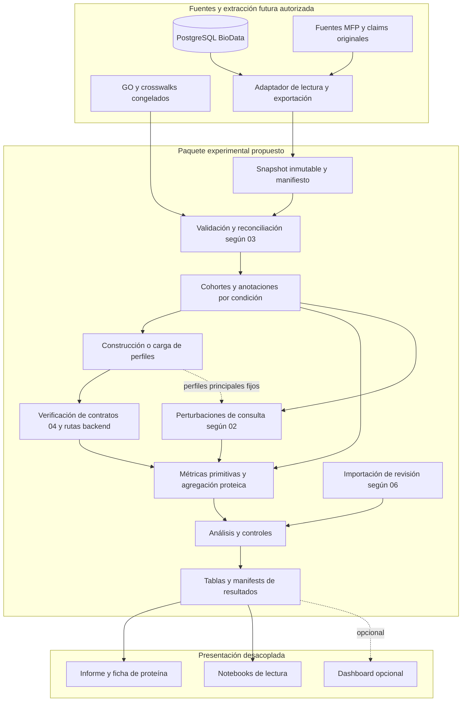

# Diseño técnico de la experimentación reproducible sobre el corpus positivo

| Campo | Valor |
|---|---|
| Archivo | `05_diseno_tecnico.md` |
| Versión | 0.1 |
| Estado | borrador para revisión, no aprobado |
| Fecha | 2026-10-26 |
| Responsable | Pendiente de asignar |
| Revisión técnica, científica y de datos | Pendiente de asignar |
| Proyecto y alcance | PEC; auditoría y caracterización del corpus positivo atribuido como multifuncional |
| Repositorio inspeccionado | `CBBIO/BioData` |
| Commit recuperado e inspeccionado | `ed073bd4df680a3b45ee69943916e196d28b63b6` |
| Fuentes | Inventario de §18; código remoto, documentación de proyecto e historial de conversación |
| Dependencias | 01 alcance; 02 protocolo; 03 datos; 04 y 04a métricas; 06 revisión; 07 implementación y aceptación |

> [!NOTE]
> **Document Status & Current Role (Historical Technical Design Proposal)**:
> This document is an archived historical technical architecture proposal. It does **not** describe current repository implementation; the proposed server-daemon architecture (PostgreSQL, Redis, RabbitMQ) was superseded in favor of an offline, pure-Python architecture.
> - **Active Architecture**: Core data integrity principles (checkpointing, atomic file writes, deterministic entity hashing under [ADR-005](../../decisions/ADR-005-deterministic-protein-ids.md), and cryptographic manifest verification) are codified in accepted Level 3 architecture in [`docs/architecture/data-flow.md`](../../architecture/data-flow.md) and [`docs/architecture/requirements-traceability.md`](../../architecture/requirements-traceability.md).
> - **Traceability**: The original Spanish text is retained intact for technical architecture traceability. Section-level mappings are detailed in the [Documentation Recovery Map](../../reports/documentation-recovery-map.md#81-reconciled-section-level-recovery-matrix).

Este documento traduce los borradores 02–04 en componentes implementables. Su responsabilidad es la arquitectura y la operación técnica; no redefine hipótesis, políticas de datos, fórmulas o categorías curatoriales. No es una implementación, una migración de producción ni un informe de resultados.

La actividad de esta sesión se limita a lectura remota y documental y a generar este archivo. No se han ejecutado experimentos, tests, notebooks ni consultas a la base BioData del usuario; no se han modificado repositorios ni creado commits, issues o pull requests. No se presupone ordenador local, conexión, exportación, entorno Python instalado o credenciales disponibles.

## Índice

1. Principios, alcance y leyenda
2. Arquitectura observada y límites de verificación
3. Responsabilidades y fronteras de sistemas
4. Arquitectura propuesta y diagrama
5. Componentes y estructura del paquete
6. Adaptadores de acceso y exportación
7. Preparación, cohortes y recursos
8. Adaptadores métricos y perfiles fijos
9. Perturbaciones, revisión y análisis
10. Contratos físicos, configuración e identificadores
11. Manifiestos, hashes y canonicalización
12. Errores, checkpoints, represa y publicación atómica
13. Caché e invalidación
14. CLI, notebooks, informes y dashboard
15. Rendimiento, memoria y paralelismo
16. Secuencia de la primera entrega vertical
17. Decisiones, pendientes y aceptación del diseño
18. Fuentes, accesibilidad y entorno futuro
19. Comprobación final de coherencia

## 1. Principios, alcance y leyenda

La solución inicial es un paquete Python pequeño en el repositorio experimental, con adaptadores a BioData, resultados congelados y notebooks de lectura. No requiere una plataforma nueva, servidor HTTP, gestor distribuido, cola, Redis ni dashboard. El primer objetivo técnico es completar una entrega vertical verificable.

El núcleo ejecuta reglas de 02–04 y escribe artefactos; los notebooks los explican. Los recursos estadísticos se construyen aparte y permanecen fijos durante las perturbaciones principales. El cálculo reutilizable se mantiene o integra progresivamente en BioData solo tras revisión; los nombres de cohortes y decisiones de PEC no se convierten en defaults universales del laboratorio.

No se seleccionan ni validan negativos, no se entrenan clasificadores ni se generan embeddings. Positivos, referencia y pool reservado son roles de datos diferentes. Ningún componente emite una etiqueta definitiva de moonlighting a partir de scores.

| Etiqueta | Significado |
|---|---|
| VERIFICAT EN CODI | Símbolo, implementación o esquema leído; no demuestra ejecución ni coincidencia con una instalación. |
| DOCUMENTAT NO VERIFICAT | Descripción accesible sin verificación operacional. |
| PROPOSTA | Elemento del diseño futuro, no disponible actualmente por defecto. |
| PENDENT | Decisión que debe resolver el rol indicado. |
| NO ACCESSIBLE | Recurso no consultado en esta sesión; no significa inexistente. |

Tipos de componente: R = reutilización de un símbolo existente, condicionada a aceptación; A = adaptación sobre capacidad existente; N = componente nuevo propuesto. Todos los componentes de orquestación de este documento son PROPOSTA salvo evidencia explícita de código.

Leyenda: API = interfaz de programación; CLI = interfaz de línea de órdenes; GO = Gene Ontology; MF/BP/CC = función molecular/proceso biológico/componente celular; IC = contenido informativo; OBO = formato de ontología; SQL = lenguaje de consulta; DSN = cadena de conexión; PK/FK = clave primaria/foránea; JSON/YAML/CSV/Parquet = formatos de intercambio; SHA-256 = huella digital; checkpoint = salida validada que permite continuar una ejecución; caché = resultado reutilizable bajo una clave de compatibilidad. «Atómico» no implica por sí solo durabilidad frente a fallos físicos.

## 2. Arquitectura observada y límites de verificación

### 2.1. Qué se ha leído

El README y árbol raíz identifican `CBBIO/BioData.py`, `CBBIO/GO.py`, paquetes de embeddings, búsqueda y probing, `sql/schema.sql`, documentación y tests. La existencia de módulos adicionales no los convierte en dependencias científicas de esta fase. [G1]

Se han inspeccionado el cliente en los símbolos visibles, GO completo, esquema, tests GO, tests de integración y documentación GO. La respuesta del cliente se trunca en parte posterior; no se atribuyen símbolos no leídos. No se ha inspeccionado la base desplegada ni la ingesta PIS.

Arquitectura observada acotada:

```text
BioDataClient → psycopg/PostgreSQL → tablas según esquema efectivo
GOOntology → OBO local + goatools → operaciones de términos/similitud
Tests → fixtures GO y pruebas de integración condicionadas a entorno
```

`GO.py` se declara y se observa independiente del acceso a base. `BioDataClient.__init__` importa el servicio de búsqueda y `connect()` registra por defecto tipos vectoriales si `register_halfvec` está activo. Reutilizar el cliente puede tener dependencias ajenas al cálculo GO; no se supone un cliente mínimo separado ya disponible. [G2–G3]

### 2.2. API existente verificada estáticamente

Las firmas siguientes resumen símbolos leídos, no interfaces nuevas ni ejemplos ejecutados. Se conserva el asterisco que indica argumentos por nombre.

| Símbolo real | Firma relevante observada | Uso y límite |
|---|---|---|
| `BioDataClient` | `__init__(dsn=None, *, autocommit=None, register_halfvec=None, config_path=None, index_manager=None, index_database_label=None)` | Construcción configurable; no modo read_only explícito en constructor. |
| `BioDataClient.connect` / `close` | `connect() -> None`; `close() -> None` | Gestión de conexión, no autorización automática. |
| `BioDataClient.query_all` | `query_all(sql: str, params=None) -> list[dict]` | Materializa filas con `fetchall`; no es streaming. |
| `BioDataClient.query_one` / `scalar` | `query_one(sql, params=None)`; `scalar(sql, params=None)` | Consultas auxiliares, no validadores científicos. |
| `BioDataClient.transaction` | `transaction()` como context manager | Commit/rollback solo si autocommit desactivado; no fija aislamiento ni read-only. |
| `get_protein_by_accession` | `(accession_code: str) -> dict | None` | Join local accession→protein, no namespace global. |
| `get_protein_species_taxonomy` | `(protein_ids: Sequence[str]) -> dict` | Lectura batch de metadatos; ausencias no reconstruidas. |
| `get_protein_sequences` | `(protein_ids: Sequence[str]) -> dict[str,str]` | Solo secuencias encontradas; se deben reconciliar faltantes. |
| `get_protein_go_annotations` | `(protein_id: str) -> list[dict]` | Selecciona GO/categoría/descripción/evidencia; no exporta publicación o clave raw. |
| `load_go` de `CBBIO.GO` | `(obo_path: str, *, load_obsolete=False, optional_attrs=None, quiet=True) -> GOOntology` | Carga recurso; no valida políticas de 03 por sí sola. |
| `GOOntology.prepare_term_counts` | `(annotations: Mapping[str,Collection[str]], *, relationships=None) -> None` | Modifica `_term_counts`; no recurso inmutable ya serializado. |
| `GOOntology.information_content` | `(go_id: str) -> float` | Requiere conteos; guardas de cobertura necesarias. |
| `GOOntology.semantic_similarity` | `(go_id_a, go_id_b, *, method="resnik") -> float` | Incluye ramas lin/wang; no acepta relaciones/pesos explícitos en esta firma. |
| `GOOntology.minimal_branch_length` | `(go_id_a, go_id_b, *, branch_dist=None) -> int | None` | Rutas dependientes de backend; aceptación condicionada por 04. |
| `GOOntology.group_similarity` | `(terms_a, terms_b, *, method="resnik", aggregate="bma") -> float | None` | BMA entre conjuntos, no media interna de pares. |
| `GOOntology.term` / `category_for_term` | `term(go_id) -> dict`; `category_for_term(go_id) -> str | None` | Etiquetas/namespace; no clasificación de rigor. |

Localizadores: cliente [G2], ontología [G3]. No se utiliza `from CBBIO import connect` como única evidencia de firma de reexportación: el diseño puede importar las clases/módulos verificados directamente. Los ejemplos de docs no sustituyen comprobación de `__init__.py` si se desea usar sus aliases públicos.

### 2.3. Brechas que condicionan el diseño

1. G4, esquema remoto, carece de `publication_id`; C4, esquema aportado, sí lo incluye y cambia PK/UQ. Se necesita adaptación según esquema efectivo, no una consulta universal inventada.
2. Las funciones de anotaciones visibles no preservan toda procedencia requerida; extraer raw por una proyección explícita.
3. `GO.py` filtra algunos términos silenciosamente y `_as_float` puede convertir ausencias en cero. El adaptador debe preservar estados antes de interpretar valores. [G3]
4. MBL tiene fallback local observado con riesgo documentado por 04; no se corrige aquí silenciosamente ni se sustituye por shortest path.
5. Relaciones/pesos Wang y semántica de IC/Lin dependen de rutas y dependencias. Reutilización condicionada a 04/07, no disponibilidad científica garantizada.
6. No se ha localizado motor NPMI en el módulo GO leído. A es extensión condicional, no prerequisito del primer hito.
7. Los tests de integración pueden omitirse si faltan entorno o datos; un resumen «sin errores» no demuestra que se ejecutaron. [G5–G6]

## 3. Responsabilidades y fronteras de sistemas

| Sistema/actor | Papel respaldado | Responsabilidad propuesta para esta fase | No se presupone |
|---|---|---|---|
| BioData | VERIFICAT EN CODI: cliente y GO de G2/G3. | Proveer acceso y algoritmos reutilizables tras verificación. | Motor experimental completo, snapshots o NPMI disponibles. |
| PIS | DOCUMENTAT NO VERIFICAT: adquisición/procedencia descritas en dossier inicial. | Entregar artefactos o metadatos mediante contrato si su capacidad se confirma. | Repositorio accesible, gestión de PMID o migraciones funcionando. |
| Repositorio experimental | PROPOSTA: sede de protocolo/cohortes/orquestación. | Paquete ligero, configuración, informes, curación y resultados. | Que ya exista esta estructura o CLI. |
| mfp-bibliography | DOCUMENTAT NO VERIFICAT: catálogo de atribuciones y bibliografía según visión accesible. | Candidato a sede experimental o proveedor del catálogo; decisión pendiente. | Integración remota verificada con BioData ni equivalencia de IDs. |
| PEC | Marco del proyecto; contratos históricos de clasificación documentados. | Consumidor futuro potencial de artefactos, no parte de la ejecución actual. | Entrenamiento, embeddings o selección negativa dentro del piloto. |
| Revisores | Roles aún sin personas asignadas. | Curación y aprobación según 06/07. | Aprobación ya concedida por existencia de documentos. |

Dependencias unidireccionales propuestas: el experimento consume BioData; BioData no importa cohortes o reglas particulares del experimento; el catálogo provee claims sin convertirlos en una verdad binaria. Si un algoritmo genérico nuevo se integra después en BioData, se elimina la duplicación solo tras equivalencia probada y actualización de versión.

## 4. Arquitectura propuesta y diagrama conceptual

Primera implementación: un proceso CLI y almacenamiento local de artefactos, sin servicio persistente. El almacenamiento puede residir en una estación o servidor del laboratorio autorizado; no se fija una máquina ni capacidad de RAM sin medición.



La flecha punteada PROF→PERT indica dependencia declarada e inmutable, no reconstrucción de perfiles por réplica. Las sensibilidades que cambian referencia son ejecuciones con profile_id alternativo, según 02. No hay flecha de dashboard a base de producción ni entrenamiento.

## 5. Componentes y estructura del paquete

Nombres propuestos, no rutas existentes verificadas:

```text
repositorio-experimental/
├── pyproject.toml
├── configs/
│   └── pilot.yaml
├── schemas/
├── templates/
│   ├── run_manifest.json
│   └── review_records.csv
├── src/mfp_experiment/
│   ├── cli.py
│   ├── config.py
│   ├── contracts.py
│   ├── access.py
│   ├── snapshot.py
│   ├── prepare.py
│   ├── profiles.py
│   ├── metrics.py
│   ├── perturbations.py
│   ├── bibliography.py
│   ├── analysis.py
│   ├── presentation.py
│   └── artifacts.py
├── tests/
├── notebooks/
│   ├── 01_quality.ipynb
│   ├── 02_atlas.ipynb
│   └── 03_sensitivity.ipynb
└── workspace/
    ├── snapshots/
    ├── prepared/
    ├── profiles/
    ├── cache/
    ├── curation/
    └── runs/
```

Se puede comenzar con menos archivos y dividirlos al crecer, conservando fronteras. No hace falta implementar todos los bloques opcionales antes de la entrega vertical. `workspace/` no se sube indiscriminadamente a Git; código, contratos y configuración sin secretos sí pueden versionarse. Las carpetas son propuesta, no ubicación local existente.

### Tabla de componentes

| Componente | Tipo | Responsabilidad | Input | Output | Dependencias |
|---|---|---|---|---|---|
| `config.py` | N | Cargar, resolver y validar configuración estricta; separar secretos | YAML y referencias de recursos | RunSpec inmutable y config_id | Contratos 02–04; schemas |
| `contracts.py` | N | Tipos y validadores estructurales sin lógica científica duplicada | Tablas/manifests | Informes y objetos tipados | 03/04 |
| `access.py` | A/R | Adaptador read-only con inspección de esquema y queries permitidas | Conexión autorizada y proyección | Flujos de filas raw + schema descriptor | BioDataClient o driver directo justificado |
| `snapshot.py` | N | Publicar exportación coherente e inmutable | Raw, fuentes, OBO, metadatos | SnapshotRef + checksums | access/artifacts; 03 |
| `prepare.py` | N con R puntual | Identidad, normalización, condiciones y cohorts | Snapshot y políticas/crosswalks | Tablas canónicas, términos y pérdidas | 03, utilidades GO aceptadas |
| `profiles.py` | A/N | Preparar y verificar recursos IC y coocurrencia | Referencia preparada, GO, contratos | ProfileRefs y conteos verificables | BioData GO aceptado; 03/04a |
| `metrics.py` | A/R y N de agregación | Ejecutar primitivas aceptadas y agregación de 04 | Términos, perfiles y MetricSpecs | Tabla larga y detalle opcional | CBBIO.GO bajo guardas |
| `perturbations.py` | N | Materializar intervenciones reproducibles, no redefinirlas | Preparados y plan 02 | Descriptores de intervención y resultados por réplica | prepare/metrics, semillas estables |
| `bibliography.py` | N/adaptación del catálogo si existe | Exportar fichas de revisión e importar decisiones tipadas | Claims, referencias y selección | Paquetes de revisión y registro | 03/06; no clasificación automática |
| `analysis.py` | N | Ejecutar estimandos y tablas de 02 | Resultados largos, pertenencias y revisión | Contrastes y tablas de análisis | 02; sin consultas de origen |
| `presentation.py` | N | Figuras, ficha y reporte desde tablas | Run finalizado y plantillas | PNG/SVG/HTML/Markdown | analysis y recursos de etiquetas congelados |
| `artifacts.py` | N | Hashes, escritura atómica, checkpoints y caché | Objetos/archivos y claves | Artefactos completos y trazables | Contratos 03; almacenamiento local |
| `cli.py` | N | Orquestación ligera por etapas | RunSpec/órdenes | Estados y localizadores | Los componentes anteriores |
| Notebooks | N | Exploración y explicación del run | Artefactos completos | Vistas y notas no normativas | presentation; sin motor paralelo |
| Dashboard | N opcional | Consulta interactiva, preferiblemente solo lectura | Runs aceptados | Vista filtrable | Sin dependencia para piloto |

No crear una segunda biblioteca de ontologías. Las funciones matemáticas ausentes o no conformes se implementarán en una ubicación genérica acordada o en un adaptador experimental claramente versionado de forma transitoria. No copiar un algoritmo y seguir llamándolo «CBBIO actual».

## 6. Adaptadores de acceso y exportación

### 6.1. Dos modos de entrada

- `from_snapshot`: modo normal para cálculo; sin conexión ni red. Reconstruye desde un paquete ya congelado conforme a 03.
- `export_from_biodata`: tarea separada y futura, con autorización y credencial de solo lectura; no se dispara por importar el paquete ni abrir un notebook.

Leer GitHub desde Perplexity no permite usar ninguno de esos modos contra una base que no está conectada. El connector empleado aquí da acceso a código del repositorio, no a PostgreSQL.

### 6.2. Lectura coherente

El exportador debe identificar variante real de esquema antes de seleccionar columnas. No intentar `publication_id` suponiendo su existencia; tampoco omitirlo si sí existe. Obtener descriptor estructural y evidencias de capacidad, conservar proyección exacta y claves según 03.

Propuesta para exportación multi-query: una conexión dedicada, transacción `REPEATABLE READ, READ ONLY`, parámetros fijados antes de la primera consulta y usuario con privilegios SELECT limitados. PostgreSQL fija la vista en la primera consulta de la transacción; read-only y aislamiento son controles distintos [P1]. No se afirma que `BioDataClient.transaction()` proporcione esos controles automáticamente.

Alternativas técnicas a validar:

1. Reutilizar BioDataClient con `autocommit=False` y el método público `execute` únicamente para la configuración transaccional y consultas permitidas, sin exponerlo al resto del paquete. La primera operación transaccional debe fijar aislamiento/acceso antes de inspecciones que abran otra vista.
2. Para exportación grande, driver psycopg directo encapsulado con conexión read_only y aislamiento explícitos, usando streaming si procede. Esta adaptación está justificada porque `query_all` usa fetchall y no ofrece streaming. No acceder a `_conn` como contrato estable ni monkey-patchear atributos privados.

Psycopg documenta cuándo los atributos de transacción afectan a conexiones con autocommit y que no se cambian dentro de una transacción ya activa [P2]. La integración concreta se probará en 07, fuera de Perplexity. Se desactiva `register_halfvec` si no es necesario y el camino elegido lo permite, sin crear extensiones o índices para exportar GO.

### 6.3. Seguridad y control de consultas

No ofrecer SQL arbitrario por CLI ni un «conector de consultas» de propósito general. Definir allowlist de consultas/proyecciones, parámetros enlazados y nombres de tablas validados frente a esquema inspeccionado. Mantener escritura de base fuera del adaptador público. La protección no depende solo de que la cadena empiece por SELECT: privilegios mínimos y read-only de servidor son la barrera principal.

No ejecutar schema.sql en la base del usuario como parte de exportación. No crear tablas temporales, vistas, permisos o migraciones desde el experimento. No llamar por defecto a un health_check que exija embeddings/pgvector como criterio científico de elegibilidad: inspeccionar solo capacidades necesarias del flujo.

### 6.4. Atomicidad del snapshot

Cerrar la conexión al terminar la extracción, antes de los cálculos. Si se pierde la conexión o transacción durante la extracción, no continuar con nuevas consultas y archivos parciales bajo el mismo snapshot como si compartieran vista. Reiniciar toda la extracción o usar una fuente congelada coherente acreditada. Una vista transaccional no se recupera arbitrariamente tras cerrar su sesión.

Exportar con paginación por clave completa estable dentro de la misma vista cuando no se use streaming. No asumir `id` aislado único en anotaciones del esquema remoto. Conservar raw sin joins que oculten registros no resueltos y verificar completitud por tabla. No usar OFFSET inestable o queries a una base cambiante para construir un supuesto snapshot.

## 7. Preparación, cohortes y recursos

`prepare.py` materializa las tablas propuestas de 03, con estados y derivaciones. No implementa reglas alternativas sin policy_id. Conserva:

- Raw y localizadores originales.
- Claims de cada fuente y categorías originales.
- Crosswalk de entidad local/canónica y ambigüedades.
- Enlaces bibliográficos GO y MFP separados.
- Observabilidad de campos y decisiones de selección.
- Conjuntos únicos por entidad/aspecto/condición y vínculo al soporte.

Los términos se resuelven antes de llamar a funciones que los omitan silenciosamente. La información de `NOT` no observable no se rellena como false. La semántica de referencias de GAF o formatos propios se implementa por parser específico de 03, no mediante split genérico que suponga varios artículos independientes.

`cohort_membership` se valida y congela; no consulta dinámicamente `data_class` ni «todas las proteínas» para decidir pertenencia. Positivo, referencia y reservado conservan roles distintos y sus solapamientos declarados. La CLI no añade una orden `select-negatives` ni entrenamiento.

El OBO y crosswalks se cargan desde archivos fijados y verificados. No se descarga latest durante reconstrucción. Enriquecimiento bibliográfico, si se autoriza, es etapa separada que publica nuevos artefactos; no cambia retrospectivamente snapshots. No se asigna esa capacidad a PIS sin inspección de su código.

## 8. Adaptadores métricos y perfiles fijos

### 8.1. Registro de capacidades

Cada métrica tendrá un MetricSpec derivado de 04/04a y una entrada de backend con:

- Símbolo/ruta y versión efectiva.
- Recursos y parámetros requeridos.
- Guardas de dominio/cobertura.
- Pruebas de conformidad exigidas por 07.
- Estado `candidate`, `accepted_for_pilot`, `blocked` o equivalente técnico.

Estos nombres de estado de capacidad no sustituyen status de resultado de 04. No basta detectar que existe un método con `hasattr` para marcarlo aceptado. Una implementación desconocida no se ejecuta como aceptada por el mero hecho de devolver floats.

### 8.2. BioDataGOAdapter propuesto

El adaptador aplica selección y guardas antes de invocar primitivas verificadas y valida su salida. No vuelve a definir la fórmula ni interpreta confianza biológica.

| Familia | Reutilización prevista | Guarda técnica |
|---|---|---|
| MBL | `minimal_branch_length` | Identificar ruta/dependencia; bloquear fallback no conforme de 04; no convertir negativo a cero. |
| IC | `prepare_term_counts` + `information_content` | Perfil explícito; comprobar conteos/cobertura/base y distinguir cero legítimo de ausencia. |
| Wang | `semantic_similarity(..., method="wang")` | Registrar ruta/relaciones/pesos efectivos; no afirmar que se pasan por una firma que no los acepta. |
| Lin | `semantic_similarity(..., method="lin")` | Verificar MICA, denominador y reglas de 04 antes de aceptar valor. |
| Medias internas | Agregador nuevo | Pares y términos de 04, no BMA de conjunto contra sí mismo. |
| Asociaciones A | Motor genérico pendiente | Solo con perfiles y contrato 04a aceptados, no fallback a otra puntuación. |

Si se requiere un cálculo que CBBIO no expone con la semántica requerida, hay tres salidas explícitas: bloquear familia, registrar otra variante aceptada científicamente o integrar una mejora revisada en BioData. No cambiar la semántica dentro de una excepción catch-all ni acceder a métodos privados como API permanente.

### 8.3. Perfiles como artefactos inmutables

`profiles.py` construye o carga conteos y universos según 03 y registra la definición métrica de 04. No serializar objetos arbitrarios de Python con pickle como único contrato portable. Persistir tablas/metadata; reconstruir el objeto runtime bajo la versión fijada cuando se necesite.

`prepare_term_counts` modifica el estado del objeto; no compartir un GOOntology mutable entre perfiles concurrentes. Propuesta inicial: una instancia por perfil IC y proceso, preparada una vez, encapsulada sin método de mutación en la interfaz que recibe el scorer. Instancias de grafo sin IC pueden reutilizar recursos si sus opciones coinciden, pero deben mantener identidad verificable.

Un ProfileHandle propuesto expone ID, fingerprints y consultas de cobertura/conteos, no la posibilidad de reconstruirse al puntuar una proteína. Las perturbaciones reciben el mismo handle F0. Cambiar referencia exige construir otro artefacto y otro handle.

## 9. Perturbaciones, revisión y análisis

### 9.1. Perturbaciones

`perturbations.py` implementa los planes y réplicas de 02 sin cambiar sus decisiones. Genera descriptores reproducibles: unidad, condición, operación, parámetros, selección de términos o referencia retirada, semilla/subflujo y estado.

Para reducción aleatoria, guardar la selección o su huella y receta exacta; compartirla entre métricas. Para retirada documental, reconstruir términos desde soporte restante, no borrar un GO ID por aparecer en una publicación. El motor no decide OR/AND de una celda ambigua; recibe la interpretación de 03/06.

Cálculo y agregación de una perturbación llaman al mismo scorer que baseline. No copiar algoritmos a notebooks o a cada tipo de perturbación. Los perfiles principales no se recalculan; sensibilidades de referencia son tareas distintas con otro profile_id.

### 9.2. Bibliografía y revisión

`bibliography.py` genera paquetes de revisión con claims y material identificado. Según 02/06, se debe poder ocultar scores y razones de priorización al revisor inicial. No incluirlos en nombres de carpeta o columnas ocultas fácilmente visibles de la hoja ciega.

Importar revisión exige claves de entidad/claim/referencia, versión de manual, revisor identificado en el ámbito autorizado y validación de categoría/justificación. Dos revisores producen registros distintos; una adjudicación no sobrescribe los originales. No se guarda la valoración manual en las filas originales de BioData.

Se conserva el nivel de texto consultado: metadatos, resumen o texto completo, según 06. No descargar artículos durante el cálculo principal ni confundir recuperación de título con lectura científica.

### 9.3. Análisis e informes

`analysis.py` consume tablas finalizadas, mantiene emparejamiento de entidades y reporta transiciones de calculabilidad. Las diferencias, incertidumbre y multiplicidad proceden de 02. Los resultados de réplicas no se tratan como nuevas proteínas.

`presentation.py` genera las figuras previstas y una ficha de proteína desde tablas y etiquetas del mismo recurso GO. No consultar nombres actualizados por red ni eliminar nulos en silencio para hacer gráficos más limpios. La ficha distingue atribución fuente, anotación, score y revisión; no produce una etiqueta de verdad única.

## 10. Contratos físicos, configuración e identificadores

### 10.1. Artefactos y fuentes normativas

| Artefacto técnico propuesto | Fuente normativa | Consumidores |
|---|---|---|
| Raw export + schema descriptor + snapshot manifest | 03 | Preparación y auditoría. |
| Tablas canónicas/cohort_membership/prepared_terms/derivaciones | 03 | Perfiles, métricas, curación. |
| Perfil IC/coocurrencia y universos | 03 y cálculo 04/04a | Scorer. |
| Resultados largos y detalle de unidades | 04/04a | Perturbaciones, análisis y presentación. |
| Tablas de intervención/réplica | Diseño 02; identidad/soporte 03 | Scorer y análisis. |
| Registros de revisión | 06; referencias de 03 | Análisis y ficha final. |
| Tablas analíticas y figuras | 02 | Informe y notebooks. |

No se repiten aquí diccionarios de campos reales ni fórmulas. Los archivos físicos propuestos son Parquet para tablas tipadas, JSON para manifiestos y descriptores y CSV como exportación humana con nulos/tipos documentados. CSV no es la única fuente de verdad si pierde estructuras o tipos.

`schemas/` contendrá esquemas versionados de snapshot, tablas lógicas, resultados, perfiles y plan/manifest. `templates/run_manifest.json` será una plantilla validable sin fingir valores de ejecución. Son artefactos a crear, no existentes comprobados. Para importaciones CSV, establecer columnas y tipos explícitos; nunca convertir identificadores numéricos a floats ni NA textual accidentalmente a null sin contrato.

### 10.2. Identificadores

| ID | Función técnica |
|---|---|
| `snapshot_id` | Identidad de paquete realmente exportado según 03. |
| `cohort_id` | Pertenencia congelada y política correspondiente. |
| `profile_id` | Conteos/recursos y definición de referencia efectivos. |
| `config_id` | Huella de configuración científica/operativa resuelta sin secretos ni campos volátiles. |
| `experiment_fingerprint` | Huella de inputs, contratos, perfiles, código y parámetros relevantes. |
| `run_id` | Identidad de una ejecución lógica; no sustituye huella de inputs. |
| `attempt_id` | Intento operativo o reanudación dentro de un run compatible. |
| `stage_key` / `task_key` | Identidad determinista de etapa/tarea y dependencias para reuso seguro. |

Propuesta: run_id se crea al iniciar realmente el run, mediante timestamp UTC y sufijo aleatorio o UUID. Repetir exactamente un experimento puede producir otro run_id con el mismo experiment_fingerprint; la caché se reutiliza por contenido compatible, no por hora. `resume` conserva run_id y crea nuevo attempt_id. Cambiar un parámetro científico o código relevante crea un run distinto, no un intento que mezcle resultados anteriores.

No se asigna ningún ID real en este documento. Un snapshot no puede llamarse completo antes de confirmar sus artefactos.

### 10.3. Configuración estricta

`config.py` no reutiliza silenciosamente defaults de conexión del cliente como parámetros científicos. Rechaza claves desconocidas, recursos sin resolver y combinaciones incompatibles. Almacena `config.resolved.yaml` con listas efectivas y versiones aprobadas, no solo nombres ambiguos como EXP. Los defaults de 02–04 son propuestas hasta ratificación y deben materializarse en configuración efectiva.

Ejemplo de estructura, PROPOSTA NO EXECUTADA; los null bloqueantes deben sustituirse con recursos reales y no constituyen configuración lista para ejecutar:

```yaml
config_schema_version: "0.1"
scope: positive_corpus_audit
input:
  mode: from_snapshot
  snapshot_manifest: null
  cohort_manifest: null
  reference_manifest: null
contracts:
  protocol_document: "02_protocolo_cientifico_y_analisis.md"
  data_document: "03_contrato_datos_y_recursos.md"
  metrics_document: "04_especificacion_metricas.md"
  approved_versions: null
resources:
  ontology_manifest: null
  ic_profile_manifest: null
conditions_manifest: null
metrics_manifest: null
randomness:
  master_seed: null
execution:
  workers: 1
  network_during_compute: false
  resume_policy: validated_artifacts_only
presentation:
  dashboard_required: false
```

La estructura `conditions_manifest`/`metrics_manifest` permite referenciar listas exactas de condiciones y MetricSpecs; no inventa su existencia. El validador debe resolverlo todo antes de comenzar las etapas que lo requieran.

## 11. Manifiestos, hashes y canonicalización

### 11.1. Manifiesto de run

Contenido propuesto: versiones de documentos/contratos y schemas; snapshot/cohortes/GO/perfiles; configuración resuelta y fingerprint; versiones de Python, CBBIO, goatools y librerías numéricas efectivas; commit experimental y estado de modificaciones locales si las hay; seeds/generador; tareas previstas y estados; intentos; outputs con hashes físicos/lógicos; incidencias; cambios/desviaciones y aceptación.

Si el código futuro tiene cambios sin commit, registrar patch/hashes de código en entorno seguro y marcar la ejecución no reproducible por commit solo. No suponer que conocer un branch reproduce su contenido. No serializar objetos de cliente, variables de entorno completas ni DSN.

### 11.2. Canonicalización técnica de la propuesta de 03

Para hashes de inputs lógicos se implementará la norma de 03: tipos y columnas fijados por schema, claves completas, nulos distintos de strings vacíos, multiplicidad raw preservada, sets ordenados y expresiones compuestas sin aplanar. Propuesta de serialización: JSON por fila con claves ordenadas, UTF-8, separadores compactos, ensure_ascii=false y LF final; Unicode NFC para campos canónicos no raw. Ordenar filas por la clave completa y desempate de localizador definido, no por orden de lectura accidental.

Para timestamps: UTC explícito con precisión fijada cuando hay zona conocida; naive conservado con tipo y estado de zona desconocida, no localizado por la máquina. Dates YYYY-MM-DD. Para floats de resultados usar representación round-trip de versión fijada, rechazar NaN/Inf y conservar null para no estimables. La equivalencia de inputs/conteos sigue siendo exacta; tolerancias numéricas de resultados proceden de 04/07, no se usan para hacer equivalentes datos distintos.

Se calculan SHA-256 sobre archivos reales y sobre flujos canónicos lógicos. Dos Parquet con compresión/metadatos diferentes pueden tener igual hash lógico y distinto hash físico. El descriptor de hash excluye su propio campo y metadatos volátiles identificados, para evitar circularidad. Una huella acredita igualdad de contenido bajo el algoritmo, no veracidad biológica ni autorización de uso.

### 11.3. Semillas y reproducibilidad de réplicas

Materializar subsemillas mediante derivación estable sobre semilla maestra, ID de etapa, entidad, aspecto, tamaño y réplica, conforme a 02. Propuesta técnica: serialización canónica de esa tupla, SHA-256, interpretación little-endian de bytes fijados para alimentar SeedSequence de NumPy/PCG64 con versión registrada. El número exacto de bytes y algoritmo de serialización se congelan y prueban en 07 antes de usarlo en evaluación. No usar hash() de Python ni orden de workers como semilla.

Guardar banco de selecciones o huellas y receta, compartido entre métricas. Diferencias de orden de planificación no deben cambiar sorteos. No se añade una semilla ficticia en este borrador.

## 12. Errores, checkpoints, represa y publicación atómica

### 12.1. Separar tres estados

1. Estado científico/técnico de la métrica: definido por 04, incluye insuficiencia, cobertura parcial y errores.
2. Estado de tarea: planned, running, completed, failed o blocked.
3. Estado de run: planned, running, completed, completed_with_limitations, incomplete, failed o cancelled.

Son enums propuestos de orquestación, no estados ya existentes en BioData. Una tarea puede completar produciendo null científico válido; no es lo mismo que fallar antes de producir la fila esperada. Un run con métricas obligatorias no aceptadas no se marca completed aunque genere gráficos.

### 12.2. Política de fallos

| Fallo | Acción propuesta |
|---|---|
| Snapshot corrupto, schema desconocido, secreto detectado en manifiesto o recursos incompatibles | Bloquear ejecución dependiente; no publicar paquete como completo. |
| Se pierde vista transaccional durante exportación | Invalidar exportación parcial y reiniciar coherentemente; no mezclar sesiones. |
| Identidad ambigua o término no resoluble | Incidencia y estado de unidad según 03/04; conservar entidad en cobertura. |
| Falta perfil IC válido | Bloquear IC/Lin; permitir diagnóstico de otras familias si configuración autoriza parcial, sin completar hito. |
| Ruta métrica no conforme detectada | Desactivar familia globalmente para ese backend; no solo los pares que evidenciaron problema. |
| Pareja insuficientemente soportada | Resultado no estimable conforme a contrato, no excepción operativa ni imputación. |
| Excepción inesperada | Registrar causa con datos sensibles filtrados; por defecto fallar tarea y detener rama. Solo continuar por unidad si está clasificada como fallo local recuperable y política predeclarada lo permite. |
| Falla una figura | Mantener resultados numéricos inmutables; informe incompleto, reintentar render sin recalcular ciencia. |
| Falla acceso al texto bibliográfico | Registrar nivel de evidencia/no acceso, no categoría biológica negativa. |

No aplicar `except Exception: return 0`. No reintentar indefinidamente un fallo determinista. Reintentos solo para fallos transitorios clasificados, con límite efectivo y sin alterar inputs. Cambiar código para arreglar un fallo crea nueva versión y recalcula rama afectada.

### 12.3. Granularidad de checkpoints

Checkpoints iniciales: snapshot completo; preparación completa; cada perfil; particiones de métricas por entidad/lote determinista; particiones de perturbación por entidad/plan; tablas de análisis; reporte. El plan lista todas las tareas esperadas antes de ejecutar, para detectar huecos aunque un proceso muera sin escribir resultados.

Cada checkpoint incluye clave de tarea, fingerprint de dependencias y código, schema, número de filas, hashes y estado de completitud. El simple hecho de que exista un archivo no lo valida. Un checksum correcto de un archivo parcial tampoco acredita completitud: debe concordar con la tarea y contabilidad prevista.

### 12.4. Escritura atómica y consistencia de artefactos

Propuesta para sistema de archivos local validado:

1. Escribir en staging privado dentro del mismo filesystem del destino, con nombre de intento único.
2. Cerrar, validar schema/conteos, calcular hashes y sincronizar cuando se requiera durabilidad.
3. Publicar una generación nueva completa, sin sobrescribir generaciones anteriores.
4. Publicar al final un pequeño descriptor/manifest de commit que referencia exactamente esa generación y sus hashes; el lector solo ve generaciones con commit válido.
5. Actualizar el puntero de generación activa mediante reemplazo atómico si se necesita; lectores resuelven una generación una vez, no mezclan archivos de dos versiones.

`os.replace` puede ofrecer rename atómico si tiene éxito y puede fallar entre filesystems; no es una transacción multiarchivo ni reemplazo portable de directorio no vacío [P3]. Se usa para el descriptor/puntero o archivo individual, no para prometer atomicidad de toda una carpeta mutable. Durabilidad requiere operaciones adicionales y pruebas específicas del almacenamiento en 07. En NFS/object storage no se presume idéntica garantía: estrategia distinta requiere aprobación.

Un único escritor por run/stage en el piloto; lock y escritor identificado. Paralelismo futuro usa resultados por worker en staging y un coordinador que valida/publica. No permitir dos procesos anexando al mismo Parquet o JSONL sin coordinación.

### 12.5. Represa e idempotencia

`resume` verifica firma de configuración, código, recursos y todas las dependencias del checkpoint. Reutiliza solo salidas completas compatibles y planifica las pendientes. Si el entorno métrico o política cambia, rechaza la represa bajo el mismo run científico y exige nuevo run.

Idempotencia significa que solicitar una etapa con la misma task_key produce el mismo artefacto lógico o reutiliza uno ya validado, sin duplicar filas. No implica mismos timestamps ni bytes de compresión. No garantiza que una exportación repetida de una base viva tenga los mismos datos; eso es un snapshot nuevo salvo fuente congelada idéntica.

Los intentos fallidos se conservan como diagnóstico no consumible y pueden limpiarse solo por política de retención. Nunca inferir éxito porque la CLI salió con código cero sin reconciliar tareas y resultados.

## 13. Caché e invalidación

### 13.1. Claves por nivel

| Nivel | Componentes mínimos de clave |
|---|---|
| Lectura/preparación | Hash lógico raw, schema/adapter/parser, crosswalks/decisiones y políticas efectivas. |
| Ontología | Hash OBO, parser/dependencias, opciones de carga y relaciones. |
| Perfil | Huella de referencia preparada, miembros/universos, política y propagación, GO y versión de conteo. |
| Primitiva MBL/Wang | GO/semántica efectiva, versión de métrica/backend/ruta, pareja canónica y pesos/opciones aplicables. |
| Primitiva IC/Lin | Lo anterior pertinente y profile_id IC/controles de dominio. |
| Pareja A | Profile_id, par de aspectos/términos y versión de estimador y parámetros que afecten score/estado. |
| Agregado proteico | Huella del conjunto de términos preparado, condición/política, métrica/versión, perfiles, parámetros de cobertura y agregación. |
| Perturbación | Plan 02, selección materializada/semilla, input original, recursos fijos y métricas. |
| Figura/informe | Hash lógico de tablas, versión de función/plantilla, filtros y recursos de etiquetas. |

Se puede separar conteo/valor crudo de decisión de soporte para reutilizar conteos, pero sus estados derivados se recalculan con la configuración vigente. Una caché de estado no puede ignorar cambios de umbral.

Ordenar pares solo cuando la primitiva está aceptada como simétrica; no esconder asimetrías de una ruta defectuosa ordenando inputs antes de probarla. Las A conservan roles X/Y aunque se pruebe simetría matemática bajo un mismo universo.

### 13.2. Reglas de reuso

Una entrada debe tener contenido, versión, claves y checksum comprobables. Cache miss significa desconocido; no coocurrencia cero ni ausencia de función. No reutilizar por nombre de proteína, fecha o nombre de archivo solamente. Si cambia un input relevante, derivar otra clave: no «limpiar caché» como sustituto de identidad correcta.

Cachear resultados científicos no estimables deterministas puede ser válido si conservan motivo y recursos. No cachear fallos de red/memoria como si fueran resultados de dominio. No utilizar TTL como mecanismo de reproducibilidad: envejecimiento temporal no prueba compatibilidad ni invalida un artefacto inmutable por sí solo.

Al abrir el dashboard o notebook, la clave debe incluir generación/run y fingerprint de tablas; una caché en memoria de interfaz no es la autoridad de resultados.

## 14. CLI, notebooks, informes y dashboard

### 14.1. API experimental propuesta

Las firmas siguientes son diseño no ejecutado. `RunSpec`, `ArtifactRef`, `ProfileBundle`, `MetricSpec`, `PerturbationPlan`, `ReviewSpec` y tipos similares son modelos propuestos a crear, no clases actuales de BioData.

```python
def export_snapshot(source, export_spec, store) -> ArtifactRef: ...
def validate_snapshot(snapshot_ref, contracts) -> ValidationReport: ...
def prepare_inputs(snapshot_ref, policy_bundle, store) -> PreparedBundle: ...
def build_profiles(prepared_reference, resource_specs, store) -> ProfileBundle: ...
def load_metric_backend(metric_specs, profiles, ontology_ref) -> MetricBackend: ...
def score_cohort(prepared_query, backend, metric_specs, store) -> ArtifactRef: ...
def run_perturbations(prepared_query, fixed_profiles, plan, backend, store) -> ArtifactRef: ...
def import_reviews(review_files, review_spec, store) -> ArtifactRef: ...
def analyze_run(run_manifest, analysis_spec, store) -> ArtifactRef: ...
def render_report(analysis_ref, presentation_spec, store) -> ArtifactRef: ...
```

Los componentes reciben referencias verificadas, no clientes de base salvo `access/export`. No reconstruir perfiles dentro de score_cohort ni permitir que funciones de gráficos disparen consultas o perturbaciones.

### 14.2. CLI propuesta

Ejemplos no ejecutados; comandos no existentes actualmente verificados:

```bash
mfp-exp validate-config --config configs/pilot.yaml
mfp-exp export --config configs/pilot.yaml
mfp-exp validate --config configs/pilot.yaml
mfp-exp prepare --config configs/pilot.yaml
mfp-exp profiles --config configs/pilot.yaml
mfp-exp metrics --config configs/pilot.yaml
mfp-exp perturb --config configs/pilot.yaml
mfp-exp analyze --config configs/pilot.yaml
mfp-exp report --config configs/pilot.yaml
```

`run` podrá encadenar etapas offline según plan; `export` queda fuera por defecto y requiere acción explícita. `resume` recibirá un manifiesto real, no un run_id de ejemplo inventado. La salida de CLI debe distinguir configuración inválida, ejecución incompleta y error; las filas NA científicas no son por sí mismas un fallo global si el contrato las permite.

No se ofrecen órdenes para actualizar fuentes, escribir base o cambiar esquema de forma implícita. El plan mínimo no necesita una CLI compleja: argparse o equivalente basta; elección de librería no afecta el contrato.

### 14.3. Frontera de presentación

Paquete: lógica científica y transformación reproducible. CLI: ejecución explícita. Notebook exploratorio: nuevas preguntas claramente marcadas, sin sobrescribir outputs aceptados. Notebook de presentación: solo carga una generación concreta y llama a funciones de visualización. Informe: salida reconstruible y autónoma de esa generación.

Un notebook que cambia manualmente filtros científicos ya no representa el run original; debe exportar su análisis como nueva especificación o mantenerse como exploración no confirmatoria. No almacenar contraseñas en celdas ni en salidas guardadas.

Dashboard opcional: lectura de artefactos finalizados; filtros de visualización visibles; sin volver a estimar IC o lanzar réplicas al interactuar. Si posteriormente permite edición curatorial, será un subsistema con autenticación, auditoría y control de concurrencia propio, no requisito del piloto. No desplegar interfaz pública con datos/licencias no revisados.

## 15. Rendimiento, memoria y paralelismo

Todas las estimaciones de esta sección son algorítmicas y no medidas. No se fijan horas, latencia, número de cores o memoria garantizada.

- Exportar una vez, calcular offline muchas veces; no query por proteína/pareja durante puntuación.
- Preparar identidad y GO compartidos una vez; materializar condiciones sin repetir joins de origen.
- Reutilizar primitivas para parejas GO que aparecen en varias proteínas y perturbaciones, con claves correctas.
- Generar combinaciones de pares por bloques/iteradores; no matriz densa del universo GO.
- Agregar sumas/conteos de manera determinista; detalle completo opcional, explicación regenerable desde inputs.
- Construir coocurrencias dispersas o mediante conjuntos de entidades por término según medición; la ausencia de matriz no elimina el coste de conteo.
- Separar cálculo estadístico, formateo y gráficos. Un cambio de título de figura no invalida perfiles.

Para proteína con k términos, métricas de pares requieren k(k−1)/2 pares candidatos según 04. El tiempo depende también de cierres ancestrales y backend. Las A dependen del producto entre tamaños de aspectos. Las perturbaciones multiplican consultas lógicas, pero no deben multiplicar reconstrucciones de F0.

Comenzar secuencialmente. Si los tiempos medidos lo justifican, paralelizar particiones deterministas de entidades en procesos, con límite explícito de workers y memoria. Cada proceso puede duplicar DAG/cachés; no asumir copy-on-write portable. No compartir objeto GOOntology mutable ni conexión SQL entre workers. Evitar paralelismo anidado de librerías y sobresuscripción de hilos.

Limitar tamaño de lotes, cola de tareas y caché en memoria. Guardar particiones y combinar ordenadamente con verificación de PK. Registrar tiempos por etapa, pico de memoria y entorno cuando exista ejecución, pero no convertir resultados de profiling aislado en benchmark biológico.

No se requiere GPU para las operaciones propuestas. El entorno completo de BioData puede traer dependencias de GPU según su empaquetado; no se promete que un entorno mínimo GO ya esté separado. Antes de proponer cambios de empaquetado, revisar su necesidad real para la primera entrega.

## 16. Secuencia de la primera entrega vertical

### 16.1. Alcance mínimo preservado

Cohorte pequeña identificada, exportación congelada y GO fijada; MBL, IC, 1−Wang y 1−Lin bajo ALL, EXP-convencional y EXP-ampliada de 02; estados de cobertura, tabla reproducible, dos figuras previstas y ficha de proteína. El tamaño y parámetros efectivos no se inventan aquí.

### 16.2. Secuencia implementable

1. Validar contratos mínimos 02–04 y configuración; detectar métricas candidatas/bloqueadas.
2. Obtener snapshot coherente en entorno autorizado o recibir uno existente verificable; registrar esquema y diferencias con G4.
3. Validar raw y construir entidades/claims/términos de 03, con contabilidad y observabilidad.
4. Seleccionar cohortes por manifests; conservar referencia separada y pool sin uso si existe.
5. Cargar GO y construir/cargar perfil IC con semántica aceptada; publicar manifiestos de recursos.
6. Comprobar conformidad de backend bajo pruebas de 07 antes de puntuar datos reales.
7. Generar términos por las tres condiciones y plan de pares/unidades; puntuar las cuatro familias aceptadas con F0 fijo.
8. Publicar particiones y tabla larga con todas las combinaciones previstas y sus status, incluso sin valor.
9. Calcular comparaciones apareadas y cobertura de 02; generar F01/F02 sin consultar producción.
10. Generar ficha con claims, anotaciones, métricas y referencias separadas; si bibliografía no es observable, marcar limitación, no inventar enlaces.
11. Publicar manifiesto final y reporte de completitud; declarar hito parcial si falta una familia obligatoria.

La reducción aleatoria y la revisión de desarrollo se incorporan a continuación según plan mínimo de 02; el primer circuito visual no debe confundirse con completar ese plan científico entero. A, retirada de artículos, perfiles alternativos y evaluación posterior son extensiones, no excusa para retrasar el circuito básico.

## 17. Decisiones, pendientes y aceptación del diseño

### 17.1. Registro de decisiones

| ID | Decisión | Estado |
|---|---|---|
| D05-01 | Paquete Python pequeño + artefactos + notebooks lectores | PROPOSTA coherente con dirección conversacional. |
| D05-02 | Extracción separada y cálculo offline | PROPOSTA apoyada en separación GO/DB de G3. |
| D05-03 | Sin dashboard obligatorio ni entrenamiento | Alcance fijado por encargo; diseño propuesto de interfaz. |
| D05-04 | No usar API de anotaciones como exportación completa | Derivado de campos leídos en G2/G4 y contrato 03. |
| D05-05 | Métricas detrás de aceptación por contrato, sin fallback científico silencioso | PROPOSTA de integración de 04/07. |
| D05-06 | Generaciones inmutables y manifiesto publicado al final | PROPOSTA técnica, a probar en filesystem elegido. |

### 17.2. Pendientes accionables

| ID | Pregunta e impacto | Propuesta provisional justificada | Quién valida | ¿Bloquea? |
|---|---|---|---|---|
| DP-01 | ¿Qué repositorio alojará el paquete? Determina propiedad y releases. | Evaluar mfp-bibliography como sede científica sin duplicar core BioData. | Coordinación científica/técnica. | No redacción; sí integración estable. |
| DP-02 | ¿Qué esquema real y datos se exportan? Afecta parser y referencias. | Descriptor efectivo y adaptador por variante, sin ejecutar schema.sql ni asumir G4=C4. | Responsable BioData/datos. | Sí exportación/piloto. |
| DP-03 | ¿Qué ruta de lectura ofrece consistencia y memoria adecuadas? | Cliente encapsulado para pequeño volumen, driver directo read-only streaming si necesario; prueba de aislamiento. | Responsable técnico y base de datos. | Sí extracción aceptada. |
| DP-04 | ¿Qué versión/backend cumple 04 para cada familia? | Fijar dependencia y puertas, bloquear no conformes, no parche oculto. | Mantenedor y revisor métricas. | Sí familias afectadas del hito. |
| DP-05 | ¿Referencia y perfiles son compatibles? | Cargar por fingerprint y mantener F0 sin mutación; sensibilidad con otro ID. | Responsable científico/datos. | Sí IC/Lin/A aceptadas. |
| DP-06 | ¿Qué estados de degradación se permiten? Afecta completitud. | Fail-closed para error global; NA de dominio conforme a 04; entrega parcial visible. | Responsable científico/técnico. | Sí para declarar éxito. |
| DP-07 | ¿Qué filesystem y garantías de commit son válidos? | Un escritor local, staging mismo filesystem y commit marker; adaptar si almacenamiento remoto. | Responsable de infraestructura y 07. | Sí publicación/represa aceptadas. |
| DP-08 | ¿Qué schemas y serialización final se implementan? | Implementar 03/04 y fingerprint sin volátiles, probar equivalencia. | Responsable datos/arquitectura. | Sí inputs/resultados aceptados. |
| DP-09 | ¿Semillas/generador/lotes/workers efectivos? | Secuencial inicial y derivación estable, valores en configuración, no selección por resultado. | Responsable técnico/científico. | Sí réplicas reproducibles; no inventario. |
| DP-10 | ¿Cómo se integrará curación y enriquecimiento? | Archivos tipados y revisión versionada; no atribuir capacidades a PIS no verificadas. | Responsable bibliográfico/ingesta. | No atlas; sí bloque documental. |
| DP-11 | ¿Se integran funciones nuevas en BioData o adaptador temporal? | Núcleo genérico preferentemente en BioData tras revisión; adapter explícito mientras tanto. | Mantenedores y coordinación. | No diseño; sí implementación elegida. |
| DP-12 | ¿Quién aprueba y con qué entornos? | Asignar roles y aceptación de piloto, sin personas inventadas; no pedir credenciales para redactar. | Coordinación del proyecto. | Sí autorización de ejecución posterior. |

### 17.3. Criterios verificables de aceptación del diseño

- AC05-01: cada componente tiene input, output, dependencia, propietario lógico y clasificación R/A/N.
- AC05-02: símbolos reutilizados corresponden a firmas leídas y su límite está declarado.
- AC05-03: extracción read-only y consistente no depende de un nombre de método transaccional; la implementación se probará en 07.
- AC05-04: cómputo desde snapshot no necesita base ni red y no modifica origen.
- AC05-05: perfiles no mutan entre condiciones/perturbaciones y no se mezclan por caché.
- AC05-06: errores y estados de dominio se diferencian y no se imputan como cero.
- AC05-07: plan de tareas, checkpoints y publicación detectan faltantes y corrupción.
- AC05-08: represa rechaza dependencias incompatibles; equivalencia de 03 y resultados de 04 comprobables en 07.
- AC05-09: notebooks/dashboard no redefinen cálculo ni son prerrequisito del hito.
- AC05-10: secretos y datos restringidos no aparecen en manifests, logs o informes públicos.
- AC05-11: primer flujo mantiene las cuatro familias condicionales, tres condiciones, tabla, dos figuras y ficha.
- AC05-12: revisión de roles y aprobación registrada; actualmente pendiente.

Estos criterios son especificación de aceptación futura, no pruebas declaradas como superadas.

## 18. Fuentes, accesibilidad y entorno futuro

### 18.1. Inventario de lectura remota

Se consultó primero README y árbol raíz; el árbol identificó el commit de cabecera, usado en lecturas posteriores. Falló la extracción web de portada, pero el connector GitHub permitió lectura de código. No hubo acceso a PostgreSQL.

| ID | Repositorio/ruta y símbolos/sección | Alcance |
|---|---|---|
| G1 | [CBBIO/BioData — README.md](https://github.com/CBBIO/BioData/blob/ed073bd4df680a3b45ee69943916e196d28b63b6/README.md), What Is In This Repo; Documentation; Running Tests | DOCUMENTAT NO VERIFICAT para capacidades solo descritas; árbol raíz observado. |
| G2 | [CBBIO/BioData.py](https://github.com/CBBIO/BioData/blob/ed073bd4df680a3b45ee69943916e196d28b63b6/CBBIO/BioData.py), `BioDataClient.__init__`, `connect`, `close`, `transaction`, `query_all`, `query_one`, `scalar`, `execute`, `health_check`, métodos de proteína detallados en §2 | VERIFICAT EN CODI para cuerpo visible. Respuesta truncada después de los métodos relevantes; no se afirma lectura completa. |
| G3 | [CBBIO/GO.py](https://github.com/CBBIO/BioData/blob/ed073bd4df680a3b45ee69943916e196d28b63b6/CBBIO/GO.py), `load_go`, `GOOntology`, conteos, primitivas, BMA, caches y helpers | VERIFICAT EN CODI: archivo leído completo, no ejecución ni inspección completa de dependencia. |
| G4 | [sql/schema.sql](https://github.com/CBBIO/BioData/blob/ed073bd4df680a3b45ee69943916e196d28b63b6/sql/schema.sql), tablas/PK/UQ/FK de protein, accession, go_terms y anotaciones | VERIFICAT EN CODI: esquema, no base desplegada. |
| G5 | [tests/test_go.py](https://github.com/CBBIO/BioData/blob/ed073bd4df680a3b45ee69943916e196d28b63b6/tests/test_go.py), fixture y tests IC/Lin/Wang/MBL/errores | Tests leídos, no ejecutados; no certifican contrato nuevo 04. |
| G6 | [tests/test_biodata_integration.py](https://github.com/CBBIO/BioData/blob/ed073bd4df680a3b45ee69943916e196d28b63b6/tests/test_biodata_integration.py), fixture y tests de query/proteína/GO | Tests leídos; skips posibles sin entorno/datos; ninguna prueba de snapshot o publicación aceptada aquí. |
| G7 | [docs/GO.md](https://github.com/CBBIO/BioData/blob/ed073bd4df680a3b45ee69943916e196d28b63b6/docs/GO.md), Information Content; Group similarity; Full Workflow Example | Documentación leída, ejemplos no ejecutados. |

El contrato 04 incorpora evidencia upstream y fuentes científicas de fórmulas; 05 no las reproduce ni atribuye sus resultados a este experimento. No se verificó `__init__.py` en esta consulta para todas las reexportaciones; se usa el módulo/clase cuya firma sí se leyó.

### 18.2. Fuentes primarias de operación consultadas

- P1. PostgreSQL, «SET TRANSACTION»: https://www.postgresql.org/docs/current/sql-set-transaction.html ; documentación consultada por búsqueda el 2026-10-26, aislamiento, read-only y momento de configuración.
- P2. Psycopg 3, «Transactions management»: https://www.psycopg.org/psycopg3/docs/basic/transactions.html ; documentación consultada por búsqueda el 2026-10-26, parámetros de transacción y autocommit. La versión efectiva deberá fijarse en implementación.
- P3. Python, «os — Miscellaneous operating system interfaces», `os.replace`: https://docs.python.org/3/library/os.html ; documentación consultada por búsqueda el 2026-10-26, rename atómico si tiene éxito y límite entre filesystems. No prueba del almacenamiento del laboratorio.

### 18.3. Materiales previos disponibles

- `Dossier_extensio_PIS_BioData_PEC_v0.1.md`, §§3–5, 8, 10–11: adjunto identificado y contenido accesible en historial. Reutilización de separación adquisición/cálculo/experimento y trazabilidad; no implementación aprobada.
- `Especificacion_metricas_asociacion_GO_BioData_v1.1.md`: contenido de generación visible en conversación de 2026-10-26 13:49 CET. Archivo físico independiente no recuperado en esta sesión; se ha integrado como anexo 04a en turno anterior, con procedencia y límites.
- Propuestas de experimentación/infraestructura: historial PEC de solicitudes 2026-10-26 20:29 y 20:56 CET. Diseño de motor+notebooks, no código operativo.
- 01, 02, 03, 04 y 04a v0.1: contenido completo visible en historial de esta conversación. No se presupone que archivos generados en turnos previos estén en un clon local o subidos a GitHub; no se afirma aprobación formal.
- `dataset_designer_functional_contract.md`, §§3–8: Project File recuperado en esta consulta. Requisitos de procedencia reutilizables, objetivos de negativos excluidos.
- `canonical_multifunctional_protein_data_dossier.md`, resumen y apartados de procedencia: contenido previamente recuperado accesible en conversación; no certificado de enforcement ni identificadores efectivos.
- `mfp_bibliographic_catalog_vision.md`, Purpose, Scientific Interpretation, Identity Model: contenido de exploraciones previas accesible en historial. Papel de catálogo documentado, integración remota no inspeccionada.
- `ARCHITECTURE_DIAGRAM.md`: Project File recuperado en esta consulta. Declara arquitectura propuesta de clasificación PEC; no demuestra arquitectura de BioData ni gobierna la auditoría positiva. Sus ejemplos y porcentajes no son datos de este experimento.

### 18.4. No accesible y verificación futura

| Se puede verificar ahora mediante lectura en Perplexity | Requiere después entorno de ejecución autorizado |
|---|---|
| Rutas, firmas y cuerpo de código recuperado | Importación real y dependencias efectivas. |
| Esquema SQL versionado | Esquema y contenido del PostgreSQL desplegado. |
| Existencia/contenido de tests | Ejecución real, skips y resultados de conformidad. |
| Diseño y consistencia documental | Equivalencia de inputs y resultados, hashes de datos reales. |
| Localización de riesgos estáticos | Corrección de rutas, aislamiento, read-only, atomicidad y recuperación. |
| Propuesta de costes algorítmicos | Tiempo, memoria y justificación de paralelismo. |

NO ACCESSIBLE: credenciales, base, exports y recursos operativos del usuario; entornos/notebooks ejecutados; repositorios de PIS y código remoto de mfp-bibliography no inspeccionados. Documentos 06–07 formales no localizados en las fuentes accesibles; se requiere su contrato sin fingir aprobación. La falta de acceso no significa que no existan en el laboratorio.

Las credenciales futuras permanecerán en gestor de secretos, configuración privada con permisos restrictivos o variables de entorno controladas. No serializar todo el entorno; no registrar DSN ni configuración mezclada que contenga contraseña, no incluir secretos en argumentos de proceso visibles. La identidad de conexión se registra con alias no secreto. Revisar redacción de logs/excepciones y contenido de notebooks antes de compartir. Los claims, notas de revisores, rutas internas y artículos pueden tener restricciones; conservar licencias y acceso según 03/06. Sin privilegios de escritura a tablas, extensiones, índices o esquema.

Este diseño se entrega sin pedir instalaciones ni credenciales. Toda ejecución futura exige autorización separada y las puertas de 07; este documento no la representa.

## 19. Comprobación final de coherencia

- Con 01: conserva alcance positivo y primer hito; no incorpora clasificación ni negativos.
- Con 02: implementa condiciones, perturbaciones, semillas e informes sin elegir análisis al ver resultados.
- Con 03: consume identidad, raw, claims, referencias, universos y normas de equivalencia; no asume namespace global ni publication_id uniforme.
- Con 04/04a: adapta primitivas a contratos explícitos y preserva no estimables; no redefine fórmulas o umbrales ni usa BMA como dispersión interna.
- Con 06: propone transporte y conservación de revisiones, no sus criterios científicos; preserva cegamiento.
- Con 07: proporciona componentes, riesgos y comportamientos que deberán probarse, sin declarar pruebas ejecutadas.

Las reglas se mantienen en sus documentos responsables y los valores efectivos vivirán en configuración y manifiesto reales. Este archivo ofrece un diseño implementable y progresivo; las decisiones abiertas se localizan por bloque y no impiden entregar el resto del diseño. El estado final permanece «borrador para revisión, no aprobado».
