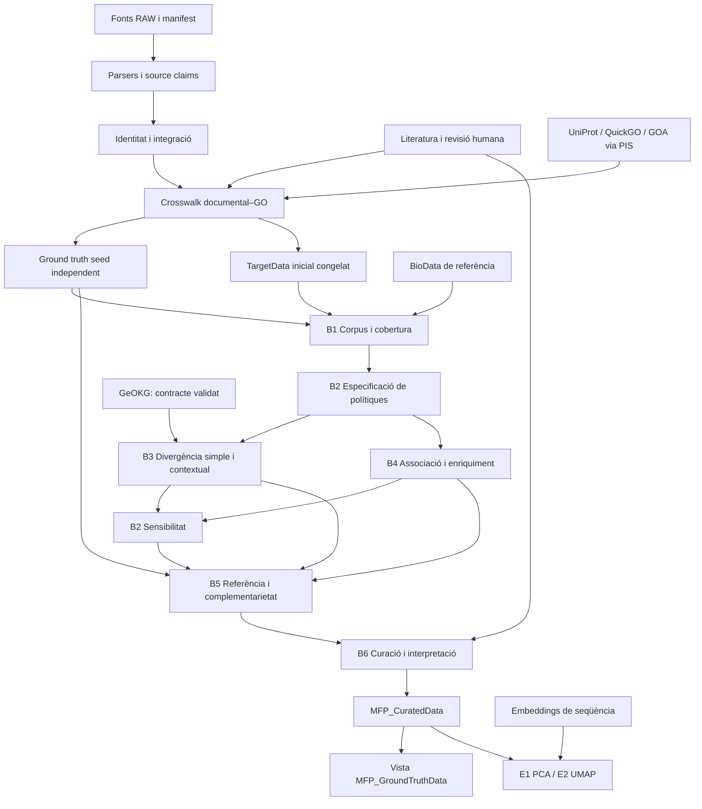
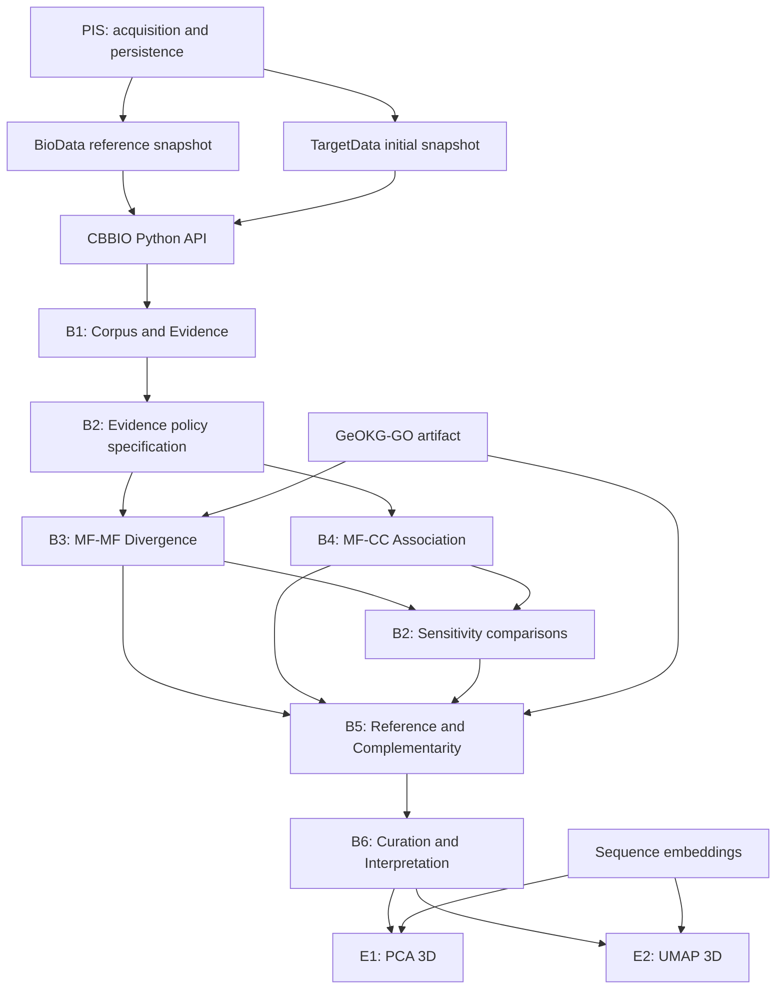

# Guió mestre de l’experiment bibliogràfic MFP

> De l’adquisició RAW a `MFP_CuratedData`: evidència documental, concordança GO, divergència funcional simple i contextual, comparació amb referència i curació reproduïble.

| Control | Valor |
|---|---|
| Identificador | PEC-EXP-001 |
| Edició | 0.2.1 — reconstrucció descarregable |
| Data | 2026-11-06 |
| Estat | Proposta de revisió; no aprovada per a execució completa |
| Projecte executor proposat | `mfp-bibliography`, interoperable amb PIS i CBBIO; consum futur per PEC |
| Fonts | `experiment_guio_v1.md` i `Pla-de-recerca-de-l-experiment-sobre-MFPData.md` |
| Producte | `MFP_CuratedData`, amb vista estricta `MFP_GroundTruthData` |

> [!NOTE]
> **Document Status & Preserved Historical Source Version**:
> This document is the **preserved Catalan source version** (`Estat: Proposta de revisió`, Edition 0.2.1, 2026-11-06) of the research proposal `PEC-EXP-001`.
> - **Maintained English Successor**: The actively maintained research proposal is now the English successor [`docs/roadmap/core/experimental-master-proposal.md`](../../roadmap/core/experimental-master-proposal.md).
> - **Availability for Provenance**: This source document is preserved in the repository archive for historical provenance, auditability, and comparative verification. It is not an active implementation mandate.
> - **Proposal Status**: Both this source document and its English successor remain **proposals under review**. Language migration establishes active English documentation compliance under [`AGENTS.md`](../../../AGENTS.md) Section 3; it does **not** constitute scientific approval of the experimental design. Execution of blocks B0–B6 remains blocked pending Gate G0 authorization.
> - **Traceability**: Section-level mappings and the disposition of embedded Annexes A and B are detailed in the [Documentation Recovery Map](../../reports/documentation-recovery-map.md#81-reconciled-section-level-recovery-matrix) and the English successor's [Migration Appendix](../../roadmap/core/experimental-master-proposal.md#19-provenance-and-migration-appendix-coverage-record).

**Nota de recuperació:** aquesta edició s’ha reconstruït perquè el fitxer temporal enllaçat anteriorment no estava disponible. No és una còpia byte a byte de l’edició 0.2.0: recupera i organitza el plantejament integrat i incorpora íntegrament els dos documents originals en annexos per evitar pèrdua de contingut. Inclou la rectificació sobre RCA indicada a la resposta anterior. Els annexos són testimonis documentals, no decisions aprovades; davant d’una contradicció s’aplica el cos integrat i es resol el registre de decisions abans d’executar.

La integració conserva els blocs B1–B6, els lliurables D0–D7, les extensions E1/E2, els gates G0–G5 i les decisions DEC-01–DEC-17 del primer guió. S’hi afegeix B0 per a RAW, claims, concordança i ground truth inicial, i s’amplien els blocs amb les preguntes del pla de recerca. [file:1][file:2]

## Lectura i convencions

El document fixa el recorregut científic i operatiu complet. Les estructures de dades i les interfícies que es proposen no afirmen que ja existeixin al repositori. Les observacions locals provenen de les sortides aportades als adjunts; no s’ha connectat amb el servidor ni s’ha inspeccionat el contingut dels fitxers RAW. [file:2]

- **Aportat:** observació inclosa en els documents d’origen, no comprovada independentment al servidor.
- **Proposat:** elecció metodològica per a revisió i aprovació.
- **Pendent:** decisió que s’ha de resoldre abans del gate corresponent.
- **Extensió:** treball conservat, però separat del nucli o condicionat a recursos addicionals.

La regla central és **evidència primer, descriptors després, interpretació i curació finalment**. Els scores no creen la veritat de referència contra la qual es contrasten. Les hipòtesis no pressuposen diferències significatives ni una superioritat de tripletes o embeddings.

## Marc científic

### Pregunta central

Quina evidència de multifuncionalitat es pot reconstruir de les fonts RAW i la literatura, com queda representada a les anotacions GO i fins a quin punt els descriptors simples i contextuals permeten caracteritzar casos documentalment pobres respecte d’un subconjunt bibliogràficament ben sustentat i d’una referència comparable?

Aquesta pregunta suma el plantejament de caracterització del guió i el contrast RAW–QuickGO–base local del pla. No transforma l’estudi en una classificació MF/NMF ni interpreta BioData com una classe negativa verificada. [file:1][file:2]

### Objectius

| ID | Objectiu | Evidència de compliment |
|---|---|---|
| O1 | Definir corpus i cohort traçables | Manifest, identitats, cobertura i exclusions |
| O2 | Quantificar sensibilitat a evidència | Comparacions aparellades i control del nombre de termes |
| O3 | Caracteritzar divergència intraproteïna | MF–MF principal; BP–BP secundària |
| O4 | Contextualitzar funcions i compartiments | MF–CC principal; BP–CC secundària |
| O5 | Avaluar posicionament i complementarietat | Referència comparable, redundància i discordances |
| O6 | Produir curació auditable | Evidències, revisors i decisions versionades |
| O7 | Reconstruir afirmacions originals | Claims amb localitzador RAW i procedència |
| O8 | Mesurar concordança documental–GO | Crosswalk bidireccional amb graus de concordança |
| O9 | Contrastar simples i tripletes | Definició contextual, elegibilitat i comparacions controlades |
| O10 | Estudiar casos accession-only | Posicionament respecte del seed, sense confirmació automàtica |
| O11 | Separar catàleg i veritat estricta | Paquet complet i vista estricta identificable |

O1–O6 preserven la lògica original; O7–O11 despleguen les ampliacions. [file:1][file:2]

### Hipòtesis

| ID | Hipòtesi de treball | Bloc |
|---|---|---|
| H1 | Cobertura i composició poden explicar part de les diferències | B0/B1/B5 |
| H2 | Part de la sensibilitat a evidència pot reflectir pèrdua de termes | B2/B3/B4 |
| H3 | Mètodes topològics, semàntics i GeOKG poden ser parcialment complementaris | B3/B5 |
| H4 | Associacions MF–CC rares amb suport poden orientar revisió | B4/B6 |
| H5 | Algunes diferències poden persistir després de controls de composició | B5 |
| H6 | Discordances poden orientar curació, però no creen etiquetes | B5/B6 |
| H7 | Algunes funcions documentades poden faltar a GO o tenir una altra granularitat | B0/B1/B6 |
| H8 | El context pot aportar informació absent d’una llista de termes | B3/B4/B5 |
| H9 | Alguns casos pobres poden tenir perfils semblants al seed independent | B5/B6 |
| H10 | Cobertura i suport poden variar entre espècies i fonts | B1/B2/B5 |

### Preguntes del pla

| ID | Pregunta preservada | Resposta |
|---|---|---|
| Q1 | Quina evidència tenen les anotacions? | Freqüències per codi/aspecte/font/espècie |
| Q2 | Quina part té publicació associada? | Cobertura i validació del tipus de referència |
| Q3 | BP/MF són divergents? | Descriptors, referència i nul·les per aspecte |
| Q4 | Canvia la divergència en filtrar? | Diferències aparellades, rangs i parells |
| Q5 | Quins CC s’associen a funcions divergents? | Associació i enriquiment amb multiplicitat |
| Q6 | La documentació concorda amb GO? | Crosswalk i revisió humana |

La taula preserva Q1–Q6 del pla; els RQ detallats del primer guió es mantenen íntegres a l’annex A i es concreten en els blocs integrats. [file:1][file:2]

## Abast i límits

El nucli inclou fonts RAW, extracció de claims, identitat, seqüència/taxonomia quan siguin accessibles, GO, literatura, cinc polítiques d’evidència, divergència simple/contextual, associació, referència i curació. GeOKG conserva el paper proposat a B3/B5, condicionat a un contracte d’artefacte vàlid. [file:1][file:2]

Queden fora del nucli: entrenament MF/NMF, generació de negatius verificats, validació wet-lab, causalitat deduïda de coanotació, reentrenament GeOKG obligatori, nou servei HTTP, plataforma massiva de tuning i ús confirmatori de PCA/UMAP. La integració futura a PEC exigeix un protocol propi d’etiquetes, ratios, mostreig, homologia, selecció de models i avaluació; TP/NTP són rols experimentals, no etiquetes biològiques automàtiques. [file:1]

## Terminologia i estats

| Concepte | Definició operativa |
|---|---|
| Registre de font | Entrada original d’un catàleg, abans de resoldre identitat |
| Source claim | Afirmació i categoria tal com les expressa la font |
| Functional claim | Funció o rol concret atribuït a una proteïna |
| Assertion GO | Relació producte–GO amb evidència, referència i procedència |
| Context funcional | Unitat que lliga funció, procés i localització quan hi ha suport |
| Multifuncionalitat | Propietat biològica; no recompte de termes |
| Moonlighting | Categoria estricta amb criteri propi; no sinònim de tota multifuncionalitat |
| IC | Information content, distingit del codi d’evidència IC |
| Snapshot | Estat identificable, congelat i reproduïble |
| Perfil de referència | Artefacte derivat amb univers, política i fingerprint |

| Estat de dades proposat | Paper |
|---|---|
| `MFP_RAW` | Originals immutables i manifest |
| `MFP_ParsedData` | Registres extrets sense perdre l’original |
| `MFP_IntegratedData` | Identitats resoltes amb claims i evidències |
| `MFPUniProtData_initial` / `TargetData_initial` | Snapshot operacional congelat per analitzar |
| `MFP_GroundTruthSeed` | Subconjunt inicial revisat independentment dels scores |
| `BioData_reference` | Població contextual congelada |
| `Reference_profile` | Counts, IC o associació derivats |
| `MFP_AnalysisData` | Resultats versionats amb elegibilitat i statuses |
| `MFP_CuratedData` | Paquet final complet amb decisions |
| `MFP_GroundTruthData` | Vista estricta del paquet, no substitut del catàleg |

Els noms locals `MFPUniProtData` i `MFP_UniProtData` s’han de conciliar en la configuració real: no es pressuposa que dues grafies identifiquin bases diferents o equivalents. El nom lògic no substitueix host, base, schema, export i checksum. [file:2]

## Punt de partida aportat

| Element | Dada aportada | Tractament |
|---|---|---|
| RAW | Sis directoris i 716 fitxers | Verificar inventari, contingut i hashes |
| Base objectiu | PostgreSQL 16.13; 2.182 proteïnes | No consulta nova |
| Anotacions | 96.186 files | No confondre amb proteïnes o termes únics |
| Publicació nul·la | 40.669 files | Absència del camp no demostra manca de suport |
| BioData local | 137.213 proteïnes | Identificar snapshot i unitat real |
| Esquema d’anotació | Inclou `publication_id` nul·lable | Auditar desplegament, no assumir model públic idèntic |
| Duplicats nuls consultats | Zero grups repetits en la consulta mostrada | No prova absència de qualsevol duplicació |

Aquestes dades són observacions aportades al pla, inclòs l’apèndix SQL. El text inicial que les anomenava desconegudes queda actualitzat per aquell apèndix, sense atribuir a aquesta revisió noves consultes. [file:2]

| Codi | Files | Codi | Files |
|---|---:|---|---:|
| IEA | 22.694 | IDA | 20.562 |
| IPI | 18.013 | IBA | 7.810 |
| IMP | 5.773 | TAS | 5.217 |
| ISS | 4.616 | EXP | 3.762 |
| NAS | 2.277 | HDA | 1.980 |
| ISO | 1.743 | IGI | 577 |
| IC | 307 | IEP | 299 |
| RCA | 176 | HTP | 140 |
| ISM | 96 | ISA | 83 |
| ND | 27 | HMP | 20 |
| HEP | 13 | IKR | 1 |

La distribució prové exclusivament de l’apèndix aportat. No representa la mida final de les capes després de filtrar termes, negacions, duplicats i elegibilitat. [file:2]

| Aspecte | Valors observats a `go_terms` |
|---|---|
| CC | `cellular_component`: 33; `C`: 1.000 |
| BP | `biological_process`: 214; `P`: 5.561 |
| MF | `molecular_function`: 117; `F`: 2.451 |

La consulta compta files del diccionari GO, no anotacions ni proteïnes per aspecte. Normalitzar les categories exigeix contrastar el namespace amb l’ontologia fixada. El pla no mostra arestes del DAG a `go_terms`: el càlcul ontològic requereix un artefacte addicional. [file:2]

El guió original observava un model públic d’anotació reduït; el pla mostra un desplegament local amb publicació. Es mantenen totes dues observacions com a indicis de versions diferents i s’exigeix introspecció abans de modificar ingesta, consultes o claus. La disponibilitat del backup públic no demostra que sigui el mateix snapshot que BioData local. [file:1][file:2]

## Arquitectura de l’experiment



Lectura sense Mermaid: B0 reconstrueix fonts i evidència; B1 fixa poblacions i denominadors; B2 especifica polítiques; B3/B4 calculen descriptors; B2 completa sensibilitats; B5 contextualitza; B6 revisa i publica. La doble presència de B2 no implica un cicle de dependències: especificació i comparació són etapes diferents.

## B0: RAW i evidència

### B0.1 Adquisició i congelació

El pla identifica cinc fonts i aquests artefactes d’exemple. No es coneix el contingut real dels fitxers en aquesta revisió. [file:2]

| Font | Artefactes aportats | Precaució |
|---|---|---|
| MoonDB | `all_emf_and_curated.tsv`, `all_EMF_annotation.tsv`, `all_manual_curated.tsv` | No comptar exports superposats com a noves proteïnes |
| MoonProt | `artifact_index.csv`, `mpid_100.html` i altres HTML | Unir índex, pàgina i identificador de fitxa |
| MultifacetedProtDB | JSON i TXT | Verificar equivalència abans de fusionar formats |
| MultitaskProtDB-II | `proteins.csv` | Preservar categoria i referències pròpies |
| PlantMP | CSV all/confirmed/likely/predicted i XLSX | Conservar estat original; no igualar predicció i confirmació |

1. Inventariar fitxers existents i les seves fonts d’adquisició.
2. Registrar URL/origen, data, mètode, nom original, format, mida, hash SHA-256, versió si existeix, permisos i estat.
3. Conservar originals sense sobreescriure’ls; cada nova descàrrega crea snapshot.
4. Separar èxit, absent, inaccessible, incomplet i error de parseig.
5. Conciliar índexs i exports equivalents abans de comptar registres.
6. Registrar llicències i restriccions abans de redistribuir RAW o text d’articles.

**Sortida DA0:** manifest RAW, targetes de font i incidències. **Acceptació:** cada artefacte té identitat i condicions d’ús; les absències són explícites. No es bloqueja tota la recerca per una font inaccessible, però se’n declara l’impacte i s’aprova la reducció d’abast.

### B0.2 Extracció sense pèrdua

Crear parsers específics per font/format. Produir `source_records` i `source_claims` amb localitzador estable, camps originals, categories, accessions, taxonomia, funcions, contextos, GO si la font els inclou, referències i incidències. Separar text extret, interpretació normalitzada i decisió humana.

No col·lapsar prematurament una entrada a una fila proteïna–llista GO. Una mateixa proteïna pot acumular afirmacions diferents, prediccions i evidència parcial. Un segon format o catàleg que replica la mateixa publicació no constitueix una evidència independent nova.

**Sortida DA1 parcial:** dades parsejades, schemas, proves i informe de cobertura per camp. **Acceptació:** cada afirmació pot retornar al seu origen; els errors no s’han convertit en valors buits silenciosos.

### B0.3 Resolució d’identitats

Distingir registre, proteïna, accession, isoforma, seqüència i context experimental. Normalitzar àlies sense destruir valors originals; conservar mappings un-a-molts i conflictes. Verificar organisme i forma de la proteïna abans d’atribuir-li funcions.

La seqüència idèntica pot ajudar a detectar overlap, però no autoritza a fusionar automàticament organismes, procedències o claims. Registrar `mapping_method`, font, versió, confiança, revisor i motiu. Els ambigus continuen com a casos no resolts o exclosos d’un bloc, no desapareixen del catàleg.

**Sortida DA1 complet:** entitats integrades, mapa de procedència i taula de conflictes. **Acceptació:** identitat resolta o status explícit per a cada registre.

### B0.4 Crosswalk documental–GO

Comparar tres nivells: funcions RAW/literatura, anotacions disponibles a QuickGO/GOA i anotacions preservades a la base local. Congelar dates i versions; un canvi temporal pot explicar una discrepància sense que hi hagi error d’ingesta.

| Classe de concordança | Criteri proposat |
|---|---|
| Coincidència específica | La funció documentada correspon al terme assignat |
| GO més general | El terme cobreix la funció amb menor detall |
| GO més específic | La granularitat exigeix revisar si la font justifica el detall |
| Funció absent de GO consultat | Claim documentat sense correspondència observable |
| GO sense suport localitzat | No s’ha trobat suport al material consultat; no equival a fals |
| Contradicció explícita | Evidència avaluada contrària al claim, amb context i revisió |
| No avaluable | Text inaccessible, identitat ambigua o informació insuficient |
| Pèrdua entre proveïdor i base | El proveïdor té camps/assercions no preservats localment |

Fer el contrast en les dues direccions: dels claims a GO i de GO al suport documental. Registrar terme candidat, relació de mapping, evidència/localitzador i revisió. L’absència al RAW no prova absència de bibliografia mundial, i un PMID compartit no prova per si sol un lligam funcional.

**Sortida DA2:** crosswalk i cobertura de funcions/hipòtesis per font, espècie i camp. **Acceptació:** cada discrepància distingeix absència, diferent granularitat, pèrdua i impossibilitat d’avaluar.

### B0.5 Ground truth inicial

Definir criteris i una mostra inicial abans de mirar scores. Proposta mínima: producte identificat; almenys dues funcions o rols diferenciables; evidència primària avaluable; comprovació que no s’ha confós organisme/isoforma o una propietat agregada; decisió humana documentada. Una etiqueta de moonlighting estricte requereix criteri addicional propi, no només complir multifuncionalitat àmplia.

La selecció combina estrats de font, organisme i riquesa documental. Tots els casos que entren a la vista estricta necessiten revisió i adjudicació de discrepàncies; es proposa doble revisió independent per a aquest subconjunt. Si no hi ha capacitat per revisar-los tots, el seed és més petit o l’estat és provisional, no es relaxa silenciosament el criteri.

La fitxa d’article inclou referència, aportació, funcions, organisme/forma, mètode experimental, context, límits, possibles dependències entre fonts, localitzadors i estat de revisió. Les eines d’IA poden ajudar a extreure candidats, però cap canvi de criteri o etiqueta estricta es delega sense aprovació humana.

**Sortida DA3:** `MFP_GroundTruthSeed`, decisions, mostra, exclusions i fingerprint anterior als scores. Si la cobertura és insuficient, s’informa i es redueix la inferència; no s’inventa un ground truth.

## Contractes de dades

| Entitat | Camps mínims proposats |
|---|---|
| Artefacte | `artifact_id`, origen, data, hash, format, versió i permisos |
| Registre/claim | `source_record_id`, `source_claim_id`, categoria original, localitzador i parser version |
| Proteïna | `protein_id`, accessions, taxó, seqüència/hash, longitud i isoform policy |
| Funció | `functional_claim_id`, descripció, termes candidats i context |
| Evidència | Referència normalitzada, tipus de suport, localitzador, accés i revisor |
| Assertion GO | GO ID, aspecte, evidence/ECO, relació/qualifier, referències, with/from, data, assigned_by, extensions i product form si disponibles |
| Context | `context_id`, components MF/BP/CC, lligam justificatiu i completesa |
| Resultat | Mètrica/versió, política, valor, status, counts, cobertura i run |
| Curació | Claim, decisió, motiu, evidència, revisor, data i versió anterior |

El contracte no pressuposa que la base operacional contingui tots els camps: les mancances poden exigir recuperació upstream o un sidecar de procedència. Un API no pot reconstruir per si sol informació perduda en ingestió. Una clau proteïna–terme no ha de destruir múltiples evidències vàlides. [file:1][file:2]

### Política GO

Fixar release, aspectes, relacions, obsolets/alt IDs, arrels, negacions i propagació. Baseline proposat: termes asserted únics elegibles per a parells; no afegir-hi tots els ancestres. La propagació d’IC és una operació separada i ha de concordar amb la biblioteca. La supressió de redundància ancestre–descendent és una sensibilitat declarada.

No tractar `NOT` com a positiu. Comptar `ND` i codis desconeguts en cobertura, sense fer-los evidència positiva específica. Si els qualifiers no es conserven, no afirmar que la garantia de positivitat està resolta. El tractament de termes genèrics ha de ser preregistrat, no derivat del resultat que es vulgui obtenir. [file:1][file:2]

### Missingness i errors

| Status | Significat |
|---|---|
| `ok` | Resultat definit i completat |
| `insufficient_terms` | Menys de dos termes elegibles per a divergència |
| `missing_annotation` | Falta un aspecte requerit |
| `missing_reference` | Referència no preservada o no recuperada |
| `not_assessable` | Evidència no avaluable |
| `ambiguous_identity` | Producte no resolt |
| `partial_context` | Context incomplet |
| `unlinked_context` | Components sense lligam verificat |
| `missing_embedding` | Falta representació |
| `low_support` | Estimació sense suport mínim |
| `unobserved_pair` | Parella absent del corpus de referència |
| `degenerate_probability` | Cas matemàtic no definit pel descriptor |
| `unsupported_geometry` | Distància no validada per a l’artefacte |
| `calculation_error` | Fallada tècnica o numèrica |

Un missing es desa com a valor absent amb status, mai com a zero per defecte. Informar denominador per anàlisi, no una única xifra de cohort que amagui pèrdues entre blocs.

## Ground truth i cohorts

| Vista proposada | Criteri | Paper |
|---|---|---|
| `GT_seed_strict` | Evidència independent revisada i suficient | Referència inicial congelada |
| `CAND_partial` | Funcions/evidència parcial però insuficients | Curació i descripció |
| `CAND_accession` | Informació RAW limitada a identificació | Comparació descriptiva quan es recupera GO |
| `CAND_predicted` | Categoria original de predicció | Estrat independent |
| `UNRESOLVED` | Ambigüitat o material no avaluable | Preservar sense forçar etiqueta |
| `EXCLUDED_analysis` | No compleix un bloc concret | Conservar motiu, no eliminar del catàleg |

Separar estat documental, etiqueta biològica, rol de cohort i elegibilitat analítica. «Accession-only» es defineix sobre la informació inicial: si després es recupera literatura, es registra la transició sense reescriure retrospectivament el punt de partida. Si tampoc es recupera GO suficient, no hi ha descriptor calculable; no s’imputa per semblança.

El seed i els criteris inicials queden fixats abans del càlcul. La vista estricta final pot créixer gràcies a revisió, però els nous casos s’identifiquen com a afegits després de l’anàlisi i no es reciclen com a validació independent retrospectiva dels scores que els van prioritzar.

## B1: corpus i cobertura

**Propòsit:** fixar què s’analitza i amb quines limitacions. Preserva les preguntes RQ1.1–RQ1.4 del primer guió i hi afegeix camps documentals i contextuals. [file:1][file:2]

- Entitats úniques després de resoldre identifiers i duplicats.
- Cobertura de seqüència, taxó, GO, procedència, literatura, context i embeddings.
- Overlap amb BioData per accession i seqüència exacta; homologia com a sensibilitat separada.
- Distribució de fonts, espècies, longituds, counts i classes documentals.

**Entrades:** DA0–DA3, base objectiu i BioData congelats. **Càlcul:** integritat, counts per unitat, categories normalitzades, referències vàlides, cobertura d’hipòtesis/funcions i matriu d’elegibilitat per bloc. No exigir embeddings per entrar en GO analysis.

**D1:** manifest, mapatge d’identitat, coverage matrix, overlap i exclusions. **Acceptació:** cada registre resolt o amb status; cada anàlisi té denominador reconstruïble. **Figures:** flux de cohort i mapa de cobertura. Alta cobertura no demostra qualitat i baixa cobertura no demostra absència de funció.

## B2: sensibilitat a evidència

**Propòsit:** separar selecció de suport i pèrdua de termes. Preserva RQ2.1–RQ2.4 i les capes A–E del pla. [file:1][file:2]

| Capa | ID | Selecció proposada |
|---|---|---|
| A | `ALL_ELIGIBLE` | Tots els codis admesos per la versió i les regles aprovades |
| B | `EXP_CONVENTIONAL` | EXP, IDA, IPI, IMP, IGI, IEP |
| C | `EXP_EXTENDED` | B + HTP, HDA, HMP, HGI, HEP |
| D | `EXP_CURATOR_AUTHOR` | C + TAS, NAS, IC; definició que requereix aprovació |
| E | `NON_IEA` | A sense IEA |

D s’explicita perquè el pla no resol quins codis d’autor ni si inclou high throughput. Una sensibilitat sense NAS pot denominar-se `D_TRACEABLE`; no substitueix D silenciosament. TAS/IC no es reetiqueten experimentals; no s’assumeix una escala universal de qualitat ni que no electrònic equivalgui a experimental. [file:1][file:2]

**Rectificació RCA:** no s’aplica l’exclusió general anunciada erròniament a l’edició anterior. Les 176 files RCA aportades es conserven al perfilat i, quan siguin elegibles segons la versió i política aprovades, a la capa A. Una anàlisi sense RCA seria una sensibilitat motivada, no conseqüència d’una invalidesa presumpta. La llista definitiva de codis queda congelada a G2. [file:2]

Primer filtrar assertions i després deduplicar termes: una mateixa parella proteïna–GO pot tenir suports diferents. Per a contextos, conservar evidència dels components i del lligam; si només part és elegible, el context és parcial.

1. Fixar ontologia i perfils IC/coocurrència en el contrast principal.
2. Calcular retenció d’assertions, termes, proteïnes i contextos per capa/aspecte/espècie/font.
3. Comparar descriptors aparellats sobre proteïnes comunes.
4. Mostrar també pèrdues d’elegibilitat, no només complete cases.
5. Fer downsampling repetit d’A a counts comparables, amb seeds aprovades.
6. En contextos, controlar nombre i completesa, no només termes.
7. Informar correlacions de rangs i Jaccard amb univers explícit.
8. Separar la sensibilitat que reestima perfils de la que canvia només anotacions del cas.

**D2:** policies, retenció, canvis, estabilitat i controls. **Acceptació:** denominadors i status visibles; cap interpretació automàtica de «menys divergència = més veritat». **Figures:** retenció i canvis aparellats.

## B3: divergència funcional

**Propòsit:** caracteritzar divergència MF–MF principal i BP–BP secundària, conservar parells explicatius i contrastar simples/contextuals. RQ3.1–RQ3.4, GeOKG i famílies originals no s’eliminen. [file:1][file:2]

### Anotació simple

Per a cada aspecte, usar termes únics elegibles asserted. Comparar parells no ordenats; no barrejar termes MF i BP en una similitud que pressuposi un mateix namespace.

| Família | Paper | Condició |
|---|---|---|
| Wang | Candidat principal de baseline | Implementació i convencions validades |
| MBL | Descriptor topològic secundari | Definició i escala explícites |
| Lin/Resnik/Schlicker | Família dependent d’IC | Corpus, denominador i propagació congelats |
| GeOKG-GO | Representació apresa complementària | Mapping i geometria aprovats |
| PrOnto AP | Contrast de coocurrència | Corpus i procediment documentats |
| PrOnto IP | Extensió condicionada | Xarxa PPI adequada i procediment definit |
| D³-MBL / RICD-MBL | Candidats ajornats preservats | No calcular sense fórmula aprovada |

Baseline proposat del guió original:

\[
D_p=\frac{2}{n_p(n_p-1)}\sum_{i<j}[1-S_{\mathrm{Wang}}(t_i,t_j)],\qquad n_p\geq2.
\]

La fórmula és candidata a aprovar a G2, no una mètrica seleccionada després d’observar resultats. Mediana, quantils i màxim són secundaris. Conservar `n_terms`, `n_pairs_expected`, `n_pairs_computed`, `pair_coverage`, parells extrems i status. Menys de dos termes no és divergència zero. [file:1]

PrOnto/MoonDB es preserven com a precedents del pla; reconstruir una probabilitat de coocurrència sense PPI no és una replicació de la via IP ni de tot MoonGO. Els llindars històrics, inclòs p = 0,05 esmentat al pla, no es converteixen en llindars validats de multifuncionalitat per a aquest experiment. [file:2]

### Tripletes contextuals

**Definició proposada, no estàndard assumit:** una tripleta \(\tau_k=(m_k,b_k,c_k)\) descriu una unitat funcional amb MF, BP i CC lligats al mateix claim/context amb evidència suficient. El pla diu «tripletes» sense precisar-ne la semàntica: DEC-22 ha de confirmar aquesta interpretació abans d’executar. [file:2]

| Tipus | Construcció | Ús |
|---|---|---|
| Completa lligada | MF/BP/CC i lligam revisat | Contrast contextual principal si hi ha cobertura |
| Parcial lligada | Funció/context, però falta component | Conservar i analitzar separadament |
| Candidata coanotada | Components a la mateixa proteïna sense lligam | Només exploració explícita |
| Sense suport | Combinació inventada o incompatible | No tractar-la com a fet |

No generar producte cartesià MF×BP×CC i anomenar-lo funcions demostrades. Un PMID compartit no garanteix mateix context. Si un context té diversos termes per aspecte, conservar conjunts, no fabricar múltiples tripletes independents.

Proposta de descriptor: comparar MF amb MF, BP amb BP i CC amb CC entre contextos. Presentar primer el vector de components; un agregat ponderat només és admissible amb escales i pesos preregistrats. Sense component requerit, informar parcialitat; qualsevol renormalització ha de declarar-se i no fer passar contextos incomplets per equivalents als complets.

Comparar simples i contextuals sobre les mateixes proteïnes i, quan sigui possible, termes/contextos comuns. Distingir l’efecte de representar relacions del de tenir més dades. La similitud de perfils d’un cas accession-only amb el seed no confirma que tingui tripletes documentades.

### Contracte GeOKG

Conservar distinció GO vs GOA, checkpoint/hash, graf/release, mapping GO, dimensions, espai, curvatura, paràmetres de relació i definició del descriptor. No assumir que cosine d’una matriu exportada sigui el score natiu ni fer centroides euclidians d’un espai hiperbòlic sense justificació. [file:1]

Si no hi ha distància simètrica nativa definida, cal aprovar un descriptor explícit. Comparar mètodes sobre els mateixos parells calculables; reportar cobertura pròpia separadament. Si falla el contracte, aprovar reducció d’abast o ajornament, mai ometre GeOKG silenciosament.

**D3:** descriptors, parells, contextos, cobertura GeOKG, discrepàncies i status. **Acceptació:** fórmula, direcció, escala, agregació i absències fixades. **Figures:** distribucions, parells explicatius i simples/contextuals. Un valor alt no és demostració de multifuncionalitat.

## B4: funció i compartiment

**Propòsit:** conservar MF–CC i afegir BP–CC, enriquiment i anàlisi de funcions divergents sense confondre coanotació i mecanisme. [file:1][file:2]

**Entrades:** cohort/policies, GO i BioData. **Univers principal proposat:** proteïnes úniques amb almenys un terme elegible de cada aspecte comparat. Cada proteïna compta una vegada per parella; marginals i conjunts comparteixen denominador. Excloure overlap amb TargetData o quantificar-lo i fer sensibilitat.

Candidate NPMI preservada:

\[
\mathrm{NPMI}(m,c)=\frac{\log[P(m,c)/(P(m)P(c))]}{-\log P(m,c)}.
\]

Conservar \(N\), counts marginals i conjunts, política, corpus i fingerprint. Si la probabilitat conjunta és zero: `unobserved_pair`, no incompatibilitat. Si és u: cas degenerat amb tractament explícit. Suport baix: `low_support`, encara que existeixi estimació numèrica. Definir a G2 resum per proteïna i cobertura mínima. [file:1]

Separar coanotació global, associació contextual evidenciada i enriquiment de CC en funcions/parells divergents. La selecció dels «divergents» requereix regla preregistrada i controls; comparar només subconjunts seleccionats pot introduir biaix. Per enriquiment, informar efecte, comptes, incertesa i correcció de proves múltiples, amb unitat independent adequada.

**D4:** univers, count tables, perfils, fingerprint i descriptors. **Acceptació:** denominadors coherents, suport i agregació aprovats. **Figures:** heatmap amb suport i efectes. Una funció i un CC a la mateixa proteïna no demostren que aquella funció s’executi en aquell compartiment. [file:1]

## B5: referència i complementarietat

**Propòsit:** contextualitzar cohort/seed/candidats respecte de BioData i contrastar descriptors, no construir negatius. [file:1][file:2]

1. Definir comparadors BioData dins de rangs de longitud i taxonomia pertinents.
2. Excloure overlap per identificadors i seqüència exacta; documentar homologia.
3. Informar resultats globals, estratificats i matched quan existeixi common support.
4. Separar comparació marginal i condicionada per annotation count/evidence coverage.
5. Comparar correlacions i redundància sobre les mateixes proteïnes/parells calculables.
6. Seleccionar discordants per revisió, sense equiparar independència estadística i utilitat biològica.
7. Comparar `CAND_accession` amb `GT_seed_strict` sobre suport disponible, cobertura i composició.
8. Contrastar simples/contextuals sense confondre manca de context amb distància baixa.

Preservar BMA entre conjunts GO quan el mètode ho suporta i està verificat. BMA GeOKG o una agregació entre contextos són extensions que requereixen contracte, no capacitats assumides. La comparació protein-level GeOKG pot ajornar-se sense canviar retrospectivament B3. [file:1]

No derivar probabilitat de multifuncionalitat, especificitat diagnòstica o precisió de classificació d’aquestes comparacions. Per a candidats, les categories adequades són semblança descriptiva, discrepància, sensibilitat o no avaluable; la confirmació exigeix evidència independent.

**D5:** efectes, incertesa, controls, balanç/matching, redundància, casos discordants i candidats prioritzats. **Acceptació:** common support i cobertura explícits; no presentar BioData com a NMF. **Figures:** efectes, matriu de correlació i fitxes de discordància.

## B6: curació i interpretació

La revisió final no substitueix el ground truth inicial: és una segona etapa. B0.5 aporta referència independent abans de scores; B6 integra descriptors i evidència per revisar casos i publicar una nova versió. Aquesta separació suma els dos documents i limita circularitat. [file:1][file:2]

La mostra final inclou representatius, extrems, sensibles a evidència, discordants, accession-only i una mostra no seleccionada per scores. Fixar regles i pressupost abans de revisar. Quan sigui viable, amagar scores al revisor en l’adjudicació inicial i comparar decisions després.

| Camp de fitxa | Contingut |
|---|---|
| Identitat | Proteïna, accessions, organisme, forma i snapshot |
| Claim | Funcions/rols i criteri biològic aplicat |
| Evidència | Referències originals, context experimental, localitzadors i límits |
| Anotacions | GO, evidència, relacions i crosswalk |
| Contextos | Completesa i lligams justificats |
| Descriptors | Policies, scores, cobertura i status |
| Decisió | Sustentat, insuficient, contradictori o no resolt |
| Revisió | Revisor, data, desacord i adjudicació |
| Impacte | Canvi, versió anterior i motiu |

Tots els casos de la vista estricta han de tenir revisió i adjudicació. Els no resolts romanen visibles. Un error tècnic, una publicació inaccessible o una baixa puntuació no justifiquen declarar falsa una funció.

**D6:** paquet curat, evidències, decisions, change set i interpretació. **Acceptació:** cada canvi és auditable; el resultat inicial no s’esborra. **Figures:** flux de curació i casos traçables. Els casos confirmats després de ser prioritzats per scores no es reutilitzen com a validació independent d’aquells scores. [file:1]

## E1: PCA 3D

Extensió posterior preservada: embeddings de seqüència d’un model/layer/pooling fixats, join per identitat de seqüència, tres components i variància explicada visible. Registrar centrat, normalització i escalat; no estandarditzar per defecte sense justificació. [file:1]

Colors: divergència, associació, counts, retenció, longitud, taxonomia, font, concordança i curació. Mantenir coordenades i escales comparables; els filtres no fan refit silenciós i els missing tenen categoria pròpia. No comparar eixos de models diferents com si fossin el mateix espai.

**Sortida:** HTML, figura estàtica, coordenades i manifest. **Acceptació:** join i preprocessament verificats. Els descriptors són colors, no inputs addicionals de la projecció principal.

## E2: UMAP 3D

Extensió posterior sobre el mateix conjunt d’embeddings, tret de canvi declarat. Fixar mètrica, paràmetres, versió, seeds i petita graella d’estabilitat abans de veure projeccions. Mantenir colors d’E1. [file:1]

**Sortida:** HTML, figura, coordenades, manifest i estabilitat. **Acceptació:** no seleccionar només la vista visualment atractiva. Eixos i clústers no són variables biològiques ni confirmació de classes. E1/E2 tenen aprovació i pressupost propis.

## Pla estadístic

| Anàlisi | Unitat | Control |
|---|---|---|
| Adquisició | Artefacte/registre | No comptar formats com a individus |
| Cobertura | Claim/assertion/terme/proteïna | Denominador explícit |
| Policies | Mateixa proteïna | Disseny aparellat i elegibilitat |
| Divergència | Proteïna; parells interns | No pseudorèpliques per parella |
| Contextos | Proteïna, contextos relacionats | Dependència interna i completesa |
| Associació | Proteïna única per parella | Comptes coherents |
| Referència | Proteïna/grup relacionat | Taxonomia, longitud, homologia i balanç |
| Curació | Cas revisat | Mostreig i revisors |

Prioritzar distribucions, grandàries d’efecte i intervals de confiança del 95% com a proposta. Fixar estimadors, bootstrap/permutacions, seeds, agrupació biològica i multiplicitat a G2. Re-mostrejar proteïnes o grups definits, no tots els parells GO com si fossin independents. Si la mida/cobertura no permet inferència fiable, lliurar descripció amb limitacions. [file:1]

Proposta de contrasts principals a ratificar: sensibilitat A–B de divergència MF; posicionament cohort/seed respecte de BioData comparable; diferència descriptiva simple/contextual en suport comú. BP, AP/IP, GeOKG i altres sensibilitats mantenen paper predeclarat, no desapareixen si no són primaris.

- Permutació: preservar counts per proteïna/aspecte i blocs d’especificitat/taxonomia; verificar els invariants realment mantinguts.
- Densitat: downsampling repetit i control de counts/contextos.
- Termes genèrics: llista/política preregistrades.
- Policies: perfils fixos principalment; reestimats en anàlisi separada.
- Referència: amplis/matched, exclusions i homologia documentats.
- Llindars: graella predefinida, no selecció retrospectiva del menor p-valor.
- Replicació: dades externes separades de l’ajust si estan disponibles.
- Tripletes: no permutar components com si combinacions no observades fossin evidència real.

Distingir controls aleatoritzats de dades observades. Els confusors inclouen taxonomia, longitud, annotation density, evidència, font, accessibilitat documental i homologia. La restricció a tripletes/GeOKG pot seleccionar proteïnes més estudiades. La manca de significació no demostra equivalència; un resultat nul o inestable és científicament vàlid si és traçable.

## Responsabilitats de programari

| Capacitat | Propietari proposat | Justificació |
|---|---|---|
| RAW bibliogràfic i parsers | `mfp-bibliography` | Semàntica pròpia de fonts |
| UniProt/GOA/seqüència/estructura | PIS quan ja és responsabilitat seva | Evitar connectors duplicats |
| Claims i sidecar documental | Projecte bibliogràfic interoperable | No forçar pèrdua al model operacional |
| Batch retrieval | CBBIO | Interfície comuna |
| GO i mètodes generals | CBBIO.GO | Separar mecanisme i hipòtesi |
| Selectors/perfils/agregació | CBBIO si són generals; mòduls aïllats inicialment | Reutilització sense hard-coding de cohort |
| GeOKG adapter | CBBIO després del contracte | Aïllar geometria i compatibilitat |
| Cohorts, controls i inferència | Projecte experimental | Decisions específiques |
| Curació i release | Projecte i revisors | Responsabilitat científica |
| Training futur | PEC | Protocol separat |

Abans de reutilitzar codi, fixar commits i provar signatures, arguments, retorns, errors, camps i desplegament. Documentació mutable no equival a integració comprovada. CBBIO.GO sobre OBO/mappings locals no exigeix una consulta SQL per cada parella. No assumir que una extensió proposada ja existeix. [file:1]

Les extensions generals requereixen contractes tipats, documentació, errors/status, tests i absència d’IDs/thresholds exclusius hard-coded. SQL excepcional va a adapters; no es dispersa entre notebooks. Especificacions implementables separades han d’enllaçar inputs, outputs, tests i gate, tal com demana el pla. [file:1][file:2]

## Reproduïbilitat i execució

### Manifest de run

Registrar protocol/versió/run/data; snapshots i hashes; schema fingerprint; GO/ECO; policies i qualificadors; univers i perfils; commits i dependències; definició de mètrica, agregació i missingness; model/checkpoint/layer/pooling/geometria; seeds i resampling; temps/recursos; errors i amendments.

No incloure passwords, tokens o cadenes de connexió amb secrets. Els exemples de credencials del pla original no són una configuració per copiar al repositori.

```text
mfp-bibliography/
  docs/research/experiment-plan.md
  docs/research/decisions/
  docs/research/source-cards/
  specs/
  configs/
  src/mfp_bibliography/
  scripts/
  tests/
  data/raw/
  data/interim/{parsed,claims,identity,crosswalk}/
  data/frozen/{target,reference,groundtruth_seed}/
  data/curated/releases/
  experiment/{protocol,manifests,tables,figures,curation,reports,presentation}/
```

Estructura proposada, no inventari auditat del repositori.

### Pilot i escalat

Incloure fonts/formats, espècies, counts, missingness, accession ambiguity, negacions, referències múltiples, contextos parcials/complets i cobertura GeOKG. Verificar el recorregut RAW→claims→identitat→crosswalk→seed→scores→fitxa→paquet. Mesurar temps de retrieval, CPU/GPU, memòria, disc, consultes, errors i hores de revisió; no triar la mètrica amb millor separació durant el pilot.

Els parells creixen com \(n(n-1)/2\). Caches per terme/parella, ontologia, política, perfil, mètrica i artefacte; batch retrieval; shards/checkpoints; concurrència limitada per protegir serveis i PostgreSQL. Mostrejar parells per cost és un amendment, no optimització invisible. Pressupost i calendari depenen del pilot, amb core, GeOKG, revisió i extensions separats. [file:1]

### Proves

| Família | Verificació |
|---|---|
| RAW/parsers | Hash, integritat, formats, errors i localitzadors |
| Fonts/claims | Categories i exports superposats, dependència de papers |
| Identitat | Àlies, isoformes, taxó, joins i seqüències |
| GO/assertions | Roots, obsolets, namespaces, NOT, múltiples suports |
| Crosswalk | Concordança, absència i no avaluable |
| Tripletes | Lligams i no fabricació cartesiana |
| Mètriques | Rangs, direcció, simetria quan pertoqui i casos límit |
| Perfils | Marginals/conjunts, denominadors, IC i fingerprint |
| Missingness | Zero vàlid diferent d’absència/error |
| GeOKG | Mapping, dimensions, geometria i incompatibilitat |
| Estadística | Invariants de controls i unitat de resampling |
| Release | Claus, traça, criteri estricte i schemas |
| Integració/reproducció | API/deployment, exports consistents, resume i toleràncies |

Fixtures artificials de tests, clarament identificades, no poden presentar-se com a dades biològiques o resultats reals.

## Release de MFP_CuratedData

El producte és un paquet complet, no una llista d’accessions amb scores. Conserva claims, origen, evidència, anotacions, contextos, resultats, elegibilitat i decisions.

```text
MFP_CuratedData/<version>/
  README.md
  dataset_card.md
  manifest.json
  checksums.sha256
  schemas/
  proteins.parquet
  accessions.parquet
  source_records.parquet
  source_claims.parquet
  functional_claims.parquet
  references.parquet
  claim_evidence.parquet
  go_assertions.parquet
  annotation_crosswalk.parquet
  functional_contexts.parquet
  metric_results.parquet
  curation_decisions.parquet
  eligibility.parquet
  exclusions.parquet
  views/{groundtruth_strict,candidate_partial,candidate_accession,unresolved}.parquet
  reports/{coverage,validation,limitations}/
```

Els RAW/textos restringits poden quedar fora de la publicació amb manifest i instruccions d’accés. CSV/JSON complementaris no poden destruir relacions multivaluades. Un dump de base no substitueix documentació ni contractes.

### Vista estricta

`MFP_GroundTruthData` és una vista del paquet, amb evidència suficient i adjudicació. Distingir multifuncionalitat àmplia i moonlighting estricte. Prediccions i no resolts continuen al paquet complet, fora de la vista. Registrar incorporacions posteriors als scores i evitar validació circular.

### Definició de completat

- Identitats resoltes o amb status explícit.
- Claims amb font/localitzador o incidència documentada.
- Assertions amb suports disponibles i mancances declarades.
- Contextos complets amb lligam; parcials/candidats diferenciats.
- Resultats amb política, configuració, counts, status i cobertura.
- Decisions amb revisor, evidència, motiu i versió.
- Vista estricta revisada i adjudicada.
- Exclusions/no resolts i denominadors publicats.
- Schema, integritat i reproduïbilitat verificats.
- Permisos, llicència, dataset card, changelog i instruccions de citació.
- Aprovació G5 amb artefactes públics/restringits diferenciats.

La dataset card especifica usos previstos/no previstos, unitats, fonts/períodes, criteris, cobertura, biaixos taxonòmics/documentals, absències, validació i actualització. Adverteix que no hi ha classe NMF verificada i que les prioritats descriptives no són etiquetes biològiques.

## Lliurables i gates

| ID | Lliurable | Acceptació |
|---|---|---|
| D0 | Protocol i decisions | Abast i bloquejants resolts |
| DA0 | RAW i inventari | Origen, hashes, permisos, incidències |
| DA1 | Claims i identitats | Localitzadors, parsers, mappings |
| DA2 | Crosswalk | Regles i cobertura bidireccional |
| DA3 | Ground truth seed | Evidència independent i freeze |
| D1 | Cohort i cobertura | Denominadors i exclusions reconstruïbles |
| D2 | Sensibilitat A–E | Retenció i controls |
| D3 | Divergència | Parells, contextos i contractes |
| D4 | Associació | Univers, counts i fingerprint |
| D5 | Referència/complementarietat | Efectes, incertesa i controls |
| D6 | Paquet curat | Evidències i audit trail |
| D7 | Presentació | Storyboard coherent amb protocol |
| E1 | PCA 3D | Coordenades i variància |
| E2 | UMAP 3D | Paràmetres i estabilitat |

| Gate | Aprova | Bloquejant |
|---|---|---|
| G0 | Preguntes, definicions, B0–B6 i límits | Objectiu o criteri estricte no acordats |
| G1 | RAW, schema, identitat, snapshots i seed | Camps crítics sense avaluar o traça insuficient |
| G2 | Policies, mètriques, tripletes, estadística i GeOKG | Fórmules/lligams ambigus o perfils incoherents |
| G3 | Pilot, proves i pressupost | Cost no mesurat o no reproduïble |
| G4 | Execució completa | Canvis silenciosos o artefactes incomplets |
| G5 | Interpretació, decisions i release | Claims no sustentats o permisos insuficients |

G0 precedeix treball experimental nou. G1–G3 són verificacions controlades, no autorització a canviar el disseny lliurement. E1/E2 tenen autorització separada. Dades ja existents són inputs a auditar, no aprovació retrospectiva.

Rols preservats: Scientific Lead, Data/PIS Owner, API/Methods Owner, Analysis Owner, Curation Lead/Reviewer i Team Approver. S’hi afegeixen responsable de fonts bibliogràfiques i responsable de release. Cada gate necessita propietari nominal; doble revisió no equival a dues sortides del mateix agent. [file:1]

Seqüència: acord G0 → B0 i G1 → especificació B1/B2 i G2 → pilot i G3 → B3/B4/sensibilitat/B5 i G4 → B6/release/D7 i G5 → extensions aprovades. No s’inventen dates sense pilot.

## Registre de decisions

Les posicions següents són proposades, no aprovacions. Cada resolució registra responsable, data, justificació, alternatives i impactes. DEC-01–17 continuen el guió original. [file:1]

| ID | Decisió | Proposta / gate |
|---|---|---|
| DEC-01 | Abast | Bibliografia i caracterització, no training / G0 |
| DEC-02 | Identitat | Registre/proteïna/accession/isoforma/seqüència / G1 |
| DEC-03 | Compatibilitat | Introspecció i adapter fi / G1 |
| DEC-04 | Procedència | Referències/qualifiers/múltiples suports / G1 |
| DEC-05 | Evidència | Cinc capes amb D explícita / G2 |
| DEC-06 | GO | Release i asserted/propagation separats / G2 |
| DEC-07 | MF principal | Mitjana Wang candidata / G2 |
| DEC-08 | GeOKG | Artefacte, mapping i geometria / G2 |
| DEC-09 | Associació | NPMI candidata amb suport / G2 |
| DEC-10 | Agregació B4 | Resum i elegibilitat / G2 |
| DEC-11 | Referència | Overlap, composició i common support / G2 |
| DEC-12 | Estadística | Contrasts, nul·les i multiplicitat / G2 |
| DEC-13 | Curació | Seed independent i revisió final / G0–G3 |
| DEC-14 | Pressupost | Mesurat al pilot / G3 |
| DEC-15 | Embeddings seqüència | Model/layer/pooling / E1/E2 |
| DEC-16 | Visualització | Escales i estabilitat / E1/E2 |
| DEC-17 | PEC futur | Protocol separat / ajornada |
| DEC-18 | RAW | Inventari i permisos / G1 |
| DEC-19 | Fonts | Categories i dependència / G1 |
| DEC-20 | Concordança | Crosswalk bidireccional / G1–G2 |
| DEC-21 | Ground truth | Criteri, revisors i freeze / G0–G1 |
| DEC-22 | Tripletes | Confirmar proposta MF–BP–CC / G2 |
| DEC-23 | Contextual | Components, pesos i absències / G2 |
| DEC-24 | Accession-only | Definició i paper descriptiu / G2 |
| DEC-25 | BP/PrOnto | Paper i dependències / G2 |
| DEC-26 | BioData | Snapshot, unitat i metadades / G1 |
| DEC-27 | Unicitat | Schema i nuls abans de migrar / G1 |
| DEC-28 | Release | Contracte, criteri estricte i permisos / G3–G5 |
| DEC-29 | Codis | RCA sense exclusió per invalidesa presumpta / G2 |

Cap agent modifica definicions, membres del seed, exclusions, pesos o llindars científics sense aprovació humana. Una decisió oberta és un compromís de revisió, no una invitació a omplir dades inventades.

## Riscos i salvaguardes

| Risc | Control | Bloc |
|---|---|---|
| Pèrdua de procedència | Recuperació upstream/sidecar o conclusions limitades | B0/B1/B6 |
| Exports/catàlegs duplicats | Conciliar registres i papers compartits | B0/B5 |
| Categories diferents | Conservar source claim i criteris | B0/B6 |
| Identitat/isoforma errònia | Taxó, forma i mapping revisats | B0/B1 |
| Text inaccessible | No avaluable, no etiqueta negativa | B0/B6 |
| Qualifier/referència absent | Recuperació o límit d’elegibilitat | B0/B2 |
| Nuls/unicitat | Inspecció abans de deduplicar/migrar | B1 |
| Versions canviants | Snapshots i hashes compatibles | Tots |
| Densitat d’anotació | Paired/downsampling/counts | B2/B3/B5 |
| Taxonomia/longitud | Estrats/matching/common support | B5 |
| Overlap | Exclusió/quantificació i sensibilitat | B4/B5 |
| Termes genèrics | Política preregistrada | B2/B3 |
| Tripletes inventades | Lligam d’evidència obligatori | B0/B3/B4 |
| Cobertura contextual esbiaixada | Denominadors i suport comú | B3/B5 |
| Geometria no vàlida | Contracte i tests | B3/B5 |
| Cobertura diferent entre mètriques | Mateixos parells/casos | B3/B5 |
| Parells escassos | Counts i low_support | B4 |
| Pseudoreplicació | Resampling per proteïna/grup | B3/B5 |
| Curació circular | Seed independent i revisió cega viable | B0/B6 |
| Multiplicitat/cherry-picking | Contrasts i correccions fixats | B2–B5 |
| Projeccions seleccionades | Graella i seeds predefinides | E1/E2 |
| Cost combinatori | Caches, batches, shards, límits | Execució |
| Permisos/secrets | Control de llicències i configuració externa | RAW/release |
| Expansió d’abast | Backlog, gates i amendments | Tots |

Les flags de qualitat d’annotations, incloses combinacions d’evidència/activitat catalítica esmentades al pla, s’han de contrastar amb les regles de la versió fixada. No s’elimina tot un codi com IPI ni es declara fals un terme genèric per una flag aplicada fora de context. [file:2]

## SQL d’auditoria proposat

Consultes no executades aquí. Revisar schema real i executar en connexió sense exposar credencials. Les taules/camps procedeixen del pla; no s’assumeixen camps de taxonomia/longitud no mostrats. [file:2]

```sql
BEGIN TRANSACTION ISOLATION LEVEL REPEATABLE READ READ ONLY;
SELECT current_database(), version(), CURRENT_TIMESTAMP;

SELECT table_schema, table_name, column_name, data_type, is_nullable
FROM information_schema.columns
WHERE table_schema='public'
  AND table_name IN ('protein','accession','sequence','go_terms',
                     'protein_go_term_annotation')
ORDER BY table_name, ordinal_position;

SELECT schemaname, tablename, indexname, indexdef
FROM pg_indexes
WHERE schemaname='public'
  AND tablename='protein_go_term_annotation';

SELECT COUNT(*) FROM protein;
SELECT COUNT(*) FROM protein_go_term_annotation;
SELECT category, COUNT(*) FROM go_terms GROUP BY category;

SELECT evidence_code, COUNT(*) AS n_rows,
       COUNT(DISTINCT protein_id) AS n_proteins
FROM protein_go_term_annotation
GROUP BY evidence_code ORDER BY n_rows DESC;

SELECT g.category, a.evidence_code, COUNT(*) AS n_rows,
       COUNT(DISTINCT a.protein_id) AS n_proteins
FROM protein_go_term_annotation a
JOIN go_terms g ON g.go_id=a.go_id
GROUP BY g.category, a.evidence_code;

SELECT COUNT(*) FILTER (WHERE publication_id IS NULL) AS n_null,
       COUNT(*) FILTER (WHERE publication_id IS NOT NULL) AS n_non_null
FROM protein_go_term_annotation;

SELECT COUNT(*) AS n_without_annotation
FROM protein p
WHERE NOT EXISTS (
  SELECT 1 FROM protein_go_term_annotation a WHERE a.protein_id=p.id
);

SELECT protein_id, go_id, evidence_code, COUNT(*) AS n
FROM protein_go_term_annotation
WHERE publication_id IS NULL
GROUP BY protein_id, go_id, evidence_code HAVING COUNT(*)>1;

SELECT protein_id, go_id, evidence_code, publication_id, COUNT(*) AS n
FROM protein_go_term_annotation
GROUP BY protein_id, go_id, evidence_code, publication_id
HAVING COUNT(*)>1;

SELECT a.go_id, COUNT(*) AS n
FROM protein_go_term_annotation a
LEFT JOIN go_terms g ON g.go_id=a.go_id
WHERE g.go_id IS NULL GROUP BY a.go_id;

COMMIT;
```

Coordinar export i transacció: un export posterior independent no és automàticament el mateix snapshot. Obsolets/alt IDs necessiten ontologia fixada. Validar referències i normalitzar àlies abans d’interpretar un recompte d’identificadors com a papers independents. No incloure ordres destructives en l’auditoria inicial.

## Storyboard de presentació

Preservar S01–S17 i afegir peces que facin visible el nou recorregut. La presentació inicial és de proposta; no inclou resultats ficticis. El storyboard original complet i les seves regles es conserven a l’annex A. [file:1]

| ID | Títol/tema | Missatge integrat |
|---|---|---|
| S01 | Project Proposal | RAW a paquet curat |
| S02 | Research Questions | Preguntes connectades |
| S03 | Scope and Non-Goals | Ni classifier ni scores com a prova |
| S04 | Data Ecosystem | Bibliografia i PIS–CBBIO |
| S05 | Data Readiness | Disponibilitat no és cobertura |
| S06 | Experimental Roadmap | B0 suma a B1–B6 |
| S07 | B1 | Cohort i denominadors |
| S08 | B2 | Cinc capes i densitat |
| S09 | B3 | Divergència i famílies |
| S10 | GeOKG | Contracte i geometria |
| S11 | B4 | Coanotació no és mecanisme |
| S12 | B5 | Referència no negativa |
| S13 | B6 | Curació amb evidència |
| S14 | Reproducibility | Pilot, manifests i gates |
| S15 | 3D Backlog | PCA/UMAP posteriors |
| S16 | Risks | Salvaguardes |
| S17 | Approval Request | Decisions i owners |
| S18 | RAW Sources and Claims | Artefacte a claim |
| S19 | Literature–GO | Concordança bidireccional |
| S20 | Simple and Contextual | Tripletes lligades |
| S21 | Curated Data | Paquet i vista estricta |

Ordre recomanat: S01–06 → S18–19 → S07–10 → S20 → S11–14 → S21 → S15–17. Fórmules, policies, suport, geometria, matching i schemas van a apèndixs. Actualitzar protocol abans del deck i afegir run manifests quan hi hagi resultats reals.

## Matriu de fusió

| Element d’origen | Tractament | Destí |
|---|---|---|
| Pregunta, O1–6, H1–6 | Preservats i ampliats | Marc |
| B1–6, D0–7, G0–5 | IDs preservats | Blocs/governança |
| RAW i cinc fonts | Nova etapa formal | B0 |
| Claims i categories | Preservació sense equiparació | B0/contractes |
| RAW–QuickGO–base | Crosswalk bidireccional | B0.4 |
| Ground truth ben anotat | Seed independent abans de scores | B0.5 |
| MFP_GroundTruthData | Vista estricta del paquet | Release |
| Accessions sense més informació | Cohort documental explícita | Cohorts/B5 |
| MF–MF original | Principal preservat | B3 |
| BP del pla | Paral·lel secundari | B3/B4 |
| Simples/tripletes | Proposta i decisió bloquejant | B3/DEC-22–23 |
| Wang/MBL/IC methods | Famílies preservades | B3 |
| D³-MBL/RICD-MBL | Backlog, no fórmula inventada | B3 |
| PrOnto AP/IP/MoonDB | Incorporats amb dependències | B3 |
| GeOKG GO/GOA i geometria | Contracte i dos usos preservats | B3/B5 |
| MF–CC/NPMI | Preservats amb counts/status | B4 |
| BP–CC/enriquiment | Afegits i separats | B4 |
| Capes originals A/B/C | Preservades | B2 |
| D/E del pla | Definició explícita | B2 |
| IC fix i reestimat/downsampling | Preservats | B2 |
| Taxonomia/longitud/BioData | Matching i common support | B1/B5 |
| Nul·les/llindars/rèplica | Predeclarats | Estadística |
| Curació bibliogràfica final | Preservada; seed inicial afegit | B0.5/B6 |
| SQL i observacions aportades | Separar dades ja disponibles d’absents | Punt de partida/SQL |
| Schema públic vs local | Conciliar per versions | Contractes |
| PCA/UMAP | E1/E2 posteriors | Extensions |
| Tests/manifests/pilot/cost | Preservats i ampliats | Execució |
| Responsabilitats PIS/CBBIO | Ampliades amb parsers bibliogràfics | Programari |
| DEC-01–17 i riscos | Preservats i ampliats | Governança |
| Storyboard i checklist | Preservats i ampliats | Comunicació/revisió |
| PEC futur i ratios | Fora del nucli, protocol separat | Abast |
| Detalls no reproduïts literalment al cos | Originals complets preservats | Annexos A/B |

Les principals reconciliacions són: bibliografia abans i després, sense circularitat; MF-only compatible amb una referència que no és negativa; model públic/local com a versions a auditar; tripletes com a proposta pendent, no definició inventada presentada com a consens; paquet curat complet compatible amb vista estricta. [file:1][file:2]

## Checklist de revisió

- [ ] Pregunta, hipòtesis, abast i no-objectius acceptats.
- [ ] B0–B6 amb inputs, outputs i acceptació revisats.
- [ ] Multifuncionalitat, moonlighting i counts diferenciats.
- [ ] RAW, manifest, permisos i parsers verificats.
- [ ] Claims amb procedència i identitat resolta o explícitament ambigua.
- [ ] Snapshot/schema real de totes dues bases identificat.
- [ ] Referències/qualifiers i múltiples evidències auditats.
- [ ] Crosswalk bidireccional amb absències/no avaluables.
- [ ] Seed independent congelat abans dels scores.
- [ ] Definició de tripleta i lligams aprovats.
- [ ] Cinc capes, RCA i termes genèrics resolts a G2.
- [ ] Ontologia i perfils versionats i coherents.
- [ ] Mètriques, agregació, suport i statuses sense zeros per defecte.
- [ ] GeOKG/CBBIO/PIS amb contract tests.
- [ ] Referència sense negatives presumptes ni overlap ocult.
- [ ] Contrasts, nul·les, seeds, resampling i multiplicitat fixats.
- [ ] Pilot tècnic, pressupost i owners aprovats.
- [ ] Curació inclou mostra no seleccionada per scores.
- [ ] Vista estricta revisada/adjudicada; no resolts visibles.
- [ ] Release amb integritat, permisos, manifest i dataset card.
- [ ] E1/E2 amb autorització pròpia.
- [ ] Presentació alineada amb protocol.
- [ ] Amendments i historials conservats.

## Historial d’edicions

| Edició | Data | Estat |
|---|---|---|
| Guió 0.1.0 | 2026-10-27 | Original aportat |
| Pla 0.1 | No indicada al document | Original aportat |
| Fusió 0.2.0 | 2026-11-06 | Fitxer temporal no recuperable; resposta anterior |
| Recuperació 0.2.1 | 2026-11-06 | Reconstrucció descarregable, rectificació RCA i originals en annex |

Conservar identificadors. Canvis editorials no requereixen nou run; canvis de cohort, font, definició, mètrica, perfils, pesos, llindars o inferència després del freeze exigeixen amendment i reexecució dels artefactes afectats.

## Annexos de preservació

Els dos annexos següents preserven els documents d’origen per facilitar l’auditoria de la fusió. No són una segona versió executable del protocol. Les observacions antigues, referències, credencials d’exemple i decisions encara obertes no s’adopten automàticament: prevalen les convencions i reconciliacions del cos integrat.


## Annex A: guió original

### Protein Multifunctionality — Experimental Design Proposal

> Documento maestro de trabajo para definir, revisar y presentar la propuesta del proyecto.

| Document control | Valor |
|---|---|
| Document ID | PEC-EXP-001 |
| Version | 0.1.0 |
| Status | Draft for team review — no aprobado para full-scale execution |
| Date | 2026-10-27 |
| Language | Castellano; terminología técnica en inglés |
| Intended audience | Research team, data engineering, software engineering y scientific reviewers |
| Purpose | Acordar scientific scope, data contracts, experimental blocks, deliverables y decision gates |
| Execution status | Propuesta de diseño; no contiene resultados experimentales ni estimaciones de coste verificadas |

#### Executive Overview

Se propone un estudio de **functional characterization y dataset curation** organizado en seis experimental blocks. El diseño separa la preparación de datos, la sensibilidad a la evidencia, la divergencia entre funciones, la asociación entre función y compartimento, la comparación con una reference population y la revisión biológica final.

El principio arquitectónico es **PIS for data acquisition and persistence → CBBIO Python API for data access and reusable calculations → experimental project for comparisons and interpretation**. Esta separación se apoya en las responsabilidades documentadas de [PIS](https://github.com/CBBIO/protein-information-system/blob/main/README.md), del [BioData client](https://github.com/CBBIO/BioData/blob/main/docs/BioData.md) y de las [GO utilities](https://github.com/CBBIO/BioData/blob/main/docs/GO.md).

**BioData** será la reference population y **TargetData** la cohort de proteínas multifuncionales que se caracterizará y curará. Esta función de TargetData procede del planteamiento del proyecto: no implica que ya se hayan verificado su tamaño, cobertura, esquema o despliegue. BioData no se considerará un conjunto de verified negative samples.

Los **GeOKG-GO embeddings** se incorporan al B3 para estudiar term-level divergence y al B5 para evaluar metric complementarity y, cuando exista una agregación válida, protein-level comparison. Las visualizaciones **PCA 3D** y **UMAP 3D** quedan como extensiones posteriores a los seis bloques.

**Regla de inicio:** aprobar el protocolo y sus dependencias antes de comenzar el trabajo experimental. La aprobación del diseño no exige implementar todo a la vez: permite un technical pilot y una ejecución progresiva bajo change control.

#### Document Usage

Este archivo es la fuente editable de la propuesta y la base narrativa para preparar un slide deck. No es todavía un executable protocol, una especificación de API aprobada ni una presentación de resultados.

- **Verified capability:** capacidad identificada en documentación o código enlazado; no equivale a disponibilidad comprobada en el deployment del laboratorio.
- **Project assumption:** recurso o condición prevista por el equipo, pendiente de comprobación operativa.
- **Proposed decision:** elección metodológica propuesta para revisión; no debe presentarse como una decisión ya aprobada.
- **Open decision:** definición que bloquea un decision gate concreto hasta quedar resuelta.
- **Future extension:** funcionalidad fuera del core scope inicial.

Para modificar el documento, conservar los identifiers de blocks, research questions, deliverables y decisions. Registrar los cambios que afecten a interpretación, cohort, métricas o scope en el Decision Register y en el Change Log. Los cambios editoriales no requieren un nuevo experimental run; los cambios metodológicos posteriores al protocol freeze sí deben producir una versión identificable.

#### Contents

- [Research Framework](#research-framework)
- [Scope and Boundaries](#scope-and-boundaries)
- [Terminology](#terminology)
- [Resource Baseline](#resource-baseline)
- [Data Contracts](#data-contracts)
- [Experimental Architecture](#experimental-architecture)
- [B1 — Corpus and Evidence](#b1--corpus-and-evidence)
- [B2 — Evidence Sensitivity](#b2--evidence-sensitivity)
- [B3 — MF–MF Divergence](#b3--mfmf-divergence)
- [B4 — MF–CC Association](#b4--mfcc-association)
- [B5 — Reference and Complementarity](#b5--reference-and-complementarity)
- [B6 — Curation and Interpretation](#b6--curation-and-interpretation)
- [E1 — PCA 3D](#e1--pca-3d)
- [E2 — UMAP 3D](#e2--umap-3d)
- [Statistical Analysis Plan](#statistical-analysis-plan)
- [Software Responsibility Map](#software-responsibility-map)
- [Reproducibility and Execution](#reproducibility-and-execution)
- [Delivery and Approval](#delivery-and-approval)
- [Decision Register](#decision-register)
- [Risk Register](#risk-register)
- [Slide Deck Storyboard](#slide-deck-storyboard)
- [Review Checklist](#review-checklist)
- [Change Log](#change-log)

#### Research Framework

##### Central Research Question

> ¿Cómo se caracteriza la functional diversity de las proteínas de TargetData, hasta qué punto depende de las anotaciones disponibles y qué información adicional aportan distintas métricas para orientar su curation?

##### Scientific Objectives

| ID | Objective | Evidencia prevista |
|---|---|---|
| O1 | Definir una cohort trazable y analizable | Coverage report, identity mapping y exclusion log |
| O2 | Cuantificar sensitivity a las evidence policies | Paired comparisons y annotation-count controls |
| O3 | Caracterizar intra-protein GO-MF divergence | Semantic, topological y embedding-based descriptors |
| O4 | Contextualizar GO-MF–GO-CC co-annotation | Reference association profile y support counts |
| O5 | Evaluar posicionamiento y metric complementarity | Reference comparisons y discordance analysis |
| O6 | Producir decisiones de curation auditables | Evidence records, reviewer decisions y versioned TargetData |

##### Working Hypotheses

Estas hipótesis son contrastables, pero no presuponen diferencias significativas ni una dirección favorable a una métrica concreta.

| ID | Working hypothesis | Block |
|---|---|---|
| H1 | Coverage y corpus composition pueden explicar parte de las diferencias observadas | B1, B5 |
| H2 | Parte de la evidence sensitivity puede deberse a la reducción del número de términos | B2 |
| H3 | Las representaciones topológicas, semánticas y GeOKG-GO pueden aportar información parcialmente complementaria | B3, B5 |
| H4 | Las asociaciones GO-MF–GO-CC poco frecuentes pueden priorizar revisión, siempre que exista soporte suficiente | B4, B6 |
| H5 | Algunas diferencias TargetData–reference pueden persistir tras controlar annotation density y otros confounders | B5 |
| H6 | Las discordancias entre métricas y evidencia pueden orientar curation sin constituir una etiqueta biológica automática | B6 |

#### Scope and Boundaries

##### Core Scope

| Included | Expected output |
|---|---|
| Characterization de TargetData con BioData como referencia | Cohort y reference profiles congelados |
| Evidence sensitivity y coverage analysis | Resultados comparables entre annotation policies |
| Intra-protein GO-MF–GO-MF analysis | Descriptors de divergence y term pairs trazables |
| GO-MF–GO-CC co-annotation analysis | Association profiles con soporte explícito |
| GeOKG-GO en B3 y B5 | Distancias o dissimilarities con contrato geométrico documentado |
| Reference comparison y metric complementarity | Análisis de redundancia y casos discordantes |
| Evidence-based curation | TargetData versionado y decision log |

##### Out of Scope

- Entrenar un nuevo multifunctionality classifier o hacer un benchmark exhaustivo de modelos.
- Interpretar un descriptor elevado como demostración automática de multifunctionality o moonlighting.
- Realizar wet-lab validation.
- Reentrenar GeOKG como requisito inicial.
- Rediseñar PIS o crear un nuevo HTTP service.
- Convertir PCA o UMAP en pruebas confirmatorias de biological separation.
- Implementar de entrada una plataforma de hyperparameter tuning o experimentación masiva.

##### Future PEC Integration

El [README de PEC](https://github.com/alexdorocode/protein-embedding-classifier/blob/master/README.md) documenta componentes de dataset construction, training, prediction y experiment orchestration. La propuesta es que PEC consuma posteriormente los datasets y descriptors validados, sin convertir el estudio actual en un training experiment. PEC utiliza los experimental roles **TP (Target Protein)** y **NTP (Non-Target Protein)**; esos roles no se reinterpretarán automáticamente como multifunctional/non-multifunctional biological labels. [PEC terminology](https://github.com/alexdorocode/protein-embedding-classifier/blob/master/README.md)

Las futuras comparaciones de Target/Non-Target ratios requerirán un protocolo separado: definición de labels, selección de samples, homology-aware splits, model selection y evaluación. Ni BioData ni un rol Non-Target deberán equipararse automáticamente a ausencia biológica de multifunctionality.

#### Terminology

| Term | Uso en el documento |
|---|---|
| Protein multifunctionality | Propiedad biológica bajo estudio; no equivale al número de anotaciones GO |
| Moonlighting | Concepto que requiere una definición biológica explícita; no se tratará como sinónimo automático de toda multifunctionality |
| GO-MF | Aspect Molecular Function de Gene Ontology |
| GO-CC | Aspect Cellular Component de Gene Ontology |
| MF–MF | Comparación entre términos GO-MF dentro de una proteína, salvo indicación explícita |
| MF–CC | Asociación estadística entre términos GO-MF y GO-CC coanotados |
| TargetData | Cohort objetivo a caracterizar y curar |
| BioData | Nombre del reference dataset/database; también aparece en el nombre del repositorio CBBIO/BioData |
| CBBIO Python API | Interfaz de biblioteca para consultar datos y reutilizar cálculos; no se presupone una REST API |
| Snapshot | Versión inmutable e identificable de datos o artefactos |
| Evidence policy | Regla versionada que selecciona anotaciones elegibles |
| Information Content, IC | Descriptor ontológico dependiente de un annotation corpus; no confundir con el evidence code IC |
| Descriptor / score | Resultado numérico; no presupone propiedades matemáticas de distance |
| Reference population | Población de contextualización, no un conjunto de verified negatives |
| Coverage | Fracción de entidades o pares con datos elegibles para un análisis |
| Decision gate | Revisión con criterios explícitos para continuar, condicionar o detener una fase |

#### Resource Baseline

##### Available and Expected Resources

| Resource | Evidence status | Uso previsto | Verificación necesaria |
|---|---|---|---|
| PIS | Verified capability documental | Data acquisition y persistence | Deployment, access y fuentes habilitadas |
| BioData reference snapshot | Project assumption de disponibilidad | IC, co-occurrence y contextualización | Versión, tamaño real, contenido y overlap |
| TargetData initial snapshot | Project assumption definida por el proyecto | Cohort principal | Identidad, fuentes, coverage y estado de curation |
| CBBIO data access | Verified capability documental | Consultas batch de secuencias, taxonomía, GO y embeddings | Version compatibility y acceso efectivo a ambos datasets |
| CBBIO GO utilities | Verified capability documental | DAG navigation, semantic similarity y MBL | Comportamiento, parametrización y tests |
| GeOKG-GO artifact | Recurso previsto por el proyecto | Term embeddings en B3 y B5 | Checkpoint, mapping, geometría y cobertura |
| Sequence embeddings | Acceso soportado; disponibilidad concreta no verificada | E1 y E2 | Model, layer, pooling y sequence mapping |
| Scientific references | Disponibilidad pendiente de auditoría | B6 | Preservación de PMID/DOI y evidencia original |

PIS documenta extracción desde UniProt, PDB y GOA y la restauración de BioData desde backups publicados; no se infiere que una instalación concreta contenga ya todo lo necesario. [PIS documentation](https://github.com/CBBIO/protein-information-system/blob/main/README.md)

El client de CBBIO documenta retrieval batch de secuencias, taxonomía, GO annotations y embeddings, así como consultas de disponibilidad de modelos y capas. [BioData API](https://github.com/CBBIO/BioData/blob/main/docs/BioData.md)

Las GO utilities documentan MBL, Wang, Resnik, Lin, Schlicker y group similarity mediante Best Match Average, además de la preparación del corpus para IC. [GO API](https://github.com/CBBIO/BioData/blob/main/docs/GO.md)

**Distinción de implementación:** `CBBIO.BioData` es el PostgreSQL client; `CBBIO.GO` opera sobre OBO files y annotation mappings y puede trabajar sin conexión a la base de datos. La referencia a «API» en el diseño engloba estas interfaces de biblioteca: extraer vía client y calcular sobre un snapshot local no implica añadir carga SQL a cada cálculo GO. [BioData client](https://github.com/CBBIO/BioData/blob/main/docs/BioData.md) [GO utilities](https://github.com/CBBIO/BioData/blob/main/docs/GO.md)

La revisión documental de esta versión se ha contrastado con los archivos enlazados. No sustituye un integration test del deployment, una auditoría completa del repositorio ni el acceso a las bases de datos. Los enlaces a branches son navegables pero mutables; la versión aprobada del protocolo deberá registrar commits y snapshots inmutables antes de ejecutar.


##### Data Preservation Gap

El modelo `ProteinGOTermAnnotation` inspeccionado contiene `protein_id`, `go_id` y `evidence_code`, con una restricción de unicidad por pareja proteína–término. En ese modelo no se observan campos para bibliographic references o qualifiers. Esta observación está acotada al archivo revisado y no demuestra ausencia en todas las tablas del deployment. [PIS annotation model](https://github.com/CBBIO/protein-information-system/blob/main/protein_information_system/sql/model/entities/go_annotation/go_annotation.py)

**Consecuencia propuesta:** auditar si se preservan múltiples evidencias y referencias para una misma pareja. Un único evidence code retenido puede limitar la reconstrucción de evidence policies. Si la información se perdió en ingestion, una extensión del retrieval API no puede reconstruirla por sí sola.

#### Data Contracts

##### Dataset Identity

Se propone separar explícitamente:

- `TargetData_initial`: snapshot congelado para los análisis principales.
- `TargetData_curated`: versión derivada después de B6, con cada cambio justificado.
- `BioData_reference`: snapshot utilizado como reference population.
- `Reference_profile`: artefacto derivado de BioData para IC o co-occurrence, con su propia configuración y fingerprint.

TargetData no presupone un schema idéntico al de BioData. La compatibilidad del client se probará antes de comprometer acceso directo; si hace falta, se definirá un adapter fino y trazable, evitando duplicar la lógica de análisis.

##### Minimum Analysis Record

| Field group | Campos propuestos | Requirement |
|---|---|---|
| Identity | `protein_id`, `source_id`, `accessions`, `source_dataset` | Obligatorio para trazabilidad |
| Sequence identity | `sequence_id`, `sequence_hash`, `isoform_policy`, `sequence_length` | Obligatorio cuando se utilicen secuencias o embeddings |
| Taxonomy | `taxonomy_id`, `species` | Necesario para estratificación y controles |
| GO assertion | `go_id`, `go_aspect`, `evidence_code`, `qualifier`, `annotation_source` | Necesario para evidence policies completas |
| Evidence provenance | `reference_ids`, `annotation_date`, `source_release` | Necesario para revisión de evidencia; si falta, declarar la limitación |
| Biological curation | `biological_label`, `evidence_level`, `curation_status` | Separado de los experimental roles |
| Experimental role | `cohort_role`, `analysis_eligibility`, `exclusion_reason` | Necesario para reconstruir cada análisis |

Este contrato es una **especificación propuesta**, no una afirmación de que todos los campos existan actualmente.

##### GO Processing Policy

Antes de G2 deben fijarse el GO release, los namespaces, las allowed relations, la política de propagation, el tratamiento de obsolete terms/alternative IDs y los filtros de raíces y calificadores.

Como baseline propuesto, la diversidad intraproteína se calculará sobre unique eligible asserted terms, sin añadir automáticamente todos los ancestros a la lista de pares. La propagation para IC se tratará por separado y se verificará frente al comportamiento de la biblioteca. Una non-redundant term policy, que suprima redundancia ancestro–descendiente bajo reglas definidas, podrá evaluarse como sensitivity analysis sin sustituir silenciosamente el baseline.

Las anotaciones `NOT` no se tratarán como positive assertions. Cuando no se conserven qualifiers, el alcance de esta garantía quedará condicionado a la procedencia y al filtrado upstream. Los códigos `ND` y `UNKNOWN` se contabilizarán en coverage, pero no se aceptarán sin más como evidencia positiva específica.

##### Missingness and Calculation Status

| Status | Significado |
|---|---|
| `ok` | Cálculo definido y completado |
| `insufficient_terms` | No hay suficientes términos elegibles |
| `missing_annotation` | No hay anotaciones requeridas |
| `missing_embedding` | Falta representación para una entidad o término |
| `low_support` | Association estimate sin el soporte mínimo aprobado |
| `unobserved_pair` | Pareja no observada en el reference corpus |
| `unsupported_geometry` | No se ha definido una distancia válida para el artefacto |
| `calculation_error` | Fallo técnico o numérico |

Un resultado no calculable se almacenará como valor ausente acompañado de `status`, nunca como cero por defecto. Un cero válido debe poder distinguirse de un error o de falta de datos.

#### Experimental Architecture

##### Block Map

| Block | Research question | Main deliverable | Downstream use |
|---|---|---|---|
| B1 | ¿Qué entidades y evidencias son analizables? | D1 — Frozen cohort and coverage | Todos los bloques |
| B2 | ¿Cuánto dependen los resultados de la evidence policy? | D2 — Evidence sensitivity report | Interpretación de B3–B5 |
| B3 | ¿Qué divergencia existe entre GO-MF terms? | D3 — Intra-protein divergence table | B5 y B6 |
| B4 | ¿Qué asociaciones GO-MF–GO-CC son habituales? | D4 — Association reference profile | B5 y B6 |
| B5 | ¿Qué es particular de TargetData y qué aporta cada descriptor? | D5 — Reference and complementarity report | B6 |
| B6 | ¿Qué conclusiones y decisiones de curation tienen soporte? | D6 — Curated TargetData and evidence log | Release y futuras fases |

##### Dependency Diagram



**Lectura sin Mermaid:** B1 fija la cohort; B2 especifica las policies; B3 y B4 producen los descriptors; B2 completa sus sensitivity comparisons; B5 integra y contextualiza; B6 revisa la evidencia. E1 y E2 consumen los resultados finales. Las extensiones se entregan después del core study, aunque su preparación técnica pueda adelantarse bajo aprobación explícita.

#### B1 — Corpus and Evidence

##### Purpose and Questions

**Purpose:** establecer qué entra al estudio y con qué limitaciones.

- **RQ1.1:** ¿Qué entidades únicas contiene TargetData después de resolver identifiers y duplicados?
- **RQ1.2:** ¿Qué coverage existe para sequence, taxonomy, GO, evidence provenance y embeddings?
- **RQ1.3:** ¿Qué overlap hay con BioData por accession y por sequence identity?
- **RQ1.4:** ¿Cómo se distribuyen especies, longitudes, fuentes y annotation counts?

##### Resource Stratification

| Layer | Contenido |
|---|---|
| Upstream inputs | TargetData inicial, BioData, source identifiers y provenance |
| Existing capability | Retrieval batch mediante CBBIO; acceso a modelos y capas disponibles |
| Required additions | Identity rules, eligibility policy, source mapping y contratos de campos |
| Resources produced | Frozen cohort, coverage matrix, overlap report y exclusion log |
| Downstream consumers | B2–B6; selección del technical pilot; E1/E2 cuando proceda |

Las capacidades de retrieval reutilizables están documentadas en la [BioData API](https://github.com/CBBIO/BioData/blob/main/docs/BioData.md).

##### Analysis Plan

1. Resolver source identifiers sin fusionar automáticamente proteínas, isoformas y secuencias.
2. Detectar exact duplicates y documentar la regla de canonicalization.
3. Medir coverage por fuente y organismo; conservar ausencias y ambigüedades.
4. Definir analysis eligibility por bloque, sin exigir embeddings a quien solo participe en GO analysis.
5. Congelar la cohort y registrar los exclusion reasons.

##### Outputs and Exit Criteria

**D1:** manifest, identity mapping, coverage matrix, overlap report y exclusion log.

**Exit criterion:** cada registro tiene identidad resuelta o estado explícito de ambiguity/exclusion; cada bloque dispone de un denominator reproducible.

**Presentation asset:** cohort flow diagram y coverage heatmap. **Interpretation boundary:** alta coverage no demuestra calidad biológica, y baja coverage no demuestra ausencia de función.

#### B2 — Evidence Sensitivity

##### Purpose and Questions

**Purpose:** separar el efecto de la evidence selection del efecto del número de términos disponibles.

- **RQ2.1:** ¿Cuántas anotaciones y proteínas elegibles se retienen con cada policy?
- **RQ2.2:** ¿Cómo cambian los descriptors de B3 y B4 dentro de la misma proteína?
- **RQ2.3:** ¿Los cambios exceden los observados al igualar annotation counts?
- **RQ2.4:** ¿Qué conclusiones son estables y cuáles dependen del filtrado?

##### Resource Stratification

| Layer | Contenido |
|---|---|
| Upstream inputs | D1, GO snapshot y evidence codes/provenance |
| Existing capability | GO annotation retrieval y GO calculations |
| Required additions | Versioned policy selector y downsampling control si no están cubiertos |
| Resources produced | Evidence policies, retention table y sensitivity results |
| Downstream consumers | B3/B4 para ejecución bajo policies; B5/B6 para interpretación |

##### Proposed Evidence Policies

| Policy ID | Eligible evidence codes | Uso |
|---|---|---|
| `ALL_ELIGIBLE` | Todos los códigos admisibles tras GO processing y qualifier policy | Baseline de coverage |
| `EXP_CONVENTIONAL` | EXP, IDA, IPI, IMP, IGI, IEP | Subconjunto experimental convencional |
| `EXP_EXTENDED` | Los anteriores más HTP, HDA, HMP, HGI, HEP | Sensibilidad a high-throughput evidence |

La guía de GO separa experimental evidence, high-throughput evidence, author statements y curator statements. TAS no se incluirá como experimental evidence; el evidence code IC tampoco. Estos códigos clasifican el soporte de una anotación, no constituyen una escala universal de calidad. [GO evidence-code guide](https://geneontology.org/docs/guide-go-evidence-codes/)

##### Analysis Plan

1. Especificar policies antes de calcular B3/B4.
2. Retener el mismo GO snapshot y los mismos reference profiles en la comparación principal.
3. Comparar descriptors de forma paired en proteínas calculables bajo ambas policies.
4. Informar también de las proteínas que dejan de ser calculables; no limitar el reporte a complete cases.
5. Aplicar repeated downsampling de `ALL_ELIGIBLE` al número de términos de la policy comparada, con seeds y repetitions fijadas antes de ejecución.
6. Separar el análisis anterior de una sensibilidad adicional que reconstruya los reference profiles por evidence policy.

La unicidad proteína–término del modelo PIS revisado obliga a comprobar si múltiples evidencias por assertion se preservan en otra capa antes de interpretar estas policies como completas. [PIS annotation model](https://github.com/CBBIO/protein-information-system/blob/main/protein_information_system/sql/model/entities/go_annotation/go_annotation.py)

##### Outputs and Exit Criteria

**D2:** policy definitions, retention report, paired changes y annotation-count control.

**Exit criterion:** todo cambio se acompaña de coverage, annotation count y eligibility; missingness no se sustituye por cero.

**Presentation asset:** retention plot y paired-change plot. **Interpretation boundary:** una reducción del score al filtrar no se atribuirá automáticamente a mayor especificidad biológica.

#### B3 — MF–MF Divergence

##### Purpose and Questions

**Purpose:** caracterizar diferencias entre unique GO-MF terms de una proteína.

- **RQ3.1:** ¿Qué amplitud de divergence muestran los annotation sets?
- **RQ3.2:** ¿Coinciden semantic similarity, graph distance y GeOKG-GO dissimilarity?
- **RQ3.3:** ¿Qué pares explican los valores extremos?
- **RQ3.4:** ¿Qué estabilidad se mantiene entre evidence policies?

##### Resource Stratification

| Layer | Contenido |
|---|---|
| Upstream inputs | D1, policies B2, GO snapshot y reference IC profile |
| Existing capability | MBL, Wang, Resnik, Lin y Schlicker en CBBIO |
| Required additions | Pair aggregation con status y GeOKG-GO distance adapter validado |
| Resources produced | Protein descriptors, term-pair table, extreme-pair log y embedding coverage |
| Downstream consumers | B2 sensitivity comparisons, B5 y B6 |

CBBIO documenta estas semantic similarity methods y la preparación de counts para IC. [GO API](https://github.com/CBBIO/BioData/blob/main/docs/GO.md)

##### Descriptor Hierarchy

| Family | Proposed role | Restricción |
|---|---|---|
| Wang | Primary baseline candidate | Validar implementación y conventions |
| MBL | Secondary topological descriptor | Mantener separada su escala de la similitud |
| Lin / Resnik / Schlicker | IC-dependent sensitivity family | Reference corpus y propagation congelados |
| GeOKG-GO | Complementary learned representation | Geometría y artifact contract explícitos |
| D³-MBL / RICD-MBL | Deferred candidates del planteamiento anterior | Sin definición operativa aprobada; no forman parte de los cálculos iniciales |

**Primary descriptor propuesto:** media de `1 − Wang similarity` sobre pares no ordenados de términos distintos. Su selección debe aprobarse en G2, antes de inspeccionar resultados. Se denomina dissimilarity descriptor; no se presupone que satisfaga todos los axiomas de una mathematical distance.

Para una proteína con términos elegibles \(T_p\), el descriptor propuesto es:

\[
D_p = \frac{2}{n_p(n_p-1)}\sum_{i<j}\left[1-S_{\mathrm{Wang}}(t_i,t_j)\right],\qquad n_p=|T_p|\geq 2.
\]

Mediana, quantiles y máximo son secondary descriptors. Se conservarán `n_terms`, `n_pairs_expected`, `n_pairs_computed` y `pair_coverage`. Una proteína con menos de dos términos elegibles recibirá `insufficient_terms`.

##### GeOKG-GO Contract

El repositorio distingue entrenamiento GO mediante `GeOKG_go` y entrenamiento GOA mediante `GeOKG`; no se intercambiarán sus artefactos. [GeOKG README](https://github.com/ukjung21/GeOKG/blob/main/README.md)

La implementación incorpora operaciones hiperbólicas, parámetros de curvature y transformaciones dependientes de relation. Por ello, aplicar cosine a una matriz exportada no equivale automáticamente al model-native score. [GeOKG implementation](https://github.com/ukjung21/GeOKG/blob/main/models/geokg.py)

El contract debe registrar checkpoint, checksum, training graph/GO release, GO ID mapping, vector space, curvature, relation parameters necesarios y definición exacta de dissimilarity. Si no hay una única distancia simétrica entre términos implícita en el modelo, no se inventará: se aprobará un descriptor explícito y se limitará su interpretación. Un generic cosine baseline sobre vectors puede estudiarse por separado, correctamente etiquetado.

La comparación principal entre métricas usará el mismo conjunto de term pairs calculables. Los resultados sobre todos los pares disponibles para cada método se reportarán como análisis adicional, con su coverage.

##### Outputs and Exit Criteria

**D3:** descriptor table, term-pair table, GeOKG coverage y calculation-status report.

**Exit criterion:** fórmula, dirección, escala, aggregation y missingness especificados; GeOKG no entra en ejecución hasta validar su contract.

**Presentation asset:** distributions de divergence y ejemplos de pares discordantes. **Interpretation boundary:** GO-MF divergence no se convierte por sí sola en evidencia de multifunctionality o moonlighting.

#### B4 — MF–CC Association

##### Purpose and Questions

**Purpose:** medir co-annotation patterns entre GO-MF y GO-CC en una reference population.

- **RQ4.1:** ¿Qué parejas son frecuentes o poco frecuentes dentro del corpus elegible?
- **RQ4.2:** ¿Con qué support counts se estiman esas asociaciones?
- **RQ4.3:** ¿Qué perfiles presenta TargetData frente a la referencia?
- **RQ4.4:** ¿Qué resultados dependen de propagation, evidence policy o taxonomic composition?

##### Resource Stratification

| Layer | Contenido |
|---|---|
| Upstream inputs | D1, policies B2, GO-MF/GO-CC annotations y BioData snapshot |
| Existing capability | Retrieval batch y ontology utilities de CBBIO |
| Required additions | Co-occurrence profile builder, support policy y protein aggregation |
| Resources produced | Reference counts, association table y per-protein association descriptors |
| Downstream consumers | B2, B5 y B6 |

El retrieval de GO annotations y los accesos batch se apoyan en la [BioData API](https://github.com/CBBIO/BioData/blob/main/docs/BioData.md); la métrica de asociación es una propuesta experimental, no una capacidad existente afirmada del client.

##### Proposed Association Specification

El baseline propuesto utiliza proteínas únicas con al menos un término GO-MF y uno GO-CC elegibles, de modo que joint y marginal counts comparten el mismo denominator. Cada proteína contribuye como máximo una vez a cada term pair.

Como candidate association descriptor se propone Normalized Pointwise Mutual Information, NPMI:

\[
\mathrm{NPMI}(m,c)=\frac{\log\left[P(m,c)/(P(m)P(c))\right]}{-\log P(m,c)}.
\]

La definición operativa se aprobará en G2 y distinguirá al menos:

- Joint probability cero: registrar `unobserved_pair`; no asignar automáticamente un valor de incompatibilidad.
- Joint probability uno: caso degenerado de la expresión; registrar el tratamiento explícito y no dejar que genere NaN silenciosos.
- Support insuficiente: `low_support`, aunque exista una estimación numérica.
- Rare marginals: reportar los counts junto con el score.
- Propagation y roots: fijar una policy para evitar que términos generales dominen las coocurrencias.

El reference profile excluirá TargetData por identificadores y exact sequence matches cuando sea factible. Si el overlap no puede eliminarse, se cuantificará y se realizará una sensibilidad; no se ocultará.

##### Outputs and Exit Criteria

**D4:** reference profile fingerprint, eligible-universe definition, count tables y association descriptors.

**Exit criterion:** denominadores consistentes; support threshold aprobado; casos límite y protein aggregation documentados.

**Presentation asset:** association heatmap con counts y categorías de soporte. **Interpretation boundary:** una GO-MF y una GO-CC coanotadas en una proteína no demuestran que esa función se ejecute en ese compartimento. Rareza no equivale a incompatibilidad.

#### B5 — Reference and Complementarity

##### Purpose and Questions

**Purpose:** contextualizar TargetData y seleccionar un panel de descriptors informativos sin confundir reference population con negative class.

- **RQ5.1:** ¿Dónde se sitúa TargetData en las distribuciones de BioData?
- **RQ5.2:** ¿Persisten diferencias al controlar taxonomía, longitud y annotation density?
- **RQ5.3:** ¿Qué métricas son redundantes y cuáles generan discordancias útiles?
- **RQ5.4:** ¿Qué aporta GeOKG-GO más allá de los descriptors clásicos?

##### Resource Stratification

| Layer | Contenido |
|---|---|
| Upstream inputs | D1–D4, metadatos y GeOKG-GO contract |
| Existing capability | Data retrieval y BMA para semantic similarity entre conjuntos GO |
| Required additions | Reference sampling/matching plan, statistical comparisons y GeOKG set aggregation si se aprueba |
| Resources produced | Contextualized comparisons, redundancy map y discordance case list |
| Downstream consumers | B6, panel final de descriptors y presentation assets |

La API GO documenta BMA entre annotation sets para sus semantic similarity methods; eso no implica que BMA para GeOKG esté ya implementado o validado. [GO API](https://github.com/CBBIO/BioData/blob/main/docs/GO.md)

##### Comparison Plan

Se propone combinar una comparación global con análisis estratificados o matched comparisons, cuando exista common support. Las reglas de matching se fijarán antes de analizar los outcomes: organism/taxonomic group, sequence length, annotation count y evidence coverage. No se forzarán matches de mala calidad ni se extrapolará a estratos sin comparadores adecuados.

La correlación entre descriptors se analizará sobre las mismas proteínas calculables, con coverage explícita. La independencia de un descriptor respecto de otro no basta para demostrar utilidad biológica; deberá conectarse con evidencia y casos interpretables en B6.

##### GeOKG-GO Uses

| Use | Propuesta | Condición |
|---|---|---|
| Descriptor comparison | Contrastar intra-protein GeOKG divergence con Wang, MBL e IC-based descriptors | Mismo term-pair support |
| Protein-level comparison | Comparar conjuntos GO mediante una agregación explícita de term dissimilarities | Definición simétrica y geométricamente justificada |

No se calcularán arithmetic centroids de embeddings hiperbólicos como si fueran puntos euclidianos sin justificación. La comparación protein-level es secundaria y puede aplazarse sin redefinir retrospectivamente el objetivo de B3.

##### Outputs and Exit Criteria

**D5:** reference comparison report, effect estimates, redundancy analysis y discordance list.

**Exit criterion:** comparaciones acompañadas de uncertainty, coverage y matching diagnostics; sin presentar BioData como verified NMF class.

**Presentation asset:** effect-size plot, metric correlation matrix y discordance table. **Interpretation boundary:** ninguna comparación descrita constituye una evaluación supervisada MF–NMF ni demuestra causalidad.

#### B6 — Curation and Interpretation

##### Purpose and Questions

**Purpose:** convertir resultados numéricos en decisiones de curation con evidencia independiente y audit trail.

- **RQ6.1:** ¿Qué casos tienen soporte suficiente para la etiqueta biológica propuesta?
- **RQ6.2:** ¿Qué discordancias se explican por incomplete data o annotation artefacts?
- **RQ6.3:** ¿Qué casos continúan unresolved después de revisar sus fuentes?
- **RQ6.4:** ¿Qué conclusiones puede defender el equipo sin exceder la evidencia?

##### Resource Stratification

| Layer | Contenido |
|---|---|
| Upstream inputs | D1–D5, source records y bibliographic evidence |
| Existing capability | Protein context retrieval mediante CBBIO |
| Required additions | Curation form, reviewer protocol y disagreement resolution |
| Resources produced | Curated TargetData, evidence records, decision log y scientific narrative |
| Downstream consumers | Dataset release, presentation y future PEC experiments |

El acceso al contexto de proteína está documentado en la [BioData API](https://github.com/CBBIO/BioData/blob/main/docs/BioData.md); la disponibilidad de referencias primarias deberá verificarse por separado.

##### Review Sampling

La revisión incluirá casos representativos, extremos, discordantes entre métricas, sensibles a evidence policy y una muestra no seleccionada por scores. El presupuesto de revisión y la sample selection rule se aprobarán antes de abrir las fichas. Cuando sea viable, un segundo reviewer evaluará una parte predefinida, con resolución explícita de desacuerdos.

##### Curation Record

| Field | Contenido |
|---|---|
| Case identity | Protein ID, accessions, organismo y snapshot |
| Biological claim | Funciones cuya coexistencia se evalúa y definición aplicada |
| Independent evidence | Referencias originales, experimental context y limitaciones |
| Computed descriptors | Scores, policies, coverage y calculation status |
| Decision | Supported, insufficient evidence, contradictory evidence o unresolved |
| Review trace | Reviewer, fecha, justificación y disagreement resolution |
| Dataset impact | Cambio propuesto y relación con el registro anterior |

Biological label, evidence level y experimental role se mantendrán separados. La curación no borrará la historia de TargetData_initial.

##### Outputs and Exit Criteria

**D6:** TargetData_curated, evidence records, change set e informe científico.

**Exit criterion:** cada decisión tiene fuente, justificación y reviewer; los casos unresolved permanecen visibles. La release puede contener incertidumbre documentada y no exige forzar todas las etiquetas.

**Presentation asset:** case study cards y curation flow. **Interpretation boundary:** no confirmar casos mediante un score y reutilizar después esas etiquetas como validación independiente del mismo score.

#### E1 — PCA 3D

##### Extension Specification

| Element | Propuesta |
|---|---|
| Purpose | Explorar gradients de los descriptors en las principales direcciones de sequence embeddings |
| Input | Embeddings de un model/layer/pooling identificados, unidos por sequence identity |
| Projection | Tres principal components y explained variance por componente |
| Color variables | Divergence, MF–CC association, annotation counts, evidence retention, longitud, taxonomía, fuente y curation status |
| Interaction | Hover con identificadores, coverage y cálculo seleccionado; filtros sin refit silencioso |
| Output | Interactive HTML, static figure, coordinate table y projection manifest |
| Exit criterion | Data join validado, preprocessing registrado y explained variance visible |

La comparación entre colores mantendrá las mismas coordenadas. La misma variable conservará color scale y rango entre vistas comparables; missing values tendrán una categoría visual diferenciada. No se compararán ejes PC de modelos distintos como si fueran un espacio común.

Centering, normalization y cualquier scaling se aprobarán y registrarán explícitamente. No se aplicará standardization por defecto sin justificarla para los embeddings utilizados.

#### E2 — UMAP 3D

##### Extension Specification

| Element | Propuesta |
|---|---|
| Purpose | Explorar local neighborhoods asociados a los descriptors calculados |
| Input | El mismo embedding set utilizado en E1, salvo diferencia declarada |
| Projection | Tres dimensiones; metric, parameters, seed y version registrados |
| Color variables | El mismo catálogo de E1, sin usar esos scores como input de la proyección principal |
| Stability | Pequeña configuration grid predefinida y comparación entre seeds |
| Output | Interactive HTML, static figure, coordinates y configuration manifest |
| Exit criterion | Configuración y estabilidad documentadas; sin selección exclusiva de la vista más atractiva |

Los ejes UMAP no se interpretarán como variables biológicas. Una separación visual no será una prueba confirmatoria de class separability ni validará un futuro classifier. Un análisis de projection quality o neighborhood preservation puede incorporarse si se aprueba expresamente.

E1 y E2 son deliverables futuros: esta propuesta no contiene proyecciones calculadas ni synthetic demonstration data.

#### Statistical Analysis Plan

##### Analysis Units

| Analysis | Unidad | Control requerido |
|---|---|---|
| B1 coverage | Proteína o secuencia, según denominator declarado | Identity/deduplication policy |
| B2 policy comparison | Misma proteína bajo varias policies | Paired design y eligibility changes |
| B3 divergence | Proteína; term pairs como observaciones internas | No tratar pares como biological replicates independientes |
| B4 reference counts | Proteína única por term pair | Marginals y joint counts con el mismo denominator |
| B5 comparison | Proteína o grupo de proteínas relacionadas | Stratification, matching y dependencia biológica |
| B6 curation | Caso revisado | Review sampling y provenance |

##### Estimation and Uncertainty

Como default propuesto, priorizar distributions, effect sizes y 95% confidence intervals. Cuando se utilice bootstrap, el resampling se hará por proteína o por agrupación biológica definida, no por term pair. Replications, seeds y clustering rule se aprobarán en G2. Si el número o la composición de las observaciones no permite una inferencia fiable, el resultado se presentará como descriptive analysis.

Los primary contrasts se especificarán antes del full-scale run. Los secondary/exploratory analyses se etiquetarán; si se presentan múltiples hypothesis tests, se fijará el multiple-testing correction plan. No se seleccionará retrospectivamente la métrica que produzca el menor p-value.

##### Confounders and Sensitivity

El plan considerará taxonomy, sequence length, annotation density, evidence coverage, source composition y homology/duplicate structure. Ajustar o emparejar por annotation count estima una comparación condicionada distinta de la comparación marginal; ambas se presentarán con su interpretación, no como si una reemplazara necesariamente a la otra.

Coverage restriction, term-set preprocessing, overlap handling y reference profile choices serán sensitivity dimensions. Un resultado nulo o inestable es un resultado válido; el éxito del proyecto depende de responder las preguntas con trazabilidad, no de obtener diferencias favorables.

#### Software Responsibility Map

##### Component Ownership

| Capability | Proposed owner | Rationale |
|---|---|---|
| Acquisition y preservación de assertions/references | PIS | Corregir en origen la pérdida de información |
| Database access y batch retrieval | CBBIO | Interfaz común, reusable y testeable |
| Evidence selection como mecanismo general | CBBIO, si se generaliza | Evitar filtros duplicados en cada experimento |
| GO semantic calculations | CBBIO | Reutilizar las capacidades existentes |
| Pair aggregation y status management | CBBIO si tiene uso transversal | Mecanismo reusable, separado de hipótesis |
| IC/co-occurrence profile builders | CBBIO si se generalizan | Artefactos compartidos con fingerprint |
| GeOKG adapter | CBBIO tras aprobar el contract | Aislar geometría y compatibilidad del artefacto |
| Cohort, matching y scientific contrasts | Experimental project | Decisiones específicas del estudio |
| Curation y presentation | Experimental project | Interpretación y comunicación científica |
| Future training/benchmarking | PEC | Fase posterior con protocolo propio |

##### Extension Acceptance Criteria

Una extensión de CBBIO debe tener una responsabilidad general, typed inputs/outputs, documentación de errores, unit tests y tests de integración cuando requiera datos reales. No deberá contener IDs de la cohort ni thresholds exclusivos del proyecto hard-coded.

El experimental project consumirá la API preferentemente mediante batch operations. Las consultas SQL excepcionales deberán quedar aisladas y justificadas; la existencia de raw SQL helpers no convierte el acoplamiento al schema en la opción principal. [BioData access documentation](https://github.com/CBBIO/BioData/blob/main/docs/BioData.md)

##### Compatibility Audit

Antes de reutilizar código de etapas anteriores, ejecutar contract tests contra las versiones fijadas de CBBIO y del pipeline. Esta propuesta no da por demostrado un defecto concreto de legacy code sin una auditoría reproducible. El control obligatorio es verificar method names, argument conventions, return types y tratamiento de fallos.

#### Reproducibility and Execution

##### Run Manifest

Cada run y cada derived table deberán permitir recuperar:

- `protocol_id`, `protocol_version`, `run_id` y timestamp.
- BioData y TargetData snapshot IDs/checksums.
- GO release, evidence policy y term processing policy.
- Reference profile fingerprint y eligible-universe definition.
- Code commits, dependency lock y runtime environment.
- Model, checkpoint, layer, pooling y embedding provenance, cuando proceda.
- Metric definition/version, aggregation y missingness policy.
- Seeds, sampling configuration y bootstrap configuration.
- Resources consumidos, execution status y failure log.

##### Artifact Layout

La siguiente estructura es una **propuesta de almacenamiento de resultados**, no una descripción del repositorio actual:

```text
experiment/
├── protocol/        # Documento, decision register y versiones aprobadas
├── configs/         # Cohort, policies, metrics y execution settings
├── manifests/       # Fingerprints de snapshots, profiles y runs
├── tables/          # Tablas derivadas, status y coverage
├── figures/         # Figuras reproducibles por block
├── curation/        # Evidence records y reviewer decisions
├── reports/         # Interpretación y entregables de revisión
└── presentation/    # Storyboard y futuro slide deck
```

##### Pilot and Scaling

El technical pilot incluirá registros con diferentes annotation counts, missingness, organismos y cobertura GeOKG. Su objetivo será validar el recorrido completo y medir retrieval time, CPU/GPU time, memory, storage y errores; no elegir la variante que ofrezca mejores resultados científicos.

Los pares de n términos crecen como \(n(n-1)/2\). Por ello, se propone caching por term pair y configuración, batch retrieval y checkpoints por shard. Las concurrency limits deben proteger PostgreSQL. Si es necesario introducir sampling de pares por coste, será un protocol amendment, no una optimización invisible.

No se comprometen todavía horas de GPU, volumen de almacenamiento o calendario. El resource budget se aprobará con mediciones del pilot, incluyendo GeOKG artifact loading, reference profile construction, reviewer effort y E1/E2 por separado.

##### Test Strategy

| Test family | Comprobación propuesta |
|---|---|
| Identity tests | Aliases, isoformas, duplicate sequences y joins |
| GO policy tests | Roots, obsolete IDs, qualifiers, unknown evidence y namespace separation |
| Metric tests | Identidad, simetría cuando aplique, rango documentado y casos límite |
| Missingness tests | Ausencia/error distinguibles de cero válido |
| Profile tests | Marginal/joint counts coherentes y corpus fingerprint |
| GeOKG tests | Mapping, dimensionalidad, geometría y artefactos incompatibles |
| Reproducibility tests | Resultados repetibles dentro de tolerancias declaradas |
| Integration tests | Acceso a snapshots y compatibilidad del deployment |

#### Delivery and Approval

##### Deliverable Matrix

| ID | Deliverable | Acceptance evidence |
|---|---|---|
| D0 | Protocol and decision record | Scope aprobado y open decisions bloqueantes resueltas |
| D1 | Frozen cohort and coverage | Manifest, mapping y exclusions reconstruibles |
| D2 | Evidence sensitivity report | Policies y denominadores comparables |
| D3 | MF–MF divergence results | Fórmulas, status, pairs y GeOKG contract |
| D4 | MF–CC reference profile | Universe, counts, support y profile fingerprint |
| D5 | Reference/complementarity report | Effect estimates, uncertainty y controls |
| D6 | Curated TargetData | Evidence records y audit trail |
| D7 | Team proposal presentation | Storyboard derivado del protocolo aprobado |
| E1 | PCA 3D package | Coordinates, preprocessing y explained variance |
| E2 | UMAP 3D package | Coordinates, parameters y stability report |

##### Decision Gates

| Gate | Approval scope | Blocking condition |
|---|---|---|
| G0 — Scientific approval | Questions, seis blocks, scope y conclusions permitidas | Scope o objetivo central sin acuerdo |
| G1 — Data readiness | Access, snapshots, contracts y overlap policy | Campos críticos o identity mapping sin resolver |
| G2 — Calculation readiness | Metrics, policies, aggregation, statistics y GeOKG contract | Fórmulas o tratamiento de fallos ambiguos |
| G3 — Pilot approval | End-to-end correctness, resource budget y tests | Coste no medido o resultados no reproducibles |
| G4 — Full-scale release | Main analyses y sensitivities separados | Cambios no registrados o artefactos incompletos |
| G5 — Team review | Interpretation, curation y release decisions | Claims sin evidencia o decisiones no auditables |

G0 debe preceder al trabajo experimental. G1–G3 son verificaciones controladas previstas por el protocolo, no autorización para modificar libremente el diseño. GeOKG en B3 es parte de la propuesta científica; si su artifact contract falla, el equipo debe aprobar un alcance reducido explícito en lugar de omitirlo silenciosamente. Las extensiones E1/E2 se autorizan y presupuestan por separado.

##### Roles

| Role | Responsabilidad |
|---|---|
| Scientific Lead | Hipótesis, scope, interpretación y protocol amendments |
| Data/PIS Owner | Snapshots, provenance, schema y access |
| API/Methods Owner | Contracts, implementations, tests y cálculo |
| Analysis Owner | Statistical plan, figures y reproducibility |
| Curation Lead / Reviewer | Evidence records y disagreement resolution |
| Team Approver | Aceptación de gates, recursos y deliverables |

Una persona puede cubrir varios roles, pero las responsabilidades deben tener un owner nominal antes del gate que corresponda.

#### Decision Register

| ID | Decision | Proposed position | State | Required by |
|---|---|---|---|---|
| DEC-01 | Scope principal | Characterization and curation; no classifier training | Proposed | G0 |
| DEC-02 | Unit identity | Diferenciar proteína, accession, isoforma y sequence | Open | G1 |
| DEC-03 | TargetData/BioData compatibility | Verificar schema y acceso API; adapter fino si procede | Open | G1 |
| DEC-04 | Provenance preservation | Auditar references, qualifiers y múltiples evidencias | Open | G1 |
| DEC-05 | Evidence policies | ALL_ELIGIBLE, EXP_CONVENTIONAL, EXP_EXTENDED | Proposed | G2 |
| DEC-06 | GO processing | Congelar release y separar asserted terms de IC propagation | Proposed | G2 |
| DEC-07 | Primary MF–MF descriptor | Mean Wang dissimilarity; secundarios separados | Proposed | G2 |
| DEC-08 | GeOKG contract | Confirmar artifact, mapping y geometry antes de ejecución | Open | G2 |
| DEC-09 | MF–CC association | NPMI candidate con universe y support definidos | Proposed | G2 |
| DEC-10 | Protein aggregation B4 | Fijar resumen y regla de elegibilidad | Open | G2 |
| DEC-11 | Reference selection | Excluir overlap y comparar con controles definidos | Proposed | G2 |
| DEC-12 | Statistical settings | Primary contrasts, resampling, matching y multiplicidad | Open | G2 |
| DEC-13 | Curation protocol | Case sampling, reviewers y independent evidence | Open | G3 |
| DEC-14 | Resource budget | Aprobar a partir de mediciones del pilot | Open | G3 |
| DEC-15 | Sequence embeddings | Elegir model/layer/pooling y normalization | Open | E1/E2 |
| DEC-16 | Visualization parameters | Congelar color scales y UMAP stability grid | Open | E1/E2 |
| DEC-17 | Future PEC integration | Protocolo separado de training y sampling ratios | Deferred | Fase futura |

Las open decisions son compromisos de revisión con gate asociado, no huecos que deban rellenarse inventando datos. Una resolución debe añadir fecha, owner, justificación y efectos sobre otras decisiones.

#### Risk Register

| Risk | Consecuencia | Mitigation | Block |
|---|---|---|---|
| Provenance incompleta | Policies o curation no reconstruibles | Corregir ingestion o limitar claims explícitamente | B1/B2/B6 |
| Reference/TargetData overlap | Contextualización parcialmente autorreferente | Exclusion policy y sensitivity | B1/B4/B5 |
| Annotation density bias | Scores altos por mayor número de términos | Count controls y paired design | B2/B3/B5 |
| Taxonomic composition | Diferencias debidas a composición | Stratification, matching y common-support checks | B5 |
| GeOKG geometry mismatch | Distancias sin interpretación válida | Artifact contract y geometry tests | B3/B5 |
| Coverage mismatch entre métricas | Complementarity aparente por samples distintos | Common-support comparison | B3/B5 |
| Sparse MF–CC pairs | Asociaciones extremas poco fiables | Support counts y low-support status | B4 |
| Pseudoreplication | Uncertainty demasiado optimista | Protein/group-level resampling | B3/B5 |
| Circular curation | Validación inválida del propio score | Independent evidence y sample no seleccionado por score | B6 |
| Projection cherry-picking | Narrativa visual no robusta | Fixed preprocessing y predefined stability grid | E1/E2 |
| Scope creep | Bloqueo del core study | Deferred backlog y protocol amendments | Todos |

#### Slide Deck Storyboard

##### Presentation Purpose

La primera presentación es de **project proposal**, no de resultados. Su objetivo es acordar questions, scope, resources y approval criteria. Las figuras previstas deben mostrarse como diagramas o specifications; no utilizar resultados inventados ni gráficos que aparenten observaciones reales.

El storyboard se deriva de los identifiers del documento. Cada slide debe tener una idea central, un visual útil y una decisión o mensaje verificable; el detalle de fórmulas, contracts y tests puede trasladarse al appendix.

##### Core Narrative

| Slide | English title | Mensaje en castellano | Visual propuesto | Document source |
|---|---|---|---|---|
| S01 | Project Proposal | Se solicita aprobación de un estudio de characterization y curation | Objetivo central y scope boundary | Executive Overview |
| S02 | Research Questions | El proyecto responde seis preguntas conectadas, no una lista abierta de métricas | Question map | Research Framework |
| S03 | Scope and Non-Goals | El éxito no exige entrenar un classifier ni demostrar multifunctionality con un score | Included / excluded panel | Scope and Boundaries |
| S04 | Data Ecosystem | PIS, BioData, TargetData y CBBIO tienen responsabilidades distintas | Architecture diagram | Resource Baseline |
| S05 | Data Readiness | Disponibilidad de software no equivale a coverage de datos | Contract matrix y readiness statuses | Data Contracts |
| S06 | Experimental Roadmap | Cada block deja artefactos que habilitan el siguiente | Dependency flow | Experimental Architecture |
| S07 | B1 — Corpus and Evidence | Primero se fija qué se analiza y con qué evidencia | Mock layout de coverage, sin datos | B1 |
| S08 | B2 — Evidence Sensitivity | Hay que separar evidence filtering de annotation-count effects | Paired-design schematic | B2 |
| S09 | B3 — MF–MF Divergence | Se contrastan semantic, topological y learned representations | Descriptor families y term pairs | B3 |
| S10 | GeOKG-GO Integration | El valor añadido depende de artifact coverage y geometry | Contract y dos usos B3/B5 | B3/B5 |
| S11 | B4 — MF–CC Association | Rareza y coanotación no equivalen a mecanismo biológico | Count-to-association schematic | B4 |
| S12 | B5 — Reference and Complementarity | BioData contextualiza; no constituye una negative class | Comparison/control design | B5 |
| S13 | B6 — Curation and Interpretation | Los scores priorizan revisión; la evidencia independiente decide | Evidence record y decision flow | B6 |
| S14 | Reproducibility and Resources | Snapshots, manifests y pilot measurements hacen auditable la ejecución | Run manifest y gates | Reproducibility and Execution |
| S15 | 3D Exploration Backlog | PCA/UMAP consumen embeddings de secuencia y colores de los descriptors | Esquema inputs/projection/color | E1/E2 |
| S16 | Risks and Safeguards | Los principales sesgos tienen controles explícitos | Risk-to-control matrix | Risk Register |
| S17 | Approval Request | La reunión debe cerrar decisiones y owners por gate | Decision checklist | Delivery and Approval |

##### Appendix Candidates

- Fórmula y aggregation del primary divergence descriptor.
- Evidence policies y tratamiento de qualifiers.
- NPMI universe, support y casos límite.
- GeOKG artifact contract y diferencias GO/GOA.
- Statistical Analysis Plan y matching diagnostics.
- Data contracts, calculation statuses y test strategy.

##### Reuse Rules

1. Extraer mensajes del scope y de las research questions aprobadas, no de resultados esperados.
2. Mantener consistentes los nombres B1–B6, D1–D7 y E1/E2 entre documento y slides.
3. Conservar hyperlinks a las fuentes técnicas en notes o appendix.
4. No trasladar tablas extensas literalmente: seleccionar el mensaje y mantener el detalle en este documento.
5. Después de ejecutar, sustituir las especificaciones visuales por figuras reales y añadir una referencia al run manifest.
6. Si cambia el scope durante la revisión, actualizar primero este documento y después el deck.

#### Review Checklist

##### Scientific Approval

- [ ] La central research question está aprobada.
- [ ] Los seis blocks tienen inputs, outputs y exit criteria aceptados.
- [ ] Se distingue multifunctionality de moonlighting y de annotation count.
- [ ] BioData no se presenta como verified negative class.
- [ ] GeOKG tiene un uso y un contract definidos.
- [ ] Los primary contrasts y la interpretation boundary están fijados.

##### Data and Methods Readiness

- [ ] TargetData_initial y BioData_reference están identificados y accesibles.
- [ ] Identity, isoform y overlap policies están cerradas.
- [ ] References, qualifiers y evidence provenance están auditados.
- [ ] GO snapshot y evidence policies están versionados.
- [ ] Missingness y calculation statuses se aplican sin zeros por defecto.
- [ ] Reference profiles, support thresholds y aggregation están definidos.
- [ ] Contract tests e integration tests son satisfactorios.

##### Execution and Communication

- [ ] El pilot tiene propósito técnico y selección documentada.
- [ ] El resource budget y los owners están aprobados.
- [ ] Los protocol amendments quedan registrados.
- [ ] La curation usa evidencia independiente y conserva casos unresolved.
- [ ] Las extensiones E1/E2 tienen presupuesto y configuración propios.
- [ ] El proposal deck se deriva de la versión aprobada del documento.

#### Change Log

| Version | Date | Change | Status |
|---|---|---|---|
| 0.1.0 | 2026-10-27 | Consolidación de la propuesta de seis blocks, GeOKG-GO, extensiones PCA/UMAP, data contracts y presentation storyboard | Draft for team review |

<!-- Editing guidance: mantener los IDs estables; registrar decisiones metodológicas con owner y fecha. Los valores operativos aún no aprobados se resuelven mediante el Decision Register, no sustituyendo silenciosamente el texto. -->


## Annex B: pla original

### Pla de recerca: anotacions GO, evidència i divergència funcional a MFPUniProtData

**Estat:** esborrany per a validació (v0.1). Cap decisió d'aquest document s'ha d'implementar fins que sigui revisada.


#### 1. Resum

L'experiment proposat estudia **com es descriuen les proteïnes multifuncionals (MF) de MFPUniProtData mitjançant anotacions GO i quina evidència les sustenta**. Planteja tres preguntes: (1) quina qualitat i quin tipus d'evidència tenen les anotacions; (2) si les funcions d'una mateixa proteïna són semànticament divergents; (3) si aquesta divergència i l'associació amb components cel·lulars canvien en restringir l'anàlisi a evidència experimental.

El pla manté l'orientació **evidence-first** que ja havies considerat: primer determinar què està documentat i amb quin suport, i després interpretar les mètriques sobre GO. També conserva l'abast MF-only del projecte: no hi ha etiquetes NMF, benchmark de classificació ni afirmació sobre multifuncionalitat de proteïnes externes al catàleg.[^1][^2]

#### 2. Punt de partida

!!!!!!!!!!!!!!!!!!!!!!!!!!!!!!!!!!!!!!!!!!

La informació raw de cada proteina ve de cadescun dels documents que es brinde les bases de dades o hem extret d'alguna manera. Les dades es troben a 

(mfp-bibliography) alexdoro@galactica:~/repositories/mfp-bibliography$ tree data/raw/
data/raw/
├── moondb
│   ├── all_emf_and_curated.tsv
│   ├── all_EMF_annotation.tsv
│   └── all_manual_curated.tsv
├── moonprot
│   ├── artifact_index.csv
│   ├── mpid_100.html
    ...

├── multifacetedprotdb
│   ├── MultifacetedProtDB_data.json
│   └── MultifacetedProtDB_data.txt
├── multitaskprotdb-ii
│   └── proteins.csv
├── plantmp
│   ├── PlantMP MySQL-all-147.csv
│   ├── PlantMP MySQL-confirmed .csv
│   ├── PlantMP MySQL-likely.csv
│   ├── PlantMP MySQL.xlsx
│   ├── PlantMP_all.csv
│   └── PlantMP-predicted.csv
└── README.md

6 directories, 716 files

--
El que hem de comparar es la infoamció que som capaços d'extreure de la raw data, veure la covertura que tenim de les hipotesis, estudiar com es la coincidencia entre els termes extrets de QuickGO, veure el suport de les anotacions es troben a RAW data, mitjançant la informació recollida a MFPUniProtData. Un cop fet aixo, hem de estudiar les anotacions, veure el suport que tenim en cada especie. Aleshores podrem fer la comparació de veure si les anotacions de les proteines del las quals no tenim mes infomació que el seu ACCESION, podem veure que si segueixen les metriques de dissimilitud funcional.

Sobre tot el gran experiment a fer es estudiar la distancia en notació simple i en tripletes, per veure si ens es possible identificar proteines que segueixin disimilituds semblants a la GROUNDTRUTH ben anotada.

!!!!!!!!!!!!!!!!!!!!!!!!!!!!!!!!!!!!!!!!!!


##### 2.1 Fets verificats pel que has aportat

| Element | Dada |
|---|---|
| Base de dades | `MFPUniProtData`, PostgreSQL (servidor 16.13) |
| Proteïnes a `protein` | 2.182 |
| Taules | `accession`, `chain`, `go_terms`, `protein`, `protein_go_term_annotation`, `sequence`, `sequence_embedding_type`, `sequence_embeddings`, `state`, `structural_alignment_types`, `structure`, `structure_3di` |
| `protein_go_term_annotation` | `id`, `protein_id`, `go_id`, `evidence_code` (no nul), `publication_id` (nul·lable) |
| `go_terms` | `go_id`, `category`, `description` |

El que **no** s'ha mostrat (nombre d'anotacions, distribució de codis, cobertura de `publication_id`, valors de `category`) es tracta com a desconegut i es mesura a la Fase 0.

De les taules amb les que comptem tenim MFPUniProtData, i també tenim BioData. BioData es la nostre referencia. El univers contra el que comparem. Aqui tenim un total de 137213 de les quals ens quedarem amb les que estiguin dins dels tamanys de les proteines que tenim, estratificant per tamany i taxonomia, de tal manera que ens seribira per poder comparar si les metriques obtingues de les proteines candidatas a mfp. Les dues bases de dades tenen les mateixes taules. i s'accedeixen amb el comando

> psql -h localhost -U usuario [DB]
pw: clave

> DB: BioData || MFP_UniProtData

Al que aspirem es a poder acabar produïnt un MFP_GroundTruthData, per poder experimentar i desenvlolupar les seguents fases del projecte.


##### 2.2 Observacions de l'esquema

- **Unicitat amb `publication_id` nul.** La restricció única inclou una columna que admet nuls. PostgreSQL tracta normalment els nuls com a diferents dins d'una restricció única, de manera que podrien coexistir files idèntiques sense referència. Cal comprovar-ho empíricament i, si cal, usar `NULLS NOT DISTINCT` (PostgreSQL 15 o posterior) o una clau normalitzada. Això és una inferència a validar, no un error confirmat.
- **No hi ha jerarquia GO.** `go_terms` no conté arestes pare-fill. Cal una versió fixada de l'ontologia per calcular ancestres, especificitat o distàncies.
- **Camps GAF absents.** El format GAF 2.2 inclou relació/qualificador, `With/From`, data, `assigned_by` i extensions. Si no s'han conservat, no es pot distingir una anotació positiva d'una negada ni reconstruir la font de la inferència.[^3]
- **Referència única.** GAF permet una sola referència principal per línia; una clau amb una sola `publication_id` és coherent amb aquest model, però cal verificar com s'han tractat referències múltiples.[^4]

#### 3. Marc científic

##### 3.1 Evidència GO

Els codis d'evidència s'agrupen en experimentals (EXP, IDA, IPI, IMP, IGI, IEP), d'alt rendiment (HTP, HDA, HMP, HGI, HEP), filogenètics, computacionals, de declaració d'autor, de curador i electrònics (IEA). Les anotacions experimentals de la literatura primària són les més valorades i s'usen per estudiar enriquiments i funcions. Els IEA deriven de transferència o càlcul i no han estat revisats manualment.[^5][^6]

Dues regles de GO són rellevants per a la neteja: IPI amb activitat catalítica es considera una evidència massa feble i es marca per revisió, i les anotacions directes a *protein binding* són poc informatives.[^7]


##### 3.2 Divergència funcional

PrOnto calcula dues mètriques de dissimilitud entre termes GO: probabilitats de coocurrència en anotacions de proteïnes (AP) i en anotacions de parells que interaccionen (IP); el llindar per defecte és p = 0,05. Utilitza totes les anotacions independentment del codi d'evidència. MoonDB usa aquestes mètriques, agrupament de la xarxa d'interaccions i herència d'anotacions per identificar proteïnes multifuncionals extremes (EMF).[^8][^9][^10]

Això crea un contrast metodològic útil: l'experiment pot mesurar quant canvia la divergència en usar només evidència experimental respecte a totes les anotacions.

##### 3.3 Context documental

PlantMP separa proteïnes confirmades, probables i predites, amb criteris diferents per a cada categoria. Per tant, la procedència d'una proteïna a MFPUniProtData no s'ha de tractar com a equivalent d'una etiqueta uniforme de moonlighting.[^11]

#### 4. Preguntes i hipòtesis

| ID | Pregunta | Hipòtesi operativa | Falsabilitat |
|---|---|---|---|
| Q1 | Quina part de les anotacions és experimental, no experimental o electrònica? | Les distribucions difereixen entre aspectes (MF, BP, CC) | Taula de freqüències per codi i aspecte |
| Q2 | Quina part té publicació associada? | La cobertura és menor per a codis no experimentals | Proporció de `publication_id` no nul per grup |
| Q3 | Les proteïnes tenen funcions BP/MF semànticament divergents? | La divergència és superior a un fons aleatori comparable | Comparació amb distribucions nul·les |
| Q4 | La divergència depèn del filtre d'evidència? | Restringir a evidència experimental canvia el rànquing de parells | Correlació de rangs i parells conservats |
| Q5 | Quins CC s'associen a termes MF/BP divergents? | Hi ha CC enriquits respecte a l'esperat | Test d'enriquiment amb correcció per proves múltiples |
| Q6 | L'evidència documentada concorda amb les anotacions de GO? | Part de les funcions descrites a la bibliografia no apareix com a terme explícit | Revisió manual d'una mostra |

Les hipòtesis són provisionals: cap s'ha de considerar acceptada abans de la validació.

#### 5. Disseny experimental

##### Fase 0. Auditoria i congelació

1. Registrar versions: PostgreSQL, data d'extracció de UniProt i QuickGO, versió de GO i, si és possible, esquema i hash d'un export.
2. Crear un export immutable de les taules rellevants (CSV o Parquet) amb manifest de checksums.
3. Executar consultes de perfilat: nombre d'anotacions, proteïnes sense anotacions, termes per proteïna, valors de `evidence_code` i `category`, nuls i duplicats a `publication_id`, anotacions a termes obsolets o no presents a l'ontologia.
4. Documentar què significa cada codi de `category` abans de qualsevol anàlisi.

*Criteri d'acceptació:* informe de perfilat revisat i export reproduïble.

##### Fase 1. Normalització

- Carregar una versió fixada de l'ontologia GO i registrar ancestres per terme.
- Reparar o marcar termes obsolets, alternatius i fusionats; GO documenta regles automàtiques per a això.[^7]
- Agrupar els codis en classes (experimental, alt rendiment, filogenètic, computacional, autor, curador, electrònic).
- Excloure o analitzar per separat termes massa genèrics quan la mètrica ho requereixi.
- Resoldre duplicats segons la política validada.

*Decisió pendent:* com tractar HTP/HDA/HMP/HGI/HEP, ja que són experimentals però d'alt rendiment.

##### Fase 2. Capes d'anàlisi

| Capa | Anotacions incloses | Finalitat |
|---|---|---|
| A | Totes | Referència comparable amb PrOnto |
| B | Experimentals de baix rendiment | Capa conservadora |
| C | B més alt rendiment | Sensibilitat a HTP |
| D | Experimentals + curador/autor | Evidència no automàtica ampliada |
| E | Excloent IEA | Prova de robustesa |

##### Fase 3. Mètriques

1. **Perfil per proteïna:** nombre de termes per aspecte, especificitat, nombre de referències úniques i proporció per classe d'evidència.
2. **Divergència interna:** distància semàntica entre termes de la mateixa proteïna (mètode final a decidir, vegeu §8) i, quan sigui possible, dissimilitud basada en coocurrència segons PrOnto.[^9]
3. **Associació MF–CC:** freqüència de coocurrència entre termes funcionals i cel·lulars, amb mesures d'enriquiment i correcció per comparacions múltiples.
4. **Estabilitat:** coeficients de correlació de rangs i índex de Jaccard entre capes.

##### Fase 4. Controls

- **Nul per permutació:** mantenir el nombre de termes per proteïna i barrejar assignacions dins de blocs d'especificitat comparable.
- **Control de mida:** estratificar o ajustar pel nombre d'anotacions, ja que les proteïnes molt anotades poden produir més parells divergents.
- **Sensibilitat:** repetir amb diferents llindars de p-valor i amb i sense termes genèrics.
- **Replicació:** si es disposa de dades externes, usar-les com a validació separada, no per ajustar paràmetres.

##### Fase 5. Contrast bibliogràfic

Seleccionar una mostra estratificada (per font, organisme i classe d'evidència) i comparar la funció descrita per l'article amb els termes GO assignats. Cada cas es classifica: coincidència, terme més general, terme absent, terme no suportat o impossible de valorar. La revisió humana és obligatòria, ja que GO exigeix revisió manual d'associacions suggerides per IA abans d'acceptar-les.[^12]

#### 6. Resultats esperats

- Informe de perfilat de MFPUniProtData amb limitacions de dades.
- Taules de distribució d'evidència per aspecte i classe.
- Rànquing de parells de termes i proteïnes amb alta divergència per capa.
- Anàlisi de sensibilitat a l'evidència.
- Taula d'associacions MF–CC amb mida d'efecte i incertesa.
- Mostra anotada bibliogràficament amb criteris explícits.

#### 7. Risc i limitacions

| Risc | Impacte | Mitigació |
|---|---|---|
| Biaix d'estudi: les proteïnes més estudiades tenen més anotacions | Pot inflar la divergència | Control per nombre d'anotacions |
| Termes genèrics | Distorsionen distàncies | Sensibilitat amb exclusions |
| Pèrdua de camps GAF | Limita la interpretació de negacions i inferències | Documentar absències; recuperar camps si cal |
| Evidència mixta | Conclusions dependents del filtre | Anàlisi per capes |
| Duplicats amb `publication_id` nul | Recomptes incorrectes | Prova d'unicitat |
| Absència d'un fons negatiu | No es pot afirmar especificitat de MF | Interpretar com a descripció del catàleg, no com a classificació |
| Evolució de GO i UniProt | Resultats no reproduïbles | Congelar versions |

#### 8. Decisions pendents

1. Mètrica semàntica principal: coocurrència tipus PrOnto, mesura basada en contingut d'informació o ambdues.
2. Tractament d'alt rendiment, IEA i termes genèrics.
3. Si s'inclouen proteïnes sense anotació experimental en l'anàlisi principal.
4. Si MF–CC s'analitza sobre tots els parells o només sobre els associats amb funcions MF/BP divergents.
5. Quins camps GAF es poden recuperar de QuickGO per a anotacions existents.
6. Tamany i mètode de selecció de la mostra bibliogràfica.

#### 9. Integració amb la bibliografia

Els articles ja seleccionats poden ajudar a definir les fonts de MFPUniProtData i les limitacions de cada recurs, però no hauran de fixar automàticament criteris científics. Proposta mínima:

- Fitxa breu per article amb aportació, límits i estat de revisió.
- `docs/research/experiment-plan.md` com a contracte d'experiment.
- Una especificació separada per a cada pas implementable, amb criteris d'acceptació verificables.
- Cap acció de l'agent que modifiqui definicions o llindars sense aprovació humana.

#### 10. Calendari orientatiu

| Etapa | Entregable | Dependència |
|---|---|---|
| 0 | Perfilat i congelació | Accés a la base |
| 1 | Normalització i capes | Fase 0 validada |
| 2 | Mètriques i controls | Decisions de §8 |
| 3 | Contrast bibliogràfic | Resultats preliminars |
| 4 | Informe final | Totes les anteriors |

No s'estimen dates: depenen de la revisió i de la mida de les anotacions encara no mesurada.

#### 11. Criteris per validar el pla

- L'abast MF-only es manté sense classificació NMF.
- Totes les preguntes són mesurables amb les taules disponibles o amb extensions explicitades.
- Els resultats es poden reproduir amb versions congelades.
- Les conclusions distingeixen anotació, evidència i interpretació.
- Hi ha una decisió explícita sobre cada punt obert abans d'implementar.

#### Apèndix A. Consultes inicials suggerides

Aquestes consultes són de perfilat i no modifiquen dades.

```sql
MFP_UniProtData=# SELECT COUNT(*) FROM protein_go_term_annotation;

SELECT evidence_code, COUNT(*) AS n
FROM protein_go_term_annotation
GROUP BY evidence_code ORDER BY n DESC;

SELECT category, COUNT(*) FROM go_terms GROUP BY category;

SELECT COUNT(*) AS sense_publicacio
FROM protein_go_term_annotation
WHERE publication_id IS NULL;

SELECT protein_id, go_id, evidence_code, COUNT(*)
FROM protein_go_term_annotation
WHERE publication_id IS NULL
GROUP BY protein_id, go_id, evidence_code
HAVING COUNT(*) > 1;
 count 
-------
 96186
(1 row)

 evidence_code |   n   
---------------+-------
 IEA           | 22694
 IDA           | 20562
 IPI           | 18013
 IBA           |  7810
 IMP           |  5773
 TAS           |  5217
 ISS           |  4616
 EXP           |  3762
 NAS           |  2277
 HDA           |  1980
 ISO           |  1743
 IGI           |   577
 IC            |   307
 IEP           |   299
 RCA           |   176
 HTP           |   140
 ISM           |    96
 ISA           |    83
 ND            |    27
 HMP           |    20
 HEP           |    13
 IKR           |     1
(22 rows)

      category      | count 
--------------------+-------
 cellular_component |    33
 C                  |  1000
 biological_process |   214
 P                  |  5561
 molecular_function |   117
 F                  |  2451
(6 rows)

 sense_publicacio 
------------------
            40669
(1 row)

 protein_id | go_id | evidence_code | count 
------------+-------+---------------+-------
(0 rows)

```

#### Apèndix B. Límits d'aquesta versió

No s'ha pogut accedir a la base de dades ni al repositori privat des d'aquest entorn; el pla es basa en la sortida de `psql` que has aportat, en el context previ del projecte i en la documentació pública de GO i UniProt. Aquests documents confirmen les regles generals, però no els valors reals de MFPUniProtData.

---

#### References

1. [Hi ha una nova dada important a tot aixo. Hem deixit que finalment considerem tota la informació que donen els laboratoris sobre els termes que s'està experimentant, hem de primer veure quins termes podem dedurïr de la bibliografia, que la majora es ...

...r el mòdul parser a `src/mfp_bibliography/go_normalization.py`.
     * Definir l'esquema a `data/curated/go_annotations.schema.json`.
     * Crear un script d'execució determinista a `scripts/normalize_go_annotations.py` amb tests unitaris associats.](https://www.perplexity.ai/search/8962e874-0f1a-4645-96bb-065a51f5a63e) - Sí: aquesta informació justifica un viratge important. Jo passaria d’un estudi centrat primer en les...

2. [El problema es que aqui no estem treballant amb NMF, nomes amb MF, ja que estem en el estudi bibliografic del problema, no estem definint un dataset on hi han MF i no NMF, volem ser capaços de produir un fixter unificat de totes les proteines MF que ...

...─ test_overlap_audit.py
    ├── test_plantmp_claims.py
    ├── test_profiling.py
    ├── test_provenance.py
    ├── test_schema.py
    ├── test_source_claim_policy.py
    ├── test_source_claims.py
    └── test_validation.py

39 directories, 901 files](https://www.perplexity.ai/search/0d40d339-7abe-4dec-a185-cdf4b29a6380) - Tens raó: aquest repositori no és un projecte de classificació MF vs NMF. És un repositori bibliogrà...

3. [geneontology.github.io › docs › go-annotation-fileGO Association File (GAF) format - Gene Ontology Resource](https://geneontology.github.io/docs/go-annotation-file-gaf-format-2.1/) - See the GO evidence code guide for the list of valid evidence codes for GO annotations

4. [GO Association file format: GAF 2.0](https://geneontology.org/docs/go-annotation-file-gaf-format-2.0/) - This guide lays out the format specifications for the deprecated *G* ene *A* ssociation *F* ile (GAF...

5. [Primer on the Gene Ontology - PMC](https://pmc.ncbi.nlm.nih.gov/articles/PMC6377150/) - Annotations based on direct experimental evidence found in the primary literature are denoted with t...

6. [Evidence | UniProt help](https://www.uniprot.org/help/evidences) - Experimental evidence codes · EXP: Inferred from Experiment = ECO:0000269 · IDA: Inferred from Direc...

7. [go-site/metadata/rules/README.md at master · geneontology/go-site](https://github.com/geneontology/go-site/blob/master/metadata/rules/README.md) - The GAF 2.2 spec is here: http://geneontology.org/docs/go-annotation-file-gaf-format-2.2/ .

8. [MoonDB 2.0: an updated database of extreme multifunctional and ...](https://pmc.ncbi.nlm.nih.gov/articles/PMC6323955/) - PrOnto database: GO term functional dissimilarity inferred from biological data.
Front.
Genet.

9. [www.ncbi.nlm.nih.gov › pmc › articlesPrOnto database : GO term functional dissimilarity inferred ...](https://www.ncbi.nlm.nih.gov/pmc/articles/PMC4452890/) - We have therefore developed PrOnto, a web-based tool that provides two metrics of GO *functional dis...

10. [Redefining protein moonlighting](https://pmc.ncbi.nlm.nih.gov/articles/PMC4627267/) - We developed two measures of functional dissimilarity [4], one based on the frequency with which the...

11. [PlantMP: a database for moonlighting plant proteins - PMC - NIH](https://pmc.ncbi.nlm.nih.gov/articles/PMC6482322/) - per B Su · 2019 · Citat per 29 — The database contains searchable UniProt IDs and names, canonical a...

12. [Contributing GO annotations](https://www.geneontology.org/docs/contributing-to-go/) - - a precise evidence code
- all other mandatory elements listed in the GAF 2.2 documentation

