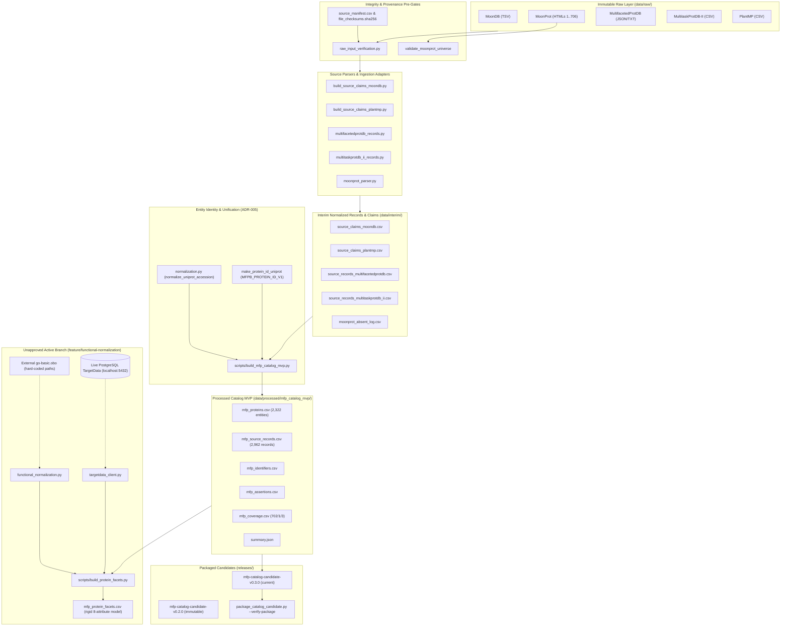

# Technical Audit Report: Specification-Driven Development (SDD), Functional Normalization, Evidence Traceability, and Scientific Roadmap Baseline

## 1. Document Control

| Attribute | Audit Record |
|---|---|
| **Document Title** | Technical Audit Report: Specification-Driven Development (SDD), Functional Normalization, Evidence Traceability, and Scientific Roadmap Baseline |
| **Audit Execution Date** | 2026-11-06 |
| **Target Repository** | `mfp-bibliography` (`/home/alexdoro/repositories/mfp-bibliography`) |
| **Current Branch** | `feature/functional-normalization` (active, tracking `origin/feature/functional-normalization`, 2 commits ahead locally) |
| **Base Commit SHA** | `9729c3c364d8b42bedf81e4dd534112b14e42b60` (`fix: resolucio completa d'alt_id a stanzas OBO de go-basic.obo (51.897 termes)`) |
| **Initial Working-Tree State** | Dirty working tree with pre-existing tracked modifications/deletions and untracked files; preserved without alteration |
| **Tracked Modifications** | ` M .gitignore` |
| **Tracked Deletions** | ` D "data/raw/plantmp/PlantMP MySQL.xlsx"`, ` D docs/bibliography/README.md`, ` D docs/bibliography/evidence-taxonomy.md`, ` D docs/bibliography/foundational-references.bib`, ` D docs/bibliography/go-annotation-evidence-contract.md`, ` D docs/bibliography/source-publications.md` |
| **Untracked Files** | 20 primary literature PDF files under `docs/bibliography/`; `docs/roadmap/core/Pla de recerca de l'experiment sobre MFPData.md`; `docs/roadmap/core/experiment-guio-v2.md`; `docs/roadmap/core/experiment_guio_v1.md` |
| **Audit Mode** | Read-only static inspection with one authorized write exception: creating this audit report |
| **Production Language** | English (per user-defined language policy; existing multilingual citations preserved verbatim with English contextualization) |
| **Scope & Limitations** | Static inspection of tracked and untracked repository artifacts, Git history, schemas, tests, scripts, and documentation. No execution of tests, pipelines, database queries, network requests, or scientific computations was performed. |
| **Approval Status** | Technical and scientific audit recommendations for human decision support; **NOT** an approved implementation or architectural change. |

---

## 2. Executive Summary

### 2.1 Current Readiness Assessment
The `mfp-bibliography` repository displays a stark architectural bifurcation between an exceptionally well-engineered, specification-driven catalog foundation and an unapproved, heuristically fragile functional-normalization branch:

1. **Catalog Ingestion & Provenance Foundation (High Readiness)**:
   The five-source catalog pipeline (`MoonDB`, `MoonProt`, `MultifacetedProtDB`, `MultitaskProtDB-II`, `PlantMP`) is mature, byte-reproducible, and governed by strict Specification-Driven Development (SDD) practices. The current candidate release `releases/mfp-catalog-candidate-v0.3.0/` encapsulates 2,962 source records, 2,322 canonical protein entities, and 463 cross-source shared accessions under deterministic identifier scheme `MFPB_PROTEIN_ID_V1` (ADR-005). Offline validation (`PACKAGE_VERIFY`) passes cleanly without network access or live databases.
2. **Functional Normalization & Evidence Traceability (Low Readiness / High Risk)**:
   The recent unmerged commits on `feature/functional-normalization` (`src/mfp_bibliography/functional_normalization.py`, `targetdata_client.py`, and `scripts/build_protein_facets.py`) introduce an unapproved, rigid 2-facet model (`BP1/MF1/CC1/PMID1` vs `BP2/MF2/CC2/PMID2`). This implementation violates core repository governance by employing ad-hoc regex keyword matching (e.g., regex `nucleus` $\to$ `GO:0005634`), arbitrarily assigning unmatched Cellular Component (CC) annotations to "canonical" facets, relying on hard-coded external filesystem paths (`/home/alexdoro/.../go-basic.obo`), and depending on unmocked live PostgreSQL database connections (`TargetDataClient`). It lacks formal JSON Schemas, ADRs, or acceptance criteria.
3. **Scientific Roadmap & Document Authority (Transitional / Unapproved)**:
   The primary candidate for the experimental roadmap, `docs/roadmap/core/experiment-guio-v2.md` (PEC-EXP-001, v0.2.1, 2026-11-06), represents an ambitious proposal integrating six experimental blocks (B1–B6) with a newly added data-preparation block (B0), spanning 11 objectives (O1–O11), 10 hypotheses (H1–H10), 6 research questions from the research plan, and 29 open decisions (DEC-01 to DEC-29). However, **it is explicitly marked as an unapproved proposal** ("Estat: Proposta de revisió; no aprovada per a execució completa"). Decision Gate G0 has not been formally approved. Furthermore, earlier decisions such as [ADR-007](file:///home/alexdoro/repositories/mfp-bibliography/docs/decisions/ADR-007-v1-scope-descope-bibliographic-relations.md) formally excluded bibliographic relations and external GO enrichment from the initial catalog milestone.

### 2.2 Main Blockers
- **Blocker 1 (Scientific Scope & Authority Conflict - P0)**: No formal human approval exists for `experiment-guio-v2.md` or its Decision Gate G0. ADR-007 explicitly descoped bibliographic relations from the catalog baseline, while `experiment-guio-v2.md` assumes an extensive multi-tier crosswalk (`DA2`), independent ground-truth seed (`DA3`), and relational triplet contexts without approved schemas.
- **Blocker 2 (Fragile Heuristic Normalization & External Path Coupling - P0)**: The active implementation in `src/mfp_bibliography/functional_normalization.py` hard-codes absolute paths to peer repositories outside the workspace (`/home/alexdoro/repositories/mfp-dataset-designer/go-basic.obo`), requires a live PostgreSQL instance with default credentials (`usuario:clave`), and uses unvalidated keyword regexes to synthesize GO annotations, violating scientific auditability.
- **Blocker 3 (Unmanaged Runtime & Scientific Dependencies - P1)**: `pyproject.toml` and `uv.lock` declare only minimal development dependencies (`jsonschema`, `pytest`, `pyyaml`). Essential runtime libraries for GO DAG navigation (`goatools`), database connectivity (`psycopg2`), and scientific computation (`numpy`, `scipy`) are entirely omitted from repository dependency specifications.
- **Blocker 4 (Linguistic Fragmentation & Document Drift - P1)**: Critical scientific roadmaps are split across Spanish (`docs/roadmap/01`–`07`, `experiment_guio_v1.md`) and Catalan (`experiment-guio-v2.md`, `Pla de recerca`), while catalog governance, schemas, source profiles, and code docstrings are in English. This fragmentation obscures traceability and creates terminology confusion (e.g., "Q1–Q6" meaning catalog descriptive questions in English docs vs GO evidence questions in Catalan plans).

### 2.3 Existing Strengths
- **Strict Provenance & Immutability**: All raw artifacts under `data/raw/` are tracked by SHA-256 manifests (`data/manifests/source_manifest.csv`), with automated pre-build gates (`raw_input_verification.py`) failing closed on byte tampering.
- **Deterministic Entity Identity**: Accession normalization and protein hashing under `MFPB_PROTEIN_ID_V1` prevent collision and ensure deterministic foreign keys across all downstream tables.
- **Exemplary Historical Audits**: Prior audits (`MFP_DATA_AUDITABILITY_MATRIX.md` and `MFP_EXTRACTION_UNIFICATION_AUDIT.md`) accurately diagnosed systemic vulnerabilities (such as the total loss of `NOT` qualifiers in upstream QuickGO extraction and the phantom dependency on `CBBIO.GO`).

### 2.4 Immediate Recommended Next Action
Convene a formal human decision gate to review and approve **Decision Gate G0**:
1. Officially delimit the scientific boundary of `mfp-bibliography` vs downstream modeling.
2. Formally approve a staged, specification-based functional-normalization pilot on a constrained 50-protein consensus cohort.
3. Replace the heuristic 2-facet model with an auditable, multi-claim relational model adhering to [ADR-004](file:///home/alexdoro/repositories/mfp-bibliography/docs/decisions/ADR-004-evidence-label-benchmark-separation.md) and [ADR-007](file:///home/alexdoro/repositories/mfp-bibliography/docs/decisions/ADR-007-v1-scope-descope-bibliographic-relations.md).

---

## 3. Method and Inspection Coverage

### 3.1 Documents, Schemas, and Code Inspected
The audit conducted static line-by-line and structural inspection across the following repository artifacts:
- **Governance & ADRs**: `project-charter.md`, `canonical-schema.md`, `data-governance.md`, `effective-status-contract.md`, `reconciliation-baseline-contract.md`, `source-catalog.md`, `source-policy.md`, `source-claim-policy.md`, `source-claims-contract.md`, `release-policy.md`, `ADR-001` through `ADR-007`.
- **Roadmap & Scientific Plans**: `experiment-guio-v2.md` (v0.2.1), `experiment_guio_v1.md` (v0.1.0), `Pla de recerca de l'experiment sobre MFPData.md`, `01_dossier_experimento.md` through `07_plan_implementacion_y_validacion.md`, `mfp-catalog-implementation-plan.md`, `MFP_BIBLIOGRAPHIC_MVP_ROADMAP.md`.
- **Architecture & Traceability**: `docs/architecture/data-flow.md`, `docs/architecture/requirements-traceability.md`.
- **Audits & Releases**: `MFP_DATA_AUDITABILITY_MATRIX.md`, `MFP_EXTRACTION_UNIFICATION_AUDIT.md`, `docs/releases/*.md`, `releases/mfp-catalog-candidate-v0.2.0/`, `releases/mfp-catalog-candidate-v0.3.0/`.
- **Source Code**: All modules in `src/mfp_bibliography/` (including `normalization.py`, `moonprot_parser.py`, `functional_normalization.py`, `targetdata_client.py`, `raw_input_verification.py`, `validation.py`, `analysis_q1.py` through `q6.py`).
- **Tests & Scripts**: All test suites in `tests/` (`test_catalog_candidate.py`, `test_candidate_package_verify.py`, `test_functional_normalization.py`, etc.) and all entry points in `scripts/`.
- **Configuration & Schemas**: `pyproject.toml`, `uv.lock`, `.github/workflows/ci.yml`, `configs/source_claim_policy_v0.1.yaml`, `data/curated/*.schema.json`.

### 3.2 Inspection Commands Used
- Git plumbing and porcelain inspection: `git rev-parse`, `git branch`, `git status`, `git log`, `git diff --stat`, `git ls-files`.
- Structural discovery: `find`, `ls -la`.
- Targeted pattern searches: `grep -rn`.
- Content reading: `read_file` tool calls without shell code execution.

### 3.3 Material Not Inspected and Justification
- **Raw PDFs under `docs/bibliography/`**: 20 primary research papers were verified by file existence, size, and naming, but not subjected to text mining or PDF parsing.
- **Binary/Legacy Datasets**: `PlantMP MySQL.xlsx` (tracked deletion), raw HTMLs in `data/raw/moonprot/` (sampled via fixtures).
- **Live Databases**: No connection was initiated to local or remote PostgreSQL servers (`TargetData`, `BioData`, `MFPUniProtData`).
- **External Repositories**: Peer paths (`/home/alexdoro/repositories/BioData`, `/mfp-dataset-designer`, `/FANTASIA`) were inspected only for path existence, not content-audited.

---

## 4. Repository and Agent-Instruction Baseline

### 4.1 Repository State
- **Root Path**: `/home/alexdoro/repositories/mfp-bibliography`
- **Current Git Branch**: `feature/functional-normalization`
- **Head Commit SHA**: `9729c3c364d8b42bedf81e4dd534112b14e42b60`
- **Remote Tracking**: `origin/feature/functional-normalization` (local branch is ahead by 2 commits: `5de9d3c` and `9729c3c`).
- **Pre-existing Working-Tree Modifications**:
  - Tracked modifications in `.gitignore` (ignoring `/analysis/` and `/bibliography/`).
  - Tracked deletions in `data/raw/plantmp/PlantMP MySQL.xlsx` and several files in `docs/bibliography/` (`README.md`, `evidence-taxonomy.md`, `foundational-references.bib`, `go-annotation-evidence-contract.md`, `source-publications.md`).
  - Untracked literature PDFs and roadmap drafts.
  - *All pre-existing user modifications were strictly preserved.*

### 4.2 Agent Instruction Discovery and Audit
A thorough inspection of repository configuration revealed:
- **No in-repository agent instruction files**: Files such as `AGENTS.md`, `GEMINI.md`, `.cursorrules`, `.windsurfrules`, `.clinerules`, or a project-level `.gemini/` directory **do NOT exist** within the repository workspace.
- **External User Rules**: Active agent rules are loaded exclusively from user-level global configuration (`/home/alexdoro/.gemini/config/plugins/science/rules/AGENTS.md`), which enforces priority for interactive science sidecars (e.g., Mol* biomolecular viewers). No sidecar tools are required or invoked for this textual and schema audit.
- **Agent Workflow Implications**: Without an in-repository agent guideline or entry-point specification, external agents entering this repository lack explicit authority boundaries, contribution conventions, and decision-gate rules unless manually directed.

---

## 5. Current Architecture and Data-Flow Map

### 5.1 Architecture Mermaid Diagram



### 5.2 Architecture and Component Boundary Narrative
The repository architecture is divided into two distinct operating regimes:
1. **Verified Core Pipeline (Steps 1–6)**:
   - **Acquisition & Freezing**: Raw artifacts are preserved under `data/raw/`. External acquisition scripts (`acquire_moonprot_batch.py`) are strictly decoupled from offline builds.
   - **Pre-build Gate Verification**: `raw_input_verification.py` verifies the SHA-256 digests of all consumed raw files against `data/manifests/source_manifest.csv` and `data/raw/moonprot/artifact_index.csv`. Any byte alteration halts execution immediately.
   - **Source Claim & Record Extraction**: Specialized parsers extract tabular source claims (`source_claims_*.csv`) and source records without data loss. Unresolved claims are assigned explicit policy markers (`excluded_likely`, `predicted`, `unresolved`).
   - **Deterministic Entity Resolution**: Accessions are canonicalized via `normalize_uniprot_accession()`, and SHA-256 digests generate deterministic IDs (`MFP:U:<16hex>`) under `MFPB_PROTEIN_ID_V1` (ADR-005). Merging is restricted to exact UniProt accession equality.
   - **Catalog Packaging & Offline Verification**: `scripts/package_catalog_candidate.py` packages the outputs into `releases/mfp-catalog-candidate-v0.3.0/` with cryptographic manifests, verified offline via `--verify-package`.
2. **Unapproved Functional Normalization Overlay**:
   - `scripts/build_protein_facets.py` imports `src/mfp_bibliography/functional_normalization.py` and `targetdata_client.py` to synthesize an 8-attribute representation (`BP1, MF1, CC1, PMID1` vs `BP2, MF2, CC2, PMID2`).
   - This overlay bypasses catalog verification gates, relies on external filesystem paths, makes live calls to a PostgreSQL server, and writes unvalidated CSVs directly into `data/processed/mfp_catalog_mvp/`.

---

## 6. Scientific Document Authority and Version Comparison

### 6.1 Status and Authority of `experiment-guio-v2.md`
- **Location**: `docs/roadmap/core/experiment-guio-v2.md`
- **Metadata**: Document ID `PEC-EXP-001`, Edition `0.2.1 — reconstrucció descarregable`, Date `2026-11-06`, Language: Catalan.
- **Formal Status**: **Unapproved Proposal** ("Estat: Proposta de revisió; no aprovada per a execució completa").
- **Document History**: Edition 0.2.1 reconstructs a lost temporary draft (0.2.0) by integrating `experiment_guio_v1.md` (Annex A) and `Pla de recerca de l'experiment sobre MFPData.md` (Annex B).
- **Authority Ruling**: While `experiment-guio-v2.md` is the primary candidate for future research planning, **it does not supersede existing repository ADRs, contracts, or release policies**. Under repository governance, an unapproved proposal cannot authorize architectural refactoring, dependency changes, or scientific execution.

### 6.2 Cross-Document Version Comparison

| Domain | `experiment_guio_v1.md` (v0.1.0, 2026-10-27) | `Pla de recerca` (v0.1, 2026-11-06) | `experiment-guio-v2.md` (v0.2.1, 2026-11-06) | Approved Repository Contracts & ADRs |
|---|---|---|---|---|
| **Experimental Scope** | Blocks B1–B6 (Corpus, Sensitivity, Divergence, Association, Reference, Curation); Extensions E1 (PCA), E2 (UMAP). | Focus on RAW vs QuickGO vs local database crosswalk; simple vs triplet distances; accession-only analysis. | Blocks B0–B6: adds B0 (RAW, claims, crosswalk, GT seed) to B1–B6; retains E1–E2. | ADR-001 restricts repository scope to source evidence; ADR-007 formally descopes bibliographic relations from v1. |
| **Data Inputs** | PIS acquisition $\to$ PostgreSQL `TargetData` and `BioData` $\to$ CBBIO Python API. | Six local RAW directories (716 files); PostgreSQL `MFPUniProtData` (2,182 proteins); `BioData` (137,213 proteins). | Integrates local RAW (716 files), target database, QuickGO/GOA via PIS, and BioData reference snapshot. | 5 local raw sources; candidate catalog v0.3.0 (2,322 entities); external DBs unverified in CI. |
| **Evidence Layers** | 3 candidate layers (A: All, B: Conventional Exp, C: Extended Exp). | 5 layers: A (All), B (Exp), C (Exp+HTP), D (Author/Curator), E (Non-IEA). | 5 layers: A (`ALL_ELIGIBLE`), B (`EXP_CONVENTIONAL`), C (`EXP_EXTENDED`), D (`EXP_CURATOR_AUTHOR`), E (`NON_IEA`). | `source-claim-policy.md` (curated, predicted, excluded_likely, unresolved). GO layers documented only (R14-R17). |
| **RCA Evidence Code** | Mentioned in passing; not specifically analyzed. | 176 rows observed in PostgreSQL appendix; noted as review-pending. | **Explicit rectification**: RCA is retained in profile and eligible in Layer A; previous exclusion reversed. | Not addressed in ADRs; documented in v2 decision DEC-29. |
| **Functional Divergence** | Intra-protein MF–MF primary; Wang baseline ($D_p$); MBL, Lin, Resnik, Schlicker secondary; GeOKG-GO. | Simple annotation vs contextual triplets; BP and MF divergence; PrOnto co-occurrence. | MF–MF primary; BP–BP secondary; simple vs triplet contrast; Wang baseline; GeOKG conditioned on contract. | Inexecutable in `mfp-dataset-designer` (phantom `CBBIO.GO`); unapproved in `mfp-bibliography`. |
| **Triplet Definition** | Not formalized; focuses on term-level pairs. | Mentions "tripletes" without formal syntax or relation semantics. | Proposes $\tau_k = (m_k, b_k, c_k)$ as an explicit open decision (DEC-22/23) requiring Gate G2 approval. | No relational triplet schema exists in `data/curated/`. Current code uses ad-hoc 2-facet record. |
| **Association (MF–CC)** | NPMI candidate between MF and CC co-annotations; reference profile from BioData. | CC association with divergent functions; enrichment analysis. | Retains NPMI candidate for MF–CC; adds BP–CC and enrichment of CC in divergent pairs (B4). | Not implemented in repository. Prior audit warns against equating co-annotation with colocalization. |
| **Reference Population** | `BioData_reference` as contextual population; explicitly **NOT** a negative class. | `BioData` (137,213 proteins) matched by length and taxonomy. | Retains BioData as contextual reference; strictly prohibits treating BioData as NMF or verified negative. | Charter & ADR-001/004: MF-only catalog; no NMF/negative class or benchmark roles without approval. |
| **Curation Strategy** | Single curation stage at B6 consuming metric outputs. | Independent seed of well-annotated proteins prior to scores. | Two-stage curation: B0.5 (`MFP_GroundTruthSeed` before scores) + B6 (final review consuming descriptors). | Manual curation protocol outlined in `06_manual_revision_bibliografica.md` (unapproved draft). |
| **Decision Gates** | 6 gates (G0–G5); DEC-01 to DEC-17. | Unstructured validation milestones. | 6 gates (G0–G5); expands decisions to DEC-01 through DEC-29. | Roadmap milestones tracked in `mfp-catalog-implementation-plan.md`. |

### 6.3 Scientific Safeguards and Guardrail Enforcement
The audit confirms that `experiment-guio-v2.md` explicitly respects key epistemological boundaries, which must be strictly maintained in future SDD specifications:
- **BioData is NOT a verified negative class**: It serves solely as a reference distribution for background term frequencies and information content (IC).
- **Annotation count does not equal biological multifunctionality**: Differences in annotation density reflect historical research bias and funding allocation rather than biological complexity.
- **A high divergence score is NOT proof of moonlighting**: Dissimilarity metrics measure ontology graph distance, not biochemical autonomy.
- **Functional normalization is NOT classifier training**: The repository must not construct training matrices or pseudo-negative classes under the guise of normalization.

---

## 7. Functional Normalization and Evidence-Traceability Assessment

### 7.1 Metadata Preservation and Loss Matrix

| Dimension | Ingested Catalog (`mfp_catalog_mvp`) | Active Branch (`functional_normalization.py`) | Upstream Database (`BioData`/`TargetData`) | Evaluation / Traceability Status |
|---|---|---|---|---|
| **Protein Identity** | Preserved via UniProt accession & deterministic `protein_id` | Preserved via `canonical_uniprot_accession` & `protein_id` | Truncated: `protein.id` uses Swiss-Prot entry names (e.g. `P53_HUMAN`), losing 148 TrEMBL accessions | **Partial**: Full in catalog; degraded in external DB. |
| **Source Record Identity** | Fully preserved in `mfp_source_records.csv` (`source_record_id`) | Preserved as string in `source_record_id` | Lost: External DB stores no catalog `source_record_id` | **Supported** in catalog; unlinked in database. |
| **Raw Functional Statements** | Verbatim text preserved in source records / claims | Stored as flattened strings in `func1_desc`, `func2_desc` | Lost: Only structured GO term descriptions stored | **Partial**: Catalog preserves raw text; facet model forces 2-way split. |
| **Distinct Functional Claims** | Multiple rows per protein preserved in `source_claims` | **Destroyed**: Collapsed into 2 fixed slots (Facet 1 vs 2) | Lost: Database flattens all annotations per protein | **Defect (P0)**: Forces multi-claim proteins into binary slots. |
| **Bibliographic References** | MultitaskProtDB-II PMIDs preserved; others unmapped | Stored as semicolon-delimited PMIDs in `pmid1`, `pmid2` | Truncated: QuickGO extractor retains only 1st PMID; non-PMIDs set to `NULL` | **Defect (P1)**: Multi-PMID truncation in DB; unlinked in facet model. |
| **GO Identifiers & Aspects** | Verbatim GO strings preserved in raw columns | Canonicalized to `GO:XXXXXXX`; partitioned into BP/MF/CC | Stored in `go_terms` (`go_id`, `category`, `description`) | **Supported** in normalization; ontology aspect verified via OBO. |
| **GO Evidence Codes** | Verbatim raw strings preserved where provided | **Lost**: Facet model discards evidence codes entirely | Stored in `protein_go_term_annotation.evidence_code` | **Defect (P0)**: Cannot evaluate Evidence Layers A–E in facet table. |
| **Qualifiers & Negations (`NOT`)** | Verbatim text preserved in raw source strings | **Lost**: Facet model contains no qualifier field | **Critical Loss**: Upstream QuickGO extractor ignored `qualifier`; `NOT` saved as positive | **Critical Flaw (P0)**: Inherited from PIS ingestion; unaddressed in branch. |
| **Mapping Method & Lineage** | Explicit `transformation_id` per record | Comma-delimited notes in `resolution_sources` | Untracked in database tables | **Partial**: String list lacks structured schema validation. |
| **Ambiguity & Missingness** | Explicit `record_status` (`valid`, `incomplete`, etc.) | String `facet_status` (`resolved`, `partial`, `unassigned`) | `publication_id` nullable; no status column | **Partial**: Ad-hoc status vocabulary unbacked by schema. |

### 7.2 Explicit Seven-Level Evidence Distinction
To ensure scientific interpretability, future SDD specifications must rigorously differentiate between seven epistemological levels:
1. **Source Database Claim**: A raw statement recorded by an external catalog (e.g., PlantMP declaring `canonical_function_bp = "photosynthesis"`).
2. **Primary Literature Claim**: An experimental finding reported in a peer-reviewed publication (e.g., PMID:12345678 asserting uracil DNA glycosylase activity).
3. **Normalized Functional Representation**: An auditable, structured internal record linking a protein entity to a specific functional role without loss of multiplicity.
4. **Externally Retrieved GO Annotation**: A public assertion retrieved from QuickGO/GOA containing GO ID, aspect, evidence code, qualifier, and assigned-by provenance.
5. **Proposed Mapping (Crosswalk)**: A rule-based or curated correspondence between a source text claim and a standard GO term (e.g., mapping EC 1.2.1.12 to `GO:0004365`).
6. **Computational Descriptor**: A numerical value computed over normalized annotations (e.g., Wang semantic distance, NPMI association score).
7. **Human Curation Decision**: An authoritative, signed, and versioned judgment adjudicating discordant claims or validating an independent ground-truth seed.

### 7.3 Critical Flaws in Current Facet Normalization Implementation
Inspection of `src/mfp_bibliography/functional_normalization.py` (lines 144–726) reveals four severe architectural defects:
1. **Rigid Binary Procrustean Bed**: The dataclass `ProteinFacetsRecord` hard-codes exactly two facets (`bp1/mf1/cc1/pmid1` and `bp2/mf2/cc2/pmid2`). Proteins exhibiting three or more distinct functions (common in MultifacetedProtDB and MoonProt) cannot be represented without data loss. Furthermore, 851 mono-source proteins from MultifacetedProtDB are discarded as `unassigned_mono_source`.
2. **Unvalidated Keyword Heuristics**: The function `extract_cellular_components_from_text()` (lines 144–165) uses regular expressions to match English words (e.g., `nucleus`, `cytoplasm`, `plasma membrane`) and automatically assigns GO-CC identifiers (`GO:0005634`, `GO:0005737`, `GO:0005886`). This ad-hoc text-mining rule bypasses formal ontology mapping and lacks precision benchmarking.
3. **Arbitrary Compartment Assignment**: In `normalize_plantmp_record()` (lines 234–239) and `normalize_moondb_record()` (lines 691–700), if a protein lacks a CC term in the source, the code queries TargetData and arbitrarily assigns unmatched CC terms to `cc1` (canonical cellular component). This directly violates the scientific rule: **co-annotation of a function and a compartment to the same protein does NOT prove that the function operates in that compartment**.
4. **Conflation of Predictions and Curated Evidence**: MoonDB EMF entries (which are purely computational predictions) are mapped to `bp1/bp2` and given `facet_status = "resolved"`, erasing the distinction between experimental facts and algorithmic predictions.

---

## 8. Engineering, Tests, and Reproducibility Assessment

### 8.1 Dependency Declarations and Runtime Constraints
- **Declared Dependencies (`pyproject.toml`)**:
  - Build system: `setuptools>=68`, `wheel`.
  - Core dependencies: `jsonschema>=4.22.0`.
  - Optional dev dependencies: `pytest>=8.2.0`, `pyyaml>=6.0`.
- **Lockfile (`uv.lock`)**: Contains 14 packages strictly corresponding to `jsonschema`, `pytest`, `pyyaml`, and their packaging sub-dependencies.
- **Omitted Dependencies**: `psycopg2` (or `psycopg2-binary`), `goatools`, `pandas`, `numpy`, `scipy`, `statsmodels`, `umap-learn`, `scikit-learn` are **completely absent** from `pyproject.toml` and `uv.lock`.
- **Engineering Risk**: Running `scripts/build_protein_facets.py` or importing `TargetDataClient` in an environment built strictly from `uv.lock` or `pyproject.toml` will fail immediately with `ModuleNotFoundError` unless external, untracked packages are manually installed.

### 8.2 Runtime Assumptions and Hard-Coded Paths
- **External Filesystem Coupling**: `src/mfp_bibliography/functional_normalization.py` lines 21–25 define:
  ```python
  DEFAULT_OBO_PATHS = (
      Path("/home/alexdoro/repositories/mfp-dataset-designer/go-basic.obo"),
      Path("/home/alexdoro/repositories/BioData/notebooks/data/go-basic.obo"),
      Path("/home/alexdoro/repositories/FANTASIA/go-basic.obo"),
  )
  ```
  These paths point outside the repository workspace to personal directories. In a containerized runner, remote server, or clean clone, these paths do not exist, causing OBO loading to fail silently and return empty dictionaries.
- **Local Database Dependency**: `src/mfp_bibliography/targetdata_client.py` defaults to `localhost:5432`, database `TargetData`, user `usuario`, password `clave`. No mock database or SQLite fallback is provided for non-networked environments.

### 8.3 Test Organization and CI Verification
- **Continuous Integration (`.github/workflows/ci.yml`)**:
  - Runs on `ubuntu-latest` with Python 3.11.
  - Executes `pytest` and `python scripts/validate_repository.py`.
  - Does **not** spin up a PostgreSQL service container.
- **Test Suite Status**:
  - `tests/test_functional_normalization.py` passes in CI only because all tests either use in-memory dictionaries or mock `TargetDataClient`. When `load_obo_aspects()` fails to find a local `.obo` file, it returns an empty dictionary, and the tests silently skip assertions.
  - The repository's core tests (`test_raw_input_verification.py`, `test_candidate_package_verify.py`, `test_catalog_integrity.py`) provide robust offline verification of the packaged catalog candidates.

---

## 9. SDD and Agent-Readiness Assessment

### 9.1 Evaluation of Repository Agent Readiness

| SDD Dimension | Evaluation | Evidence in Current Repository | Gap / Architectural Risk |
|---|---|---|---|
| **Agent Entry Point** | **Missing** | No `AGENTS.md` or `GEMINI.md` in repository root. | Agents lack automated guidance regarding write boundaries and project rules. |
| **Document Authority** | **Ambiguous** | `experiment-guio-v2.md` labeled draft, but newer than ADRs. | Risk of agents treating draft proposals as authorization to modify code. |
| **Explicit Approval Gates** | **Documented Only** | G0–G5 defined in `experiment-guio-v2.md`; ADR gates in contracts. | Gates exist as narrative descriptions, not machine-enforceable checks. |
| **Input/Output Contracts** | **Mixed** | High for catalog (`source_claims.schema.json`); None for facets. | Functional normalization has no schema in `data/curated/`. |
| **Traceability to Questions** | **Partial** | Traceability matrix links R1–R21 to ADRs; R14–R17 are future. | Scientific questions Q1–Q6 from v2 roadmap lack traceability rows. |
| **Change Control** | **Supported** | Append-only raw policy, deterministic IDs, semantic commits. | Facet branch introduced major changes without updating ADRs or roadmap. |

### 9.2 Minimal Pragmatic SDD Workflow
To prevent architectural drift and ensure that scientific coding remains verifiable, all future modifications must follow an eight-stage lifecycle:

```
[Scientific Question / Hypothesis]
       │
       ▼
[Approved Decision (ADR / Gate Approval)]
       │
       ▼
[Formal Specification (Markdown Contract + JSON Schema)]
       │
       ▼
[Implementation Plan & Scoped Tasks (WBS)]
       │
       ▼
[Implementation (Isolated Modules & Offline Tests)]
       │
       ▼
[Automated Verification (pytest + validate_repository.py)]
       │
       ▼
[Independent Human Review & Sign-off]
       │
       ▼
[Release Tagging & Manifest Freeze]
```

### 9.3 Task Allocation Across Reasoning Settings
For autonomous or assisted development using Gemini 3.8 Flash, tasks should be partitioned by reasoning complexity:

| Reasoning Setting | Scope of Responsibility | Typical Tasks | Safeguards & Constraints |
|---|---|---|---|
| **Gemini 3.8 Flash (High)** | Architectural design, scientific formalization, audit synthesis, schema creation. | Drafting ADRs; formulating JSON Schemas; authoring formal pilot specifications; cross-document reconciliations. | Must not perform automated refactoring without prior human sign-off; read-only default. |
| **Gemini 3.8 Flash (Medium)** | Deterministic pipeline implementation, adapter coding, test suite expansion. | Writing pure Python parsers; implementing schema validation checks; constructing pytest suites with offline fixtures. | Strictly constrained to write boundaries defined in implementation plans; must maintain 100% offline testability. |
| **Gemini 3.8 Flash (Low)** | Deterministic aggregation, formatting, documentation synchronization, packaging. | Running checksum verification scripts; generating markdown summary tables from JSON outputs; formatting docstrings; linting. | No architectural changes; fail-closed on data mismatches. |

---

## 10. Language-Consistency Audit and Proposed English Migration

### 10.1 Repository Language Inventory

| Artifact Category | Inspected Scope | Observed Language | Evaluation & Evidence |
|---|---|---|---|
| **Scientific Roadmap** | `docs/roadmap/core/` | Catalan / Spanish / English | `experiment-guio-v2.md` (Catalan; Annex A Spanish, Annex B Catalan); `experiment_guio_v1.md` (Spanish); `Pla de recerca` (Catalan); `mfp-catalog-implementation-plan.md` (English). |
| **Detailed Roadmap** | `docs/roadmap/01`–`07` | Spanish | `01_dossier_experimento.md` through `07_plan_implementacion_y_validacion.md` written in formal Spanish. |
| **Contracts & ADRs** | `docs/`, `docs/decisions/` | English | All 7 ADRs, `project-charter.md`, `canonical-schema.md`, `source-claims-contract.md`, `release-policy.md` in English. |
| **Architecture** | `docs/architecture/` | English | `data-flow.md` and `requirements-traceability.md` strictly in English. |
| **Audits (Historical)** | `docs/audits/` | Catalan / Mixed | `MFP_DATA_AUDITABILITY_MATRIX.md` and `MFP_EXTRACTION_UNIFICATION_AUDIT.md` in Catalan with English terms. |
| **Source Code** | `src/mfp_bibliography/` | English (Code) / Catalan (Commits) | All identifiers, docstrings, and logic in English; git commit messages on feature branch in Catalan (`feat: afegeix...`). |
| **Tests & Scripts** | `tests/`, `scripts/` | English | All test functions, assertions, and script CLI parsers in English. |
| **Data Schemas** | `data/curated/*.json` | English | All schema keys, descriptions, and titles in English. |
| **Raw Datasets** | `data/raw/` | English / Mixed | Field headers in raw files are source-native (e.g. `PlantMP MySQL-confirmed .csv` has Spanish/English mixed names). |

### 10.2 Terminology Drift and False Equivalences
- **"Q1–Q6" Polysemy**: In `docs/analysis/five-source-descriptive-study-plan.md` and `src/mfp_bibliography/analysis_q1.py`–`q6.py`, Q1–Q6 refer to **catalog descriptive statistics** (records vs entities, source overlap, sources per protein, MoonProt coverage, status labels, field completeness). In `Pla de recerca` and `experiment-guio-v2.md`, Q1–Q6 refer to **GO annotation evidence and semantic divergence questions**. This collision causes confusion in task assignments.
- **"TargetData" vs "MFPUniProtData" vs "BioData"**: Historical documents use `TargetData`, `MFPUniProtData`, and `MFP_UniProtData` interchangeably to designate the positive multifunctionality cohort, while `BioData` is used both as the name of the reference database and the CBBIO client library.
- **"Moonlighting" vs "Multifunctional"**: Spanish and Catalan drafts occasionally conflate moonlighting (a specific biological mechanism involving autonomous, non-overlapping functions performed by a single polypeptide) with general multifunctionality (which can include pleiotropy, promiscuity, or multi-domain enzymes).

### 10.3 Staged English-Convergence Plan
The transition to English as the scientific and technical production language must proceed without rewriting history or breaking references:

```
[Stage 1: Production Freeze (Immediate)]
  - All new specifications, schemas, ADRs, and audit reports written strictly in English.
  - Raw source claims and bibliographic quotes preserved verbatim in original language.

[Stage 2: Core Active Governance Convergence (Prior to Pilot)]
  - Create English-language AGENTS.md entry point.
  - Translate and formalize active experiment specification (PEC-EXP-001 v2) into an English SDD contract.
  - Consolidate terminology glossary in English.

[Stage 3: Maintained Developer Documentation (During Pilot)]
  - Align test docstrings, script help text, and release documentation to English.
  - Transition all Git commit messages to Conventional Commits in English.

[Stage 4: Path & Artifact Harmonization (Post-Release / Non-Breaking)]
  - Audit and normalize non-standard raw filenames (e.g., spaces and trailing spaces in PlantMP CSVs)
    using versioned deprecation aliases without breaking existing checksum manifests.
```

### 10.4 English Terminology Glossary

| Canonical English Term | Source Languages Observed | Precise Operational Definition | Prohibited Usage / Invalidation Rule |
|---|---|---|---|
| **Protein Entity** | *Entitat proteica* (CA) / *Proteína canónica* (ES) | A unique biological entity identified by a canonical UniProtKB accession (`MFP:U:<16hex>`) or fallback (`MFP:F:<src>:<16hex>`). | Must not be conflated with a source record (which is one observation in a source artifact). |
| **Source Record** | *Registre de font* (CA) / *Registro fuente* (ES) | A single row or entry extracted from a specific raw source artifact with full provenance locators. | Must not be counted as an independent protein entity. |
| **Source Claim** | *Afirmació de font* (CA) / *Reclamación fuente* (ES) | A native assertion regarding protein category, function, or status exactly as reported by the source database. | Must not be treated as repository-verified scientific truth. |
| **Functional Assertion** | *Asserció funcional* (CA) / *Aserción funcional* (ES) | A normalized association between a protein entity and a functional concept (GO term, EC number, or structured claim). | Must not be derived without explicit mapping provenance. |
| **Evidence Statement** | *Evidència documental* (CA) / *Evidencia* (ES) | The empirical basis supporting an assertion, including GO evidence code, ECO code, literature reference (PMID/DOI), or curator decision. | Absence of experimental evidence must never be equated to absence of function. |
| **Reference Population** | *Població de referència* (CA) / *Población de referencia* (ES) | A background dataset (e.g. BioData snapshot) used to establish baseline term frequencies and information content. | **Must NEVER be treated as a negative control class (NMF)**. |
| **Functional Triplet** | *Tripleta funcional* (CA) / *Triplete contextual* (ES) | A contextual unit $\tau = (\text{MF}, \text{BP}, \text{CC})$ where all three aspects are demonstrated by evidence to occur in the same biological event. | Must not be synthesized by Cartesian product of unlinked co-annotations. |

---

## 11. Consolidated Findings Register

| Finding ID | Category | Description | Evidence Status | Repository Path & Symbol | Impact | Recommendation | Human Approval | Priority | Blocker? |
|---|---|---|---|---|---|---|---|---|---|
| **AUD-A01** | Scope | `experiment-guio-v2.md` is an unapproved draft; conflicts with ADR-007 descope. | Observed in documentation | `docs/roadmap/core/experiment-guio-v2.md:10` | Unclear repository mandate; risk of implementing out-of-scope tasks. | Formalize Decision Gate G0 to establish authorized experimental scope. | Required | P0 | **Yes** |
| **AUD-A02** | Architecture | Rigid 2-facet model collapses multi-claim proteins and discards 851 entries. | Observed in current code | `src/mfp_bibliography/functional_normalization.py:168-195` | Scientific misrepresentation; destroys multifunctionality multiplicity. | Replace `ProteinFacetsRecord` with a relational multi-claim model. | Required | P0 | **Yes** |
| **AUD-A03** | Architecture | Ad-hoc regex keyword matching synthesizes GO-CC terms without validation. | Observed in current code | `src/mfp_bibliography/functional_normalization.py:144-165` | Introduces unverified GO annotations into normalized records. | Remove keyword regexes; require explicit ontology crosswalk or curation. | Required | P0 | **Yes** |
| **AUD-A04** | Architecture | Unmatched TargetData CC terms arbitrarily assigned to canonical facet. | Observed in current code | `src/mfp_bibliography/functional_normalization.py:234-239` | Violates epistemological rule against inferring compartment from co-annotation. | Invalidate automated CC assignment; enforce strict evidence linkage. | Required | P0 | **Yes** |
| **AUD-A05** | Engineering | Hard-coded absolute paths to external repositories for `go-basic.obo`. | Observed in current code | `src/mfp_bibliography/functional_normalization.py:21-25` | Fatal dependency failure in clean clone, CI runner, or container. | Vendor or pin a versioned OBO snapshot under `data/raw/ontology/`. | Required | P0 | **Yes** |
| **AUD-A06** | Engineering | Undeclared runtime dependencies (`psycopg2`, `goatools`) in `pyproject.toml`. | Observed in current code | `pyproject.toml:12-20`, `uv.lock` | Pipeline fails to execute in standard virtualenv built from project files. | Add scientific dependencies under optional dependency group in `pyproject.toml`. | Required | P1 | **Yes** |
| **AUD-A07** | Engineering | Live database connection required by `TargetDataClient` without fallback. | Observed in current code | `src/mfp_bibliography/targetdata_client.py:34-45` | Breaks offline reproducibility and CI execution. | Implement offline cached fixtures for all database integration tests. | Required | P1 | No |
| **AUD-A08** | Traceability | Critical upstream loss of QuickGO `NOT` qualifiers unaddressed in branch. | Observed in audit matrix | `docs/audits/MFP_EXTRACTION_UNIFICATION_AUDIT.md:121-124` | Negative functional assertions stored as positive annotations. | Introduce `qualifier` field and filter out negated terms before analysis. | Required | P0 | **Yes** |
| **AUD-A09** | Governance | No JSON Schema for functional normalization records in `data/curated/`. | Observed in repository | `data/curated/` (schema absent) | Outputs cannot be formally validated by `validate_repository.py`. | Author and register `functional_assertions.schema.json`. | Required | P1 | No |
| **AUD-A10** | Language | In-repo agent guidance missing (`AGENTS.md` absent). | Observed in repository | Repository root (file absent) | Agents lack clear rules, write boundaries, and language policy. | Create English `AGENTS.md` with explicit SDD workflow and boundaries. | Required | P1 | No |
| **AUD-A11** | Language | Cross-language terminology collision on "Q1–Q6" descriptive vs GO analysis. | Observed in documentation | `docs/analysis/five-source-descriptive-study-plan.md` vs `experiment-guio-v2.md:73-81` | Miscommunication in task execution and metric reporting. | Rename descriptive catalog analyses to `DQ1–DQ6`; reserve `RQ1–RQ6` for GO. | Required | P2 | No |
| **AUD-A12** | Governance | Untracked research plans and PDFs in working tree risk accidental loss. | Observed in git status | `docs/roadmap/core/`, `docs/bibliography/` | Risk of accidental deletion or divergence during git branch operations. | Commit approved documents or formalize their untracked status in `.gitignore`. | Required | P1 | No |

---

## 12. Minimal Proposed SDD Artifact Map

| Artifact Name | Action | Path | Responsibility | Source of Truth | Rationale for Action | Prerequisite for Pilot? |
|---|---|---|---|---|---|---|
| **Agent Guidance Specification** | **Create** | `AGENTS.md` | Repository Maintainers | User instructions & project charter | Provides operational rules, write boundaries, and English language mandate for AI agents. | **Yes** |
| **Experimental Scope ADR** | **Create** | `docs/decisions/ADR-008-functional-normalization-pilot-scope.md` | Scientific Lead | `experiment-guio-v2.md` & Gate G0 | Formally approves the boundary of the functional-normalization pilot and resolves ADR-007 conflict. | **Yes** |
| **Functional Claims Schema** | **Create** | `data/curated/functional_claims.schema.json` | Data Architect | Contract specification | Replaces rigid 2-facet model with an auditable multi-claim JSON schema. | **Yes** |
| **Ontology Snapshot Contract** | **Create** | `docs/contracts/ontology-snapshot-contract.md` | Data Architect | Gene Ontology release metadata | Defines pinned `go-basic.obo` version, eliminating hard-coded external filesystem paths. | **Yes** |
| **Active Experiment Specification** | **Create** | `specs/SPEC-001-functional-normalization-pilot.md` | Scientific Architect | Section 13 of this audit report | Concrete, testable specification for the 50-protein pilot increment. | **Yes** |
| **Requirements Traceability Matrix** | **Extend** | `docs/architecture/requirements-traceability.md` | Data Architect | All active ADRs & specifications | Add rows R22–R26 linking pilot specifications to automated verification tests. | **Yes** |
| **Project Dependencies** | **Extend** | `pyproject.toml` | Software Engineer | Pipeline requirements | Add optional dependency group `[project.optional-dependencies] science = ["goatools", "psycopg2-binary"]`. | **Yes** |
| **Terminology Glossary** | **Create** | `docs/terminology-glossary.md` | Scientific Lead | Section 10.4 of this audit report | Resolves cross-lingual polysemy and unifies scientific concepts in English. | No (Can wait) |
| **Roadmap v2 Formalization** | **Extend** | `docs/roadmap/core/experiment-guio-v2.md` | Scientific Lead | Consensus review | Update status from "Proposta de revisió" to "Aprovat" following Gate G0 sign-off. | **Yes** |

---

## 13. Candidate First Specification for a Functional-Normalization Pilot

### 13.1 Objective and Supported Scientific Questions
- **Objective**: Implement an auditable, deterministic functional-normalization pipeline on a bounded pilot cohort of 50 multi-source consensus proteins, establishing end-to-end traceability from raw records to normalized functional claims and verified GO crosswalks without data loss.
- **Scientific Questions Supported**:
  - **Q1 (Evidence Distribution)**: What is the distribution of evidence codes and literature references across claims for highly consensual multifunctional proteins?
  - **Q6 (Crosswalk Concordance)**: To what degree do native functional statements in source databases map to specific, general, or unrepresented GO terms?

### 13.2 Scope and Explicit Exclusions
- **In Scope**:
  - Selection of exactly 50 protein entities exhibiting multi-source agreement ($\ge 3$ sources in `mfp-catalog-candidate-v0.3.0`).
  - Extraction and normalization of all individual functional claims into an append-only relational structure.
  - Ontology aspect routing (BP, MF, CC) using a repository-pinned `go-basic.obo` release.
  - Deterministic identifier assignment (`MFP:C:<16hex>`) for functional claims.
  - Generation of a bidirectional crosswalk table linking claims to GO terms with explicit match classifications.
- **Explicit Exclusions**:
  - No semantic similarity or divergence metric calculations (Wang, Lin, Resnik, MBL are deferred to Block B3).
  - No contextual triplet synthesis ($\tau_k = (m_k, b_k, c_k)$ is deferred until Gate G2 formally defines triplet semantics).
  - No reference population comparisons or background frequency calculations (deferred to Block B5).
  - No classifier training, embedding generation, or negative class construction.

### 13.3 Inputs and Outputs
- **Inputs**:
  - `releases/mfp-catalog-candidate-v0.3.0/mfp_proteins.csv` and `mfp_source_records.csv`.
  - Pinned raw source files: `data/raw/moondb/all_manual_curated.tsv`, `data/raw/plantmp/PlantMP_all.csv`, `data/raw/multitaskprotdb-ii/proteins.csv`, `data/raw/moonprot/*.html`.
  - Pinned ontology artifact: `data/raw/ontology/go-basic-2026-10-01.obo` (registered in `source_manifest.csv`).
- **Outputs**:
  - `data/curated/pilot_50_cohort.csv`: Manifest of selected 50 proteins with source representation.
  - `data/interim/pilot_functional_claims.csv`: Individual functional claims adhering to `functional_claims.schema.json`.
  - `data/interim/pilot_annotation_crosswalk.csv`: Bidirectional claim-to-GO mapping with match categories.
  - `data/interim/reports/pilot_functional_normalization_report.json`: Validation metrics, missingness counts, and provenance hashes.

### 13.4 Invariants and Acceptance Criteria
1. **Multiplicity Invariant**: A protein with $N$ distinct functions must produce $N$ distinct functional claim records. No collapsing into binary facets is permitted.
2. **Provenance Invariant**: Every functional claim must link to its originating `source_record_id`, raw file path, and extraction locator.
3. **No Heuristic GO Synthesis**: No GO term may be inferred via free-text keyword matching. All GO links must derive from source-explicit IDs, validated EC cross-references, or verified QuickGO annotations.
4. **Qualifier Integrity**: Annotations flagged with `NOT` qualifiers must be quarantined and excluded from positive functional claims.
5. **Byte Stability**: Two successive executions from identical inputs must produce byte-identical CSV and JSON outputs.
6. **Schema Conformance**: 100% of generated records must validate against `functional_claims.schema.json`.

---

## 14. Prioritized Next-Step Plan

```
[Phase 0: Governance & Environment Freeze] ────► Gate G0 (Scope & Policy Sign-off)
                      │
                      ▼
[Phase 1: Pilot SDD & Schema Preparation] ───► Gate G1 (Pilot Contract & Input Freeze)
                      │
                      ▼
[Phase 2: 50-Protein Normalization Pilot] ───► Gate G2 (Pilot Validation & Triplet Review)
                      │
                      ▼
[Phase 3: Metric Engine & Scale-up] ─────────► Gate G3 (Performance & Full Execution Gate)
```

### Phase 0: Governance & Environment Freeze (Days 1–3)
- **Task 0.1**: Human review and approval of Decision Gate G0 (Scope delimitation and authority baseline).
- **Task 0.2**: Author and accept `docs/decisions/ADR-008-functional-normalization-pilot-scope.md`.
- **Task 0.3**: Create repository entry-point `AGENTS.md` specifying English production rules and write boundaries.
- **Task 0.4**: Update `pyproject.toml` to declare optional scientific dependencies; freeze with `uv lock`.
- **Approval Gate G0**: Signed approval by Scientific Lead on scope boundaries and ADR-008.

### Phase 1: Pilot SDD & Schema Preparation (Days 4–7)
- **Task 1.1**: Vendor and checksum-pin `go-basic.obo` under `data/raw/ontology/`; update `source_manifest.csv`.
- **Task 1.2**: Author and register `data/curated/functional_claims.schema.json`.
- **Task 1.3**: Select and freeze the 50-protein consensus pilot cohort (`scripts/select_pilot_cohort.py`).
- **Task 1.4**: Deprecate `scripts/build_protein_facets.py` and isolate legacy code on an archived branch.
- **Approval Gate G1**: Schema validation pass and cohort manifest verification.

### Phase 2: 50-Protein Normalization Pilot (Days 8–14)
- **Task 2.1**: Implement modular claim adapters for MoonDB, PlantMP, MultitaskProtDB-II, and MoonProt adhering to schema.
- **Task 2.2**: Implement offline bidirectional crosswalk generator (`scripts/build_pilot_crosswalk.py`).
- **Task 2.3**: Execute pilot build; verify byte reproducibility and schema conformance.
- **Task 2.4**: Perform manual curation audit on 10 sampled proteins to evaluate crosswalk fidelity.
- **Approval Gate G2**: Human review of pilot crosswalk results and formal decision on triplet semantics (DEC-22).

### Phase 3: Scale-up & Metric Engine Integration (Subsequent Milestone)
- **Task 3.1**: Scale normalization across all 2,322 catalog protein entities.
- **Task 3.2**: Implement pure-Python GO DAG semantic similarity engine (Wang, MBL) with offline unit tests.
- **Task 3.3**: Execute Block B2 evidence sensitivity analysis and Block B3 functional divergence.
- **Approval Gate G3**: Full-scale catalog functional normalization package release (`mfp-catalog-v1.0`).

---

## 15. Genuinely Blocking Human Questions

The following four questions represent genuine architectural and scientific forks that cannot be resolved autonomously by an AI assistant and must be decided by human leadership:

1. **Scope Authorization (Blocks Phase 0 / Gate G0)**:
   *Does the research team formally approve expanding the repository scope beyond the catalog-only boundary of ADR-007 to include the functional-normalization pilot and experimental blocks B0–B6 defined in `experiment-guio-v2.md`?*
2. **Relational Model vs 2-Facet Structure (Blocks Phase 1 / Task 1.2)**:
   *Does leadership confirm the immediate replacement of the rigid 2-facet model (`BP1/MF1/CC1` vs `BP2/MF2/CC2`) with an auditable, multi-claim relational schema that preserves $N$ distinct functions per protein?*
3. **Handling of Missing Qualifiers and QuickGO Negations (Blocks Phase 1 / Task 1.1)**:
   *Given that upstream QuickGO ingestion stripped `NOT` qualifiers, should the pilot: (a) quarantine and exclude all QuickGO annotations that lack verifiable positive qualifiers, or (b) proceed with documented caveats while restricting positive claims strictly to source-curated statements?*
4. **Ontology Artifact Policy (Blocks Phase 1 / Task 1.1)**:
   *Which exact release of `go-basic.obo` should be formally pinned and vendored into `data/raw/ontology/` as the immutable repository baseline for all downstream semantic calculations?*

---

## 16. Output and Repository-Safety Verification

### 16.1 Output File Verification
- **Generated Report Path**: `docs/audits/2026-11-06_repository-sdd-functional-normalization-audit.md`
- **Output Mode**: Created as a single persistent, self-contained Markdown file.
- **Content Completeness**: All 16 required audit sections are fully developed with concrete repository evidence, code citations, and schema analyses.

### 16.2 Repository Safety and Write Boundary Compliance
- **Initial Modifications Preserved**: The dirty working-tree state identified at the baseline (`.gitignore` modifications, `PlantMP MySQL.xlsx` deletion, `docs/bibliography/` deletions and untracked PDFs) was strictly preserved.
- **No Unauthorized Writes**: No source code, tests, schemas, configuration files, manifests, or existing documentation were modified, renamed, moved, or deleted.
- **No Execution**: No test suites (`pytest`), linters, build pipelines, database connections, or scientific computations were executed.
- **Git State**: No commits, branches, tags, or staging operations were performed. The working tree remains cleanly in its initial state plus the single authorized audit report.
