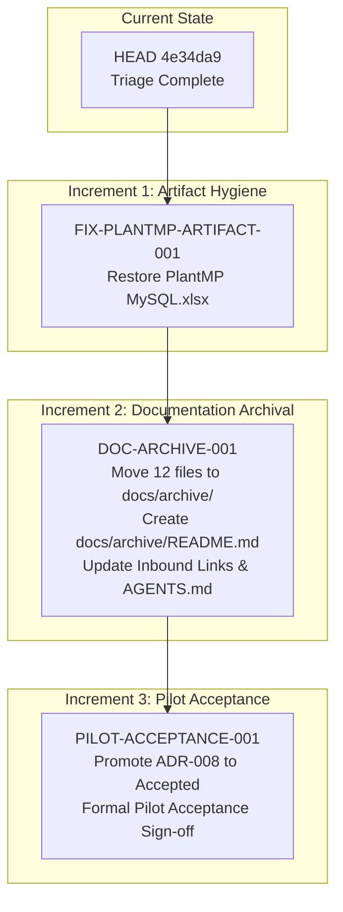

# Pending Work Triage: Historical Documentation Separation, Pilot Acceptance Review, and PlantMP Artifact Diagnosis

- **Document ID**: `PENDING-WORK-TRIAGE-001`
- **Date**: 2026-11-12
- **Author**: Scientific Software Engineering Assistant
- **Status**: Proposal / Read-Only Triage Report
- **Repository Baseline**: `feature/functional-normalization` @ `4e34da924fd36c03d282eb3fe1a14db39e341c01` (`4e34da9`)
- **Governing Policies**: [ADR-001](../decisions/ADR-001-repository-scope.md), [ADR-002](../decisions/ADR-002-raw-data-immutability.md), [ADR-005](../decisions/ADR-005-deterministic-protein-ids.md), [ADR-006](../decisions/ADR-006-coverage-only-moonprot-status-rows.md), [ADR-007](../decisions/ADR-007-v1-scope-descope-bibliographic-relations.md), [ADR-008](../decisions/ADR-008-functional-normalization-pilot-scope.md), [AGENTS.md](../../AGENTS.md)

---

## 1. Executive Summary and Baseline Assessment

### 1.1 Purpose and Authorization Boundary

This report delivers the read-only triage authorized under `PENDING-WORK-TRIAGE-001`. Following the successful Git consolidation and remote publication of commits `ce1091a` through `4e34da9` on `feature/functional-normalization`, three distinct operational and scientific workstreams require decision-ready analysis before further repository increments:

1. **Workstream A: Historical Documentation Separation and Archival Preparation**: Reconciling residual gaps (specifically `MAP-02-03`), specifying exact file move mappings, designing the English archive index, and determining the quarantine disposition of the defective duplicate file `experiment_guio_v1.md`.
2. **Workstream B: Acceptance Review of the Existing Functional Normalization Pilot**: Evaluating the Tier A preservation implementation (`specs/functional-normalization-pilot/`), schemas, adapters, and 20-record verification cohort against [ADR-008](../decisions/ADR-008-functional-normalization-pilot-scope.md), establishing its compliance with repository scientific invariants, and defining its explicit limitations.
3. **Workstream C: Diagnosis of the PlantMP Raw-Artifact/Manifest Issue**: Tracing the exact commit history of `data/raw/plantmp/PlantMP MySQL.xlsx`, evaluating the mismatch with `data/manifests/file_checksums.sha256`, and presenting three viable remediation paths.

### 1.2 Clear Separation of the Two Pilots

To prevent governance and methodological conflation, the repository distinguishes two entirely separate pilot efforts:

- **The Functional Normalization Pilot (Implemented, Under Review)**: An engineering and data preservation pilot completed under Specification-Driven Development (SDD) in `specs/functional-normalization-pilot/`. It establishes schemas, contract tests, and adapters across 3 sources (MultitaskProtDB-II, PlantMP, and MoonProt) for 20 bounded records, 44 claims, and 353 structured source GO annotations. It is governed by [ADR-008](../decisions/ADR-008-functional-normalization-pilot-scope.md) (Status: `Proposed`). It executes offline and does NOT perform ontology reconciliation, semantic similarity calculations, or literature adjudication.
- **The Scientific Pilot Experiment (`PEC-EXP-001`, Future / Under Design)**: An extensive research proposal spanning experimental blocks B0 through B6, 11 scientific objectives, and 29 open decisions, described in the maintained English master proposal [`docs/roadmap/core/experimental-master-proposal.md`](../roadmap/core/experimental-master-proposal.md). This scientific experiment is **NOT** authorized, has not been executed, and is not approved by this triage report.

### 1.3 Repository Baseline Verification

The repository baseline was inspected prior to authoring this report:
- **Repository Root**: `/home/alexdoro/repositories/mfp-bibliography` (confirmed)
- **Current Branch**: `feature/functional-normalization`
- **Full HEAD Commit Hash**: `4e34da924fd36c03d282eb3fe1a14db39e341c01` (short HEAD: `4e34da9`)
- **Working Tree Status**: Pristine clean (0 staged changes, 0 tracked modifications, 0 untracked files prior to this report).
- **Upstream Tracking Status**: `origin/feature/functional-normalization` is in exact fast-forward synchronization with local HEAD `4e34da9`.
- **Write Boundary Enforcement**: Strictly confined to authoring `docs/reports/pending-work-triage-2026-11-12.md`. No code, tests, schemas, raw files, manifests, or existing documentation files have been modified.

---

## 2. Workstream A: Historical Documentation Separation and Archival Preparation

### 2.1 Reconciliation of Named Residual Gaps (Focus on `MAP-02-03`)

In [`docs/reports/documentation-recovery-map.md`](documentation-recovery-map.md), item `MAP-02-03` was marked as partially unrecovered. A rigorous line-by-line comparative analysis between the Spanish source text and the maintained English repository documentation establishes the following:

#### 2.1.1 Source Headings and Content Inspected
- **Source Document**: [`docs/roadmap/02_protocolo_cientifico_y_analisis.md`](../roadmap/02_protocolo_cientifico_y_analisis.md)
  - `## 7. Reducción aleatoria de términos` (Lines 187–218): Algorithmic protocol for evaluating metric sensitivity to annotation volume (term density bias).
  - `## 8. Retirada de publicaciones` (Lines 219–242): Leave-one-publication-out sensitivity analysis evaluating whether multifunctionality evidence collapses upon the loss of a single literature reference.

#### 2.1.2 English Destination Headings Inspected
- **Conceptual Rationale**: [`docs/architecture/scientific-background.md`](../architecture/scientific-background.md) §8 (*Methodological Framework*, Lines 188–203), under Hypothesis **H2 (Annotation Volume Confounding)**.
- **Master Experimental Intent**: [`docs/roadmap/core/experimental-master-proposal.md`](../roadmap/core/experimental-master-proposal.md) §7.3 (*Repeated Downsampling Control Protocol*, Lines 340–368).
- **Evidence Partitions**: [`docs/architecture/go-metrics-specification.md`](../architecture/go-metrics-specification.md) §2.5 (*Evidence-Code Filtering Partitions*).

#### 2.1.3 Complete Recovery versus Conceptual Overlap
The current English documentation exhibits **conceptual overlap**, but **NOT complete procedural recovery**:
- **What IS Recovered in English**:
  - The epistemic premise that annotation density biases functional distance metrics is fully articulated in `scientific-background.md` §8.
  - The requirement for repeated downsampling ($N \ge 100$) and evidence partition stratification (`ALL_ELIGIBLE`, `EXP_CONVENTIONAL`, `EXP_EXTENDED`) is codified in `experimental-master-proposal.md` §7.3 and `go-metrics-specification.md` §2.5.
- **What is MISSING in English (Precise Procedural Gap)**:
  1. *Random Term Reduction Protocol (§7)*:
     - The explicit sampling frame: per-protein unique GO term vocabulary, unweighted sampling without replacement matching the exact term count of the experimental subset ($k = |T_{\text{EXP}}(p)|$).
     - The computational stress grid: evaluating reductions at 100%, 75%, 50%, and 25% of the baseline experimental annotation mass across 200 independent replicates per protein.
     - Replicate coordination: generating shared pseudo-random replicate banks across all downstream metric calculators (Lin, Wang, MBL) so metrics are evaluated on identical degraded term subsets.
     - Boundary rule for non-estimable replicas: explicit fallback handling when a sampled term subset leaves zero common ancestors or invalid semantic pairs.
  2. *Publication Retraction / Leave-One-Publication-Out Protocol (§8)*:
     - Algorithmic procedure for iterative single-publication removal ($P \setminus \{p_i\}$).
     - Multi-reference preservation rules: distinguishing assertions supported by independent alternative citations from assertions requiring joint citations, and formal handling of unresolved bibliographic conjunctions (AND vs OR).
     - Recalculation rules: recalculating assertions and term sets dynamically in memory without mutating raw source tables or baseline database records.
     - Quantitative collapse threshold: defining what percentage shift in functional semantic similarity constitutes an evidence-fragile assertion.

#### 2.1.4 Documentary Specification versus Scientific Adoption
Under repository governance:
- **Scientific adoption** of these protocols remains deferred pending human authorization of the scientific pilot experiment (Gate G0 / Gate G1, `DEC-MET-06`).
- However, **documentary specification** of a maintained proposal must not be left exclusively in Spanish. Language policy requires all maintained proposals to be accessible in English.
- **Smallest Justified Resolution**: The detailed mathematical and procedural specifications for Random Term Reduction and Publication Retraction should be incorporated directly into [`docs/architecture/go-metrics-specification.md`](../architecture/go-metrics-specification.md) as proposed appendix protocols under a dedicated future documentation increment, rather than blocking documentation closure or creating premature standalone execution scripts.

---

### 2.2 Exact Archival Relocation Mappings

To ensure that maintained documentation remains cleanly in English while preserving original Spanish and Catalan historical artifacts for audit provenance, 12 documents are mapped for relocation to `docs/archive/`. 

Documents are selected **strictly by their historical documentary role**, never solely because of their language. Active English reference architecture and reports remain in place.

| # | Current Path | Destination Path | Documentary Role | English Successor | Inbound Referrers Requiring Update | Internal Relative Link Maintenance | Pre-conditions Satisfied? |
|---|---|---|---|---|---|---|---|
| 1 | `docs/roadmap/01_dossier_experimento.md` | `docs/archive/proposals-2026-10-spanish/01_dossier_experimento.md` | Historical Spanish experiment dossier (2026-10) | `docs/architecture/scientific-background.md` & `docs/roadmap/core/experimental-master-proposal.md` | 12 files (including `docs/architecture/README.md`, `AGENTS.md`) | Internal cross-links to `02`–`07` become intra-archive relative links | Yes (Substantive content recovered in English architecture) |
| 2 | `docs/roadmap/02_protocolo_cientifico_y_analisis.md` | `docs/archive/proposals-2026-10-spanish/02_protocolo_cientifico_y_analisis.md` | Historical Spanish scientific protocol (2026-10) | `docs/architecture/scientific-background.md` & `docs/architecture/go-metrics-specification.md` | 12 files | Internal cross-links to `01`, `03`–`07` become intra-archive links | Yes (Core epistemology recovered; procedural gaps documented above) |
| 3 | `docs/roadmap/03_contrato_datos_y_recursos.md` | `docs/archive/proposals-2026-10-spanish/03_contrato_datos_y_recursos.md` | Historical Spanish data contract proposal (2026-10) | `docs/source-claims-contract.md` & `docs/curation/source-annotation-evidence-contract.md` | 9 files | Internal cross-links become intra-archive links | Yes (Superseded by accepted contracts) |
| 4 | `docs/roadmap/04_especificacion_metricas.md` | `docs/archive/proposals-2026-10-spanish/04_especificacion_metricas.md` | Historical Spanish metrics specification (2026-10) | `docs/architecture/go-metrics-specification.md` | 14 files | Internal cross-links become intra-archive links | Yes (Superseded by English metrics specification) |
| 5 | `docs/roadmap/04a_asociaciones_interaspecto.md` | `docs/archive/proposals-2026-10-spanish/04a_asociaciones_interaspecto.md` | Historical Spanish inter-aspect association draft (2026-10) | `docs/architecture/go-metrics-specification.md` §3 | 12 files | Internal cross-links become intra-archive links | Yes (Substantive rules on cross-aspect triplets recovered) |
| 6 | `docs/roadmap/05_diseno_tecnico.md` | `docs/archive/proposals-2026-10-spanish/05_diseno_tecnico.md` | Historical Spanish technical design (2026-10) | `docs/architecture/data-flow.md` & `specs/functional-normalization-pilot/plan.md` | 9 files | Internal cross-links become intra-archive links | Yes (Superseded by modern architecture and SDD package) |
| 7 | `docs/roadmap/06_manual_revision_bibliografica.md` | `docs/archive/proposals-2026-10-spanish/06_manual_revision_bibliografica.md` | Historical Spanish curation manual (2026-10) | `docs/curation/literature-curation-manual.md` | 12 files | Internal cross-links become intra-archive links | Yes (Superseded by English curation manual) |
| 8 | `docs/roadmap/07_plan_implementacion_y_validacion.md` | `docs/archive/proposals-2026-10-spanish/07_plan_implementacion_y_validacion.md` | Historical Spanish implementation plan (2026-10) | `docs/roadmap/mfp-catalog-implementation-plan.md` & `specs/functional-normalization-pilot/tasks.md` | 9 files | Internal cross-links become intra-archive links | Yes (Superseded by active implementation plan) |
| 9 | `docs/roadmap/core/Pla de recerca de l'experiment sobre MFPData.md` | `docs/archive/proposals-2026-11-catalan/Pla de recerca de l'experiment sobre MFPData.md` | Historical Catalan research plan (2026-11) | `docs/roadmap/core/experimental-master-proposal.md` | 7 files (reports and audits) | Links to core files adjusted | Yes (Superseded by English master proposal) |
| 10 | `docs/roadmap/core/experiment-guio-v2.md` | `docs/archive/proposals-2026-11-catalan/experiment-guio-v2.md` | Historical Catalan proposal guide (2026-11) | `docs/roadmap/core/experimental-master-proposal.md` | 10 files (including `ADR-008`, `AGENTS.md`) | Links to core files adjusted | Yes (Superseded by English master proposal) |
| 11 | `docs/roadmap/core/guion_propuesta.md` | `docs/roadmap/core/presentation/guion_propuesta.md` | Historical Spanish presentation script (companion to slides) | None (presentation-specific script) | 4 files (`decisiones_abiertas.md`, audits) | Adjust relative links to `slides.md` | Yes (Belongs in presentation directory alongside `slides.md`) |
| 12 | `docs/roadmap/core/experiment_guio_v1.md` | `docs/archive/quarantine/experiment_guio_v1.md` | Defective corrupted duplicate of `experiment_definition.md` | `docs/roadmap/core/experimental-master-proposal.md` | 8 files (reports and audits) | Isolate in quarantine | Yes (Verified 100% duplicate with UTF-8 mojibake; see §2.4) |

#### Non-Link References and Dependencies
- **`AGENTS.md`**: Section 2 (Precedence hierarchy Level 6) references `docs/roadmap/01-07` and `experiment-guio-v2.md`. Updating these paths to `docs/archive/...` must be explicitly included in the archival execution increment.
- **`scripts/validate_repository.py`**: Inspected; does not depend on paths under `docs/roadmap/01`–`07` or `docs/roadmap/core/`.

---

### 2.3 English Archive Index Structure (`docs/archive/README.md`)

A comprehensive index will be authored at `docs/archive/README.md` upon executing the archival increment. The architectural design is structured as follows:

```markdown
# Repository Historical Archive

## 1. Archival Scope and Epistemic Invariants
This directory preserves early proposals, exploratory drafts, historical working guides, and presentation scripts from the formative phases of the `mfp-bibliography` project (October–November 2026).

> [!IMPORTANT]
> - **Historical and Evidentiary Role Only**: Documents in this archive are preserved for historical auditability, provenance tracking, and retrospective reference. They do **NOT** represent active technical architecture, approved specifications, or implementation mandates.
> - **Authority Precedence**: Under repository governance (`AGENTS.md` §2), archived documents reside at Level 6 (lowest authority). They never supersede Accepted Architectural Decision Records (ADRs) or approved specifications.
> - **Authority of Historical Source Wording**: Where historical Catalan or Spanish documents record verbatim claims, original quotes from external literature, or native terminology, the archived originals remain permanently authoritative for the exact historical source phrasing.

## 2. Directory Structure and Provenance
- `proposals-2026-10-spanish/`: The foundational eight-part Spanish scientific proposal series (`01` through `07`, plus `04a`) drafted in October 2026.
- `proposals-2026-11-catalan/`: Early November 2026 Catalan working guides (`Pla de recerca...` and `experiment-guio-v2.md`).
- `quarantine/`: Defective, corrupt, or superseded duplicate files preserved exclusively for commit history integrity.

## 3. Provenance and Successor Crosswalk
[Tabular mapping linking every archived document to its maintained English successor document and section]
```

---

### 2.4 Disposition of the Defective Duplicate (`experiment_guio_v1.md`)

#### 2.4.1 Empirical Findings
A rigorous programmatic byte and content comparison was executed between:
- `docs/roadmap/core/experiment_guio_v1.md` (874 lines, 42,912 bytes)
- `docs/roadmap/core/experiment_definition.md` (874 lines, 41,833 bytes)

**Findings**:
1. When decoded as UTF-8, `experiment_guio_v1.md` displays widespread mojibake corruption resulting from double-encoding UTF-8 bytes as Windows-1252/CP1252 (e.g. `diseño` instead of `diseño`, `→` instead of `→`, `técnica` instead of `técnica`).
2. When the text of `experiment_guio_v1.md` is re-encoded to `CP1252` and decoded back as `UTF-8`, the resulting string matches `docs/roadmap/core/experiment_definition.md` **identically (100.0% character match across all 874 lines)**.
3. There is **zero unique scientific, technical, or editorial content** in `experiment_guio_v1.md`.

#### 2.4.2 Governance Authority and Gate Distinction
- In early documentation notes (`docs/reports/documentation-recovery-map.md`), duplicate disposition was erroneously tagged as pending "Gate G4".
- **Crucial Clarification**: In the master scientific experiment (`PEC-EXP-001`), Gate G4 is a **scientific decision gate** governing "Blinded Literature Adjudication" (authorizing manual curator evaluation of controversial moonlighting claims).
- Disposing of a corrupt duplicate Markdown file in the documentation tree is a routine **maintainer repository hygiene and governance action**, governed by repository maintainer sign-off under [ADR-002](../decisions/ADR-002-raw-data-immutability.md) and [AGENTS.md](../../AGENTS.md). It must **NOT** be gated on or conflated with scientific Gate G4.

#### 2.4.3 Quarantine Recommendation
`experiment_guio_v1.md` should be moved to `docs/archive/quarantine/experiment_guio_v1.md` accompanied by an explicit header notice identifying it as a CP1252-corrupted duplicate of `docs/roadmap/core/experiment_definition.md`, preserved solely to prevent broken links in historical Git logs.

---

### 2.5 Report Consistency Reconciliation

A comparative audit of [`docs/reports/documentation-recovery-map.md`](documentation-recovery-map.md) and [`docs/reports/documentation-closure-and-english-migration-plan.md`](documentation-closure-and-english-migration-plan.md) reveals several historical discrepancies:
1. **Active versus Archived Descriptions**: In `documentation-recovery-map.md` Table 2, items `MAP-01-05` and `MAP-01-07` cite paths under `docs/archive/proposals-2026-10-spanish/ [Proposed Archive]`, whereas Table 1 and narrative sections treat them as active files in `docs/roadmap/`.
2. **Action R2 Status**: Section 8.2 of `documentation-recovery-map.md` notes that Action R2 (consolidating evidence code partitions into `go-metrics-specification.md`) was pending, whereas `documentation-closure-and-english-migration-plan.md` reflects its completion in Phase 1 / Group 1.
3. **Pending Gate G4 Reference**: As detailed in §2.4.2, referencing Gate G4 for file quarantine was an editorial oversight.
4. **Deferred Archival Phase**: `documentation-closure-and-english-migration-plan.md` originally anticipated archival execution in Group 2, but this was explicitly deferred by human authorization during `ENG-MIG-003` to keep the working tree clean and reviewable.

**Recommendation**: Under [ADR-002](../decisions/ADR-002-raw-data-immutability.md), prior signed-off audit reports in `docs/reports/` should remain unchanged as immutable historical records of those specific audit cycles. The discrepancies are formally reconciled and documented in this triage report.

---

## 3. Workstream B: Acceptance Review of the Existing Functional Normalization Pilot

### 3.1 Overview and Governing Scope

The existing functional normalization pilot was developed under Specification-Driven Development (SDD) in `specs/functional-normalization-pilot/` and is governed by [ADR-008](../decisions/ADR-008-functional-normalization-pilot-scope.md) (Status: `Proposed`). 

The pilot's stated objective is **Tier A Source-Native Claim and Annotation Preservation**: ingesting raw source statements, structured source Gene Ontology annotations, and coverage denominators across a bounded empirical cohort without attempting premature ontology reconciliation or literature adjudication.

---

### 3.2 Detailed Acceptance Matrix

Every requirement and implementation task defined in `specs/functional-normalization-pilot/` was evaluated against the codebase, contract tests, and generated artifacts:

| Task ID | Task Description | Acceptance Criteria | Implementation Status | Evidence & Test Verification |
|---|---|---|---|---|
| **TASK-01** | Author Schemas for Claims, Coverage, and Annotations | Draft 2020-12 schemas with closed object validation (`additionalProperties: false`), strict types, and regex patterns. | **PASSED** | `data/curated/schemas/functional_claims.schema.json`<br>`data/curated/schemas/functional_coverage.schema.json`<br>`data/curated/schemas/source_go_annotations.schema.json`<br>Verified by `scripts/validate_repository.py` and jsonschema validator. |
| **TASK-02** | Implement Executable Contract Tests | Automated schema validation, row-level constraint checks, cross-record integrity, and sort key stability. | **PASSED** | `tests/test_functional_contracts.py` (21 tests passing). Validates synthetics, edge cases, and invalid schema inputs fail-closed. |
| **TASK-03** | MultitaskProtDB-II Adapter & Slice Package | Extract claims, annotations, coverage from MultitaskProtDB-II CSV format; exact record reference IDs; deterministic ordering. | **PASSED** | `src/mfp_bibliography/functional_claims_multitask.py`<br>`scripts/build_multitask_slice.py`<br>`tests/test_functional_claims_multitask.py` (21 tests passing). 6 real records -> 12 claims, 45 annotations, 6 coverage. |
| **TASK-04** | PlantMP Tabular Adapter & Identity Resolution | Extract claims and annotations from PlantMP; map curation tiers; eliminate sentinel entity `MFP:U:0000000000000000`; enforce catalog lookup. | **PASSED** | `src/mfp_bibliography/functional_claims_plantmp.py`<br>`tests/test_functional_claims_plantmp.py` (39 tests passing). Verifies honest `null` on `unresolved_identity`, catalog ID match, and zero CC inference. |
| **TASK-05** | MoonProt Dynamic Block Adapter | Extract dynamic $K$-block functions ($K \ge 0$); preserve function-specific PMIDs; preserve cellular location in notes without triplet synthesis. | **PASSED** | `src/mfp_bibliography/functional_claims_moonprot.py`<br>`tests/test_functional_claims_moonprot.py` (22 tests passing). Tested on real $K=0$ (MPID 288), $K=1$, $K=2$, $K=3$. 6 records -> 8 claims, 14 annotations. |
| **TASK-06** | MoonDB and MultifacetedProtDB Adapters | Full five-source adapter completion. | **DEFERRED** | Formally descoped from the bounded pilot by [ADR-008](../decisions/ADR-008-functional-normalization-pilot-scope.md) §Decision; deferred to post-pilot milestone. No unauthorized code written. |
| **TASK-07** | Pilot Pipeline CLI & Dual Baseline Check | Command-line tool to execute integrated extraction, validate schemas, verify candidate release packages. | **PASSED** | `scripts/build_functional_claims_pilot.py`<br>CLI executes dual baseline check against `package_catalog_candidate.py --verify-package` and produces structured validation report. |
| **TASK-08** | Integrated Pilot Execution & Validation Report | Run 20-record empirical cohort across 3 sources; achieve 100% denominator accounting, multi-source clustering, and byte reproducibility. | **PASSED** | Outputs in `data/interim/pilot/functional_claims_pilot/`. 20 inputs -> 20 coverage records, 44 claims, 353 annotations. Verified by `tests/test_functional_pilot_pipeline.py` (6 tests passing). |

---

### 3.3 Scope and Interface Analysis

1. **Sources Supported**:
   - **MultitaskProtDB-II**: 6 records (including `Q9Y3E5` / Row 672 and `P0AFW0`).
   - **PlantMP**: 8 records (including `Q42525`, `P34788`, and unresolved accession cases).
   - **MoonProt**: 6 records (MPID 288, 542, 626, and synthetic fixtures).
2. **Schemas Implemented** (all Draft 2020-12):
   - `functional_claims.schema.json`: Captures protein ID, source record ID, claim index, source-native role (`Canonical_Function`, `Moonlighting_function`, `function_1`, etc.), verbatim text, source EC numbers, and reference lists.
   - `functional_coverage.schema.json`: Full denominator accounting covering resolved, unresolved, and excluded records. Enforces honest `null` on `protein_id` when identity is unresolved.
   - `source_go_annotations.schema.json`: Granular preservation of source-native GO IDs (`MFPB_SOURCE_GO_ANNOTATION_V1`), aspect (`BP`, `MF`, `CC`), evidence code, and term name.
3. **CLIs and Scripts**:
   - `scripts/build_functional_claims_pilot.py`: Main entry point for generating the integrated 20-record pilot slice.
   - `scripts/build_multitask_slice.py`: Dedicated builder for the isolated MultitaskProtDB-II reference slice.
4. **Generated Output Artifacts**:
   - Persisted in `data/interim/pilot/functional_claims_pilot/`:
     - `claims.csv` (44 claims)
     - `coverage.csv` (20 coverage records, 100% denominator accounting)
     - `source_go_annotations.csv` (353 annotations)
     - `manifest.json` (metadata, source versions, SHA-256 digests)
     - `verification_report.json` (automated validation results, cross-source cluster summary)

---

### 3.4 Scientific Non-Goals and Repository Invariants Compliance

The implementation was scrutinized against the strict scientific rules set forth in [AGENTS.md](../../AGENTS.md) §5 and repository ADRs:

1. **No Fabricated GO Mappings**: The adapters parse only GO identifiers explicitly declared in raw source records. No heuristic text-matching, regex keyword-to-GO mapping, or automated enrichment is performed.
2. **No Unwarranted Function–Compartment Linkage**: The adapters preserve source cellular location text (e.g. MoonProt cellular location fields) strictly as descriptive annotations in claim notes. **Zero functional triplets were synthesized**, and no Cartesian products of GO-MF and GO-CC terms were generated.
3. **Preservation of Multiplicity**: Distinct raw statements are preserved as discrete source claims. Statements are never artificially compressed into arbitrary binary slots ("Facet 1 vs Facet 2").
4. **Qualifier and Evidence Integrity**: Source GO annotations preserve exact evidence codes (`IEA`, `IDA`, etc.) and verbatim text fragments. No negative annotations (`NOT`) are promoted to positive assertions.
5. **Reference Level Support**: Record-level references (e.g. in PlantMP and MultitaskProtDB-II) remain in `record_reference_ids` without synthetic `PMID:` prefix injection. Function-specific references (e.g. MoonProt function blocks) are strictly linked to their respective claims in `linked_reference_ids`.
6. **Elimination of Sentinel Entities**: In accordance with Draft 2020-12 schema validation, legacy sentinel strings (`MFP:U:0000000000000000`) were eliminated; unresolved records correctly emit honest `null` `protein_id`.

---

### 3.5 Verification Command Analysis and Distinctions

During triage, repository verification commands were executed with the following results:

1. **Focused Pilot Regression**:
   ```bash
   pytest tests/test_functional_claims_moonprot.py tests/test_functional_pilot_pipeline.py
   # 28 passed in 1.44s
   ```
2. **Complete Functional Pilot SDD Suite**:
   ```bash
   pytest tests/test_functional_contracts.py \
          tests/test_functional_claims_multitask.py \
          tests/test_functional_claims_plantmp.py \
          tests/test_functional_claims_moonprot.py \
          tests/test_functional_pilot_pipeline.py
   # 125 passed in 2.07s
   ```
3. **Repository Metadata and Bootstrap Validation**:
   ```bash
   PYTHONPATH=src python3 scripts/validate_repository.py
   # 9 checks passed (ok: true)
   ```

#### Crucial Limitation: Bounded Pilot Suite versus Full Repository Suite
- The passing results above confirm that the **functional normalization pilot slice and its contracts are 100% sound**.
- However, running the broad command `pytest tests/` triggers `tests/test_source_claim_policy.py`, which **fails** due to the missing `PlantMP MySQL.xlsx` raw artifact (detailed in Workstream C).
- Contributors and automated agents must **NEVER** report the 28 (or 125) passing pilot tests as "the entire repository test suite passes". Full-suite pass requires resolving the PlantMP raw artifact discrepancy.

---

### 3.6 Technical Verdict on the Functional Normalization Pilot

**VERDICT: READY FOR FORMAL PILOT ACCEPTANCE WITH NAMED, EXPLICIT LIMITATIONS**

The pilot implementation successfully satisfies all technical and scientific requirements of [ADR-008](../decisions/ADR-008-functional-normalization-pilot-scope.md) for a Tier A bounded pilot. Formal human acceptance should proceed under an explicit increment (`PILOT-ACCEPTANCE-001`) with the following explicit caveats recorded:
1. **Bounded Cohort**: The implementation is proven on a 20-record empirical cohort; mass execution and publishing across all 2,962 catalog records is deferred.
2. **Remaining Sources**: MoonDB and MultifacetedProtDB adapters (TASK-06) remain deferred.
3. **Descope of External Relations**: In accordance with [ADR-007](../decisions/ADR-007-v1-scope-descope-bibliographic-relations.md), external Gene Ontology enrichment, ontology reconciliation, and external bibliographic graph construction remain formally out of scope.
4. **ADR-008 Promotion**: [ADR-008](../decisions/ADR-008-functional-normalization-pilot-scope.md) status should be promoted from `Proposed` to `Accepted` upon human sign-off.

---

## 4. Workstream C: Diagnosis of the PlantMP Raw-Artifact/Manifest Issue

### 4.1 Chronological Evidence Timeline

A comprehensive Git history inspection of `data/raw/plantmp/` and `data/manifests/` establishes the exact origin and evolution of the discrepancy:

1. **2026-09-22 (`2c0e5f0`, commit `origin/add-source-claim-policy-v0.1`)**:
   - Initial landing of the local PlantMP raw files.
   - The binary Excel file `data/raw/plantmp/PlantMP MySQL.xlsx` (75,110 bytes) was added to the repository.
   - Simultaneously, its SHA-256 digest was recorded in `data/manifests/file_checksums.sha256`:
     ```
     544df67fbdefab958d84e3469799939dc7ea5b654a4c30a841e341a6b2e54611  data/raw/plantmp/PlantMP MySQL.xlsx
     ```
2. **2026-09-28 (`cabcd8f` & `f0ce045`)**:
   - Catalog MVP build logic (`build_mfp_catalog_mvp.py`) integrated PlantMP using the CSV artifact `data/raw/plantmp/PlantMP_all.csv` (112 records).
   - In `data/manifests/source_manifest.csv`, PlantMP's primary registered artifact was set to `data/raw/plantmp/PlantMP_all.csv` (SHA-256: `97ae53eccbbd3a9c2a1e9b3247db8bcc0b66de929bf4471b37187de5e3a494a9`).
3. **2026-11-03 (`9b50ab3`)**:
   - Repository baseline checkpoint. `PlantMP MySQL.xlsx` remained present in the tree (Git blob hash `a98fb6a0a2d2f87d63fc2d1b3f657bee38798900`).
4. **2026-11-06 (`a6def6f`, "Add functional tests for MultitaskProtDB-II claims and coverage schemas")**:
   - **The Inciting Event**: `data/raw/plantmp/PlantMP MySQL.xlsx` was deleted from the working tree (`Bin 75110 -> 0 bytes`).
   - `data/manifests/file_checksums.sha256` was **NOT** updated, creating the mismatch between the manifest and the disk state.
   - Subsequent test execution of `tests/test_source_claim_policy.py::TestSourceClaimPolicy::test_raw_checksums_unchanged` attempts to read all paths listed in `file_checksums.sha256`, encountering `FileNotFoundError` on `PlantMP MySQL.xlsx`.

---

### 4.2 Exact Artifact Presence and Checksum Verification

Every file currently in `data/raw/plantmp/` was hashed and compared against `data/manifests/file_checksums.sha256`:

| Disk Path | Working Tree State | Actual SHA-256 Digest | `file_checksums.sha256` Match? | Role in Repository |
|---|---|---|---|---|
| `data/raw/plantmp/PlantMP_all.csv` | **PRESENT** (53,366 B) | `97ae53eccbbd3a9c2a1e9b3247db8bcc0b66de929bf4471b37187de5e3a494a9` | **EXACT MATCH** | **Primary Ingestion Artifact** (112 rows, registered in `source_manifest.csv`) |
| `data/raw/plantmp/PlantMP MySQL-all-147.csv` | **PRESENT** (73,794 B) | `529e838d95715ba9b8eb1feb4277842a1a1dffbb73a66ea1967ce0f087c04f7d` | **EXACT MATCH** | Auxiliary export (147 rows) |
| `data/raw/plantmp/PlantMP MySQL-confirmed .csv` | **PRESENT** (58,625 B) | `d060c2a87180439d3f8876265be339414894988b2785ac01d2c45d84e2f39b6a` | **EXACT MATCH** | Auxiliary export (confirmed subset) |
| `data/raw/plantmp/PlantMP MySQL-likely.csv` | **PRESENT** (4,711 B) | `095e37c54c99a898a2c19f9959e3cb30b48f5c5f4e56efafdf09addf49e0f4d9` | **EXACT MATCH** | Auxiliary export (likely subset) |
| `data/raw/plantmp/PlantMP-predicted.csv` | **PRESENT** (11,497 B) | `4d11330b4298158bb75effb308e7700c889fc69baa7b562ae73b6046f9d99b1f` | **EXACT MATCH** | Auxiliary export (predicted subset) |
| `data/raw/plantmp/PlantMP MySQL.xlsx` | **MISSING FROM DISK** | N/A (historical blob: `a98fb6a...`) | Listed as `544df67fbdefab958d84e3469799939dc7ea5b654a4c30a841e341a6b2e54611` | Auxiliary binary workbook |

**Verification Result**: All 5 raw CSV files on disk match their recorded SHA-256 digests perfectly. The primary ingestion file `PlantMP_all.csv` is completely intact. The failure is **exclusively caused by the physical absence of the auxiliary Excel workbook `PlantMP MySQL.xlsx`**.

---

### 4.3 Root-Cause Assessment

The issue is an **unintended artifact omission**: an auxiliary binary file was deleted during an earlier test commit (`a6def6f`) without a corresponding governance decision or manifest reconciliation. Because [ADR-002](../decisions/ADR-002-raw-data-immutability.md) strictly forbids autonomous agents from altering raw files or manifests, the discrepancy remained unresolved across subsequent work sessions.

---

### 4.4 Viable Remediation Options with Trade-Offs

Three remediation options exist, each with distinct governance and technical trade-offs:

#### Option 1: Physical Restoration from Git Commit History (Recommended)
- **Mechanism**: Restore the exact binary file from Git commit `9b50ab3`:
  ```bash
  git checkout 9b50ab3 -- "data/raw/plantmp/PlantMP MySQL.xlsx"
  ```
- **Pros**:
  - 100% compliant with [ADR-002](../decisions/ADR-002-raw-data-immutability.md) (restores the frozen raw baseline).
  - Requires zero edits to `data/manifests/file_checksums.sha256` or tests.
  - Immediately restores `tests/test_source_claim_policy.py` to 100% passing status.
  - Preserves full cryptographic auditability of all frozen assets.
- **Cons**:
  - Adds a 75 KB binary file back to the working tree.

#### Option 2: Formal Manifest Amendment via ADR
- **Mechanism**: Author a new ADR (or amendment to ADR-002) formally retiring auxiliary binary spreadsheet formats from `data/raw/`, and delete line 11 from `data/manifests/file_checksums.sha256`.
- **Pros**:
  - Keeps the Git working tree free of redundant binary files if PlantMP is strictly consumed via CSV.
- **Cons**:
  - Modifies a frozen, immutable manifest, creating governance overhead.
  - Requires updating ADR records and policy tests.

#### Option 3: Test Policy Decoupling (Primary vs Auxiliary Manifests)
- **Mechanism**: Refactor `tests/test_source_claim_policy.py` so that only files registered in `data/manifests/source_manifest.csv` (active runtime inputs) are mandatory, while unreferenced files in `file_checksums.sha256` are treated as optional static archives.
- **Pros**:
  - Decouples pipeline execution from auxiliary raw archives.
- **Cons**:
  - Weakens strict fail-closed repository integrity checking.
  - Requires test suite refactoring.

#### Recommended Action
**Execute Option 1** in a dedicated, bounded increment (`FIX-PLANTMP-ARTIFACT-001`). It is the safest, smallest, and most conservative fix, requiring no governance exceptions or schema edits. If maintainers later wish to deprecate Excel files project-wide, that can be done under an explicit ADR.

---

### 4.5 Blocking Impact Analysis

- **Impact on Catalog Building and Ingestion**: **NONE**. The catalog builder (`scripts/build_mfp_catalog_mvp.py`) reads `data/raw/plantmp/PlantMP_all.csv`, which is intact and verified.
- **Impact on Functional Normalization Pilot**: **NONE**. The pilot tests use `plantmp_fixture.csv` and pass 100%.
- **Impact on Repository Validation**: **NONE**. `scripts/validate_repository.py` passes 9/9 checks.
- **Impact on Full Repository CI/Test Suite**: **BLOCKING**. `pytest tests/test_source_claim_policy.py` fails 1 test (`test_raw_checksums_unchanged`), preventing full-suite test passes.

---

## 5. Proposed Next Increments and Recommended Execution Order

To maintain strict Specification-Driven Development and clean human oversight, the remaining work is decomposed into three independently reviewable and approvable increments:



### Increment 1: `FIX-PLANTMP-ARTIFACT-001` (PlantMP Artifact Restoration)
- **Scope**: Restore `data/raw/plantmp/PlantMP MySQL.xlsx` from Git commit `9b50ab3`.
- **Commands**:
  ```bash
  git checkout 9b50ab3 -- "data/raw/plantmp/PlantMP MySQL.xlsx"
  pytest tests/test_source_claim_policy.py
  ```
- **Risk**: Minimal (read-only restore of a previously committed raw artifact).
- **Deliverable**: Clean pass of `tests/test_source_claim_policy.py`, unblocking the repository test suite.

### Increment 2: `DOC-ARCHIVE-001` (Historical Documentation Separation)
- **Scope**:
  - Relocate 8 Spanish roadmap files to `docs/archive/proposals-2026-10-spanish/`.
  - Relocate 2 Catalan core files to `docs/archive/proposals-2026-11-catalan/`.
  - Relocate `guion_propuesta.md` to `docs/roadmap/core/presentation/`.
  - Quarantine `experiment_guio_v1.md` to `docs/archive/quarantine/`.
  - Author `docs/archive/README.md`.
  - Update inbound links across 14 referring Markdown files and `AGENTS.md`.
- **Risk**: Low (file moves and link updates; no code or schema edits).
- **Deliverable**: Pure English maintained documentation tree, clear historical archive navigation, zero broken links.

### Increment 3: `PILOT-ACCEPTANCE-001` (Functional Pilot Acceptance)
- **Scope**:
  - Formally accept the functional normalization pilot based on the acceptance review in §3.
  - Update [ADR-008](../decisions/ADR-008-functional-normalization-pilot-scope.md) status from `Proposed` to `Accepted`.
  - Record the accepted pilot boundary in repository release notes or changelog.
- **Risk**: Low (documentation and governance status update).
- **Deliverable**: Formally closed and accepted Tier A preservation baseline.

### Recommended Execution Sequence
1. **First: `FIX-PLANTMP-ARTIFACT-001`** — Immediately fixes the broken test in `test_source_claim_policy.py`, establishing a 100% green baseline across the repository.
2. **Second: `DOC-ARCHIVE-001`** — Cleans the documentation hierarchy and establishes the English-only maintained baseline.
3. **Third: `PILOT-ACCEPTANCE-001`** — Formally closes the functional normalization pilot milestone with clean governance and passing tests.
