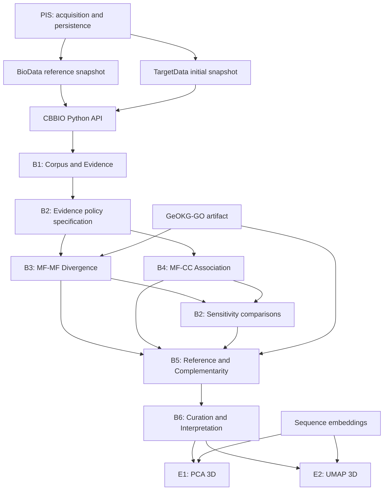

# Protein Multifunctionality — Experimental Design Proposal

> Documento maestro de trabajo para definir, revisar y presentar la propuesta del proyecto.

| Document control | Valor |
|---|---|
| Document ID | PEC-EXP-001 |
| Version | 0.1.0 |
| Status | Draft for team review — no aprobado para full-scale execution |
| Date | 2026-10-27 |
| Language | Castellano; terminología técnica en inglés |
| Intended audience | Research team, data engineering, software engineering y scientific reviewers |
| Purpose | Acordar scientific scope, data contracts, experimental blocks, deliverables y decision gates |
| Execution status | Propuesta de diseño; no contiene resultados experimentales ni estimaciones de coste verificadas |

## Executive Overview

Se propone un estudio de **functional characterization y dataset curation** organizado en seis experimental blocks. El diseño separa la preparación de datos, la sensibilidad a la evidencia, la divergencia entre funciones, la asociación entre función y compartimento, la comparación con una reference population y la revisión biológica final.

El principio arquitectónico es **PIS for data acquisition and persistence → CBBIO Python API for data access and reusable calculations → experimental project for comparisons and interpretation**. Esta separación se apoya en las responsabilidades documentadas de [PIS](https://github.com/CBBIO/protein-information-system/blob/main/README.md), del [BioData client](https://github.com/CBBIO/BioData/blob/main/docs/BioData.md) y de las [GO utilities](https://github.com/CBBIO/BioData/blob/main/docs/GO.md).

**BioData** será la reference population y **TargetData** la cohort de proteínas multifuncionales que se caracterizará y curará. Esta función de TargetData procede del planteamiento del proyecto: no implica que ya se hayan verificado su tamaño, cobertura, esquema o despliegue. BioData no se considerará un conjunto de verified negative samples.

Los **GeOKG-GO embeddings** se incorporan al B3 para estudiar term-level divergence y al B5 para evaluar metric complementarity y, cuando exista una agregación válida, protein-level comparison. Las visualizaciones **PCA 3D** y **UMAP 3D** quedan como extensiones posteriores a los seis bloques.

**Regla de inicio:** aprobar el protocolo y sus dependencias antes de comenzar el trabajo experimental. La aprobación del diseño no exige implementar todo a la vez: permite un technical pilot y una ejecución progresiva bajo change control.

## Document Usage

Este archivo es la fuente editable de la propuesta y la base narrativa para preparar un slide deck. No es todavía un executable protocol, una especificación de API aprobada ni una presentación de resultados.

- **Verified capability:** capacidad identificada en documentación o código enlazado; no equivale a disponibilidad comprobada en el deployment del laboratorio.
- **Project assumption:** recurso o condición prevista por el equipo, pendiente de comprobación operativa.
- **Proposed decision:** elección metodológica propuesta para revisión; no debe presentarse como una decisión ya aprobada.
- **Open decision:** definición que bloquea un decision gate concreto hasta quedar resuelta.
- **Future extension:** funcionalidad fuera del core scope inicial.

Para modificar el documento, conservar los identifiers de blocks, research questions, deliverables y decisions. Registrar los cambios que afecten a interpretación, cohort, métricas o scope en el Decision Register y en el Change Log. Los cambios editoriales no requieren un nuevo experimental run; los cambios metodológicos posteriores al protocol freeze sí deben producir una versión identificable.

## Contents

- [Research Framework](#research-framework)
- [Scope and Boundaries](#scope-and-boundaries)
- [Terminology](#terminology)
- [Resource Baseline](#resource-baseline)
- [Data Contracts](#data-contracts)
- [Experimental Architecture](#experimental-architecture)
- [B1 — Corpus and Evidence](#b1--corpus-and-evidence)
- [B2 — Evidence Sensitivity](#b2--evidence-sensitivity)
- [B3 — MF–MF Divergence](#b3--mfmf-divergence)
- [B4 — MF–CC Association](#b4--mfcc-association)
- [B5 — Reference and Complementarity](#b5--reference-and-complementarity)
- [B6 — Curation and Interpretation](#b6--curation-and-interpretation)
- [E1 — PCA 3D](#e1--pca-3d)
- [E2 — UMAP 3D](#e2--umap-3d)
- [Statistical Analysis Plan](#statistical-analysis-plan)
- [Software Responsibility Map](#software-responsibility-map)
- [Reproducibility and Execution](#reproducibility-and-execution)
- [Delivery and Approval](#delivery-and-approval)
- [Decision Register](#decision-register)
- [Risk Register](#risk-register)
- [Slide Deck Storyboard](#slide-deck-storyboard)
- [Review Checklist](#review-checklist)
- [Change Log](#change-log)

## Research Framework

### Central Research Question

> ¿Cómo se caracteriza la functional diversity de las proteínas de TargetData, hasta qué punto depende de las anotaciones disponibles y qué información adicional aportan distintas métricas para orientar su curation?

### Scientific Objectives

| ID | Objective | Evidencia prevista |
|---|---|---|
| O1 | Definir una cohort trazable y analizable | Coverage report, identity mapping y exclusion log |
| O2 | Cuantificar sensitivity a las evidence policies | Paired comparisons y annotation-count controls |
| O3 | Caracterizar intra-protein GO-MF divergence | Semantic, topological y embedding-based descriptors |
| O4 | Contextualizar GO-MF–GO-CC co-annotation | Reference association profile y support counts |
| O5 | Evaluar posicionamiento y metric complementarity | Reference comparisons y discordance analysis |
| O6 | Producir decisiones de curation auditables | Evidence records, reviewer decisions y versioned TargetData |

### Working Hypotheses

Estas hipótesis son contrastables, pero no presuponen diferencias significativas ni una dirección favorable a una métrica concreta.

| ID | Working hypothesis | Block |
|---|---|---|
| H1 | Coverage y corpus composition pueden explicar parte de las diferencias observadas | B1, B5 |
| H2 | Parte de la evidence sensitivity puede deberse a la reducción del número de términos | B2 |
| H3 | Las representaciones topológicas, semánticas y GeOKG-GO pueden aportar información parcialmente complementaria | B3, B5 |
| H4 | Las asociaciones GO-MF–GO-CC poco frecuentes pueden priorizar revisión, siempre que exista soporte suficiente | B4, B6 |
| H5 | Algunas diferencias TargetData–reference pueden persistir tras controlar annotation density y otros confounders | B5 |
| H6 | Las discordancias entre métricas y evidencia pueden orientar curation sin constituir una etiqueta biológica automática | B6 |

## Scope and Boundaries

### Core Scope

| Included | Expected output |
|---|---|
| Characterization de TargetData con BioData como referencia | Cohort y reference profiles congelados |
| Evidence sensitivity y coverage analysis | Resultados comparables entre annotation policies |
| Intra-protein GO-MF–GO-MF analysis | Descriptors de divergence y term pairs trazables |
| GO-MF–GO-CC co-annotation analysis | Association profiles con soporte explícito |
| GeOKG-GO en B3 y B5 | Distancias o dissimilarities con contrato geométrico documentado |
| Reference comparison y metric complementarity | Análisis de redundancia y casos discordantes |
| Evidence-based curation | TargetData versionado y decision log |

### Out of Scope

- Entrenar un nuevo multifunctionality classifier o hacer un benchmark exhaustivo de modelos.
- Interpretar un descriptor elevado como demostración automática de multifunctionality o moonlighting.
- Realizar wet-lab validation.
- Reentrenar GeOKG como requisito inicial.
- Rediseñar PIS o crear un nuevo HTTP service.
- Convertir PCA o UMAP en pruebas confirmatorias de biological separation.
- Implementar de entrada una plataforma de hyperparameter tuning o experimentación masiva.

### Future PEC Integration

El [README de PEC](https://github.com/alexdorocode/protein-embedding-classifier/blob/master/README.md) documenta componentes de dataset construction, training, prediction y experiment orchestration. La propuesta es que PEC consuma posteriormente los datasets y descriptors validados, sin convertir el estudio actual en un training experiment. PEC utiliza los experimental roles **TP (Target Protein)** y **NTP (Non-Target Protein)**; esos roles no se reinterpretarán automáticamente como multifunctional/non-multifunctional biological labels. [PEC terminology](https://github.com/alexdorocode/protein-embedding-classifier/blob/master/README.md)

Las futuras comparaciones de Target/Non-Target ratios requerirán un protocolo separado: definición de labels, selección de samples, homology-aware splits, model selection y evaluación. Ni BioData ni un rol Non-Target deberán equipararse automáticamente a ausencia biológica de multifunctionality.

## Terminology

| Term | Uso en el documento |
|---|---|
| Protein multifunctionality | Propiedad biológica bajo estudio; no equivale al número de anotaciones GO |
| Moonlighting | Concepto que requiere una definición biológica explícita; no se tratará como sinónimo automático de toda multifunctionality |
| GO-MF | Aspect Molecular Function de Gene Ontology |
| GO-CC | Aspect Cellular Component de Gene Ontology |
| MF–MF | Comparación entre términos GO-MF dentro de una proteína, salvo indicación explícita |
| MF–CC | Asociación estadística entre términos GO-MF y GO-CC coanotados |
| TargetData | Cohort objetivo a caracterizar y curar |
| BioData | Nombre del reference dataset/database; también aparece en el nombre del repositorio CBBIO/BioData |
| CBBIO Python API | Interfaz de biblioteca para consultar datos y reutilizar cálculos; no se presupone una REST API |
| Snapshot | Versión inmutable e identificable de datos o artefactos |
| Evidence policy | Regla versionada que selecciona anotaciones elegibles |
| Information Content, IC | Descriptor ontológico dependiente de un annotation corpus; no confundir con el evidence code IC |
| Descriptor / score | Resultado numérico; no presupone propiedades matemáticas de distance |
| Reference population | Población de contextualización, no un conjunto de verified negatives |
| Coverage | Fracción de entidades o pares con datos elegibles para un análisis |
| Decision gate | Revisión con criterios explícitos para continuar, condicionar o detener una fase |

## Resource Baseline

### Available and Expected Resources

| Resource | Evidence status | Uso previsto | Verificación necesaria |
|---|---|---|---|
| PIS | Verified capability documental | Data acquisition y persistence | Deployment, access y fuentes habilitadas |
| BioData reference snapshot | Project assumption de disponibilidad | IC, co-occurrence y contextualización | Versión, tamaño real, contenido y overlap |
| TargetData initial snapshot | Project assumption definida por el proyecto | Cohort principal | Identidad, fuentes, coverage y estado de curation |
| CBBIO data access | Verified capability documental | Consultas batch de secuencias, taxonomía, GO y embeddings | Version compatibility y acceso efectivo a ambos datasets |
| CBBIO GO utilities | Verified capability documental | DAG navigation, semantic similarity y MBL | Comportamiento, parametrización y tests |
| GeOKG-GO artifact | Recurso previsto por el proyecto | Term embeddings en B3 y B5 | Checkpoint, mapping, geometría y cobertura |
| Sequence embeddings | Acceso soportado; disponibilidad concreta no verificada | E1 y E2 | Model, layer, pooling y sequence mapping |
| Scientific references | Disponibilidad pendiente de auditoría | B6 | Preservación de PMID/DOI y evidencia original |

PIS documenta extracción desde UniProt, PDB y GOA y la restauración de BioData desde backups publicados; no se infiere que una instalación concreta contenga ya todo lo necesario. [PIS documentation](https://github.com/CBBIO/protein-information-system/blob/main/README.md)

El client de CBBIO documenta retrieval batch de secuencias, taxonomía, GO annotations y embeddings, así como consultas de disponibilidad de modelos y capas. [BioData API](https://github.com/CBBIO/BioData/blob/main/docs/BioData.md)

Las GO utilities documentan MBL, Wang, Resnik, Lin, Schlicker y group similarity mediante Best Match Average, además de la preparación del corpus para IC. [GO API](https://github.com/CBBIO/BioData/blob/main/docs/GO.md)

**Distinción de implementación:** `CBBIO.BioData` es el PostgreSQL client; `CBBIO.GO` opera sobre OBO files y annotation mappings y puede trabajar sin conexión a la base de datos. La referencia a «API» en el diseño engloba estas interfaces de biblioteca: extraer vía client y calcular sobre un snapshot local no implica añadir carga SQL a cada cálculo GO. [BioData client](https://github.com/CBBIO/BioData/blob/main/docs/BioData.md) [GO utilities](https://github.com/CBBIO/BioData/blob/main/docs/GO.md)

La revisión documental de esta versión se ha contrastado con los archivos enlazados. No sustituye un integration test del deployment, una auditoría completa del repositorio ni el acceso a las bases de datos. Los enlaces a branches son navegables pero mutables; la versión aprobada del protocolo deberá registrar commits y snapshots inmutables antes de ejecutar.


### Data Preservation Gap

El modelo `ProteinGOTermAnnotation` inspeccionado contiene `protein_id`, `go_id` y `evidence_code`, con una restricción de unicidad por pareja proteína–término. En ese modelo no se observan campos para bibliographic references o qualifiers. Esta observación está acotada al archivo revisado y no demuestra ausencia en todas las tablas del deployment. [PIS annotation model](https://github.com/CBBIO/protein-information-system/blob/main/protein_information_system/sql/model/entities/go_annotation/go_annotation.py)

**Consecuencia propuesta:** auditar si se preservan múltiples evidencias y referencias para una misma pareja. Un único evidence code retenido puede limitar la reconstrucción de evidence policies. Si la información se perdió en ingestion, una extensión del retrieval API no puede reconstruirla por sí sola.

## Data Contracts

### Dataset Identity

Se propone separar explícitamente:

- `TargetData_initial`: snapshot congelado para los análisis principales.
- `TargetData_curated`: versión derivada después de B6, con cada cambio justificado.
- `BioData_reference`: snapshot utilizado como reference population.
- `Reference_profile`: artefacto derivado de BioData para IC o co-occurrence, con su propia configuración y fingerprint.

TargetData no presupone un schema idéntico al de BioData. La compatibilidad del client se probará antes de comprometer acceso directo; si hace falta, se definirá un adapter fino y trazable, evitando duplicar la lógica de análisis.

### Minimum Analysis Record

| Field group | Campos propuestos | Requirement |
|---|---|---|
| Identity | `protein_id`, `source_id`, `accessions`, `source_dataset` | Obligatorio para trazabilidad |
| Sequence identity | `sequence_id`, `sequence_hash`, `isoform_policy`, `sequence_length` | Obligatorio cuando se utilicen secuencias o embeddings |
| Taxonomy | `taxonomy_id`, `species` | Necesario para estratificación y controles |
| GO assertion | `go_id`, `go_aspect`, `evidence_code`, `qualifier`, `annotation_source` | Necesario para evidence policies completas |
| Evidence provenance | `reference_ids`, `annotation_date`, `source_release` | Necesario para revisión de evidencia; si falta, declarar la limitación |
| Biological curation | `biological_label`, `evidence_level`, `curation_status` | Separado de los experimental roles |
| Experimental role | `cohort_role`, `analysis_eligibility`, `exclusion_reason` | Necesario para reconstruir cada análisis |

Este contrato es una **especificación propuesta**, no una afirmación de que todos los campos existan actualmente.

### GO Processing Policy

Antes de G2 deben fijarse el GO release, los namespaces, las allowed relations, la política de propagation, el tratamiento de obsolete terms/alternative IDs y los filtros de raíces y calificadores.

Como baseline propuesto, la diversidad intraproteína se calculará sobre unique eligible asserted terms, sin añadir automáticamente todos los ancestros a la lista de pares. La propagation para IC se tratará por separado y se verificará frente al comportamiento de la biblioteca. Una non-redundant term policy, que suprima redundancia ancestro–descendiente bajo reglas definidas, podrá evaluarse como sensitivity analysis sin sustituir silenciosamente el baseline.

Las anotaciones `NOT` no se tratarán como positive assertions. Cuando no se conserven qualifiers, el alcance de esta garantía quedará condicionado a la procedencia y al filtrado upstream. Los códigos `ND` y `UNKNOWN` se contabilizarán en coverage, pero no se aceptarán sin más como evidencia positiva específica.

### Missingness and Calculation Status

| Status | Significado |
|---|---|
| `ok` | Cálculo definido y completado |
| `insufficient_terms` | No hay suficientes términos elegibles |
| `missing_annotation` | No hay anotaciones requeridas |
| `missing_embedding` | Falta representación para una entidad o término |
| `low_support` | Association estimate sin el soporte mínimo aprobado |
| `unobserved_pair` | Pareja no observada en el reference corpus |
| `unsupported_geometry` | No se ha definido una distancia válida para el artefacto |
| `calculation_error` | Fallo técnico o numérico |

Un resultado no calculable se almacenará como valor ausente acompañado de `status`, nunca como cero por defecto. Un cero válido debe poder distinguirse de un error o de falta de datos.

## Experimental Architecture

### Block Map

| Block | Research question | Main deliverable | Downstream use |
|---|---|---|---|
| B1 | ¿Qué entidades y evidencias son analizables? | D1 — Frozen cohort and coverage | Todos los bloques |
| B2 | ¿Cuánto dependen los resultados de la evidence policy? | D2 — Evidence sensitivity report | Interpretación de B3–B5 |
| B3 | ¿Qué divergencia existe entre GO-MF terms? | D3 — Intra-protein divergence table | B5 y B6 |
| B4 | ¿Qué asociaciones GO-MF–GO-CC son habituales? | D4 — Association reference profile | B5 y B6 |
| B5 | ¿Qué es particular de TargetData y qué aporta cada descriptor? | D5 — Reference and complementarity report | B6 |
| B6 | ¿Qué conclusiones y decisiones de curation tienen soporte? | D6 — Curated TargetData and evidence log | Release y futuras fases |

### Dependency Diagram



**Lectura sin Mermaid:** B1 fija la cohort; B2 especifica las policies; B3 y B4 producen los descriptors; B2 completa sus sensitivity comparisons; B5 integra y contextualiza; B6 revisa la evidencia. E1 y E2 consumen los resultados finales. Las extensiones se entregan después del core study, aunque su preparación técnica pueda adelantarse bajo aprobación explícita.

## B1 — Corpus and Evidence

### Purpose and Questions

**Purpose:** establecer qué entra al estudio y con qué limitaciones.

- **RQ1.1:** ¿Qué entidades únicas contiene TargetData después de resolver identifiers y duplicados?
- **RQ1.2:** ¿Qué coverage existe para sequence, taxonomy, GO, evidence provenance y embeddings?
- **RQ1.3:** ¿Qué overlap hay con BioData por accession y por sequence identity?
- **RQ1.4:** ¿Cómo se distribuyen especies, longitudes, fuentes y annotation counts?

### Resource Stratification

| Layer | Contenido |
|---|---|
| Upstream inputs | TargetData inicial, BioData, source identifiers y provenance |
| Existing capability | Retrieval batch mediante CBBIO; acceso a modelos y capas disponibles |
| Required additions | Identity rules, eligibility policy, source mapping y contratos de campos |
| Resources produced | Frozen cohort, coverage matrix, overlap report y exclusion log |
| Downstream consumers | B2–B6; selección del technical pilot; E1/E2 cuando proceda |

Las capacidades de retrieval reutilizables están documentadas en la [BioData API](https://github.com/CBBIO/BioData/blob/main/docs/BioData.md).

### Analysis Plan

1. Resolver source identifiers sin fusionar automáticamente proteínas, isoformas y secuencias.
2. Detectar exact duplicates y documentar la regla de canonicalization.
3. Medir coverage por fuente y organismo; conservar ausencias y ambigüedades.
4. Definir analysis eligibility por bloque, sin exigir embeddings a quien solo participe en GO analysis.
5. Congelar la cohort y registrar los exclusion reasons.

### Outputs and Exit Criteria

**D1:** manifest, identity mapping, coverage matrix, overlap report y exclusion log.

**Exit criterion:** cada registro tiene identidad resuelta o estado explícito de ambiguity/exclusion; cada bloque dispone de un denominator reproducible.

**Presentation asset:** cohort flow diagram y coverage heatmap. **Interpretation boundary:** alta coverage no demuestra calidad biológica, y baja coverage no demuestra ausencia de función.

## B2 — Evidence Sensitivity

### Purpose and Questions

**Purpose:** separar el efecto de la evidence selection del efecto del número de términos disponibles.

- **RQ2.1:** ¿Cuántas anotaciones y proteínas elegibles se retienen con cada policy?
- **RQ2.2:** ¿Cómo cambian los descriptors de B3 y B4 dentro de la misma proteína?
- **RQ2.3:** ¿Los cambios exceden los observados al igualar annotation counts?
- **RQ2.4:** ¿Qué conclusiones son estables y cuáles dependen del filtrado?

### Resource Stratification

| Layer | Contenido |
|---|---|
| Upstream inputs | D1, GO snapshot y evidence codes/provenance |
| Existing capability | GO annotation retrieval y GO calculations |
| Required additions | Versioned policy selector y downsampling control si no están cubiertos |
| Resources produced | Evidence policies, retention table y sensitivity results |
| Downstream consumers | B3/B4 para ejecución bajo policies; B5/B6 para interpretación |

### Proposed Evidence Policies

| Policy ID | Eligible evidence codes | Uso |
|---|---|---|
| `ALL_ELIGIBLE` | Todos los códigos admisibles tras GO processing y qualifier policy | Baseline de coverage |
| `EXP_CONVENTIONAL` | EXP, IDA, IPI, IMP, IGI, IEP | Subconjunto experimental convencional |
| `EXP_EXTENDED` | Los anteriores más HTP, HDA, HMP, HGI, HEP | Sensibilidad a high-throughput evidence |

La guía de GO separa experimental evidence, high-throughput evidence, author statements y curator statements. TAS no se incluirá como experimental evidence; el evidence code IC tampoco. Estos códigos clasifican el soporte de una anotación, no constituyen una escala universal de calidad. [GO evidence-code guide](https://geneontology.org/docs/guide-go-evidence-codes/)

### Analysis Plan

1. Especificar policies antes de calcular B3/B4.
2. Retener el mismo GO snapshot y los mismos reference profiles en la comparación principal.
3. Comparar descriptors de forma paired en proteínas calculables bajo ambas policies.
4. Informar también de las proteínas que dejan de ser calculables; no limitar el reporte a complete cases.
5. Aplicar repeated downsampling de `ALL_ELIGIBLE` al número de términos de la policy comparada, con seeds y repetitions fijadas antes de ejecución.
6. Separar el análisis anterior de una sensibilidad adicional que reconstruya los reference profiles por evidence policy.

La unicidad proteína–término del modelo PIS revisado obliga a comprobar si múltiples evidencias por assertion se preservan en otra capa antes de interpretar estas policies como completas. [PIS annotation model](https://github.com/CBBIO/protein-information-system/blob/main/protein_information_system/sql/model/entities/go_annotation/go_annotation.py)

### Outputs and Exit Criteria

**D2:** policy definitions, retention report, paired changes y annotation-count control.

**Exit criterion:** todo cambio se acompaña de coverage, annotation count y eligibility; missingness no se sustituye por cero.

**Presentation asset:** retention plot y paired-change plot. **Interpretation boundary:** una reducción del score al filtrar no se atribuirá automáticamente a mayor especificidad biológica.

## B3 — MF–MF Divergence

### Purpose and Questions

**Purpose:** caracterizar diferencias entre unique GO-MF terms de una proteína.

- **RQ3.1:** ¿Qué amplitud de divergence muestran los annotation sets?
- **RQ3.2:** ¿Coinciden semantic similarity, graph distance y GeOKG-GO dissimilarity?
- **RQ3.3:** ¿Qué pares explican los valores extremos?
- **RQ3.4:** ¿Qué estabilidad se mantiene entre evidence policies?

### Resource Stratification

| Layer | Contenido |
|---|---|
| Upstream inputs | D1, policies B2, GO snapshot y reference IC profile |
| Existing capability | MBL, Wang, Resnik, Lin y Schlicker en CBBIO |
| Required additions | Pair aggregation con status y GeOKG-GO distance adapter validado |
| Resources produced | Protein descriptors, term-pair table, extreme-pair log y embedding coverage |
| Downstream consumers | B2 sensitivity comparisons, B5 y B6 |

CBBIO documenta estas semantic similarity methods y la preparación de counts para IC. [GO API](https://github.com/CBBIO/BioData/blob/main/docs/GO.md)

### Descriptor Hierarchy

| Family | Proposed role | Restricción |
|---|---|---|
| Wang | Primary baseline candidate | Validar implementación y conventions |
| MBL | Secondary topological descriptor | Mantener separada su escala de la similitud |
| Lin / Resnik / Schlicker | IC-dependent sensitivity family | Reference corpus y propagation congelados |
| GeOKG-GO | Complementary learned representation | Geometría y artifact contract explícitos |
| D³-MBL / RICD-MBL | Deferred candidates del planteamiento anterior | Sin definición operativa aprobada; no forman parte de los cálculos iniciales |

**Primary descriptor propuesto:** media de `1 − Wang similarity` sobre pares no ordenados de términos distintos. Su selección debe aprobarse en G2, antes de inspeccionar resultados. Se denomina dissimilarity descriptor; no se presupone que satisfaga todos los axiomas de una mathematical distance.

Para una proteína con términos elegibles \(T_p\), el descriptor propuesto es:

\[
D_p = \frac{2}{n_p(n_p-1)}\sum_{i<j}\left[1-S_{\mathrm{Wang}}(t_i,t_j)\right],\qquad n_p=|T_p|\geq 2.
\]

Mediana, quantiles y máximo son secondary descriptors. Se conservarán `n_terms`, `n_pairs_expected`, `n_pairs_computed` y `pair_coverage`. Una proteína con menos de dos términos elegibles recibirá `insufficient_terms`.

### GeOKG-GO Contract

El repositorio distingue entrenamiento GO mediante `GeOKG_go` y entrenamiento GOA mediante `GeOKG`; no se intercambiarán sus artefactos. [GeOKG README](https://github.com/ukjung21/GeOKG/blob/main/README.md)

La implementación incorpora operaciones hiperbólicas, parámetros de curvature y transformaciones dependientes de relation. Por ello, aplicar cosine a una matriz exportada no equivale automáticamente al model-native score. [GeOKG implementation](https://github.com/ukjung21/GeOKG/blob/main/models/geokg.py)

El contract debe registrar checkpoint, checksum, training graph/GO release, GO ID mapping, vector space, curvature, relation parameters necesarios y definición exacta de dissimilarity. Si no hay una única distancia simétrica entre términos implícita en el modelo, no se inventará: se aprobará un descriptor explícito y se limitará su interpretación. Un generic cosine baseline sobre vectors puede estudiarse por separado, correctamente etiquetado.

La comparación principal entre métricas usará el mismo conjunto de term pairs calculables. Los resultados sobre todos los pares disponibles para cada método se reportarán como análisis adicional, con su coverage.

### Outputs and Exit Criteria

**D3:** descriptor table, term-pair table, GeOKG coverage y calculation-status report.

**Exit criterion:** fórmula, dirección, escala, aggregation y missingness especificados; GeOKG no entra en ejecución hasta validar su contract.

**Presentation asset:** distributions de divergence y ejemplos de pares discordantes. **Interpretation boundary:** GO-MF divergence no se convierte por sí sola en evidencia de multifunctionality o moonlighting.

## B4 — MF–CC Association

### Purpose and Questions

**Purpose:** medir co-annotation patterns entre GO-MF y GO-CC en una reference population.

- **RQ4.1:** ¿Qué parejas son frecuentes o poco frecuentes dentro del corpus elegible?
- **RQ4.2:** ¿Con qué support counts se estiman esas asociaciones?
- **RQ4.3:** ¿Qué perfiles presenta TargetData frente a la referencia?
- **RQ4.4:** ¿Qué resultados dependen de propagation, evidence policy o taxonomic composition?

### Resource Stratification

| Layer | Contenido |
|---|---|
| Upstream inputs | D1, policies B2, GO-MF/GO-CC annotations y BioData snapshot |
| Existing capability | Retrieval batch y ontology utilities de CBBIO |
| Required additions | Co-occurrence profile builder, support policy y protein aggregation |
| Resources produced | Reference counts, association table y per-protein association descriptors |
| Downstream consumers | B2, B5 y B6 |

El retrieval de GO annotations y los accesos batch se apoyan en la [BioData API](https://github.com/CBBIO/BioData/blob/main/docs/BioData.md); la métrica de asociación es una propuesta experimental, no una capacidad existente afirmada del client.

### Proposed Association Specification

El baseline propuesto utiliza proteínas únicas con al menos un término GO-MF y uno GO-CC elegibles, de modo que joint y marginal counts comparten el mismo denominator. Cada proteína contribuye como máximo una vez a cada term pair.

Como candidate association descriptor se propone Normalized Pointwise Mutual Information, NPMI:

\[
\mathrm{NPMI}(m,c)=\frac{\log\left[P(m,c)/(P(m)P(c))\right]}{-\log P(m,c)}.
\]

La definición operativa se aprobará en G2 y distinguirá al menos:

- Joint probability cero: registrar `unobserved_pair`; no asignar automáticamente un valor de incompatibilidad.
- Joint probability uno: caso degenerado de la expresión; registrar el tratamiento explícito y no dejar que genere NaN silenciosos.
- Support insuficiente: `low_support`, aunque exista una estimación numérica.
- Rare marginals: reportar los counts junto con el score.
- Propagation y roots: fijar una policy para evitar que términos generales dominen las coocurrencias.

El reference profile excluirá TargetData por identificadores y exact sequence matches cuando sea factible. Si el overlap no puede eliminarse, se cuantificará y se realizará una sensibilidad; no se ocultará.

### Outputs and Exit Criteria

**D4:** reference profile fingerprint, eligible-universe definition, count tables y association descriptors.

**Exit criterion:** denominadores consistentes; support threshold aprobado; casos límite y protein aggregation documentados.

**Presentation asset:** association heatmap con counts y categorías de soporte. **Interpretation boundary:** una GO-MF y una GO-CC coanotadas en una proteína no demuestran que esa función se ejecute en ese compartimento. Rareza no equivale a incompatibilidad.

## B5 — Reference and Complementarity

### Purpose and Questions

**Purpose:** contextualizar TargetData y seleccionar un panel de descriptors informativos sin confundir reference population con negative class.

- **RQ5.1:** ¿Dónde se sitúa TargetData en las distribuciones de BioData?
- **RQ5.2:** ¿Persisten diferencias al controlar taxonomía, longitud y annotation density?
- **RQ5.3:** ¿Qué métricas son redundantes y cuáles generan discordancias útiles?
- **RQ5.4:** ¿Qué aporta GeOKG-GO más allá de los descriptors clásicos?

### Resource Stratification

| Layer | Contenido |
|---|---|
| Upstream inputs | D1–D4, metadatos y GeOKG-GO contract |
| Existing capability | Data retrieval y BMA para semantic similarity entre conjuntos GO |
| Required additions | Reference sampling/matching plan, statistical comparisons y GeOKG set aggregation si se aprueba |
| Resources produced | Contextualized comparisons, redundancy map y discordance case list |
| Downstream consumers | B6, panel final de descriptors y presentation assets |

La API GO documenta BMA entre annotation sets para sus semantic similarity methods; eso no implica que BMA para GeOKG esté ya implementado o validado. [GO API](https://github.com/CBBIO/BioData/blob/main/docs/GO.md)

### Comparison Plan

Se propone combinar una comparación global con análisis estratificados o matched comparisons, cuando exista common support. Las reglas de matching se fijarán antes de analizar los outcomes: organism/taxonomic group, sequence length, annotation count y evidence coverage. No se forzarán matches de mala calidad ni se extrapolará a estratos sin comparadores adecuados.

La correlación entre descriptors se analizará sobre las mismas proteínas calculables, con coverage explícita. La independencia de un descriptor respecto de otro no basta para demostrar utilidad biológica; deberá conectarse con evidencia y casos interpretables en B6.

### GeOKG-GO Uses

| Use | Propuesta | Condición |
|---|---|---|
| Descriptor comparison | Contrastar intra-protein GeOKG divergence con Wang, MBL e IC-based descriptors | Mismo term-pair support |
| Protein-level comparison | Comparar conjuntos GO mediante una agregación explícita de term dissimilarities | Definición simétrica y geométricamente justificada |

No se calcularán arithmetic centroids de embeddings hiperbólicos como si fueran puntos euclidianos sin justificación. La comparación protein-level es secundaria y puede aplazarse sin redefinir retrospectivamente el objetivo de B3.

### Outputs and Exit Criteria

**D5:** reference comparison report, effect estimates, redundancy analysis y discordance list.

**Exit criterion:** comparaciones acompañadas de uncertainty, coverage y matching diagnostics; sin presentar BioData como verified NMF class.

**Presentation asset:** effect-size plot, metric correlation matrix y discordance table. **Interpretation boundary:** ninguna comparación descrita constituye una evaluación supervisada MF–NMF ni demuestra causalidad.

## B6 — Curation and Interpretation

### Purpose and Questions

**Purpose:** convertir resultados numéricos en decisiones de curation con evidencia independiente y audit trail.

- **RQ6.1:** ¿Qué casos tienen soporte suficiente para la etiqueta biológica propuesta?
- **RQ6.2:** ¿Qué discordancias se explican por incomplete data o annotation artefacts?
- **RQ6.3:** ¿Qué casos continúan unresolved después de revisar sus fuentes?
- **RQ6.4:** ¿Qué conclusiones puede defender el equipo sin exceder la evidencia?

### Resource Stratification

| Layer | Contenido |
|---|---|
| Upstream inputs | D1–D5, source records y bibliographic evidence |
| Existing capability | Protein context retrieval mediante CBBIO |
| Required additions | Curation form, reviewer protocol y disagreement resolution |
| Resources produced | Curated TargetData, evidence records, decision log y scientific narrative |
| Downstream consumers | Dataset release, presentation y future PEC experiments |

El acceso al contexto de proteína está documentado en la [BioData API](https://github.com/CBBIO/BioData/blob/main/docs/BioData.md); la disponibilidad de referencias primarias deberá verificarse por separado.

### Review Sampling

La revisión incluirá casos representativos, extremos, discordantes entre métricas, sensibles a evidence policy y una muestra no seleccionada por scores. El presupuesto de revisión y la sample selection rule se aprobarán antes de abrir las fichas. Cuando sea viable, un segundo reviewer evaluará una parte predefinida, con resolución explícita de desacuerdos.

### Curation Record

| Field | Contenido |
|---|---|
| Case identity | Protein ID, accessions, organismo y snapshot |
| Biological claim | Funciones cuya coexistencia se evalúa y definición aplicada |
| Independent evidence | Referencias originales, experimental context y limitaciones |
| Computed descriptors | Scores, policies, coverage y calculation status |
| Decision | Supported, insufficient evidence, contradictory evidence o unresolved |
| Review trace | Reviewer, fecha, justificación y disagreement resolution |
| Dataset impact | Cambio propuesto y relación con el registro anterior |

Biological label, evidence level y experimental role se mantendrán separados. La curación no borrará la historia de TargetData_initial.

### Outputs and Exit Criteria

**D6:** TargetData_curated, evidence records, change set e informe científico.

**Exit criterion:** cada decisión tiene fuente, justificación y reviewer; los casos unresolved permanecen visibles. La release puede contener incertidumbre documentada y no exige forzar todas las etiquetas.

**Presentation asset:** case study cards y curation flow. **Interpretation boundary:** no confirmar casos mediante un score y reutilizar después esas etiquetas como validación independiente del mismo score.

## E1 — PCA 3D

### Extension Specification

| Element | Propuesta |
|---|---|
| Purpose | Explorar gradients de los descriptors en las principales direcciones de sequence embeddings |
| Input | Embeddings de un model/layer/pooling identificados, unidos por sequence identity |
| Projection | Tres principal components y explained variance por componente |
| Color variables | Divergence, MF–CC association, annotation counts, evidence retention, longitud, taxonomía, fuente y curation status |
| Interaction | Hover con identificadores, coverage y cálculo seleccionado; filtros sin refit silencioso |
| Output | Interactive HTML, static figure, coordinate table y projection manifest |
| Exit criterion | Data join validado, preprocessing registrado y explained variance visible |

La comparación entre colores mantendrá las mismas coordenadas. La misma variable conservará color scale y rango entre vistas comparables; missing values tendrán una categoría visual diferenciada. No se compararán ejes PC de modelos distintos como si fueran un espacio común.

Centering, normalization y cualquier scaling se aprobarán y registrarán explícitamente. No se aplicará standardization por defecto sin justificarla para los embeddings utilizados.

## E2 — UMAP 3D

### Extension Specification

| Element | Propuesta |
|---|---|
| Purpose | Explorar local neighborhoods asociados a los descriptors calculados |
| Input | El mismo embedding set utilizado en E1, salvo diferencia declarada |
| Projection | Tres dimensiones; metric, parameters, seed y version registrados |
| Color variables | El mismo catálogo de E1, sin usar esos scores como input de la proyección principal |
| Stability | Pequeña configuration grid predefinida y comparación entre seeds |
| Output | Interactive HTML, static figure, coordinates y configuration manifest |
| Exit criterion | Configuración y estabilidad documentadas; sin selección exclusiva de la vista más atractiva |

Los ejes UMAP no se interpretarán como variables biológicas. Una separación visual no será una prueba confirmatoria de class separability ni validará un futuro classifier. Un análisis de projection quality o neighborhood preservation puede incorporarse si se aprueba expresamente.

E1 y E2 son deliverables futuros: esta propuesta no contiene proyecciones calculadas ni synthetic demonstration data.

## Statistical Analysis Plan

### Analysis Units

| Analysis | Unidad | Control requerido |
|---|---|---|
| B1 coverage | Proteína o secuencia, según denominator declarado | Identity/deduplication policy |
| B2 policy comparison | Misma proteína bajo varias policies | Paired design y eligibility changes |
| B3 divergence | Proteína; term pairs como observaciones internas | No tratar pares como biological replicates independientes |
| B4 reference counts | Proteína única por term pair | Marginals y joint counts con el mismo denominator |
| B5 comparison | Proteína o grupo de proteínas relacionadas | Stratification, matching y dependencia biológica |
| B6 curation | Caso revisado | Review sampling y provenance |

### Estimation and Uncertainty

Como default propuesto, priorizar distributions, effect sizes y 95% confidence intervals. Cuando se utilice bootstrap, el resampling se hará por proteína o por agrupación biológica definida, no por term pair. Replications, seeds y clustering rule se aprobarán en G2. Si el número o la composición de las observaciones no permite una inferencia fiable, el resultado se presentará como descriptive analysis.

Los primary contrasts se especificarán antes del full-scale run. Los secondary/exploratory analyses se etiquetarán; si se presentan múltiples hypothesis tests, se fijará el multiple-testing correction plan. No se seleccionará retrospectivamente la métrica que produzca el menor p-value.

### Confounders and Sensitivity

El plan considerará taxonomy, sequence length, annotation density, evidence coverage, source composition y homology/duplicate structure. Ajustar o emparejar por annotation count estima una comparación condicionada distinta de la comparación marginal; ambas se presentarán con su interpretación, no como si una reemplazara necesariamente a la otra.

Coverage restriction, term-set preprocessing, overlap handling y reference profile choices serán sensitivity dimensions. Un resultado nulo o inestable es un resultado válido; el éxito del proyecto depende de responder las preguntas con trazabilidad, no de obtener diferencias favorables.

## Software Responsibility Map

### Component Ownership

| Capability | Proposed owner | Rationale |
|---|---|---|
| Acquisition y preservación de assertions/references | PIS | Corregir en origen la pérdida de información |
| Database access y batch retrieval | CBBIO | Interfaz común, reusable y testeable |
| Evidence selection como mecanismo general | CBBIO, si se generaliza | Evitar filtros duplicados en cada experimento |
| GO semantic calculations | CBBIO | Reutilizar las capacidades existentes |
| Pair aggregation y status management | CBBIO si tiene uso transversal | Mecanismo reusable, separado de hipótesis |
| IC/co-occurrence profile builders | CBBIO si se generalizan | Artefactos compartidos con fingerprint |
| GeOKG adapter | CBBIO tras aprobar el contract | Aislar geometría y compatibilidad del artefacto |
| Cohort, matching y scientific contrasts | Experimental project | Decisiones específicas del estudio |
| Curation y presentation | Experimental project | Interpretación y comunicación científica |
| Future training/benchmarking | PEC | Fase posterior con protocolo propio |

### Extension Acceptance Criteria

Una extensión de CBBIO debe tener una responsabilidad general, typed inputs/outputs, documentación de errores, unit tests y tests de integración cuando requiera datos reales. No deberá contener IDs de la cohort ni thresholds exclusivos del proyecto hard-coded.

El experimental project consumirá la API preferentemente mediante batch operations. Las consultas SQL excepcionales deberán quedar aisladas y justificadas; la existencia de raw SQL helpers no convierte el acoplamiento al schema en la opción principal. [BioData access documentation](https://github.com/CBBIO/BioData/blob/main/docs/BioData.md)

### Compatibility Audit

Antes de reutilizar código de etapas anteriores, ejecutar contract tests contra las versiones fijadas de CBBIO y del pipeline. Esta propuesta no da por demostrado un defecto concreto de legacy code sin una auditoría reproducible. El control obligatorio es verificar method names, argument conventions, return types y tratamiento de fallos.

## Reproducibility and Execution

### Run Manifest

Cada run y cada derived table deberán permitir recuperar:

- `protocol_id`, `protocol_version`, `run_id` y timestamp.
- BioData y TargetData snapshot IDs/checksums.
- GO release, evidence policy y term processing policy.
- Reference profile fingerprint y eligible-universe definition.
- Code commits, dependency lock y runtime environment.
- Model, checkpoint, layer, pooling y embedding provenance, cuando proceda.
- Metric definition/version, aggregation y missingness policy.
- Seeds, sampling configuration y bootstrap configuration.
- Resources consumidos, execution status y failure log.

### Artifact Layout

La siguiente estructura es una **propuesta de almacenamiento de resultados**, no una descripción del repositorio actual:

```text
experiment/
├── protocol/        # Documento, decision register y versiones aprobadas
├── configs/         # Cohort, policies, metrics y execution settings
├── manifests/       # Fingerprints de snapshots, profiles y runs
├── tables/          # Tablas derivadas, status y coverage
├── figures/         # Figuras reproducibles por block
├── curation/        # Evidence records y reviewer decisions
├── reports/         # Interpretación y entregables de revisión
└── presentation/    # Storyboard y futuro slide deck
```

### Pilot and Scaling

El technical pilot incluirá registros con diferentes annotation counts, missingness, organismos y cobertura GeOKG. Su objetivo será validar el recorrido completo y medir retrieval time, CPU/GPU time, memory, storage y errores; no elegir la variante que ofrezca mejores resultados científicos.

Los pares de n términos crecen como \(n(n-1)/2\). Por ello, se propone caching por term pair y configuración, batch retrieval y checkpoints por shard. Las concurrency limits deben proteger PostgreSQL. Si es necesario introducir sampling de pares por coste, será un protocol amendment, no una optimización invisible.

No se comprometen todavía horas de GPU, volumen de almacenamiento o calendario. El resource budget se aprobará con mediciones del pilot, incluyendo GeOKG artifact loading, reference profile construction, reviewer effort y E1/E2 por separado.

### Test Strategy

| Test family | Comprobación propuesta |
|---|---|
| Identity tests | Aliases, isoformas, duplicate sequences y joins |
| GO policy tests | Roots, obsolete IDs, qualifiers, unknown evidence y namespace separation |
| Metric tests | Identidad, simetría cuando aplique, rango documentado y casos límite |
| Missingness tests | Ausencia/error distinguibles de cero válido |
| Profile tests | Marginal/joint counts coherentes y corpus fingerprint |
| GeOKG tests | Mapping, dimensionalidad, geometría y artefactos incompatibles |
| Reproducibility tests | Resultados repetibles dentro de tolerancias declaradas |
| Integration tests | Acceso a snapshots y compatibilidad del deployment |

## Delivery and Approval

### Deliverable Matrix

| ID | Deliverable | Acceptance evidence |
|---|---|---|
| D0 | Protocol and decision record | Scope aprobado y open decisions bloqueantes resueltas |
| D1 | Frozen cohort and coverage | Manifest, mapping y exclusions reconstruibles |
| D2 | Evidence sensitivity report | Policies y denominadores comparables |
| D3 | MF–MF divergence results | Fórmulas, status, pairs y GeOKG contract |
| D4 | MF–CC reference profile | Universe, counts, support y profile fingerprint |
| D5 | Reference/complementarity report | Effect estimates, uncertainty y controls |
| D6 | Curated TargetData | Evidence records y audit trail |
| D7 | Team proposal presentation | Storyboard derivado del protocolo aprobado |
| E1 | PCA 3D package | Coordinates, preprocessing y explained variance |
| E2 | UMAP 3D package | Coordinates, parameters y stability report |

### Decision Gates

| Gate | Approval scope | Blocking condition |
|---|---|---|
| G0 — Scientific approval | Questions, seis blocks, scope y conclusions permitidas | Scope o objetivo central sin acuerdo |
| G1 — Data readiness | Access, snapshots, contracts y overlap policy | Campos críticos o identity mapping sin resolver |
| G2 — Calculation readiness | Metrics, policies, aggregation, statistics y GeOKG contract | Fórmulas o tratamiento de fallos ambiguos |
| G3 — Pilot approval | End-to-end correctness, resource budget y tests | Coste no medido o resultados no reproducibles |
| G4 — Full-scale release | Main analyses y sensitivities separados | Cambios no registrados o artefactos incompletos |
| G5 — Team review | Interpretation, curation y release decisions | Claims sin evidencia o decisiones no auditables |

G0 debe preceder al trabajo experimental. G1–G3 son verificaciones controladas previstas por el protocolo, no autorización para modificar libremente el diseño. GeOKG en B3 es parte de la propuesta científica; si su artifact contract falla, el equipo debe aprobar un alcance reducido explícito en lugar de omitirlo silenciosamente. Las extensiones E1/E2 se autorizan y presupuestan por separado.

### Roles

| Role | Responsabilidad |
|---|---|
| Scientific Lead | Hipótesis, scope, interpretación y protocol amendments |
| Data/PIS Owner | Snapshots, provenance, schema y access |
| API/Methods Owner | Contracts, implementations, tests y cálculo |
| Analysis Owner | Statistical plan, figures y reproducibility |
| Curation Lead / Reviewer | Evidence records y disagreement resolution |
| Team Approver | Aceptación de gates, recursos y deliverables |

Una persona puede cubrir varios roles, pero las responsabilidades deben tener un owner nominal antes del gate que corresponda.

## Decision Register

| ID | Decision | Proposed position | State | Required by |
|---|---|---|---|---|
| DEC-01 | Scope principal | Characterization and curation; no classifier training | Proposed | G0 |
| DEC-02 | Unit identity | Diferenciar proteína, accession, isoforma y sequence | Open | G1 |
| DEC-03 | TargetData/BioData compatibility | Verificar schema y acceso API; adapter fino si procede | Open | G1 |
| DEC-04 | Provenance preservation | Auditar references, qualifiers y múltiples evidencias | Open | G1 |
| DEC-05 | Evidence policies | ALL_ELIGIBLE, EXP_CONVENTIONAL, EXP_EXTENDED | Proposed | G2 |
| DEC-06 | GO processing | Congelar release y separar asserted terms de IC propagation | Proposed | G2 |
| DEC-07 | Primary MF–MF descriptor | Mean Wang dissimilarity; secundarios separados | Proposed | G2 |
| DEC-08 | GeOKG contract | Confirmar artifact, mapping y geometry antes de ejecución | Open | G2 |
| DEC-09 | MF–CC association | NPMI candidate con universe y support definidos | Proposed | G2 |
| DEC-10 | Protein aggregation B4 | Fijar resumen y regla de elegibilidad | Open | G2 |
| DEC-11 | Reference selection | Excluir overlap y comparar con controles definidos | Proposed | G2 |
| DEC-12 | Statistical settings | Primary contrasts, resampling, matching y multiplicidad | Open | G2 |
| DEC-13 | Curation protocol | Case sampling, reviewers y independent evidence | Open | G3 |
| DEC-14 | Resource budget | Aprobar a partir de mediciones del pilot | Open | G3 |
| DEC-15 | Sequence embeddings | Elegir model/layer/pooling y normalization | Open | E1/E2 |
| DEC-16 | Visualization parameters | Congelar color scales y UMAP stability grid | Open | E1/E2 |
| DEC-17 | Future PEC integration | Protocolo separado de training y sampling ratios | Deferred | Fase futura |

Las open decisions son compromisos de revisión con gate asociado, no huecos que deban rellenarse inventando datos. Una resolución debe añadir fecha, owner, justificación y efectos sobre otras decisiones.

## Risk Register

| Risk | Consecuencia | Mitigation | Block |
|---|---|---|---|
| Provenance incompleta | Policies o curation no reconstruibles | Corregir ingestion o limitar claims explícitamente | B1/B2/B6 |
| Reference/TargetData overlap | Contextualización parcialmente autorreferente | Exclusion policy y sensitivity | B1/B4/B5 |
| Annotation density bias | Scores altos por mayor número de términos | Count controls y paired design | B2/B3/B5 |
| Taxonomic composition | Diferencias debidas a composición | Stratification, matching y common-support checks | B5 |
| GeOKG geometry mismatch | Distancias sin interpretación válida | Artifact contract y geometry tests | B3/B5 |
| Coverage mismatch entre métricas | Complementarity aparente por samples distintos | Common-support comparison | B3/B5 |
| Sparse MF–CC pairs | Asociaciones extremas poco fiables | Support counts y low-support status | B4 |
| Pseudoreplication | Uncertainty demasiado optimista | Protein/group-level resampling | B3/B5 |
| Circular curation | Validación inválida del propio score | Independent evidence y sample no seleccionado por score | B6 |
| Projection cherry-picking | Narrativa visual no robusta | Fixed preprocessing y predefined stability grid | E1/E2 |
| Scope creep | Bloqueo del core study | Deferred backlog y protocol amendments | Todos |

## Slide Deck Storyboard

### Presentation Purpose

La primera presentación es de **project proposal**, no de resultados. Su objetivo es acordar questions, scope, resources y approval criteria. Las figuras previstas deben mostrarse como diagramas o specifications; no utilizar resultados inventados ni gráficos que aparenten observaciones reales.

El storyboard se deriva de los identifiers del documento. Cada slide debe tener una idea central, un visual útil y una decisión o mensaje verificable; el detalle de fórmulas, contracts y tests puede trasladarse al appendix.

### Core Narrative

| Slide | English title | Mensaje en castellano | Visual propuesto | Document source |
|---|---|---|---|---|
| S01 | Project Proposal | Se solicita aprobación de un estudio de characterization y curation | Objetivo central y scope boundary | Executive Overview |
| S02 | Research Questions | El proyecto responde seis preguntas conectadas, no una lista abierta de métricas | Question map | Research Framework |
| S03 | Scope and Non-Goals | El éxito no exige entrenar un classifier ni demostrar multifunctionality con un score | Included / excluded panel | Scope and Boundaries |
| S04 | Data Ecosystem | PIS, BioData, TargetData y CBBIO tienen responsabilidades distintas | Architecture diagram | Resource Baseline |
| S05 | Data Readiness | Disponibilidad de software no equivale a coverage de datos | Contract matrix y readiness statuses | Data Contracts |
| S06 | Experimental Roadmap | Cada block deja artefactos que habilitan el siguiente | Dependency flow | Experimental Architecture |
| S07 | B1 — Corpus and Evidence | Primero se fija qué se analiza y con qué evidencia | Mock layout de coverage, sin datos | B1 |
| S08 | B2 — Evidence Sensitivity | Hay que separar evidence filtering de annotation-count effects | Paired-design schematic | B2 |
| S09 | B3 — MF–MF Divergence | Se contrastan semantic, topological y learned representations | Descriptor families y term pairs | B3 |
| S10 | GeOKG-GO Integration | El valor añadido depende de artifact coverage y geometry | Contract y dos usos B3/B5 | B3/B5 |
| S11 | B4 — MF–CC Association | Rareza y coanotación no equivalen a mecanismo biológico | Count-to-association schematic | B4 |
| S12 | B5 — Reference and Complementarity | BioData contextualiza; no constituye una negative class | Comparison/control design | B5 |
| S13 | B6 — Curation and Interpretation | Los scores priorizan revisión; la evidencia independiente decide | Evidence record y decision flow | B6 |
| S14 | Reproducibility and Resources | Snapshots, manifests y pilot measurements hacen auditable la ejecución | Run manifest y gates | Reproducibility and Execution |
| S15 | 3D Exploration Backlog | PCA/UMAP consumen embeddings de secuencia y colores de los descriptors | Esquema inputs/projection/color | E1/E2 |
| S16 | Risks and Safeguards | Los principales sesgos tienen controles explícitos | Risk-to-control matrix | Risk Register |
| S17 | Approval Request | La reunión debe cerrar decisiones y owners por gate | Decision checklist | Delivery and Approval |

### Appendix Candidates

- Fórmula y aggregation del primary divergence descriptor.
- Evidence policies y tratamiento de qualifiers.
- NPMI universe, support y casos límite.
- GeOKG artifact contract y diferencias GO/GOA.
- Statistical Analysis Plan y matching diagnostics.
- Data contracts, calculation statuses y test strategy.

### Reuse Rules

1. Extraer mensajes del scope y de las research questions aprobadas, no de resultados esperados.
2. Mantener consistentes los nombres B1–B6, D1–D7 y E1/E2 entre documento y slides.
3. Conservar hyperlinks a las fuentes técnicas en notes o appendix.
4. No trasladar tablas extensas literalmente: seleccionar el mensaje y mantener el detalle en este documento.
5. Después de ejecutar, sustituir las especificaciones visuales por figuras reales y añadir una referencia al run manifest.
6. Si cambia el scope durante la revisión, actualizar primero este documento y después el deck.

## Review Checklist

### Scientific Approval

- [ ] La central research question está aprobada.
- [ ] Los seis blocks tienen inputs, outputs y exit criteria aceptados.
- [ ] Se distingue multifunctionality de moonlighting y de annotation count.
- [ ] BioData no se presenta como verified negative class.
- [ ] GeOKG tiene un uso y un contract definidos.
- [ ] Los primary contrasts y la interpretation boundary están fijados.

### Data and Methods Readiness

- [ ] TargetData_initial y BioData_reference están identificados y accesibles.
- [ ] Identity, isoform y overlap policies están cerradas.
- [ ] References, qualifiers y evidence provenance están auditados.
- [ ] GO snapshot y evidence policies están versionados.
- [ ] Missingness y calculation statuses se aplican sin zeros por defecto.
- [ ] Reference profiles, support thresholds y aggregation están definidos.
- [ ] Contract tests e integration tests son satisfactorios.

### Execution and Communication

- [ ] El pilot tiene propósito técnico y selección documentada.
- [ ] El resource budget y los owners están aprobados.
- [ ] Los protocol amendments quedan registrados.
- [ ] La curation usa evidencia independiente y conserva casos unresolved.
- [ ] Las extensiones E1/E2 tienen presupuesto y configuración propios.
- [ ] El proposal deck se deriva de la versión aprobada del documento.

## Change Log

| Version | Date | Change | Status |
|---|---|---|---|
| 0.1.0 | 2026-10-27 | Consolidación de la propuesta de seis blocks, GeOKG-GO, extensiones PCA/UMAP, data contracts y presentation storyboard | Draft for team review |

<!-- Editing guidance: mantener los IDs estables; registrar decisiones metodológicas con owner y fecha. Los valores operativos aún no aprobados se resuelven mediante el Decision Register, no sustituyendo silenciosamente el texto. -->
