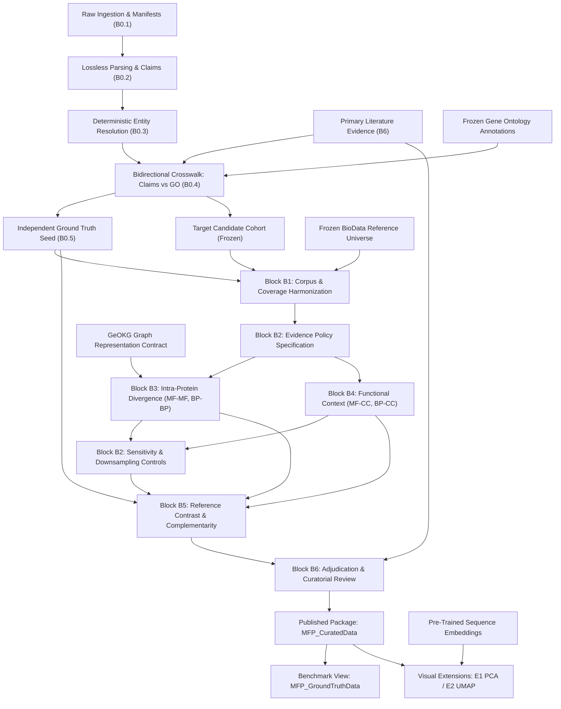

# Experimental Master Proposal: Multi-Source Evidence Concordance, Functional Dissimilarity, and Literature Adjudication Framework

| Attribute | Proposal Specification Record |
|---|---|
| **Document Title** | Experimental Master Proposal: Multi-Source Evidence Concordance, Functional Dissimilarity, and Literature Adjudication Framework |
| **Framework Identifier** | `PEC-EXP-001` |
| **Document ID** | `DOC-PROPOSAL-PEC-EXP-001-ENG` |
| **Scientific Proposal Edition** | Edition `0.2.1` (`2026-11-06`; Framework Identifier: `PEC-EXP-001`) |
| **English Proposal State** | Maintained English Successor (Migrated: `2026-11-12`) |
| **Date** | 2026-11-12 (Original source proposal: 2026-11-06) |
| **Status** | **Active Research Proposal Under Review — Not Approved for Full Experimental Execution**<br>*This proposal does not describe current repository implementation or authorize pipeline execution.* |
| **Document Role** | Governing Scientific Architecture and Research Proposal for the Multifunctional Protein Bibliographic Framework |
| **Proposed Executor** | `mfp-bibliography` (in coordination with PIS and CBBIO; consumer: PEC) |
| **Historical Lineage** | Maintained English successor to Catalan master proposal [`docs/roadmap/core/experiment-guio-v2.md`](experiment-guio-v2.md) (v0.2.1), integrating historical predecessors [`experiment_definition.md`](experiment_definition.md) and [`Pla de recerca de l'experiment sobre MFPData.md`](Pla%20de%20recerca%20de%20l'experiment%20sobre%20MFPData.md). |
| **Target Data Product** | `MFP_CuratedData` (comprehensive curated evidence package) with strict benchmark view `MFP_GroundTruthData`. |
| **Governing Rules** | [`AGENTS.md`](../../../AGENTS.md), [ADR-001](../../decisions/ADR-001-repository-scope.md) through [ADR-007](../../decisions/ADR-007-v1-scope-descope-bibliographic-relations.md), proposed [ADR-008](../../decisions/ADR-008-functional-normalization-pilot-scope.md). |

> [!IMPORTANT]
> **Active Proposal Status & Epistemic Non-Execution Notice**:
> 1. **Proposal Under Review**: This document is an **active master research proposal under review**, governing the conceptual research framework `PEC-EXP-001`. It is **NOT** an approved executable protocol, binding engineering release contract, or operational pipeline mandate.
> 2. **No Implementation Implied**: Language migration from Catalan to English establishes active documentation compliance under [`AGENTS.md`](../../../AGENTS.md) Section 3; it does **NOT** constitute scientific lead or repository maintainer approval of the proposed research design.
> 3. **Execution Gated**: Execution of the proposed experimental blocks (B0 through B6) remains strictly gated under Decision Gate G0 and requires human review. Metric calculation engines remain descoped from the baseline catalog under [ADR-001](../../decisions/ADR-001-repository-scope.md) and [ADR-007](../../decisions/ADR-007-v1-scope-descope-bibliographic-relations.md).
> 4. **Distinction from Current Baseline**: Formally released catalog capabilities are strictly confined to the packaged candidate baseline `mfp-catalog-candidate-v0.3.0` (five-source cataloging, raw artifact freezing under [ADR-002](../../decisions/ADR-002-raw-data-immutability.md), and deterministic entity hashing under [ADR-005](../../decisions/ADR-005-deterministic-protein-ids.md)). All pipeline stages described below represent proposed future research.

---

## 1. Document Reading Conventions and Epistemic Governance

This document establishes the end-to-end scientific and operational workflow for the proposed investigation. The data structures, interfaces, and metric engines described herein do not claim to exist in the current repository deployment.

To maintain epistemic clarity, statements throughout this proposal are classified into four operational categories:
- **`Provided / Observed`**: Observations reported in source documents, raw exports, or diagnostic SQL queries, distinguished from live verified database behavior.
- **`Proposed`**: Methodological choices, metric aggregation conventions, or data schemas submitted for scientific review and governance sign-off.
- **`Pending`**: Unresolved scientific questions or technical discrepancies blocking a specific Decision Gate.
- **`Extension`**: Optional research analyses (such as 3D manifold embeddings) preserved for completeness but explicitly separated from the core experimental progression.

> [!NOTE]
> **The Guiding Methodological Invariant: Evidence First**:
> The foundational rule governing this research design is **evidence first, descriptors second, interpretation and curation finally**. Mathematical semantic scores do not generate biological ground truth, nor can they validate the reference truth against which they are compared. Hypotheses do not presume significant differences or inherent superiority of contextual triplets or graph embeddings over conventional annotations.

---

## 2. Scientific Framework & Epistemic Foundations

### 2.1 Central Research Question
The core scientific inquiry uniting this experimental framework is formulated as follows:

> *What empirical evidence of protein multifunctionality can be rigorously reconstructed from raw database sources and the primary literature; how is this evidence represented within Gene Ontology (GO) annotations; and to what extent can simple and contextual dissimilarity descriptors characterize poorly annotated cases relative to a bibliographically well-supported ground-truth seed and a comparable proteomic reference baseline?*

This question synthesizes the functional characterization goals of early project proposals with the empirical cross-source contrast (RAW vs QuickGO vs local database) articulated in exploratory research plans. It does **not** convert the investigation into a binary classification task (Multifunctional vs Non-Multifunctional), nor does it treat general proteomic databases (BioData) as a verified negative class.

### 2.2 Scientific Objectives
The investigation is structured around eleven specific scientific objectives:

| ID | Scientific Objective | Concrete Evidence of Completion |
|---|---|---|
| **O1** | Define an auditable, traceable protein cohort across five sources | Ingestion manifest, resolved entity identifiers, coverage matrix, and explicit exclusion logs. |
| **O2** | Quantify metric sensitivity across curatorial evidence levels | Paired difference comparisons, rank correlation stability, and term-count reduction downsampling controls. |
| **O3** | Characterize intra-protein functional annotation divergence | Primary Molecular Function (MF–MF) divergence; secondary Biological Process (BP–BP) divergence. |
| **O4** | Contextualize functional divergence across cellular compartments | Primary Function–Compartment (MF–CC) associations; secondary Process–Compartment (BP–CC) associations. |
| **O5** | Evaluate metric positioning and complementarity relative to reference | Comparable proteomic reference baseline, multi-metric correlation matrix, and discordant case profiling. |
| **O6** | Produce an auditable, versioned literature curation package | Primary evidence units, double-blind review records, and versioned adjudication changelogs. |
| **O7** | Reconstruct verbatim raw source attribution claims | Normalized claims retaining raw string locators, original categories, and source provenance. |
| **O8** | Measure bidirectional literature–GO annotation concordance | Bidirectional crosswalk mapping documented functional claims to GO annotations across concordance classes. |
| **O9** | Contrast simple term-level annotations with contextual functional triplets | Contextual triplet definitions, evidence linkage criteria, and controlled pairwise comparisons. |
| **O10** | Profile accession-only candidate records against ground truth | Descriptive positioning of accession-only records relative to seed distributions, without automated label propagation. |
| **O11** | Decouple full catalog releases from strict benchmark ground truth | Full multi-source evidence package (`MFP_CuratedData`) released alongside a strict adjudicated benchmark view (`MFP_GroundTruthData`). |

Objectives O1 through O6 preserve the core characterization workflow of the foundational design; O7 through O11 integrate the detailed crosswalk, contextual triplet, and multi-tier release enhancements.

### 2.3 Working Hypotheses
The research framework establishes ten testable working hypotheses:

| ID | Working Hypothesis | Target Experimental Block |
|---|---|---|
| **H1** | Curatorial annotation coverage and taxonomic composition account for a substantial fraction of observed functional divergence across databases. | Blocks B0, B1, B5 |
| **H2** | Metric sensitivity across evidence filters largely reflects term-count reduction rather than biological specificity shifts. | Blocks B2, B3, B4 |
| **H3** | Graph-topological measures (MBL), information-theoretic distances (Lin), semantic value models (Wang), and learned representations (GeOKG) provide partially complementary, non-redundant functional signals. | Blocks B3, B5 |
| **H4** | Statistically rare, well-supported Molecular Function–Cellular Component (MF–CC) associations identify candidate moonlighting behaviors for targeted literature curation. | Blocks B4, B6 |
| **H5** | Measurable semantic divergence between attributed multifunctionals and reference proteomes persists after controlling for length, taxonomy, and annotation density. | Block B5 |
| **H6** | High dissimilarity scores and cross-metric discordances serve as prioritizing heuristics for manual curation, but cannot establish biological ground truth. | Blocks B5, B6 |
| **H7** | Distinct functional claims documented in primary sources frequently lack corresponding specific GO terms or are annotated at differing levels of curatorial granularity. | Blocks B0, B1, B6 |
| **H8** | Contextual functional triplets capture biological distinctions that are lost when treating a protein's annotations as an unlinked bag of GO terms. | Blocks B3, B4, B5 |
| **H9** | A subset of accession-only candidate proteins shares multi-metric profile characteristics with the independently reviewed ground-truth seed. | Blocks B5, B6 |
| **H10** | Curatorial depth, bibliographic citation density, and experimental support vary substantially across taxonomic kingdoms and contributing source databases. | Blocks B1, B2, B5 |

### 2.4 Research Questions Preserved from Predecessor Plans
This master proposal preserves and operationalizes all specific research questions articulated in earlier research drafts:
- **Questions from Catalan Research Plan (`Pla de recerca`)**:
  - `Q1`: What evidence codes support existing annotations for multifunctional proteins? (Evaluated by code, aspect, source, and taxon frequencies in B1/B2).
  - `Q2`: What proportion of functional annotations is supported by primary literature citations? (Evaluated via reference coverage and validation in B0/B1).
  - `Q3`: Are Molecular Functions and Biological Processes internally divergent within the same protein? (Evaluated via intra-protein pairwise dissimilarity in B3).
  - `Q4`: Does functional divergence change when filtering by curatorial evidence level? (Evaluated via paired comparisons, rank shifts, and downsampling in B2).
  - `Q5`: Which Cellular Components associate with functionally divergent proteins? (Evaluated via cross-aspect NPMI and enrichment in B4).
  - `Q6`: Does documented primary literature concord with assigned GO annotations? (Evaluated via bidirectional crosswalk and manual adjudication in B0/B6).
- **Detailed Block Questions (RQ1.1 through RQ6.3)**:
  - Preserved in full and embedded directly within the respective experimental block specifications (Sections 7.1 to 7.7 below).

### 2.5 Linkage to Canonical English Reference Documents
To maintain modularity and avoid redundant maintenance, detailed conceptual expositions, mathematical derivations, and curatorial workflows are formally delegated to the canonical English reference documents:
- **Foundational Epistemology & Invariants**: Delegated to [`docs/architecture/scientific-background.md`](../../architecture/scientific-background.md) (explanatory reference; covers the Open-World Assumption, annotation lag, sequence homology limits, and the ten explicit negative methodological boundaries).
- **Mathematical Formulations & Aggregation Contracts**: Delegated to [`docs/architecture/go-metrics-specification.md`](../../architecture/go-metrics-specification.md) (proposed analytical design; covers MBL, IC in nats, Wang recurrence, Lin dissimilarity, NPMI formulas, and proposed output schemas).
- **Literature Adjudication & Blinding Protocols**: Delegated to [`docs/curation/literature-curation-manual.md`](../../curation/literature-curation-manual.md) (proposed curation procedure; covers the seven linked evidentiary units, lawful full-text handling, blinding protocols, and nominal outcome categories).

---

## 3. Scope, Operating Boundaries, and Non-Goals

### 3.1 Core In-Scope Capabilities
The core scope of this experimental framework encompasses:
1. Ingestion, checksumming, and freezing of raw data artifacts across five external databases (MoonDB, MoonProt, MultifacetedProtDB, MultitaskProtDB-II, PlantMP).
2. Lossless extraction of source attribution claims and functional statements.
3. Deterministic entity resolution mapping canonical UniProtKB accessions to `MFPB_PROTEIN_ID_V1` identifiers ([ADR-005](../../decisions/ADR-005-deterministic-protein-ids.md)).
4. Bidirectional crosswalk construction between source functional claims and structured Gene Ontology annotations.
5. Evaluation of five evidence code policies (`ALL_ELIGIBLE`, `EXP_CONVENTIONAL`, `EXP_EXTENDED`, `EXP_CURATOR_AUTHOR`, `NON_IEA`).
6. Calculation of simple intra-aspect semantic dissimilarity (MF–MF, BP–BP) and contextual triplet divergence.
7. Calculation of cross-aspect associations (MF–CC, BP–CC) via Normalized Pointwise Mutual Information (NPMI).
8. Contextual comparison against a matched proteomic reference background (BioData).
9. Two-stage manual literature curation producing an auditable benchmark release (`MFP_CuratedData`).
10. Evaluation of learned knowledge graph embeddings (GeOKG-GO) conditional upon a validated artifact contract.

### 3.2 Explicit Non-Goals (Out of Scope)
The following activities are strictly excluded from the experimental baseline:
- **No Machine Learning Classifier Training**: No supervised model training, feature selection, or classification benchmark evaluation (deferred to downstream repositories under [ADR-001](../../decisions/ADR-001-repository-scope.md)).
- **No Construction of Negative Control Classes**: General proteomic databases (BioData) serve as a contextual reference frequency baseline, **never as a verified negative class (Non-Multifunctional / NMF)**. Monofunctionality cannot be proven computationally from annotation absence.
- **No Laboratory Wet-Lab Validation**: Computational scores identify candidates for literature adjudication; they do not replace physical biochemical assays.
- **No Unwarranted Cartesian Functional Triplets**: Co-annotation of terms across aspects does not establish physical execution in that compartment; synthesizing triplets by Cartesian product ($MF \times BP \times CC$) is strictly prohibited ([`AGENTS.md`](../../../AGENTS.md) Section 5).
- **No Mandatory Live GeOKG Model Retraining**: Pre-trained embeddings may be evaluated as input representations; retraining graph models is out of scope.
- **No Web Service or HTTP API Deployment**: Architecture is restricted to pure-Python, offline, reproducible CLI pipelines and static file outputs.

### 3.3 Boundaries Governing Future PEC Downstream Integration
Any eventual transition of curated datasets from `mfp-bibliography` to downstream predictive modeling in the Protein Embedding Classifier (PEC) project requires an independent protocol with its own decision gates. In that future context:
- True Positives (`TP`) and Non-True-Positives (`NTP`) are operational benchmark roles within a specific classification trial, not permanent biological ground-truth labels.
- Sequence homology controls, cluster-based data splitting, and class-imbalance penalties must be formally specified before downstream model training.

---

## 4. Operating Concepts, Terminology, and Proposed Data States

### 4.1 Core Conceptual Terminology
To ensure rigorous distinction between biological facts, database statements, and mathematical scores, the following definitions are enforced:

| Term / Concept | Operational Definition in this Framework |
|---|---|
| **Source Record** | A raw, unparsed entry in a contributing database prior to entity resolution or claim extraction. |
| **Source Claim** | A verbatim attribution statement and category label as asserted by a contributing source (e.g. `confirmed`, `predicted`). |
| **Functional Claim** | A discrete biochemical activity, physiological role, or biological process attributed to a protein entity. |
| **GO Assertion** | A structured association connecting a protein product to a GO term, accompanied by an evidence code, reference, and assigned-by provenance. |
| **Functional Context** | An evidentiary unit linking a catalytic function, biological process, and cellular location supported by primary assay evidence. |
| **Multifunctionality** | Broad biological capability of executing multiple autonomous biochemical functions, distinct from curatorial annotation density. |
| **Moonlighting** | Strict biological category where a single polypeptide chain executes two or more autonomous, non-homologous functions; not synonymous with general multifunctionality. |
| **Information Content (IC)** | Negative natural logarithm of term occurrence probability within a reference corpus; strictly distinguished from the GO evidence code `IC`. |
| **Snapshot** | An immutable, frozen, cryptographic state of a database, ontology, or software codebase identified by release date and SHA-256 hash. |
| **Reference Profile** | A derived background distribution (term counts, information content, co-occurrence frequencies) computed over a declared reference universe. |

### 4.2 Proposed Data States and Pipeline Lifecycle
Data progressing through the proposed framework is organized into ten distinct, immutable states:

| Proposed Data State | Operational Definition and Role |
|---|---|
| `MFP_RAW` | Frozen, immutable raw downloads and associated cryptographic verification manifests. |
| `MFP_ParsedData` | Normalized tabular records extracted by source parsers without data loss or semantic alteration. |
| `MFP_IntegratedData` | Unified protein entities with resolved deterministic IDs, consolidated source claims, and evidence links. |
| `MFPUniProtData_initial` | The frozen operational candidate cohort extracted from target databases for experimental scoring. |
| `MFP_GroundTruthSeed` | An independent, high-confidence benchmark subset manually reviewed before metric scoring. |
| `BioData_reference` | Frozen reference proteome snapshot serving as the contextual background frequency universe. |
| `Reference_profile` | Derived background frequency matrices, information content vectors, and pairwise joint distributions. |
| `MFP_AnalysisData` | Versioned metric calculation results accompanied by eligibility codes, counts, and diagnostic status flags. |
| `MFP_CuratedData` | Complete, published release package containing all evidence layers, analysis tables, and curation records. |
| `MFP_GroundTruthData` | Strict, high-confidence benchmark view extracted from `MFP_CuratedData` based on double-blind human adjudication. |

> [!NOTE]
> **Resolution of Historical Naming Discrepancies**:
> Early project drafts alternated between the identifiers `MFPUniProtData` and `MFP_UniProtData`. These terms are reconciled in this specification as referring to the same target candidate cohort. Logical names must never substitute for explicit connection parameters, database schemas, and cryptographic file checksums.

---

## 5. Baseline Resources, Reported Data Distributions, and Technical Caveats

### 5.1 Reported Baseline Inventory
Diagnostic audits of historical data deployments reported the following starting resource inventory:

| Resource Element | Reported Baseline Finding | Scientific and Technical Caveats |
|---|---|---|
| **Raw Source Files** | 6 directories containing 716 raw files | Complete file inventory and SHA-256 hashes must be verified offline before parsing. |
| **Target Database** | PostgreSQL 16.13 deployment containing 2,182 protein records | Represents an empirical deployment; no queries to live servers permitted during automated builds. |
| **GO Annotations** | 96,186 total annotation rows | Represents raw GAF rows, not distinct proteins or unique canonical GO terms. |
| **Null Publications** | 40,669 annotation rows lacking a `publication_id` | Null publication fields reflect GAF format conventions or ingestion loss; they do not prove lack of literature support. |
| **Reference Proteome** | Local BioData instance containing 137,213 protein records | Identifies an empirical reference snapshot; counting units and proteome boundaries must be frozen. |
| **Annotation Schema** | Schema defines a nullable `publication_id` field | Auditing showed composite keys (`protein_id`, `go_id`) risk collapsing multiple valid evidence lines if not partitioned. |

### 5.2 Observed Evidence Code Distribution
A diagnostic SQL query executed over the historical 96,186-row annotation callset reported the following distribution of Gene Ontology evidence codes:

| Evidence Code | Observed Rows | Evidence Code | Observed Rows |
|---|---:|---|---:|
| `IEA` (Electronic Annotation) | 22,694 | `IDA` (Direct Assay) | 20,562 |
| `IPI` (Physical Interaction) | 18,013 | `IBA` (Biological Ancestor) | 7,810 |
| `IMP` (Mutant Phenotype) | 5,773 | `TAS` (Traceable Author Statement) | 5,217 |
| `ISS` (Sequence Similarity) | 4,616 | `EXP` (Inferred from Experiment) | 3,762 |
| `NAS` (Non-traceable Author Statement) | 2,277 | `HDA` (High Throughput Direct Assay) | 1,980 |
| `ISO` (Sequence Orthology) | 1,743 | `IGI` (Genetic Interaction) | 577 |
| `IC` (Inferred by Curator) | 307 | `IEP` (Expression Pattern) | 299 |
| `RCA` (Reviewed Computational Analysis) | 176 | `HTP` (High Throughput Experiment) | 140 |
| `ISM` (Sequence Model) | 96 | `ISA` (Sequence Alignment) | 83 |
| `ND` (No Biological Data Available) | 27 | `HMP` (High Throughput Mutant Phenotype) | 20 |
| `HEP` (High Throughput Expression Pattern) | 13 | `IKR` (Key Residues) | 1 |

*Caveat*: This distribution represents raw historical GAF rows. Final sample sizes across experimental layers will vary following obsolete term resolution, root term exclusion, negation filtering, and pairwise eligibility gating.

### 5.3 Observed Gene Ontology Aspect Distribution
A query across the target database's `go_terms` dictionary revealed the following term counts:
- **Cellular Component (`CC`)**: 33 rows with category `cellular_component`, 1,000 rows with category `C`.
- **Biological Process (`BP`)**: 214 rows with category `biological_process`, 5,561 rows with category `P`.
- **Molecular Function (`MF`)**: 117 rows with category `molecular_function`, 2,451 rows with category `F`.

*Caveat*: These figures represent entries in the local ontology table, not protein counts. Evaluating DAG distances requires parsing a frozen OBO ontology release with full hierarchical edge structures (`is_a`, `part_of`).

---

## 6. Experimental Architecture and Workflow Overview

The end-to-end architecture decomposes into seven discrete, sequential experimental blocks (B0 through B6), two visual extensions (E1 and E2), and a multi-tier release pipeline:



### 6.1 Linear Execution Workflow
For environments unable to render Mermaid diagrams, the execution sequence proceeds as follows:
1. **Block B0**: Ingests and freezes raw multi-source files (B0.1); parses source records into structured claims without loss (B0.2); resolves protein identities to deterministic accessions (B0.3); constructs a bidirectional crosswalk between claims and GO (B0.4); and freezes an independent ground-truth seed prior to scoring (B0.5).
2. **Block B1**: Harmonizes the cohort, verifies denominators, and establishes coverage matrices across all data layers.
3. **Block B2**: Evaluates five evidence code policies and executes term-count downsampling controls to measure curatorial sensitivity.
4. **Blocks B3 & B4**: Compute mathematical semantic dissimilarity across intra-aspect pairs (B3) and statistical cross-aspect associations (B4).
5. **Block B5**: Evaluates candidate distributions against matched reference proteomes (BioData) and assesses multi-metric complementarity.
6. **Block B6**: Executes double-blind manual literature review and adjudication to produce the final curated package (`MFP_CuratedData`) and strict benchmark view (`MFP_GroundTruthData`).
7. **Extensions E1 & E2**: Compute exploratory 3D projections (PCA, UMAP) over sequence embeddings colored by curatorial and metric properties.

---

## 7. Experimental Block Specifications (B0 through B6)

### 7.1 Block B0: Raw Data Ingestion, Identity Resolution, Crosswalk, and Ground Truth Seed

#### B0.1 Acquisition and Freezing
- **Contributing Sources**: MoonDB (curated TSVs), MoonProt (HTML scrapings and artifact indexes), MultifacetedProtDB (JSON/TXT exports), MultitaskProtDB-II (`proteins.csv`), PlantMP (confirmed, likely, and predicted CSVs).
- **Protocol**:
  1. Ingest all raw files into immutable directory structures under `data/raw/`.
  2. Compute SHA-256 cryptographic hashes for every file and record in frozen manifests.
  3. Prohibit file overwrites; any updated download creates a new timestamped snapshot.
  4. Record upstream URLs, acquisition dates, download methods, and legal distribution licenses.
- **Deliverable DA0**: Raw ingestion manifest, source profile cards, and acquisition incident log.

#### B0.2 Lossless Parsing and Source Claim Extraction
- Construct dedicated parsers for each source format. Produce normalized `source_records` and `source_claims` retaining:
  - Exact source record locators (row index, table, field, or HTML tag).
  - Verbatim text statements and source-native category labels (`confirmed`, `predicted`, `likely`).
  - Documented accessions, taxonomic classifications, functional phrases, and literature citations.
- *Invariant*: Never collapse multiple distinct claims or conflicting source statements into a single row.

#### B0.3 Deterministic Identity Resolution
- Distinguish between source record, physical protein entity, canonical UniProtKB accession, isoform identifier, and amino acid sequence.
- Map canonical accessions to deterministic `MFPB_PROTEIN_ID_V1` identifiers in accordance with accepted [ADR-005](../../decisions/ADR-005-deterministic-protein-ids.md).
- Retain ambiguous mappings and unresolved accessions as explicit unmapped records; do not silently delete them from the catalog.
- **Deliverable DA1**: Parsed records, JSON schemas, entity crosswalk, and provenance traceability matrix.

#### B0.4 Bidirectional Functional Crosswalk: Source Claims vs Gene Ontology
Compare documented functional claims against structured GO annotations across seven explicit concordance classes:
1. **Specific Match**: Documented function corresponds precisely to the assigned canonical GO term.
2. **GO More General**: Assigned GO term describes the functional domain at a broader hierarchical level.
3. **GO More Specific**: Assigned GO term possesses greater granular detail than documented in the source claim.
4. **Function Absent from GO**: Documented claim lacks any observable corresponding annotation in the queried snapshot.
5. **GO Lacking Source Support**: Structured GO annotation has no identifiable supporting text in the examined source record.
6. **Explicit Contradiction**: Documented assay evidence directly contradicts the asserted GO annotation.
7. **Not Assessable**: Full text paywalled, accession ambiguous, or information insufficient to evaluate.
- *Invariant*: Pipeline loss (differences between external QuickGO GAFs and local database tables) must be explicitly isolated and logged.
- **Deliverable DA2**: Bidirectional functional crosswalk matrix and concordance summary report.

#### B0.5 Independent Ground Truth Seed (`MFP_GroundTruthSeed`)
- Establish an initial benchmark cohort of high-confidence multifunctional proteins **strictly prior to calculating semantic dissimilarity scores**, preventing circular validation.
- **Eligibility Criteria**:
  1. Unambiguous physical protein entity identified by canonical UniProtKB accession.
  2. At least two experimentally demonstrated, biochemically distinct functional activities.
  3. Primary peer-reviewed literature available and inspected by curators.
  4. Verified absence of taxonomic, organismal, or isoform confusion.
  5. Independent human curation sign-off.
- **Deliverable DA3**: Frozen ground-truth seed dataset, sample rationale, and pre-scoring cryptographic fingerprint.

---

### 7.2 Block B1: Corpus Harmonization and Coverage Characterization

- **Purpose & Core Questions**: Harmonizes the unified cohort and establishes denominators across all data layers, addressing research questions:
  - `RQ1.1`: What is the overall concordance and overlap among the five contributing multifunctionality databases?
  - `RQ1.2`: How complete are sequence, taxonomic, GO annotation, and literature references across the attributed cohort?
  - `RQ1.3`: What taxonomic and functional biases exist within the unified catalog?
  - `RQ1.4`: What proportion of the attributed cohort overlaps with the BioData reference proteome?
- **Analysis Protocol**:
  1. Deduplicate entities across sources while preserving multi-source provenance links.
  2. Compute coverage matrices across sequence lengths, taxonomic kingdoms, evidence layers, and literature availability.
  3. Establish explicit denominators for all downstream analysis blocks.
- **Deliverable D1**: Unified cohort catalog, coverage matrix, BioData overlap report, and cohort attrition flow diagram.

---

### 7.3 Block B2: Evidence Robustness Stratification & Sensitivity

- **Purpose & Core Questions**: Separates biological functional signal from curatorial annotation density, addressing research questions:
  - `RQ2.1`: How do functional dissimilarity distributions shift across different levels of curatorial evidence?
  - `RQ2.2`: To what extent are observed dissimilarity changes driven by term-count reduction rather than biological specificity?
  - `RQ2.3`: Does restricting annotations to small-scale experimental evidence reduce spurious cross-aspect associations?
  - `RQ2.4`: Are ranking orders of protein dissimilarity stable across different evidence policies?
- **Five Proposed Evidence Policies**:

| Policy Layer | Proposed Identifier | Included Gene Ontology Evidence Codes | Methodological Role |
|---|---|---|---|
| **Layer A** | `ALL_ELIGIBLE` | All controlled evidence codes in snapshot (26 explicit codes including electronic `IEA`). | Baseline coverage condition; maximum term availability. |
| **Layer B** | `EXP_CONVENTIONAL` | `EXP`, `IDA`, `IPI`, `IMP`, `IGI`, `IEP`. | Primary experimental contrast; small-scale conventional assays. |
| **Layer C** | `EXP_EXTENDED` | Layer B plus `HTP`, `HDA`, `HMP`, `HGI`, `HEP`. | High-throughput sensitivity contrast. |
| **Layer D** | `EXP_CURATOR_AUTHOR` | Layer C plus `TAS`, `NAS`, `IC`. | Broad curatorial contrast (subject to Gate G2 review). |
| **Layer E** | `NON_IEA` | Layer A excluding electronic annotations (`IEA`). | Non-electronic curatorial baseline. |

> [!NOTE]
> **Formal Rectification on Reviewed Computational Analysis (RCA)**:
> In early draft versions, the evidence code `RCA` was tentatively marked for exclusion under a presumption of computational invalidity. In accordance with Gene Ontology Consortium standards and Decision `DEC-29`, **this general exclusion is formally retracted**. All 176 observed RCA rows are preserved in the raw baseline and admitted into Layer A (`ALL_ELIGIBLE`). Any future exclusion of RCA must be framed as a specific sensitivity analysis, never as a presumption of curatorial error.

- **Repeated Downsampling Control Protocol**:
  To disentangle biological specificity shifts from sample-size reduction, Layer A (`ALL_ELIGIBLE`) must be repeatedly downsampled to match the exact term count of the compared experimental policy (Layer B or C). The downsampling procedure must use frozen pseudo-random seeds and pre-specified repetition counts ($N \ge 100$).
- **Deliverable D2**: Evidence policy specification report, annotation retention tables, paired shift distributions, and downsampling stability curves.

---

### 7.4 Block B3: Intra-Protein Functional Divergence (MF–MF and BP–BP)

- **Purpose & Core Questions**: Measures internal functional dispersion between distinct annotations asserted for the same protein, addressing research questions:
  - `RQ3.1`: What is the degree of intra-protein semantic dissimilarity among attributed multifunctional proteins?
  - `RQ3.2`: How concordant are dissimilarity estimates across topological (MBL), semantic (Wang), and information-theoretic (Lin) measures?
  - `RQ3.3`: Do learned knowledge graph embeddings (GeOKG) capture non-linear relationships unmeasured by DAG traversal?
  - `RQ3.4`: Do contextual functional triplets alter dissimilarity distributions compared to unlinked term sets?
- **Simple Annotation Dissimilarity Baseline**:
  For a protein with $n_p \ge 2$ unique canonical terms within an aspect, the primary pairwise dispersion metric is evaluated as the unweighted arithmetic mean over distinct term pairs:

  $$D_p = \frac{2}{n_p(n_p - 1)} \sum_{i < j} [1 - S_{\text{Wang}}(t_i, t_j)]$$

  Detailed mathematical derivations for Wang dissimilarity, Minimum Branch Length (MBL), and Lin dissimilarity are formally specified in [`docs/architecture/go-metrics-specification.md`](../../architecture/go-metrics-specification.md) (proposed analytical design).
- **Contextual Functional Triplets**:
  - *Proposed Definition*: A functional triplet $\tau_k = (m_k, b_k, c_k)$ represents an integrated biological activity linking a Molecular Function ($m_k$), Biological Process ($b_k$), and Cellular Component ($c_k$) supported by primary assay evidence within a specific cellular state.
  - *Triplet Categories*: Complete Linked (all 3 aspects linked with evidence), Partial Linked (2 aspects linked), Co-Annotated Candidate (co-annotated on the same protein without explicit linkage), and Unsupported (unwarranted Cartesian combination).
  - *Governing Invariant*: Synthesizing triplets via Cartesian product ($MF \times BP \times CC$) is strictly prohibited ([`AGENTS.md`](../../../AGENTS.md) Section 5).
- **GeOKG Graph Representation Contract**:
  Evaluating hyperbolic knowledge-graph embeddings requires a frozen artifact checkpoint, explicit relationship parameter mappings, and validated geometric distance functions. Euclidean operations (such as linear centroids) must not be applied to hyperbolic manifolds without geometric justification.
- **Deliverable D3**: Pairwise dissimilarity distributions, extreme pair logs, contextual triplet contrast tables, and GeOKG representation audit.

---

### 7.5 Block B4: Functional and Compartmental Context (MF–CC and BP–CC)

- **Purpose & Core Questions**: Evaluates the relationship between biochemical functions and subcellular localizations, addressing research questions:
  - `RQ4.1`: Which enzymatic molecular functions statistically associate with multiple cellular compartments across reference proteomes?
  - `RQ4.2`: Are proteins with divergent Molecular Functions significantly enriched for execution across distinct subcellular localizations?
- **Cross-Aspect Association Metric (NPMI)**:
  Cross-aspect associations between Molecular Function $m$ and Cellular Component $c$ are estimated using Normalized Pointwise Mutual Information:

  $$\text{NPMI}(m, c) = \frac{\ln \left( \frac{P(m, c)}{P(m)P(c)} \right)}{-\ln P(m, c)}$$

  - *Evaluation Universe*: Evaluated over unique proteins in the reference proteome annotated with at least one term from each compared aspect.
  - *Safeguards*: Low support ($n < 5$) is flagged as `low_support`; unobserved pairs ($P(m, c) = 0$) are classified as `unobserved_pair` (never as biological incompatibility); degenerate probabilities ($P(m, c) = 1$) are handled via explicit limit rules.
- **Governing Invariant on Cellular Compartments**:
  Co-annotation of a catalytic Molecular Function and a Cellular Component on the same protein entity does **NOT** prove that the catalytic activity is physically executed within that compartment.
- **Deliverable D4**: Reference co-occurrence frequency tables, NPMI association matrices, and compartment-enrichment profiles.

---

### 7.6 Block B5: Reference Population Contrast & Metric Complementarity

- **Purpose & Core Questions**: Contextualizes attributed multifunctional cohorts against general proteomic baselines, addressing research questions:
  - `RQ5.1`: Do attributed multifunctional proteins exhibit significantly greater semantic dissimilarity than length- and taxon-matched reference proteins?
  - `RQ5.2`: What is the degree of empirical redundancy and complementarity across different metric families?
  - `RQ5.3`: Can multi-metric profiling prioritize accession-only candidate records that resemble the ground-truth seed?
- **Methodological Guardrail on Reference Proteomes**:
  The BioData reference proteome represents an empirical proteomic frequency universe. **It is NEVER a validated negative control class (Non-Multifunctional / NMF)**. An unannotated or low-scoring protein represents an annotation gap, not evidence of monofunctionality ([`AGENTS.md`](../../../AGENTS.md) Section 1.2).
- **Analysis Protocol**:
  1. Match candidate proteins to BioData comparators using taxonomic kingdom, sequence length bands, and annotation density strata.
  2. Measure paired differences across overlapping proteins; report complete coverage and attrition rates.
  3. Evaluate Pearson and Spearman correlation matrices across metric families (MBL, Wang, Lin, NPMI, GeOKG) on identical calculable subsets.
  4. Identify discordant cases (e.g. high Wang dissimilarity but low Lin dissimilarity) as priority candidates for manual curation.
- **Deliverable D5**: Reference contrast reports, matching diagnostic plots, multi-metric correlation matrices, and discordant candidate profiles.

---

### 7.7 Block B6: Curatorial Review, Adjudication, and Package Release

- **Purpose & Core Questions**: Executes systematic literature curation to validate attributions and resolve discrepancies, addressing research questions:
  - `RQ6.1`: What proportion of computationally prioritized multifunctional proteins is corroborated by primary literature evidence?
  - `RQ6.2`: What are the primary drivers of false attribution claims in contributing databases (e.g. homologous sequence transfer, curatorial over-generalization)?
  - `RQ6.3`: Can an auditable, versioned release package establish a reliable ground-truth benchmark for downstream biocuration?
- **Two-Stage Curation Architecture**:
  1. *Stage 1: Pre-Scoring Seed Curation (Block B0.5)*: Independent benchmark established prior to running algorithms.
  2. *Stage 2: Post-Scoring Adjudication (Block B6)*: Literature review applied to prioritized candidate strata, extremes, and discordant cases.
- **Stratified Sampling Strategy**:
  Review batches must include: high-dissimilarity extremes, evidence-sensitive proteins, cross-metric discordant cases, accession-only candidates, and an unselected random control sample.
- **Blinding Protocol**:
  When operationally feasible, algorithmic dissimilarity scores must be masked from curators during primary paper review, preventing scoring bias.
- **Curatorial Adjudication Record (9 Fields)**:
  Every curated entity records: (1) Entity Identity, (2) Functional Claims, (3) Primary Evidence Locators, (4) Gene Ontology Crosswalk, (5) Contextual Triplets, (6) Metric Scores, (7) Adjudication Decision (`Supported`, `Insufficient Evidence`, `Contradicted`, `Unresolved`), (8) Reviewer Sign-Off, (9) Versioned Impact Log.
- **Deliverable D6**: Final curated package (`MFP_CuratedData`), strict benchmark view (`MFP_GroundTruthData`), and literature adjudication audit report.

---

## 8. Exploratory Visual Extensions (E1 & E2)

### 8.1 Extension E1: Three-Dimensional Principal Component Analysis (PCA 3D)
- **Design Specification**: Evaluates sequence representations derived from frozen pre-trained language models (e.g. ESM-2) projected into three principal components.
- **Controls & Preprocessing**: Mean centering, explicit scaling policies, and variance explained tracking.
- **Coloring Overlays**: Points colored by functional dissimilarity, evidence retention, sequence length, taxon, and curation status.
- **Epistemic Invariant**: Projections serve as exploratory visualization collateral; visual clusters do not define biological classes.

### 8.2 Extension E2: Three-Dimensional UMAP Projections (UMAP 3D)
- **Design Specification**: Evaluates non-linear manifold projections over the same embedding space.
- **Controls**: Hyperparameter stability grids (n_neighbors, min_dist), frozen random seeds, and reproducible coordinates.
- **Governance**: Extensions E1 and E2 require independent resource approval and do not block core deliverables D0–D7.

---

## 9. Statistical Analysis Plan

### 9.1 Units of Analysis and Dependency Controls
To prevent pseudoreplication and inflated significance, every statistical evaluation enforces an explicit unit of analysis:

| Analysis Domain | Statistical Unit of Analysis | Pseudoreplication Control |
|---|---|---|
| **Data Ingestion** | Raw Artifact / Source Record | Formats from the same source are not independent observations. |
| **Coverage & Attrition** | Resolved Protein Entity | Explicit denominators reported for every filtering stage. |
| **Evidence Sensitivity** | Pairwise Difference on Identical Protein | Paired-difference design; complete-case tracking. |
| **Intra-Protein Divergence** | Protein Entity (Aggregated Pairwise Mean) | Term pairs are internal replicates; pairs are never pooled across proteins as independent points. |
| **Contextual Triplets** | Protein Context Group | Multiple triplets on the same protein share genetic background. |
| **Cross-Aspect Associations** | Unique Protein Occurrence in Reference | Each protein contributes at most once to a joint pair cell. |
| **Reference Proteome Contrast** | Matched Protein Pair or Stratified Group | Taxonomic and length matching controls for background divergence. |
| **Curatorial Adjudication** | Adjudicated Protein Case | Reviewer inter-annotator agreement measured via Cohen's kappa. |

### 9.2 Estimation, Uncertainty, and Confounder Safeguards
- **Effect Sizes Over P-Values**: Analyses prioritize effect size estimation (Cohen's $d$, median shift) accompanied by 95% confidence intervals.
- **Resampling Invariants**: Permutations and bootstrap iterations must resample at the protein or taxon-cluster level. Permuting raw GO terms across proteins violates graph topology and creates invalid biological combinations.
- **Confounder Adjustment**: Mandatory covariates include sequence length, taxonomic kingdom, literature publication volume, and raw annotation count.

---

## 10. Software Engineering Architecture and System Responsibilities

### 10.1 System Ownership Matrix
The proposed research framework spans multiple software systems with strictly defined boundaries:

| System / Component | Proposed System Owner | Operational Boundary & Justification |
|---|---|---|
| **Raw Ingestion & Parsers** | `mfp-bibliography` | Dedicated to source provenance, license tracking, and cataloging. |
| **UniProt / GOA Retrieval** | `Protein Information System (PIS)` | PIS provides upstream entity synchronization and annotation caching. |
| **Claim Registry & Sidecars** | `mfp-bibliography` | Normalization of multi-claim functional statements. |
| **Batch Retrieval & Adapters** | `CBBIO Core API` | Shared client interfaces for proteomic queries. |
| **Gene Ontology DAG Traversal** | `CBBIO.GO` | Reusable graph calculation library (OBO parsing, MBL, Wang, Lin). |
| **Cross-Aspect Association (NPMI)**| `CBBIO.GO` / Experimental Package | Background reference frequency calculation. |
| **GeOKG Hyperbolic Adapter** | `CBBIO.GeOKG` | Geometric manifold operations. |
| **Cohort Definition & Controls** | Experimental Project Sub-package | Specific study designs, paired testing, and downsampling. |
| **Curatorial Review & Release** | `mfp-bibliography` | Release packaging, benchmark extraction, and audit trails. |
| **Downstream Model Training** | `Protein Embedding Classifier (PEC)`| Machine learning training (strictly out of scope for `mfp-bibliography`). |

---

## 11. Reproducibility Standards, Run Manifests, and Execution Pilot

### 11.1 Run Manifest Specification
Every experimental run must emit a cryptographically signed, machine-readable run manifest recording:
- Framework version (`PEC-EXP-001`), run timestamp, and executing environment.
- Cryptographic SHA-256 hashes for all input datasets, ontology releases, and config files.
- Complete software dependency tree (`pip freeze`, Python version, OS architecture).
- Explicit random seeds, downsampling schedules, and metric hyperparameter dictionaries.
- Complete execution log, elapsed wall-clock times, and error condition registers.
- *Secret Sanitization Invariant*: Manifests and config files must **never** record database passwords, API tokens, or private credentials.

### 11.2 Scaling Calibration and Algorithmic Complexity
Because pairwise comparisons scale quadratically ($O(n^2)$), full execution requires:
- Term-level and pair-level caching for semantic dissimilarity calculations.
- Chunked parallel processing over partitioned protein batches.
- Concurrency throttles to protect database servers from connection exhaustion.

---

## 12. Release Specifications for `MFP_CuratedData`

### 12.1 Packaged Directory Layout
A published release of `MFP_CuratedData` emits an immutable artifact directory structured as follows:

```text
MFP_CuratedData/<version>/
  README.md
  dataset_card.md
  manifest.json
  checksums.sha256
  schemas/
    functional_claims.schema.json
    curated_evidence.schema.json
  proteins.parquet
  accessions.parquet
  source_records.parquet
  source_claims.parquet
  functional_claims.parquet
  references.parquet
  claim_evidence.parquet
  go_assertions.parquet
  annotation_crosswalk.parquet
  functional_contexts.parquet
  metric_results.parquet
  curation_decisions.parquet
  eligibility.parquet
  exclusions.parquet
  views/
    groundtruth_strict.parquet
    candidate_partial.parquet
    candidate_accession.parquet
    unresolved.parquet
  reports/
    coverage_report.md
    validation_audit.md
    methodological_limitations.md
```

### 12.2 Strict Benchmark View (`MFP_GroundTruthData`)
`MFP_GroundTruthData` is a filtered, high-confidence benchmark view extracted directly from `MFP_CuratedData`. It is restricted to entities supported by verified primary literature evidence and double-blind curation sign-off. It does not replace the comprehensive multi-source catalog.

### 12.3 Definition of Done (12 Exit Criteria)
A formal release of `MFP_CuratedData` requires satisfying all twelve criteria:
1. All protein entities mapped to canonical accessions or explicit ambiguity codes.
2. Every functional claim traceable to a raw source file and locator.
3. Gene Ontology annotations partitioned by evidence policy with negative qualifiers preserved.
4. Functional contexts explicitly linked to primary assay citations.
5. Metric calculations accompanied by coverage, term counts, and status flags (no default zeros).
6. Every curation decision backed by reviewer ID, evidence locator, and version history.
7. Strict benchmark view (`MFP_GroundTruthData`) reviewed and signed off.
8. Complete attrition logs and exclusion reasons published.
9. All Parquet tables validated against Draft 2020-12 JSON schemas.
10. Distribution licenses, terms of use, and Dataset Card published.
11. Cryptographic SHA-256 manifest verified offline.
12. Formal sign-off on Decision Gate G5 by the Scientific Lead.

---

## 13. Governance, Deliverable Matrix, and Decision Gates

### 13.1 Deliverables Matrix

| Deliverable ID | Description | Acceptance Criteria |
|---|---|---|
| **D0** | Experimental Protocol and Decision Baseline | Scope boundaries, invariants, and Gate G0 approval established. |
| **DA0** | Raw File Ingestion and Source Registry | Checksummed raw files, provenance cards, and license logs. |
| **DA1** | Parsed Claims and Identity Resolution | Lossless extraction schemas and deterministic entity digests. |
| **DA2** | Bidirectional Literature–GO Crosswalk | Seven-class concordance matrix and pipeline loss audit. |
| **DA3** | Independent Ground Truth Seed | Pre-scoring benchmark cohort frozen with verification fingerprints. |
| **D1** | Harmonized Cohort and Coverage Matrices | Explicit denominators, taxon distributions, and attrition flowcharts. |
| **D2** | Evidence Policy Stratification & Sensitivity | Retention tables, paired shifts, and downsampling control plots. |
| **D3** | Intra-Protein Semantic Dissimilarity | Pairwise dispersion distributions, extreme pairs, and triplet contrasts. |
| **D4** | Cross-Aspect Association (NPMI) | Evaluated NPMI matrices, support guardrails, and compartment heatmaps. |
| **D5** | Reference Contrast & Complementarity | Matched BioData contrasts, correlation matrices, and discordant profiles. |
| **D6** | Published Curated Package | Complete `MFP_CuratedData` release with audit trail. |
| **D7** | Executive Presentation Deck | Storyboarded presentation collateral aligned with protocol invariants. |
| **E1** | Sequence Embedding PCA 3D | Coordinates, preprocessing logs, and variance explained tracking. |
| **E2** | Sequence Embedding UMAP 3D | Hyperparameter grid, seed logs, and stability curves. |

### 13.2 Decision Gates

```
┌─────────────────────────────────────────────────────────────────────────────────┐
│                           GOVERNANCE DECISION GATES                             │
├─────────────────────────────────────────────────────────────────────────────────┤
│ GATE G0: Scientific Scope & Protocol Approval ──► Authorizes new experimentation│
│ GATE G1: Data Ingestion & Identity Resolution ──► Validates RAW, IDs, and Seed  │
│ GATE G2: Methods, Policies & Metrics Approval ──► Freezes formulas & thresholds │
│ GATE G3: Technical Pilot & Budget Calibration ──► Verifies cost & reproducibility│
│ GATE G4: Full Pipeline Execution Authorization► Locks codebase before full run  │
│ GATE G5: Final Adjudication & Release Sign-Off──► Approves public distribution   │
└─────────────────────────────────────────────────────────────────────────────────┘
```

The governance gates defined above serve as staged checkpoints for the proposed experimental research workflow (`PEC-EXP-001`). To ensure epistemic rigor, the governance status of these gates is distinguished as follows:
- **Gate Definitions**: G0 through G5 are formal gating checkpoints designed to control progression through research blocks B0–B6, preventing premature pipeline execution or scope drift.
- **Prerequisite Requirements**: Gate G0 is a mandatory prerequisite that must be formally approved before any new experimental computation (Blocks B0 through B6) begins. Gates G1–G3 represent controlled verification gates during execution, not open authorizations to modify the scientific design.
- **Evidence of Actual Gate Execution**: None of the experimental gates (G0 through G5) have been executed or passed for the research study `PEC-EXP-001`. The proposal remains under review.
- **Distinction from Baseline Catalog Operations**: Certain foundational data ingestion and identity resolution activities corresponding in theme to Gate G1 have already been addressed for the *catalog baseline* under accepted repository ADRs (e.g., raw artifact immutability under [ADR-002](../../decisions/ADR-002-raw-data-immutability.md), deterministic entity hashing under [ADR-005](../../decisions/ADR-005-deterministic-protein-ids.md), and candidate v0.3.0 packaging under [ADR-006](../../decisions/ADR-006-coverage-only-moonprot-status-rows.md)). These baseline engineering accomplishments are part of the accepted catalog foundation, but do **not** constitute retrospective approval or execution of experimental Gate G1 for the broader `PEC-EXP-001` study.

- **Gate G0 (Scope & Boundaries)**: Approves research questions, non-goals, and block progression. **Must precede all new experimental computation**.
- **Gate G1 (Ingestion & Identity)**: Verifies raw artifact hashes, parser fidelity, entity mappings, and pre-scoring seed integrity for the experimental cohort.
- **Gate G2 (Methods & Policies)**: Ratifies evidence code groupings, Wang/MBL/Lin parameters, triplet definitions, and statistical plans.
- **Gate G3 (Pilot Execution)**: Evaluates pilot resource consumption, caching efficiency, and error handling.
- **Gate G4 (Full Execution)**: Authorizes full-cohort computation upon code and parameter freeze.
- **Gate G5 (Release Approval)**: Approves final literature curation, dataset card, and publication packaging.

---

## 14. Formal Register of Open Decisions (`DEC-01` through `DEC-29`)

The 29 methodological decisions identified throughout the research framework are formalized below. To maintain precise alignment with repository governance, each item records its source state (`Proposed`, `Open`, or `Deferred`), its assigned governance gate, and its relationship to accepted repository architecture:

| Decision ID | Decision Topic | Source Position & Proposal | Source State | Required by Gate | Relationship to Accepted Repository Baseline |
|---|---|---|---|---|---|
| **`DEC-01`** | Core Project Scope | Source-evidence curation and characterization; no classifier training. | Proposed | Gate G0 | Governed and ratified by accepted [ADR-001](../../decisions/ADR-001-repository-scope.md) (classifier training out of scope for `mfp-bibliography`). |
| **`DEC-02`** | Entity Identity Hierarchy | Distinguish record, protein, accession, isoform, and sequence under ADR-005. | Open | Gate G1 | Governed and ratified by accepted [ADR-005](../../decisions/ADR-005-deterministic-protein-ids.md) (deterministic `MFPB_PROTEIN_ID_V1` entity resolution). |
| **`DEC-03`** | Target/BioData Compatibility | Verify database schemas; implement pure-Python offline adapters. | Open | Gate G1 | Open technical requirement for experimental data adapters. |
| **`DEC-04`** | Provenance Preservation | Audit references, negative qualifiers, and multi-source evidence lines. | Open | Gate G1 | Open audit requirement; aligns with repository source claims contract. |
| **`DEC-05`** | Evidence Policies | Ratify five layers (`ALL_ELIGIBLE`, `EXP_CONVENTIONAL`, `EXP_EXTENDED`, etc.). | Proposed | Gate G2 | Proposed analytical partition; recovered in [`go-metrics-specification.md` (§2.5)](../../architecture/go-metrics-specification.md#25-recovered-proposed-evidence-partitions-and-input-selection-conditions). |
| **`DEC-06`** | Gene Ontology Release | Freeze OBO release hash; separate asserted terms from IC propagation. | Proposed | Gate G2 | Proposed pipeline standard for metric computation. |
| **`DEC-07`** | Primary MF–MF Metric | Adopt unweighted pairwise arithmetic mean Wang dissimilarity. | Proposed | Gate G2 | Proposed metric baseline; recovered in [`go-metrics-specification.md` (§3.3)](../../architecture/go-metrics-specification.md#33-wang-semantic-dissimilarity). |
| **`DEC-08`** | GeOKG Representation Contract | Require frozen artifact hash, verified mapping, and hyperbolic geometry. | Open | Gate G2 | Open contract verification; metric execution currently descoped. |
| **`DEC-09`** | MF–CC Association Metric | Adopt NPMI with support threshold ($n \ge 5$) and coverage guardrails ($0.80$). | Proposed | Gate G2 | Proposed association metric; recovered in [`go-metrics-specification.md` (§3.6)](../../architecture/go-metrics-specification.md#36-cross-aspect-associations-npmi). |
| **`DEC-10`** | Protein-Level Aggregation | Ratify complete coverage policy for primary score; diagnostic available mean. | Open | Gate G2 | Open aggregation policy for multi-term proteins. |
| **`DEC-11`** | Reference Population Contrast | Control for length, taxonomy, and density; never treat BioData as NMF. | Proposed | Gate G2 | Proposed contrast design; BioData non-NMF rule is a binding repository invariant ([`AGENTS.md`](../../../AGENTS.md)). |
| **`DEC-12`** | Statistical Analysis Plan | Prioritize effect sizes and 95% CIs; cluster resampling at protein level. | Open | Gate G2 | Open statistical parameter specification. |
| **`DEC-13`** | Curation Architecture | Enforce independent seed pre-scoring (B0.5) and double-blind adjudication (B6). | Open | Gates G0 / G3 | Open curatorial protocol; procedure drafted in [`literature-curation-manual.md`](../../curation/literature-curation-manual.md). |
| **`DEC-14`** | Execution Budget Calibration | Calibrate wall-clock time, memory, and database load during technical pilot. | Open | Gate G3 | Open operational budget checkpoint. |
| **`DEC-15`** | Sequence Embeddings | Freeze model checkpoint, layer selection, and pooling strategy. | Open | Extensions E1 / E2 | Open parameter freeze for exploratory visual extensions. |
| **`DEC-16`** | 3D Visualization Scaling | Predefine scaling, centering, and hyperparameter stability grids. | Open | Extensions E1 / E2 | Open parameter freeze for exploratory visual extensions. |
| **`DEC-17`** | Future PEC Integration | Defer classifier training to downstream repository under independent protocol. | Deferred | Future Phase | Formally out of scope for `mfp-bibliography` per accepted [ADR-001](../../decisions/ADR-001-repository-scope.md). |
| **`DEC-18`** | Raw Data Inventory | Freeze raw checksum manifests and verify redistribution licenses. | Open | Gate G1 | Governed and ratified by accepted [ADR-002](../../decisions/ADR-002-raw-data-immutability.md) (append-only frozen `data/raw/`). |
| **`DEC-19`** | Source Claim Independence | Separate multiple database entries replicating the same primary publication. | Open | Gate G1 | Open curatorial deduplication rule for multi-source ingestion. |
| **`DEC-20`** | Literature–GO Concordance | Evaluate bidirectional crosswalk across seven explicit concordance classes. | Open | Gates G1 / G2 | Open crosswalk audit design. |
| **`DEC-21`** | Ground Truth Seed Criteria | Require two autonomous functions, primary literature, and double review. | Open | Gates G0 / G1 | Open benchmark criteria for initial seed cohort. |
| **`DEC-22`** | Contextual Triplet Semantics | Require explicit experimental link connecting $m$, $b$, and $c$; no Cartesian triplets. | Proposed | Gate G2 | Proposed semantic rule; prohibition against Cartesian triplets is a binding invariant ([`AGENTS.md`](../../../AGENTS.md)). |
| **`DEC-23`** | Contextual Divergence Weights | Emit multi-component vector; prohibit ad-hoc linear aggregation. | Proposed | Gate G2 | Proposed vector representation rule for multi-facet dissimilarity. |
| **`DEC-24`** | Accession-Only Candidates | Define accession-only status at baseline; profile without automated imputation. | Proposed | Gate G2 | Proposed descriptive profiling policy. |
| **`DEC-25`** | Biological Process Divergence | Maintain BP–BP as secondary parallel analysis; separate from MF domain. | Proposed | Gate G2 | Proposed secondary analysis boundary. |
| **`DEC-26`** | BioData Reference Boundaries | Freeze reference proteome snapshot and document counting units. | Open | Gate G1 | Open snapshot specification; aligns with BioData maintenance guide. |
| **`DEC-27`** | Database Schema Unicity | Audit composite keys; verify unicity before data migration. | Open | Gate G1 | Governed in catalog baseline by accepted [ADR-006](../../decisions/ADR-006-coverage-only-moonprot-status-rows.md) candidate packaging. |
| **`DEC-28`** | Curated Release Contracts | Require complete Parquet package, Draft 2020-12 schemas, and dataset card. | Open | Gates G3 / G5 | Open release packaging criteria for proposed future product `MFP_CuratedData`. |
| **`DEC-29`** | RCA Evidence Code Handling | Retain RCA in Layer A; revoke presumptive invalidity exclusion. | Proposed | Gate G2 | Proposed evidence policy rectification. |

> [!NOTE]
> An open decision is a formal commitment to evaluate and resolve a methodological question at its assigned governance gate with documented owner, date, and rationale. It is not an authorization to invent arbitrary data or assume approval.

---

## 15. Risk Register and Mitigation Safeguards

| Identified Risk | Severity | Mitigation & Quality Control Safeguard | Target Block |
|---|---|---|---|
| **Provenance Loss** | High | Lossless parsing, upstream sidecar preservation, and explicit limitation reporting. | Blocks B0, B1, B6 |
| **Duplicated Literature Citations** | Med | Deduplicate identical PMIDs; record shared bibliography across contributing databases. | Blocks B0, B5 |
| **Conflicting Source Categories** | Med | Retain verbatim source claim alongside normalized functional statements. | Blocks B0, B6 |
| **Organism / Isoform Confusion** | High | Enforce taxon checks and sequence-level validation before functional assignment. | Blocks B0, B1 |
| **Paywalled / Inaccessible Papers** | Med | Classify as `not_assessable`; never convert document absence to a negative biological label. | Blocks B0, B6 |
| **Missing Qualifiers (`NOT`)** | High | Ingestion audits must preserve qualifiers; unverified negation rows must not become positive. | Blocks B0, B2 |
| **Schema Unicity Collapses** | High | Pre-migration SQL audits to verify composite keys accommodate multiple evidences. | Block B1 |
| **Temporal Database Drift** | Med | Cryptographically freeze all input releases, OBO files, and candidate packages. | All Blocks |
| **Annotation Density Confounding** | High | Repeated term-count downsampling controls; report paired changes on complete cases. | Blocks B2, B3, B5 |
| **Taxonomic & Length Bias** | Med | Stratified matching and common support reporting against BioData reference proteome. | Block B5 |
| **Target / Reference Overlap** | High | Exclude overlapping entities or isolate via explicit sensitivity analyses. | Blocks B4, B5 |
| **Generic Root Term Artifacts** | Med | Preregister root term exclusions (`GO:0003674`, `GO:0008150`, `GO:0005575`). | Blocks B2, B3 |
| **Fabricated Cartesian Triplets** | Critical | Enforce strict evidence-linkage rules; prohibit $MF \times BP \times CC$ Cartesian products. | Blocks B0, B3, B4 |
| **Biased Contextual Coverage** | Med | Require explicit reporting of contextual completeness and missing component flags. | Blocks B3, B5 |
| **Invalid Geometric Operations** | High | Prohibit Euclidean operations on hyperbolic embeddings without formal manifold adapters. | Blocks B3, B5 |
| **Coverage Discrepancies** | Med | Evaluate multi-metric comparisons strictly over identical, calculable candidate subsets. | Blocks B3, B5 |
| **Low-Support Cell Estimates** | Med | Flag association pairs with $n < 5$ as `low_support`; enforce minimum coverage guardrails. | Block B4 |
| **GO Pair Pseudoreplication** | High | Cluster resampling and permutation strictly at the protein or taxon level. | Blocks B3, B5 |
| **Circular Curatorial Bias** | Critical | Establish pre-scoring ground truth seed (B0.5); mask algorithmic scores during review (B6). | Blocks B0, B6 |
| **Cherry-Picked Metric Hypotheses** | High | Preregister primary descriptors (Wang) and formalize multi-test corrections. | Blocks B2, B3, B4, B5 |
| **Arbitrary 3D Manifolds** | Low | Require pre-specified hyperparameter stability grids before inspecting projections. | Extensions E1, E2 |
| **Combinatorial Pair Explosion** | High | Implement term-pair caching, chunked multiprocessing, and batch retrieval. | Execution Engine |

---

## 16. Proposed Diagnostic SQL Suite

The diagnostic SQL transaction below was developed during preliminary research to audit local database deployments. It is documented here for technical traceability (executed in read-only mode, without exposing credentials):

```sql
BEGIN TRANSACTION ISOLATION LEVEL REPEATABLE READ READ ONLY;

-- 1. Deployment and Version Environment
SELECT current_database(), version(), CURRENT_TIMESTAMP;

-- 2. Schema Structure and Column Nullability
SELECT table_schema, table_name, column_name, data_type, is_nullable
FROM information_schema.columns
WHERE table_schema = 'public'
  AND table_name IN ('protein', 'accession', 'sequence', 'go_terms', 'protein_go_term_annotation')
ORDER BY table_name, ordinal_position;

-- 3. Composite Key and Index Definitions
SELECT schemaname, tablename, indexname, indexdef
FROM pg_indexes
WHERE schemaname = 'public'
  AND tablename = 'protein_go_term_annotation';

-- 4. Baseline Entity and Annotation Counts
SELECT COUNT(*) AS total_proteins FROM protein;
SELECT COUNT(*) AS total_annotations FROM protein_go_term_annotation;
SELECT category, COUNT(*) AS term_count FROM go_terms GROUP BY category;

-- 5. Evidence Code Distribution and Protein Coverage
SELECT evidence_code, COUNT(*) AS n_rows,
       COUNT(DISTINCT protein_id) AS n_proteins
FROM protein_go_term_annotation
GROUP BY evidence_code
ORDER BY n_rows DESC;

-- 6. Evidence Code Distribution Partitioned by GO Namespace
SELECT g.category, a.evidence_code, COUNT(*) AS n_rows,
       COUNT(DISTINCT a.protein_id) AS n_proteins
FROM protein_go_term_annotation a
JOIN go_terms g ON g.go_id = a.go_id
GROUP BY g.category, a.evidence_code
ORDER BY g.category, n_rows DESC;

-- 7. Publication Field Completeness Profiling
SELECT COUNT(*) FILTER (WHERE publication_id IS NULL) AS n_null_publications,
       COUNT(*) FILTER (WHERE publication_id IS NOT NULL) AS n_linked_publications
FROM protein_go_term_annotation;

-- 8. Proteins Lacking Any Functional Annotation
SELECT COUNT(*) AS n_unannotated_proteins
FROM protein p
WHERE NOT EXISTS (
  SELECT 1 FROM protein_go_term_annotation a WHERE a.protein_id = p.id
);

-- 9. Duplicate Annotation Rows Lacking Literature Linkage
SELECT protein_id, go_id, evidence_code, COUNT(*) AS duplicate_count
FROM protein_go_term_annotation
WHERE publication_id IS NULL
GROUP BY protein_id, go_id, evidence_code
HAVING COUNT(*) > 1;

-- 10. Duplicate Annotation Rows with Literature Linkage
SELECT protein_id, go_id, evidence_code, publication_id, COUNT(*) AS duplicate_count
FROM protein_go_term_annotation
GROUP BY protein_id, go_id, evidence_code, publication_id
HAVING COUNT(*) > 1;

-- 11. Dangling Foreign Keys / Unmapped Ontology Identifiers
SELECT a.go_id, COUNT(*) AS unmapped_rows
FROM protein_go_term_annotation a
LEFT JOIN go_terms g ON g.go_id = a.go_id
WHERE g.go_id IS NULL
GROUP BY a.go_id;

COMMIT;
```

---

## 17. Presentation Strategy & Slide Deck Storyboard

To communicate the research design effectively to scientific reviewers, the proposal establishes a 21-slide narrative structure:

| Slide ID | Proposed Title & Theme | Core Methodological Narrative |
|---|---|---|
| **S01** | Project Architecture Overview | Transition from raw multi-source data to an auditable curated package. |
| **S02** | Integrated Research Questions | Linking attribution provenance, GO representation, and literature evidence. |
| **S03** | Scope Boundaries & Non-Goals | Rejecting binary MF/NMF classification; establishing descriptive bounds. |
| **S04** | Data Ecosystem & System Roles | Separation of `mfp-bibliography`, PIS, CBBIO, and downstream PEC models. |
| **S05** | Technical Data Readiness | Demonstrating that database deployment does not equal complete coverage. |
| **S06** | The Seven Experimental Blocks | Phased progression from B0 (ingestion) through B6 (curation). |
| **S07** | Block B1: Harmonization & Denominators | Establishing explicit attrition tracking and coverage matrices. |
| **S08** | Block B2: Evidence Policies & Density | Controlling for term-count reduction via repeated downsampling. |
| **S09** | Block B3: Intra-Protein Divergence | Evaluating Wang, MBL, and Lin measures on intra-aspect pairs. |
| **S10** | GeOKG Graph Embeddings | Pre-trained graph representations and hyperbolic geometry contracts. |
| **S11** | Block B4: Function & Compartment Context | Estimating NPMI associations; proving co-annotation is not catalytic mechanism. |
| **S12** | Block B5: Contextual Reference Contrast | Matched proteomic comparison; BioData is a frequency baseline, not NMF. |
| **S13** | Block B6: Curation & Adjudication | Two-stage curation architecture and double-blind review protocols. |
| **S14** | Reproducibility & Governance | Run manifests, cryptographic checksums, and the six Decision Gates. |
| **S15** | Exploratory Visual Extensions | Sequence embedding manifolds (PCA 3D, UMAP 3D) as descriptive collateral. |
| **S16** | Comprehensive Risk Register | Identified failure modes and corresponding architectural safeguards. |
| **S17** | Governance Sign-Off & Open Decisions | Formal decision register (`DEC-01`–`DEC-29`) and Gate G0 request. |
| **S18** | Raw Ingestion & Source Claims | Tracing claims from raw database exports to normalized entities. |
| **S19** | Literature–GO Crosswalk | Evaluating bidirectional concordance across seven explicit classes. |
| **S20** | Simple Annotations vs Contextual Triplets| Defining functional triplets without unwarranted Cartesian expansion. |
| **S21** | Curated Release & Benchmark Views | Delivering `MFP_CuratedData` alongside strict `MFP_GroundTruthData`. |

- **Recommended Presentation Sequence**: S01–S06 (Scope & Architecture) $\to$ S18–S19 (Ingestion & Crosswalk) $\to$ S07–S10 (Corpus & Metrics) $\to$ S20 (Contextual Triplets) $\to$ S11–S14 (Associations & Curation) $\to$ S21 (Release Package) $\to$ S15–S17 (Extensions & Approval).

---

## 18. Historical Predecessors, Fusion Traceability, and Edition History

### 18.1 Document Edition History

| Edition | Date | Language | Documentary Status & Role |
|---|---|---|---|
| **`0.1.0`** | 2026-10-27 | Bilingual (Spanish / English) | Historical predecessor draft (`docs/roadmap/core/experiment_definition.md`). |
| **`0.1`** | 2026-10-27 | Catalan | Early exploratory research plan (`Pla de recerca de l'experiment sobre MFPData.md`). |
| **`0.2.0`** | 2026-11-06 | Catalan | Intermediate working consolidation (temporary file). |
| **`0.2.1`** | 2026-11-06 | Catalan | Downloadable master proposal (`docs/roadmap/core/experiment-guio-v2.md`) with RCA correction and embedded annexes. |
| **`0.2.1-eng`** | 2026-11-12 | English | **Maintained English Successor Proposal** (this document; `experimental-master-proposal.md`), faithful translation of scientific Edition 0.2.1 with modularized annex pointers; no scientific version change. |

### 18.2 Master Fusion Traceability Matrix
The table below documents how foundational elements from historical predecessors are preserved in this maintained English successor:

| Historical Predecessor Element | Methodological Treatment in this Successor | Governing Location in this Document |
|---|---|---|
| Central Question, O1–O6, H1–H6 | Preserved and expanded to O1–O11 and H1–H10. | Section 2 (Scientific Framework) |
| Blocks B1–B6, Deliverables D0–D7, Gates G0–G5 | All identifiers preserved intact. | Sections 7 and 13 |
| Raw Ingestion across 5 Sources | Formalized as Block B0.1 (DA0). | Section 7.1 (Block B0) |
| Source Claims and Categories | Normalized without loss as Block B0.2 (DA1). | Section 7.1 (Block B0) |
| Raw–QuickGO–Local Crosswalk | Formalized as Block B0.4 across 7 concordance classes. | Section 7.1 (Block B0) |
| Pre-Scoring Ground Truth Seed | Formalized as Block B0.5 (DA3). | Section 7.1 (Block B0) |
| `MFP_GroundTruthData` | Formalized as strict benchmark view of `MFP_CuratedData`. | Section 12 (Release Specifications) |
| Accession-Only Candidate Records | Profiled descriptively without automated imputation. | Sections 4.2, 7.6, 14 (`DEC-24`) |
| Primary MF–MF Divergence | Preserved as primary baseline (Wang dissimilarity). | Section 7.4 (Block B3) |
| Secondary BP–BP Divergence | Preserved as parallel secondary analysis. | Section 7.4 (Block B3) |
| Contextual Triplets ($\tau = (m, b, c)$) | Defined with evidence linkage; Cartesian expansion barred. | Section 7.4 (Block B3), Section 14 (`DEC-22`) |
| Metric Families (Wang, MBL, Lin, IC) | Formulations preserved and delegated to metric specification. | Section 7.4; [`go-metrics-specification.md`](../../architecture/go-metrics-specification.md) |
| Deferred Metrics (D3-MBL, RICD-MBL) | Preserved as deferred backlog items; no formulas invented. | Section 7.4 (Block B3) |
| PrOnto Co-Occurrence (AP / IP) | Preserved conditionally upon PPI network availability. | Section 7.4 (Block B3) |
| GeOKG Representation & Contract | Contract requirements and two proposed uses preserved. | Section 7.4 (Block B3), Section 14 (`DEC-08`) |
| Cross-Aspect Associations (NPMI) | Preserved with joint/marginal counts and support guardrails. | Section 7.5 (Block B4), Section 14 (`DEC-09`) |
| Evidence Policies (Layers A, B, C) | Preserved with explicit code lists. | Section 7.3; [`go-metrics-specification.md` (§2.5)](../../architecture/go-metrics-specification.md#25-recovered-proposed-evidence-partitions-and-input-selection-conditions) |
| Curatorial & Electronic Policies (D, E) | Explicitly defined (`EXP_CURATOR_AUTHOR`, `NON_IEA`). | Section 7.3 (Block B2), Section 14 (`DEC-05`) |
| Downsampling & Term Density Controls | Repeated downsampling protocol specified. | Section 7.3 (Block B2) |
| Reference Proteome Matching | Matching and common support specified; BioData not NMF. | Section 7.6 (Block B5), Section 14 (`DEC-11`) |
| Two-Stage Curation Architecture | Independent seed (B0.5) decoupled from adjudication (B6). | Sections 7.1, 7.7; [`literature-curation-manual.md`](../../curation/literature-curation-manual.md) |
| Diagnostic SQL Suite | Documented in full for schema and unicity audit. | Section 16 (Proposed Diagnostic SQL) |
| Visual Manifolds (PCA 3D / UMAP 3D) | Formalized as Extensions E1 and E2 with stability grids. | Section 8 (Exploratory Extensions) |
| Software Ownership Matrix | Formalized across `mfp-bibliography`, PIS, and CBBIO. | Section 10 (System Responsibilities) |
| Formal Decision Register | Complete table of 29 decisions (`DEC-01`–`DEC-29`). | Section 14 (Decision Register) |
| Comprehensive Risk Register | Full 22-risk mitigation matrix. | Section 15 (Risk Register) |
| Presentation Storyboard | Complete 21-slide narrative structure (S01–S21). | Section 17 (Presentation Storyboard) |

---

## 19. Provenance and Migration Appendix (Coverage Record)

This appendix records the exact mapping of all 36 active Catalan main-body sections from source document `docs/roadmap/core/experiment-guio-v2.md` to this maintained English successor:

| Source Section Heading (`experiment-guio-v2.md`) | Source Lines | English Destination Heading in this Proposal | Delegated Detail in Canonical Documents | Status & Discrepancies |
|---|---|---|---|---|
| `# Guió mestre...` & Header Metadata | L1–L25 | Document Control Table & Status Notice | [`scientific-background.md`](../../architecture/scientific-background.md) | Preserved source scientific Edition 0.2.1; recorded English successor maintenance date 2026-11-12. |
| `## Lectura i convencions` | L26–L36 | **Section 1**: Reading Conventions and Epistemic Governance | — | Preserved 4 operational categories. |
| `## Marc científic` (§§Pregunta, Objectius, Hipòtesis, Preguntes) | L37–L90 | **Section 2**: Scientific Framework & Epistemic Foundations | [`scientific-background.md`](../../architecture/scientific-background.md) | O1–O11 and H1–H10 preserved in full. |
| `## Abast i límits` | L91–L96 | **Section 3**: Scope, Operating Boundaries, and Non-Goals | [`ADR-001`](../../decisions/ADR-001-repository-scope.md) | Boundaries and non-goals formalized. |
| `## Terminologia i estats` | L97–L126 | **Section 4**: Operating Concepts, Terminology, and Proposed Data States | — | Reconciled naming discrepancies. |
| `## Punt de partida aportat` | L127–L166 | **Section 5**: Baseline Resources, Reported Data Distributions, and Technical Caveats | — | Evidence code counts preserved. |
| `## Arquitectura de l’experiment` | L167–L200 | **Section 6**: Experimental Architecture and Workflow Overview | — | Mermaid and linear text preserved. |
| `## B0: RAW i evidència` (§§B0.1–B0.5) | L201–L268 | **Section 7.1**: Block B0 (Acquisition, Parsing, Identity, Crosswalk, Seed) | [`ADR-005`](../../decisions/ADR-005-deterministic-protein-ids.md) | DA0–DA3 deliverables defined. |
| `## Contractes de dades` (§§Política GO, Missingness) | L269–L311 | **Sections 4.2 & 7.1**: Data Contracts & Missingness Conventions | [`canonical-schema.md`](../../canonical-schema.md) | Status codes preserved. |
| `## Ground truth i cohorts` | L312–L326 | **Sections 4.2 & 7.1**: Ground Truth Views and Cohort Strata | — | Seed decoupled from scores. |
| `## B1: corpus i cobertura` | L327–L339 | **Section 7.2**: Block B1 (Corpus Harmonization and Coverage Characterization) | — | Questions RQ1.1–RQ1.4 preserved. |
| `## B2: sensibilitat a evidència` | L340–L368 | **Section 7.3**: Block B2 (Evidence Robustness Stratification & Sensitivity) | [`go-metrics-specification.md` (§2.5)](../../architecture/go-metrics-specification.md#25-recovered-proposed-evidence-partitions-and-input-selection-conditions) | RCA rectification codified. |
| `## B3: divergència funcional` (§§Anotació simple, Tripletes, GeOKG) | L369–L421 | **Section 7.4**: Block B3 (Intra-Protein Functional Divergence) | [`go-metrics-specification.md`](../../architecture/go-metrics-specification.md) (§§3.1–3.4) | Mathematical formulas delegated. |
| `## B4: funció i compartiment` | L422–L439 | **Section 7.5**: Block B4 (Functional and Compartmental Context) | [`go-metrics-specification.md`](../../architecture/go-metrics-specification.md) (§3.6) | NPMI formulas delegated. |
| `## B5: referència i complementarietat` | L440–L458 | **Section 7.6**: Block B5 (Reference Population Contrast & Complementarity) | [`scientific-background.md`](../../architecture/scientific-background.md) (§7.2) | BioData non-negative rule enforced. |
| `## B6: curació i interpretació` | L459–L480 | **Section 7.7**: Block B6 (Curatorial Review, Adjudication, and Package Release) | [`literature-curation-manual.md`](../../curation/literature-curation-manual.md) | Adjudication workflow delegated. |
| `## E1: PCA 3D` | L481–L488 | **Section 8.1**: Extension E1 (Three-Dimensional Principal Component Analysis) | — | Exploratory nature emphasized. |
| `## E2: UMAP 3D` | L489–L494 | **Section 8.2**: Extension E2 (Three-Dimensional UMAP Projections) | — | Hyperparameter grids required. |
| `## Pla estadístic` | L495–L522 | **Section 9**: Statistical Analysis Plan | — | Resampling units preserved. |
| `## Responsabilitats de programari` | L523–L541 | **Section 10**: Software Engineering Architecture and System Responsibilities | [`data-flow.md`](../../architecture/data-flow.md) | Ownership matrix formalized. |
| `## Reproduïbilitat i execució` (§§Manifest, Pilot, Proves) | L542–L594 | **Section 11**: Reproducibility Standards, Run Manifests, and Execution Pilot | — | Test families preserved. |
| `## Release de MFP_CuratedData` (§§Vista estricta, Completat) | L595–L645 | **Section 12**: Release Specifications for `MFP_CuratedData` | — | 12 exit criteria preserved. |
| `## Lliurables i gates` | L646–L679 | **Section 13**: Governance, Deliverable Matrix, and Decision Gates | — | D0–D7 and G0–G5 formalized. |
| `## Registre de decisions` | L680–L717 | **Section 14**: Formal Register of Open Decisions (`DEC-01`–`DEC-29`) | — | All 29 decisions preserved. |
| `## Riscos i salvaguardes` | L718–L748 | **Section 15**: Risk Register and Mitigation Safeguards | — | All 22 risks mapped. |
| `## SQL d’auditoria proposat` | L749–L813 | **Section 16**: Proposed Diagnostic SQL Suite | — | 14 diagnostic queries preserved. |
| `## Storyboard de presentació` | L814–L843 | **Section 17**: Presentation Strategy & Slide Deck Storyboard | — | 21-slide storyboard preserved. |
| `## Matriu de fusió` | L844–L882 | **Section 18.2**: Master Fusion Traceability Matrix | — | Fusion provenance preserved. |
| `## Checklist de revisió` | L883–L908 | **Section 18.2**: Review Checklist | — | 22 review items preserved. |
| `## Historial d’edicions` | L909–L919 | **Section 18.1**: Document Edition History | — | Reconciled edition history. |
| `## Annexos de preservació` | L920–L925 | **Section 18 & Section 19**: Traceable Provenance of Annexes | — | Provenance decoupled from bloat. |

### 19.1 Disposition of Historical Annexes
- **Annex A (`experiment_definition.md` / `experiment_guio_v1.md`, L926–L1803)**: Contains the historical bilingual/Spanish predecessor proposal (878 lines). Substantive research questions (RQ1.1 through RQ6.3) have been incorporated directly into Sections 7.1–7.7. The historical text is retained intact at [`docs/roadmap/core/experiment_definition.md`](experiment_definition.md) for archival provenance and is decoupled from this document to prevent duplicate maintenance overhead.
- **Annex B (`Pla de recerca de l'experiment sobre MFPData.md`, L1804–L2154)**: Contains the early Catalan exploratory research plan (351 lines). Core biological context and plan questions (Q1–Q6) have been incorporated into Section 2, and diagnostic SQL queries are codified in Section 16. The historical text is retained intact at [`docs/roadmap/core/Pla de recerca de l'experiment sobre MFPData.md`](Pla%20de%20recerca%20de%20l'experiment%20sobre%20MFPData.md) for provenance.

---

*End of Experimental Master Proposal (`DOC-PROPOSAL-PEC-EXP-001-ENG`). Maintained English research proposal under review.*
